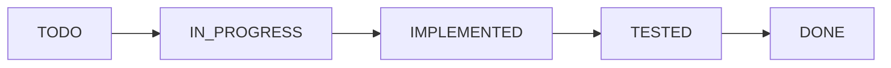

# DenHub — Development Process

> **Đây là quy trình phát triển BẮT BUỘC của DenHub.**  
> Mọi developer, Frontend Agent, Backend Agent và AI Coding Agent phải đọc file này trước khi thay đổi code.  
> **Không được bắt đầu implementation nếu chưa đọc các tài liệu liên quan trong `/docs`.**

---

## 1. MANDATORY READING BEFORE CODING

Trước khi thực hiện **BẤT KỲ** task nào, developer/agent phải đọc:

1. [`AGENTS.md`](../AGENTS.md)
2. [`00-DEVELOPMENT-PROCESS.md`](./00-DEVELOPMENT-PROCESS.md)
3. [`01-PROJECT-OVERVIEW.md`](./01-PROJECT-OVERVIEW.md)
4. [`02-SYSTEM-ARCHITECTURE.md`](./02-SYSTEM-ARCHITECTURE.md)
5. [`03-DATABASE-DESIGN.md`](./03-DATABASE-DESIGN.md)

Sau đó đọc code hiện tại liên quan trực tiếp tới task.

### Tuyệt đối KHÔNG được:

- Chỉ đọc prompt rồi code ngay.
- Chỉ đọc một file source code rồi tự suy đoán architecture toàn cục.
- Tự tạo endpoint mới ngoài contract.
- Tự tạo DTO contract hoặc tự thêm field tùy tiện.
- Tự tạo entity / field trong database.
- Tự tạo role / permission.
- Tự tạo enum / status.
- Tự tạo WebSocket destination.
- Tự thay đổi quan hệ database (relationships).

> [!WARNING]
> Nếu tài liệu chưa xác định một nghiệp vụ hoặc kỹ thuật:
> **Status: `TBD`**  
> Agent phải báo rằng contract chưa được chốt. **KHÔNG tự quyết định thay team.**

---

## 2. SOURCE OF TRUTH

Thứ tự ưu tiên và trách nhiệm của từng tài liệu trong `/docs`:

```
01-PROJECT-OVERVIEW.md      ───> WHAT / BUSINESS (Nghiệp vụ, khái niệm cốt lõi, phạm vi)
02-SYSTEM-ARCHITECTURE.md    ───> HOW / API / SECURITY / WEBSOCKET (Kiến trúc, contract giao tiếp)
03-DATABASE-DESIGN.md        ───> DATA / ENTITY / RELATIONSHIP / DATABASE (Schema, bảng, document)
00-DEVELOPMENT-PROCESS.md    ───> DEVELOPMENT RULES (Quy trình, checklist, tiến độ)
```

- **Không duplicate contract giữa các file.** Mỗi thông tin chỉ có một nơi duy nhất chịu trách nhiệm.
- **Nếu code và docs mâu thuẫn:**
  - **STOP.**
  - Không tự sửa docs theo code.
  - Không tự sửa code theo docs.
  - Phải ghi nhận conflict và yêu cầu team xác nhận.

---

## 3. BEFORE STARTING A TASK

Trước khi code, developer/agent phải xác định rõ các thông số:

```yaml
Task: [Tên task cụ thể]
Module: [Auth / Room / Member / Message / Real-time]
Related Business Rule: [Mục nào trong 01-PROJECT-OVERVIEW.md]
Related API: [Endpoint nào trong 02-SYSTEM-ARCHITECTURE.md]
Related Database: [Bảng SQL Server trong 03-DATABASE-DESIGN.md]
Related WebSocket: [Destination nào trong 02-SYSTEM-ARCHITECTURE.md]
Affected Frontend: [Các component/page bị ảnh hưởng]
Affected Backend: [Các controller/service/repo bị ảnh hưởng]
Status: [TODO / IN_PROGRESS]
```

### Checklist bắt buộc trước khi code:

- [ ] Business Rule đã `CONFIRMED` chưa?
- [ ] API Contract đã `CONFIRMED` chưa?
- [ ] Database design đã `CONFIRMED` chưa?
- [ ] Permission đã `CONFIRMED` chưa?
- [ ] Có dependency với task khác không?
- [ ] **LẬP IMPLEMENTATION PLAN & XÁC NHẬN (APPROVAL GATE):** Đã lập Implementation Plan đầy đủ các mục và trình bày cho User/Team duyệt chưa?

> [!CAUTION]
> **QUY ĐỊNH BẮT BUỘC KHÔNG ĐƯỢC BỎ QUA:**  
> Mọi tác vụ lập trình (Backend, Frontend, Database, Refactoring, Config) **TẤT CẢ** đều BẮT BUỘC phải lập Implementation Plan chi tiết và nhận được sự phê duyệt (`OK`, `Proceed`, `Duyệt`) trước khi tiến hành chỉnh sửa hoặc tạo mới file code.  
> Nếu task phụ thuộc vào một contract vẫn là `TBD`:  
> **KHÔNG tự implement theo phỏng đoán.** Dừng lại và yêu cầu team xác nhận trước.

### Kế hoạch và approval gate

Sau khi đọc docs, tiến độ/handoff, source, tests và Git status/branch, trình kế hoạch gồm: Task, Current State, Related Documentation, Files Expected to Change (mục đích từng file), Backend, Frontend, Database, API/WebSocket, Security/Permission, Test Plan (test và lệnh thực tế), Documentation Impact, Risks/Open Questions.

**DỪNG và chờ người dùng duyệt kế hoạch trước khi sửa application code, schema, API contract, cài dependency hoặc refactor.** Nếu kế hoạch thay đổi đáng kể, trình lại và chờ duyệt lại. Không coi im lặng là đồng ý. Với đợt docs 2026-10-10, Duy đã trực tiếp yêu cầu đồng bộ tài liệu theo prompt; việc này không tự phê duyệt kế hoạch triển khai Backend hoặc Frontend.

---

## 4. IMPLEMENTATION RULE

Khi implement:

- **Chỉ thay đổi những file thực sự cần thiết cho task.**
- **Không được tự ý:**
  - Refactor các module không liên quan.
  - Rename API không liên quan.
  - Rename database field không liên quan.
  - Thay đổi response format chung.
  - Thay đổi cơ chế phân quyền (permission).
  - Thêm dependency không cần thiết vào `package.json` hoặc `build.gradle.kts`.
  - Thêm feature nằm ngoài phạm vi task được giao.
  - Tự ý mở rộng scope vì lý do _"Discord cũng có tính năng này"_.
- **Implementation phải tuân thủ nghiêm ngặt theo các tài liệu trong `/docs`.**

---

## 5. TASK STATUS

Mỗi task di chuyển qua vòng đời trạng thái:



| Trạng thái    | Ý nghĩa                                             |
| :------------ | :-------------------------------------------------- |
| `TODO`        | Chưa bắt đầu thực hiện.                             |
| `IN_PROGRESS` | Đang trong quá trình implement.                     |
| `IMPLEMENTED` | Đã code xong nhưng chưa xác nhận test hoàn chỉnh.   |
| `TESTED`      | Đã chạy toàn bộ các bài test bắt buộc và PASS 100%. |
| `DONE`        | Code + test + docs liên quan đã đồng bộ hoàn toàn.  |

---

## 6. DEFINITION OF DONE (DoD)

Một task **CHỈ ĐƯỢC PHÉP** chuyển sang trạng thái `DONE` khi thỏa mãn toàn bộ checklist:

- [ ] Implementation hoàn thành đầy đủ yêu cầu.
- [ ] Không còn compile error ở cả FE và BE.
- [ ] Không còn lỗi lint / build liên quan.
- [ ] Test liên quan đã được chạy thực tế.
- [ ] Test pass 100%.
- [ ] API contract vẫn đúng theo tài liệu.
- [ ] Database contract vẫn đúng theo tài liệu.
- [ ] Business Rules vẫn đúng theo tài liệu.
- [ ] FE/BE contract đồng bộ, không bị lệch trường dữ liệu.
- [ ] Docs liên quan đã được cập nhật (`01`, `02`, `03` nếu bị ảnh hưởng).
- [ ] Không còn code debug tạm (`console.log`, `System.out.println` rác, commented-out code).
- [ ] Không chứa secret / password / token nhạy cảm trong code.
- [ ] Git diff đã được review kỹ lưỡng (`git diff`, `git status`).
- [ ] Task status đã được cập nhật trong [Section 10](#10-current-project-progress) và [Section 11](#11-completed-work-log).

> [!WARNING]
> Nếu thiếu bất kỳ mục bắt buộc nào ở trên: **Task KHÔNG được đánh dấu DONE.**

---

## 7. TEST BEFORE COMMIT

> **TEST LÀ BẮT BUỘC TRƯỚC KHI COMMIT.**  
> Tuyệt đối không làm theo chu trình: `CODE → COMMIT → TEST SAU`.  
> Phải tuân theo chu trình:  
> `CODE → TEST → FIX → TEST LẠI → UPDATE DOCS → REVIEW DIFF → COMMIT`

### 7.1 Frontend

Trước khi commit Frontend phải tối thiểu:

1. Kiểm tra dependency hợp lệ.
2. Build project Frontend:
   ```bash
   npm run build
   ```
3. Kiểm tra route/page liên quan.
4. Kiểm tra lỗi console trình duyệt liên quan.
5. Test chức năng vừa thay đổi.
6. Nếu project có lint: `npm run lint`.
7. Nếu project có automated test: `npm test`.

_(Tuyệt đối không được ghi "TESTED" nếu command chưa thực sự được chạy)._

### 7.2 Backend

Trước khi commit Backend phải chạy test project:

- **Gradle (Project hiện tại):**

  ```bash
  # Linux / macOS
  ./gradlew test

  # Windows PowerShell / CMD
  .\gradlew.bat test
  ```

- Hoặc lệnh build/verify toàn diện:
  ```bash
  .\gradlew.bat check
  ```
  _(Trường hợp sử dụng Maven: `./mvnw test` hoặc `mvnw.cmd test`)._

Phải kiểm tra:

- Compile không lỗi.
- Unit test pass.
- Service test pass.
- Repository test nếu liên quan pass.
- Controller / MockMvc test nếu liên quan pass.
- Security test nếu liên quan pass.
- Validation / error handling test nếu liên quan pass.

_(Không được đánh dấu TESTED nếu có bất kỳ test nào fail)._

### 7.3 API Integration

Nếu task ảnh hưởng cả FE ↔ BE, phải kiểm tra toàn chuỗi:

$$\text{Frontend Request} \longrightarrow \text{Backend Endpoint} \longrightarrow \text{Request DTO} \longrightarrow \text{Service} \longrightarrow \text{Database} \longrightarrow \text{Response DTO} \longrightarrow \text{Frontend}$$

Phải xác nhận:

- Endpoint URL chính xác tuyệt đối.
- HTTP method giống nhau.
- Field name khớp chuẩn (cả camelCase / snake_case).
- Kiểu dữ liệu (Datatype) tương thích hoàn toàn.
- Response JSON DTO thành công dùng wrapper hiện có theo mục 4.1 của tài liệu kiến trúc; DTO nằm trong `data`, Axios đọc `response.data.data`. Lỗi vẫn theo contract Problem Details RFC 9457 tại mục 4.3.
- Error format trả về đúng mã và cấu trúc lỗi.
- Authorization headers truyền đúng cách.

### 7.4 WebSocket

Nếu task ảnh hưởng WebSocket / STOMP, phải kiểm tra:

- `CONNECT`: Handshake và xác thực token thành công.
- `SEND`: Gửi payload lên đúng Destination prefix.
- `SUBSCRIBE`: Nhận message đúng Topic.
- `PAYLOAD`: Cấu trúc JSON gửi và nhận khớp contract.
- `AUTHENTICATION`: Bị từ chối nếu thiếu token hoặc token sai.
- `ERROR`: Xử lý khi có lỗi xảy ra.
- `RECONNECT`: Xử lý khi mất kết nối (nếu có).

FE và BE bắt buộc phải dùng cùng destination và payload format.

---

## 8. TEST FAILURE RULE

Nếu test fail:
**KHÔNG ĐƯỢC COMMIT / PUSH NHƯ MỘT TASK HOÀN CHỈNH.**

Phải thực hiện theo các bước:

1. Xác định chính xác test nào bị fail.
2. Tìm ra nguyên nhân gốc rễ (Root Cause).
3. Fix lỗi nếu thuộc phạm vi của task hiện tại.
4. Chạy lại test suite để kiểm tra ảnh hưởng phụ (regression).
5. Chỉ chuyển trạng thái `TESTED` khi tất cả bài test đã PASS.

> [!NOTE]
> **Xử lý lỗi tồn tại từ trước (Pre-existing issue):**  
> Nếu lỗi tồn tại từ trước và không thuộc phạm vi task:
>
> - Không tự ý sửa nếu có nguy cơ ảnh hưởng sang module khác.
> - Bắt buộc ghi nhận rõ ràng:  
>   `PRE-EXISTING ISSUE: [Mô tả chi tiết lỗi và file liên quan]`
> - **Tuyệt đối không được giả vờ test pass.**

---

## 9. DOCUMENTATION UPDATE AFTER TASK

Sau khi hoàn thành code, **BẮT BUỘC** kiểm tra xem tài liệu trong `/docs` có cần cập nhật không:

- Thay đổi **Business / Feature / Rule**  
  $\longrightarrow$ Cập nhật [`01-PROJECT-OVERVIEW.md`](./01-PROJECT-OVERVIEW.md)
- Thay đổi **Architecture / API / DTO / Security / WebSocket**  
  $\longrightarrow$ Cập nhật [`02-SYSTEM-ARCHITECTURE.md`](./02-SYSTEM-ARCHITECTURE.md)
- Thay đổi **Entity / Field / Relationship / Constraint / Index / Enum**  
  $\longrightarrow$ Cập nhật [`03-DATABASE-DESIGN.md`](./03-DATABASE-DESIGN.md)

_Không phải task nào cũng sửa cả 3 file, chỉ cập nhật file thực sự bị ảnh hưởng. Nhưng BẮT BUỘC phải kiểm tra cả 3 trước khi đánh dấu DONE._

---

## 10. CURRENT PROJECT PROGRESS

Bảng này phản ánh chính xác trạng thái thực tế của code và tài liệu trong dự án.\
_(Không đánh dấu DONE chỉ vì đã tạo file rỗng hay class chưa hoàn chỉnh)._

### Tiến độ riêng — Tự mở Server vừa tạo (2026-10-27)

- DONE trong phạm vi FE/API mock: tạo thành công cập nhật danh sách, đóng modal và mở ngay `/servers/{id}`; không chờ GET danh sách. Response form/route cũ chỉ cập nhật danh sách, không chiếm điều hướng của phiên mới.
- Verification cuối: 85/85 browser, 103/103 Node, build PASS. Luồng mới kiểm trên desktop 1440/mobile 375; backend/DB giữ nguyên, chưa kiểm thử SQL Server thật. Nhánh `fix/server-crud-ui`, chưa commit/push lượt này.

### Tiến độ riêng — Đồng bộ cú pháp serverApi (2026-10-26)

- DONE: 11 hàm trong `client/src/api/serverApi.js` dùng method shorthand và `return` giống `userApi`/`roomApi`. Giữ tên hàm, tham số, URL, HTTP method, encodeURIComponent và Promise trả về.
- Verification: từ `client/`, `npm test` PASS 103/103; `npm run build` PASS. Chỉ thay cú pháp, không thêm test hoặc thay contract; các thay đổi của lượt này chưa commit/push.

### Tiến độ riêng — 5 lỗi Server/kênh và Join bằng ID (2026-10-26)

| Phạm vi | FE | BE | DB | Verification | Trạng thái |
| :--- | :--- | :--- | :--- | :--- | :--- |
| Cô lập kênh/history/pagination/send, leave/kick đúng phiên; Join active và nickname an toàn | IMPLEMENTED | IMPLEMENTED | Giữ mapping hiện có | 234 BE, 78 browser, 103 Node, build PASS | DONE trong phạm vi H2/API mock đã duyệt; SQL Server thật chưa kiểm thử |

- Nhánh `fix/server-crud-ui`, chưa commit/push các sửa đổi của lượt này. Chi tiết tại log FIX-SERVER-SCOPE-AND-DIRECT-JOIN và docs/02 mục 9.6; quy tắc Join cập nhật docs/01 mục 5.

### Tiến độ riêng — Sửa UI tạo và danh sách Server (2026-10-26)

| Phạm vi | FE | BE / DB | Verification | Trạng thái |
| :--- | :--- | :--- | :--- | :--- |
| Đồng bộ tạo/list, phiên modal, tên 100 UTF-16, Home responsive và liên kết mở Server | IMPLEMENTED | Giữ nguyên | 63/63 browser, 103/103 Node, build PASS | DONE trong phạm vi FE/API mock; chưa kiểm thử SQL Server thật |

- Kế hoạch được duyệt bằng “triển khai”; đang trên nhánh local `fix/server-crud-ui`, chưa commit/push.
- Chi tiết tại log FIX-SERVER-CRUD-UI và docs/02 mục 9.5. Không thay quyền sửa/xóa, membership, API, schema hoặc dependency.

### Tiến độ riêng — Delete Server (2026-10-21)

| Phạm vi                                        | FE          | BE          | DB                                              | Verification                                                          | Trạng thái                                                       |
| :--------------------------------------------- | :---------- | :---------- | :---------------------------------------------- | :-------------------------------------------------------------------- | :--------------------------------------------------------------- |
| Owner xóa Server, cảnh báo và countdown 3 giây | IMPLEMENTED | IMPLEMENTED | Tái sử dụng schema; metadata SQL Server chỉ đọc | 322 BE tests/check; 51 browser cases; 35 Node logic tests; build PASS | Hoàn tất code/H2/browser mock; chưa kiểm thử xóa SQL Server thật |

Bản ghi này độc lập với các vùng conflict lịch sử phía dưới. Không coi trạng thái Server & Invite DONE cũ là bằng chứng Delete Server đã có trước task này.

Phát hành local 2026-10-21: Backend và Frontend đã được commit theo từng cụm cùng tests; tài liệu/tiến độ được commit riêng. Không push. Xem log RELEASE-SERVER-DELETE.

| Module                       |     FE      |     BE      |                  DB                  |      Integration      |     Test     |               Status               | Last Update |
| :--------------------------- | :---------: | :---------: | :----------------------------------: | :-------------------: | :----------: | :--------------------------------: | :---------: |
| **Authentication**           | IMPLEMENTED | IMPLEMENTED |             IMPLEMENTED              |      IN_PROGRESS      |    TESTED    |            IN_PROGRESS             | 2026-10-11  |
| **Server & Invite (Task 3.24)** |    DONE     |    DONE     |             IMPLEMENTED              |         DONE          |     PASS     |                DONE                | 2026-10-27  |
| **Server Detail — phần vỏ**  | IMPLEMENTED | IMPLEMENTED |                REUSED                | TESTED (H2 / FE mock) |     PASS     |      DONE (phạm vi đã duyệt)       | 2026-10-13  |
| **Server CRUD — sửa 6 bug**  | IMPLEMENTED | IMPLEMENTED | Mapping + script; SQL Server pending | TESTED (H2 / FE mock) |     PASS     | Release 6/6; còn apply schema thật | 2026-10-13  |
| **Member & Role**            | IMPLEMENTED | IMPLEMENTED |             IMPLEMENTED              |         DONE          |     PASS     |            IN_PROGRESS             | 2026-10-26  |
| **Channel**                  | IMPLEMENTED | IMPLEMENTED |              CONFIRMED               |      IMPLEMENTED      |    TESTED    |            IN_PROGRESS             | 2026-10-13  |
| **Message (Channel)**        |    DONE     |    DONE     |             IMPLEMENTED              |         DONE          |     PASS     |                DONE                | 2026-10-25  |
| **Message (1-1)**            |    DONE     |    DONE     |              CONFIRMED               |         DONE          |     PASS     |                DONE                | 2026-10-12  |
| **Real-time (1-1)**          |    DONE     |    DONE     |              CONFIRMED               |         DONE          |     PASS     |                DONE                | 2026-10-12  |
| **Search User & Friendship** |    DONE     |    DONE     |              CONFIRMED               |         DONE          |     PASS     |                DONE                | 2026-10-12  |
| Module                       |     FE      |     BE      |                  DB                  |      Integration      |     Test     |               Status               | Last Update |
| :---                         |    :---:    |    :---:    |                :---:                 |         :---:         |    :---:     |               :---:                |    :---:    |
| **Authentication**           | IMPLEMENTED | IMPLEMENTED |             IMPLEMENTED              |      IN_PROGRESS      |    TESTED    |            IN_PROGRESS             | 2026-10-11  |
| **Server & Invite**          | IMPLEMENTED | IMPLEMENTED |             IMPLEMENTED              |         DONE          |    TESTED    |                DONE                | 2026-10-13  |
| **Server Detail — phần vỏ**  | IMPLEMENTED | IMPLEMENTED |                REUSED                | TESTED (H2 / FE mock) |     PASS     |      DONE (phạm vi đã duyệt)       | 2026-10-13  |
| **Server CRUD — sửa 6 bug**  | IMPLEMENTED | IMPLEMENTED | Mapping + script; SQL Server pending | TESTED (H2 / FE mock) |     PASS     | Release 6/6; còn apply schema thật | 2026-10-13  |
| **Member & Role**            |    TODO     | IMPLEMENTED |             IMPLEMENTED              |         TODO          |     TODO     |            IN_PROGRESS             | 2026-10-06  |
| **Channel**                  | IMPLEMENTED | IMPLEMENTED |              CONFIRMED               |      IMPLEMENTED      |    TESTED    |            IN_PROGRESS             | 2026-10-13  |
| **Message (Channel)**        |    DONE     |    DONE     |             IMPLEMENTED              |         DONE          |     PASS     |                DONE                | 2026-10-25  |
| **Message (1-1)**            |    DONE     |    DONE     |              CONFIRMED               |         DONE          |     PASS     |                DONE                | 2026-10-12  |
| **Real-time (1-1)**          |    DONE     |    DONE     |              CONFIRMED               |         DONE          |     PASS     |                DONE                | 2026-10-12  |
| **Search User & Friendship** | IMPLEMENTED |    DONE     |              CONFIRMED               |      IMPLEMENTED      | PASS (build) |            IN_PROGRESS             | 2026-10-14  |

Các trạng thái module ngày 2026-10-06 được giữ như bản ghi trước đó, chưa được kiểm chứng lại toàn bộ trong đợt docs này. Không suy ra Task 1.07 đã có API hoàn chỉnh chỉ từ ô BE `IMPLEMENTED` của module Message.

### Tiến độ riêng — Cài đặt / chỉnh sửa Server (2026-10-15)

| Phạm vi                          | FE          | BE          | Database                             | Verification                                                   | Trạng thái                                                                      |
| :------------------------------- | :---------- | :---------- | :----------------------------------- | :------------------------------------------------------------- | :------------------------------------------------------------------------------ |
| Owner đổi tên, đổi/gỡ ảnh Server | IMPLEMENTED | IMPLEMENTED | Tái sử dụng mapping, không migration | 259 BE tests; 17 settings + 23 group browser tests; build PASS | DONE trong phạm vi code/H2/browser mock đã duyệt; chưa kiểm thử SQL Server thật |

Bản ghi mới này nằm ngoài các vùng merge conflict có sẵn của bảng tiến độ cũ; không chọn thay nhóm giữa các bản lịch sử.

### Kiểm tra riêng — Channel/File binding và đường dẫn ảnh local (2026-10-15)

| Công việc                                                   | Trạng thái      | Bằng chứng / giới hạn                                                                                                                                                                                                |
| :---------------------------------------------------------- | :-------------- | :------------------------------------------------------------------------------------------------------------------------------------------------------------------------------------------------------------------- |
| GET Channel và GET ảnh không phụ thuộc tên tham số compiler | TESTED          | Hai regression tests tái hiện lỗi trước sửa; sau sửa toàn bộ backend PASS 228/228.                                                                                                                                   |
| Thư mục chạy VS Code cho ảnh upload                         | VERIFIED CONFIG | Hai cấu hình local dùng `cwd = ${workspaceFolder}/server`, giữ `envFile = ${workspaceFolder}/server/.env`; kiểm tra đường dẫn tồn tại và 5 ảnh cũ trong `server/uploads/servers`. Cần restart phiên Java để áp dụng. |

Bản cập nhật này nằm ngoài các vùng merge conflict có sẵn, không quyết định thay nhóm giữa hai bản tiến độ cũ. Không coi kiểm tra MockMvc/H2 và đường dẫn local là kiểm thử giao diện hoặc SQL Server thật.

### Tính năng Block & Gỡ Block User, Sửa Business Rules (2026-10-16)

| Công việc                                                        | Trạng thái     | Bằng chứng / bước còn lại                                                                                                                                                                                                                                                                                                                                                                                                |
| :--------------------------------------------------------------- | :------------- | :----------------------------------------------------------------------------------------------------------------------------------------------------------------------------------------------------------------------------------------------------------------------------------------------------------------------------------------------------------------------------------------------------------------------- |
| **Sửa business rule Block User (Backend)**                       | TESTED         | `FriendshipService.blockUser`: cho phép block cả khi chưa có quan hệ và khi đã là bạn, kiểm tra user tồn tại, cập nhật `actionUserId = currentUserId`. `UserRepository.searchByUsername`: loại trừ người đã block người tìm kiếm qua điều kiện `NOT EXISTS (BLOCKED and actionUserId = u.id)`. 16 tests trong `FriendshipServiceTest` PASS 100%, toàn bộ backend suite PASS (`BUILD SUCCESSFUL`).                        |
| **Tính năng Block User (Frontend)**                              | TESTED (BUILD) | `client/src/api/friendApi.js`: thêm `blockUser`. `client/src/hooks/useFriends.js`: thêm hàm `blockUser`, `blockLoading`, tự động xóa bạn bè khi bị chặn. `client/src/pages/direct/FriendRequestPage.jsx`: nút Chặn tại `FriendCard` kèm Popconfirm. `client/src/pages/direct/SearchUserPanel.jsx`: nút Chặn ngay trong kết quả tìm kiếm kèm Popconfirm. `npm run build` PASS 100%.                                       |
| **Tính năng Gỡ Block & Danh sách chặn (Backend & Frontend)**     | TESTED         | Backend: `FriendshipService.removeBlock` (xóa bản ghi khi unblock, chặn người bị block tự gỡ), `getAllBlockedUsers` (cursor pagination). `FriendshipController`: `/api/friendships/block-user/remove` và `/blocked-users`. 23 tests `FriendshipServiceTest` PASS 100%, backend suite PASS. Frontend: `useBlockedUsers.js`, tab "Đã chặn" trên `FriendRequestPage.jsx`, nút Bỏ chặn kèm Popconfirm. `npm run build` PASS. |
| **Tắt realtime popup notification khi đồng ý kết bạn (BE & FE)** | TESTED         | Gỡ bỏ `notificationFriendshipRequest.requestAccepted` trong BE (`acceptFriendRequest` và `sendRequestAddFriend`) và gỡ bỏ popup toast `notification.success` trong `useGlobalFriendNotification.jsx` để tránh spam màn hình khi nhiều người đồng ý kết bạn cùng lúc. Cập nhật test `FriendshipServiceTest` PASS 23/23, toàn bộ backend test suite PASS.                                                                  |

### Tính năng Lấy bài viết bạn bè & Bảng tin Feed (2026-10-21)

| Công việc                                                      | Trạng thái     | Bằng chứng / bước còn lại                                                                                                                                                                                                                                                                                                                                                                                                                                                                                                                                                                                                                                            |
| :------------------------------------------------------------- | :------------- | :------------------------------------------------------------------------------------------------------------------------------------------------------------------------------------------------------------------------------------------------------------------------------------------------------------------------------------------------------------------------------------------------------------------------------------------------------------------------------------------------------------------------------------------------------------------------------------------------------------------------------------------------------------------- |
| **Sửa business rules & logic lấy bài viết (Backend)**          | TESTED         | Sửa `PostRepository.java`: truy vấn feed theo `p.privacy IN ('PUBLIC', 'FRIENDS_ONLY')` và bài viết của chính user, lọc cursor date và id; sửa alias trong `FriendshipRepository.java`; sửa `PostService.java`: xử lý list an toàn khi không có bạn bè, fetch thông tin tác giả (name, username, avatar) gán vào `PostDTO`, tính toán và set `hasMore`. 5 unit tests mới trong `PostServiceTest` PASS 100%, toàn bộ backend suite PASS (`BUILD SUCCESSFUL in 50s`).                                                                                                                                                                                                  |
| **Giao diện Bảng tin bạn bè (Frontend)**                       | TESTED (BUILD) | `postApi.js`: API client `getAllPostsFromFriends`. `useFriendPosts.js`: hook quản lý bài viết, cursor pagination (`loadMore`), refresh, optimistic like toggle. `PostCard.jsx`: Cyber Glassmorphism post card hiển thị avatar, tên, username, tag quyền riêng tư, thời gian tương đối, nội dung, ảnh đính kèm, tương tác Thích/Bình luận. `FriendFeedSection.jsx`: component Bảng tin tích hợp trên `HomePage.jsx` với skeleton loading, empty state, load more. `npm run build` PASS 100%.                                                                                                                                                                          |
| **Sửa lỗi & chuẩn hóa nghiệp vụ Post Feed Realtime (Backend)** | TESTED         | Sửa lỗi gán null author mapping và lỗi DI trong `NotificationAsyncFeedPostService.java`; chuẩn hóa `PostFeedService.java` (`@Transactional`, kiểm tra `principal`, `user.activated`, validate rỗng, độ dài `content <= 120`, `mediaUrl <= 1000`, filter `privacy != PRIVATE` khi broadcast); đồng bộ WebSocket payload với `DisplayPostDTO`; đổi `PostFeedController.java` sang `@Controller`. 12 unit tests mới trong `PostFeedServiceTest` và 3 tests trong `PostFeedControllerTest` PASS 100%, toàn bộ backend test suite PASS (`BUILD SUCCESSFUL in 1m 8s`), frontend build PASS.                                                                                |
| **Giao diện Đăng bài viết mới & Realtime Feed (Frontend)**     | TESTED (BUILD) | `CreatePostCard.jsx`: Khung tạo status Cyber Glassmorphism với Textarea đếm 120 ký tự, Dropdown chọn quyền riêng tư (`PUBLIC`, `FRIENDS_ONLY`, `PRIVATE`), nút tải ảnh qua `fileApi.upload` (`/v1/files/upload`) kèm preview và nút xóa, phím tắt `Ctrl+Enter` để đăng nhanh. `useFriendPosts.js`: Kết nối STOMP `@stomp/stompjs`, subscribe `/user/queue/new-post` để tự động nhận bài bạn bè thời gian thực, cung cấp `createPost` gửi tới `/app/post` kèm optimistic update. `FriendFeedSection.jsx`: Nhúng `CreatePostCard`, thêm Tag trạng thái kết nối trực tiếp. 5 unit tests mới trong `createPost.test.mjs` PASS 100%, `npm run build` PASS (3207 modules). |

### Theo dõi riêng phạm vi Duy (cập nhật 2026-10-13)

| Công việc                                                                         | Trạng thái                                                 | Bằng chứng / bước còn lại                                                                                                                                                                                                                                                                                                      |
| :-------------------------------------------------------------------------------- | :--------------------------------------------------------- | :----------------------------------------------------------------------------------------------------------------------------------------------------------------------------------------------------------------------------------------------------------------------------------------------------------------------------- |
| Đọc chi tiết phần vỏ Server + FE                                                  | DONE trong phạm vi code/H2/FE mock                         | `GET /api/v1/servers/{serverId}`; Owner/Member, wrapper/Problem Details, FE đọc chi tiết độc lập với dock và bỏ response cũ. Lượt API: 128 backend tests, 5 Node tests PASS. Lượt redirect 403 về Home: 15 browser tests và build PASS; không chạy lại BE/Node logic. Không triển khai Channel; chưa kiểm thử SQL Server thật. |
| Sửa 6 bug Server CRUD                                                             | Release 6/6; còn apply schema audit SQL Server             | Đã đưa vào commit: audit email dài, create/list từ chối tài khoản inactive, nickname Owner dài/rỗng, chặn tạo khi icon đang upload, bỏ upload cũ, Home loading/error/retry. Kiểm tra bản staged trước commit; SQL script preview chưa chạy. Join/Channel/UUID ngoài phạm vi.                                                   |
| Đồng bộ docs theo prompt                                                          | DONE                                                       | Đã cập nhật 4 tài liệu; kiểm tra Markdown/JSON/link, contract và diff đạt. Không thay application code hoặc database.                                                                                                                                                                                                          |
| Xác minh schema SQL Server                                                        | DONE                                                       | `messages.content` là `NVARCHAR(MAX)`, nullable; không có CHECK/trigger giới hạn 4000. Sau xác minh, Duy giao agent lựa chọn; đã chọn giới hạn request 4000 đơn vị UTF-16, giữ nguyên database.                                                                                                                                |
| Task 1.07 — API gửi tin nhắn + test                                               | Hoàn tất phạm vi code/H2 đã duyệt; còn xác minh SQL Server | POST giữ nguyên contract; JWT/Problem Details và audit email 254 đã sửa, 85/85 backend tests PASS cùng compileJava/check. Script SQL Server đã chuẩn bị để review, chưa chạy. Xem log MESSAGE-SECURITY-COMPLETE.                                                                                                               |
| Task 1.07 / lượt 1A                                                               | DONE                                                       | 9 file thuộc phạm vi đã trình; compileJava/test/check PASS, docs đồng bộ; dừng để giải thích và chờ Tiếp tục trước lượt 1B.                                                                                                                                                                                                    |
| Task 1.07 / đồng bộ wrapper thành công                                            | DONE                                                       | Duy duyệt giữ wrapper hiện có ngày 2026-10-11; cập nhật 3 docs và bổ sung assertions `message`, `error: null` trong MockMvc. `test check` PASS 32/32. Không đồng nghĩa toàn bộ lượt 1B đã DONE.                                                                                                                                |
| Task 1.12 — UI nhập và gửi tin nhắn                                               | DONE                                                       | Đã kết nối `onSend` và `onSent` vào `MessageInput`, mở khóa ô chat. Đã xây dựng UI hiển thị lịch sử tin nhắn kênh kèm Cursor Pagination (`before` + `limit`), cuộn giữ vị trí, tự động cuộn xuống đáy khi mở hoặc gửi tin nhắn mới. Build PASS 100%, unit tests PASS 53/53.                                                    |
| Task 1.12 / khung Group và ô nhập độc lập                                         | DONE                                                       | Route bảo vệ `/servers/:serverId`, chọn nhóm từ dock, loading/error/retry, bố cục desktop/mobile và composer kiểm thử độc lập. Chỉ hoàn tất phạm vi UI đã duyệt, không đánh dấu API/real-time DONE.                                                                                                                            |
| Task 1.08 — API lấy lịch sử tin nhắn + test                                       | DONE                                                       | `GET /api/channels/{channelId}/messages?before={id}&limit=30`; cursor pagination ID giảm dần, wrapper 200, Problem Details 400/401/403/404. Test: MessageServiceTest (11 tests), MessageResourceIT (4 tests), MessageSecurityIT (5 tests), toàn bộ backend suite pass 100%.                                                    |
| Task 1.09 — API sửa tin nhắn (PATCH & PUT) + test                                 | DONE                                                       | `PATCH` & `PUT /api/messages/{messageId}`; BR-MSG-02 (chỉ tác giả sửa, 403 cho người khác kể cả Server Owner); validate max 4000 UTF-16; tests: MessageServiceTest (9), MessageResourceIT (5), MessageSecurityIT (7). Toàn bộ test suite PASS 100%.                                                                            |
| Công việc                                                                         | Trạng thái                                                 | Bằng chứng / bước còn lại                                                                                                                                                                                                                                                                                                      |
| :---                                                                              | :---                                                       | :---                                                                                                                                                                                                                                                                                                                           |
| Đọc chi tiết phần vỏ Server + FE                                                  | DONE trong phạm vi code/H2/FE mock                         | `GET /api/v1/servers/{serverId}`; Owner/Member, wrapper/Problem Details, FE đọc chi tiết độc lập với dock và bỏ response cũ. Lượt API: 128 backend tests, 5 Node tests PASS. Lượt redirect 403 về Home: 15 browser tests và build PASS; không chạy lại BE/Node logic. Không triển khai Channel; chưa kiểm thử SQL Server thật. |
| Sửa 6 bug Server CRUD                                                             | Release 6/6; còn apply schema audit SQL Server             | Đã đưa vào commit: audit email dài, create/list từ chối tài khoản inactive, nickname Owner dài/rỗng, chặn tạo khi icon đang upload, bỏ upload cũ, Home loading/error/retry. Kiểm tra bản staged trước commit; SQL script preview chưa chạy. Join/Channel/UUID ngoài phạm vi.                                                   |
| Đồng bộ docs theo prompt                                                          | DONE                                                       | Đã cập nhật 4 tài liệu; kiểm tra Markdown/JSON/link, contract và diff đạt. Không thay application code hoặc database.                                                                                                                                                                                                          |
| Xác minh schema SQL Server                                                        | DONE                                                       | `messages.content` là `NVARCHAR(MAX)`, nullable; không có CHECK/trigger giới hạn 4000. Sau xác minh, Duy giao agent lựa chọn; đã chọn giới hạn request 4000 đơn vị UTF-16, giữ nguyên database.                                                                                                                                |
| Task 1.07 — API gửi tin nhắn + test                                               | Hoàn tất phạm vi code/H2 đã duyệt; còn xác minh SQL Server | POST giữ nguyên contract; JWT/Problem Details và audit email 254 đã sửa, 85/85 backend tests PASS cùng compileJava/check. Script SQL Server đã chuẩn bị để review, chưa chạy. Xem log MESSAGE-SECURITY-COMPLETE.                                                                                                               |
| Task 1.07 / lượt 1A                                                               | DONE                                                       | 9 file thuộc phạm vi đã trình; compileJava/test/check PASS, docs đồng bộ; dừng để giải thích và chờ Tiếp tục trước lượt 1B.                                                                                                                                                                                                    |
| Task 1.07 / đồng bộ wrapper thành công                                            | DONE                                                       | Duy duyệt giữ wrapper hiện có ngày 2026-10-11; cập nhật 3 docs và bổ sung assertions `message`, `error: null` trong MockMvc. `test check` PASS 32/32. Không đồng nghĩa toàn bộ lượt 1B đã DONE.                                                                                                                                |
| Task 1.12 — UI nhập và gửi tin nhắn                                               | DONE                                                       | Đã kết nối `onSend` và `onSent` vào `MessageInput`, mở khóa ô chat. Đã xây dựng UI hiển thị lịch sử tin nhắn kênh kèm Cursor Pagination (`before` + `limit`), cuộn giữ vị trí, tự động cuộn xuống đáy khi mở hoặc gửi tin nhắn mới. Build PASS 100%, unit tests PASS 53/53.                                                    |
| Task 1.12 / khung Group và ô nhập độc lập                                         | DONE                                                       | Route bảo vệ `/servers/:serverId`, chọn nhóm từ dock, loading/error/retry, bố cục desktop/mobile và composer kiểm thử độc lập. Chỉ hoàn tất phạm vi UI đã duyệt, không đánh dấu API/real-time DONE.                                                                                                                            |
| Task 1.08 — API lấy lịch sử tin nhắn + test                                       | DONE                                                       | `GET /api/channels/{channelId}/messages?before={id}&limit=30`; cursor pagination ID giảm dần, wrapper 200, Problem Details 400/401/403/404. Test: MessageServiceTest (11 tests), MessageResourceIT (4 tests), MessageSecurityIT (5 tests), toàn bộ backend suite pass 100%.                                                    |
| Task 1.09 — API sửa tin nhắn (PATCH & PUT) + test                                 | DONE                                                       | `PATCH` & `PUT /api/messages/{messageId}`; BR-MSG-02 (chỉ tác giả sửa, 403 cho người khác kể cả Server Owner); validate max 4000 UTF-16; tests: MessageServiceTest (9), MessageResourceIT (5), MessageSecurityIT (7). Toàn bộ test suite PASS 100%.                                                                            |
| FEAT-FRIEND-REQUEST-UI — UI danh sách lời mời kết bạn + Realtime                  | DONE                                                       | 5 file FE: `friendApi.js` bổ sung `getFriendRequests`; `useFriendRequests.js` STOMP + cursor pagination; `FriendRequestPage.jsx` UI đầy đủ; route `/friends`; menu Bạn Bè. `npm run build` PASS 3192 modules. Không thay backend.                                                                                              |
| FEAT-FRIEND-REQUEST-ACCEPT-REMOVE — Đồng ý và Từ chối lời mời kết bạn (FE)        | DONE                                                       | `friendApi.js` (accept/remove endpoints); `useFriendRequests.js` (`acceptRequest`, `removeRequest`, `actionLoading`); `FriendRequestPage.jsx` (Nút Đồng ý Indigo Gradient, Từ chối Dark Glass, spin loading độc lập, toast thông báo). `npm run build` PASS 3192 modules.                                                      |
| FEAT-ALL-FRIENDS-UI — Danh sách Tất cả bạn bè (FE) + Sửa query Friendship (BE)    | DONE                                                       | Sửa typo `:status <> 'PENDING'` trong `FriendshipRepository`; `friendApi.js` (`getAllFriends`); `useFriends.js` (cursor pagination, filter search); `FriendRequestPage.jsx` (Tabs Tất cả / Chờ xử lý, FriendCard, nút Nhắn tin Direct Message); `npm run build` PASS 3193 modules.                                             |
| FIX-CHAT-AUTO-SCROLL — Sửa lỗi không tự động cuộn xuống đáy khi mở đoạn chat (FE) | DONE                                                       | Điều khiển `scrollTop` trực tiếp trên container; double-RAF + fallback timeout; duy trì scroll position khi load previous messages; tối ưu `DirectMessagePage.jsx` và `ChatPage.jsx`. `npm run build` PASS 3193 modules.                                                                                                       |
| FEAT-REMOVE-FRIEND — Chức năng Hủy kết bạn (Unfriend) (FE)                        | DONE                                                       | `friendApi.js` (`removeFriend`); `useFriends.js` (`unfriend`, optimistic update, toast); `FriendRequestPage.jsx` (Nút Hủy kết bạn có Popconfirm); `npm run build` PASS 3193 modules.                                                                                                                                           |

Chỉ đánh dấu `TESTED` khi đã thực sự chạy và vượt qua các kiểm thử phù hợp. Kiểm tra docs không thay thế test code hoặc integration test SQL Server.

---

### Kiểm tra sau giải xung đột (2026-10-11)

Kết quả 58 tests/build/Auth dưới đây thuộc lượt gộp code trước khi áp dụng stash. Lượt xử lý stash chỉ chỉnh tài liệu, không chạy lại test/build và không xác nhận lại các thay đổi code vừa được khôi phục.

- Đã gộp repository dùng chung, giữ luồng Auth incoming và lịch sử công việc của cả hai nhánh. Server/Channel có test hồi quy PASS; không đồng nghĩa toàn bộ module hoặc tích hợp SQL Server đã hoàn thành.
- Backend: 58 tests PASS, gồm 6 cases trong MessageResourceIT untracked; frontend build PASS. Chín kiểm tra logic Auth dùng mock hooks/storage/API PASS, chưa kiểm thử trình duyệt/backend thật.
- MessageResource.java vẫn untracked có sẵn; MessageResourceIT.java đã được tracked từ commit ngoài lượt này. Các dòng “chưa có Controller” ngày 2026-10-10 là lịch sử lượt 1A. Security/JWT, Problem Details và H2 đã kiểm thử trong MESSAGE-SECURITY-COMPLETE; còn ghi SQL Server thật chưa xác minh.
- PRE-EXISTING ISSUE: Channel hiện cho Owner/Member tạo kênh, khác contract Owner/Admin; các đường dẫn /api/v1 vẫn khác chuẩn mục 5 của kiến trúc. Wrapper đã được chốt theo mục 4.1. Giữ hành vi hiện có theo phạm vi được duyệt, không tự đổi contract hoặc quyền.

## 11. COMPLETED WORK LOG

### [2026-10-27] FEAT-OPEN-CREATED-SERVER — Tạo Server xong mở ngay Server đó

- Người dùng duyệt kế hoạch bằng “triển khai”. `CreateServerModal` tiếp tục gọi `onSuccess` cho mọi POST thành công để cập nhật danh sách. Chỉ session form hiện tại được thông báo thành công, đóng/reset và gọi callback nội bộ `onOpenServer` với ID response.
- `MainLayout` điều hướng bằng route đã có, không await GET danh sách nền; history dùng push để Back trở về trang trước. Callback kiểm token của route visit và URL thực tế (pathname/search/hash), ngăn request cũ chiếm điều hướng sau khi chuyển trang hoặc Back/Forward. Kiểm URL còn bảo vệ khoảng thời gian browser đã đổi URL nhưng React chưa commit view mới.
- Tests: thêm 7 browser cases (desktop/mobile, 400/503 và retry, form đã đóng, form còn mở nhưng route đổi, trở lại history entry cũ); cập nhật 8 cases tạo/list/upload/session/validation để xác minh trang Server rồi quay Home kiểm danh sách. Fixture trả đúng DTO/kênh general của Server đã tạo; callback Playwright được bọc để không truyền nhầm Request vào tham số danh sách fixture.
- Red/green: test auto-open FAIL trước sửa vì vẫn ở Home. Lượt kiểm biên phát hiện race URL Back trước React commit và lỗi callback fixture trong test detail retry; đã sửa guard/fixture và chạy lại toàn bộ thành công.
- Verification cuối từ `client/`, NODE_PATH Playwright theo docs/02 mục 8.2:
  - `node --test --test-concurrency=1 tests/server-settings.browser.test.mjs tests/group-chat.browser.test.mjs`: PASS **85/85**, 0 failure/skip, không pageerror trong các cases mới.
  - `npm test`: PASS **103/103**.
  - `npm run build`: PASS; PRE-EXISTING ISSUE: warning bundle >500 kB và Ant Design có sẵn vẫn còn.
- Documentation: cập nhật business flow tại docs/01 mục 5, implementation/verification tại docs/02 mục 9.7 và tiến độ/log/handoff tại đây. Đã đối chiếu docs/03–04: không đổi Entity/schema hoặc thiết kế trực quan. Backend/API/Security/WebSocket/dependency giữ nguyên; không chạy lại backend hoặc SQL Server thật trong lượt chỉ sửa FE.
- Nhánh `fix/server-crud-ui`; sửa đổi lượt này chưa commit/push. Đã review diff, giữ nguyên các công việc trước đó.

### [2026-10-26] STYLE-SERVER-API — Đồng bộ cách khai báo hàm API frontend

- Người dùng duyệt kế hoạch bằng “triẻn khai”. Chuyển 11 arrow functions trong `serverApi.js` thành method shorthand có `return`; giữ nguyên axiosClient dùng chung, tên/tham số hàm, HTTP method, endpoint và encoding mã mời. Không đổi backend, schema, Security hoặc dependency.
- Không thêm/sửa test vì hành vi không đổi. Từ `client/`: `npm test` PASS **103/103**; `npm run build` PASS. PRE-EXISTING ISSUE: warning bundle >500 kB vẫn còn. Không chạy lại backend/browser suite trong lượt chỉ đổi cú pháp này.
- Đã đối chiếu docs/01–04: không có thay đổi business/API/DB/thiết kế cần đồng bộ; chỉ cập nhật tiến độ/log/handoff tại đây. Review diff để xác nhận đủ 11 `return` và giữ nguyên request. Nhánh `fix/server-crud-ui`, chưa commit/push các sửa đổi của lượt này.

### [2026-10-26] FIX-SERVER-SCOPE-AND-DIRECT-JOIN — Sửa đúng 5 lỗi được chọn từ audit Server

- **Approval:** người dùng chọn 5 lỗi, duyệt kế hoạch bằng “triển khai”. Giữ nhánh `fix/server-crud-ui`, không tạo commit hoặc push.
- **FE:** workspace React key theo Server ID; mỗi lần vào Server có state riêng. Ref phiên và request bảo vệ kênh, thành viên, history/retry, cursor pagination, kết quả gửi và callback cuộn trễ. Chuyển kênh reset dữ liệu trước paint. Leave cũ vẫn cập nhật danh sách Server nhưng không navigate khỏi view mới; kick cũ không cập nhật danh sách/modal của Server mới. Hai modal dùng session, giữ khả năng retry lỗi ở phiên hiện tại.
- **BE:** Join bằng ID dùng active identity guard, trả 401 cho tài khoản inactive/missing và không ghi membership. Nickname mới strip/fallback `Member`, cắt 20 UTF-16 an toàn với emoji; không sửa User.name. Helper dùng chung nhưng giữ hành vi/fallback của Owner và Invite. Không đổi API thành công, schema, Entity, roles, dependency hoặc WebSocket.
- **Tests thêm/cập nhật:** 9 service cases mới; fixture Join cũ được đổi thành Authentication đã xác thực/User active, case chưa đăng nhập kiểm 401. Thêm 10 HTTP/JWT/H2 cases kiểm inactive/missing/JWT, nickname null/rỗng/dài/emoji, đọc lại User/membership và từ chối join trùng. Thêm 15 browser cases cho response success/error cũ giữa A/B và A/B/A, chuyển kênh, pagination/send đang chờ, leave/kick sau Back và current failure/retry.
- **Red/green:** trước sửa, 2 service cases identity và 2 browser cases kênh/kick FAIL đúng lỗi audit. Sau sửa, bộ Server PASS. Lượt mở rộng browser có một fixture dùng trùng ID giữa tin cũ và tin mới khiến assertion gửi tin thất bại; đã dùng ID riêng cho tin mới và chạy lại toàn bộ.
- **Verification cuối:**
  - Từ `server/`: `.\gradlew.bat test --tests "com.denhub.service.Server*" --tests "com.denhub.web.rest.Server*" check --no-daemon`: PASS **234/234**, 0 failure/error/skip.
  - Từ `client/`, NODE_PATH Playwright theo docs/02 mục 8.2: `node --test --test-concurrency=1 tests/server-settings.browser.test.mjs tests/group-chat.browser.test.mjs`: PASS **78/78**, 0 failure/skip; không có pageerror trong các cases mới.
  - `npm test`: PASS **103/103**. `npm run build`: PASS.
- **Documentation:** cập nhật business rule Join tại docs/01, implementation/API/errors tại docs/02 mục 9.6, tiến độ/log/handoff tại đây. Đã kiểm tra docs/03 (tái sử dụng nickname 20 và mapping hiện tại) và docs/04 (không đổi thiết kế trực quan), không cần sửa hai tài liệu này.
- **Giới hạn:** chưa truy cập hoặc test SQL Server thật; các test HTTP dùng H2, browser dùng API mock. PRE-EXISTING ISSUE: bundle >500 kB và các warning Ant Design có sẵn. Các lỗi mã mời toàn số, rename rồi xóa general và Unicode blank tại API tạo Server nằm ngoài 5 mục, chưa sửa. Mâu thuẫn tài liệu về quyền kênh/Join bằng ID không được tự chốt trong lượt này.

### [2026-10-26] FIX-SERVER-CRUD-UI — Sửa lỗi tạo và hiển thị danh sách Server

- **Đã sửa:** response GET cũ không được ghi đè Server vừa tạo; MainLayout theo dõi request đang chờ và tình trạng tải đủ danh sách bằng ref, kể cả GET lỗi khi POST đang chờ. Khi cần, GET mới chạy nền sau POST; Server mới hiện ngay ở Home/dock. Nếu refresh lỗi, giữ danh sách đã biết và hiển thị cảnh báo có nút Thử lại.
- **Modal:** mỗi lần mở/đóng có session riêng, ref chặn submit trùng. Kết quả POST cũ thành công vẫn thêm đúng Server vào danh sách; success/error/finally cũ không được đóng, reset, hiển thị toast hoặc mở khóa form mới.
- **UI/validation:** tên tạo tối đa 100 đơn vị UTF-16 theo DTO hiện có; chặn whitespace. Thêm link mở đúng Server bằng tên/ảnh, hỗ trợ bàn phím. Home có CSS riêng: ở chiều rộng dưới 992px thay sidebar phụ bằng nav Tin nhắn/Bạn bè/Hồ sơ/Đăng xuất; dock thu nhỏ dưới 601px. Không đổi layout các route khác.
- **Tests:** thêm 12 browser cases trong `client/tests/group-chat.browser.test.mjs`: GET cũ 200/503, initial GET lỗi khi POST chờ, refresh lỗi/retry, POST cũ 201/503 với form mới đang chờ, submit trùng, whitespace/101 ASCII/100 UTF-16 emoji, keyboard navigation và viewport 320/375/768/1440. Fixture phân biệt GET trước/sau POST thay vì giả định StrictMode chỉ gọi GET một lần.
- **Verification cuối**, từ `client/` với NODE_PATH Playwright sẵn có theo docs/02 mục 8.2:
  - `node --test --test-concurrency=1 tests/server-settings.browser.test.mjs tests/group-chat.browser.test.mjs`: PASS **63/63**, 0 failure/error/skip. Chạy tuần tự hai suite để tránh chia sẻ Vite optimizer cache cùng lúc.
  - `npm test`: PASS **103/103**.
  - `npm run build`: PASS. Đã xem screenshot Home desktop 1440/mobile 375; browser kiểm thêm 320/768, không có pageerror trong các cases mới.
- **Quá trình kiểm thử:** trước sửa, regression responsive FAIL tại 320/375/768 và PASS tại 1440. Lượt đầu sau sửa có timeout chờ trạng thái loading và lỗi fixture giả định số request; lượt kế có một assertion dùng sai tên heading Group. Đã chạy hai suite tuần tự, sửa fixture/selector và chạy lại toàn bộ, kết quả cuối như trên.
- **Docs impact:** cập nhật docs/02 mục 9.5 và tiến độ/log/handoff tại đây. Đã đối chiếu docs/01, docs/03 và docs/04; không đổi nghiệp vụ, DB hay giao diện API, giữ hệ màu/tokens hiện có.
- **Giới hạn:** API browser là mock; không chạy backend/SQL Server thật trong lượt chỉ sửa FE. Kết quả 215 backend tests PASS ở lượt review trước là baseline, không phải lần chạy mới. PRE-EXISTING ISSUE: bundle >500 kB và các warning Ant Design/style có sẵn còn tồn tại. Chưa commit; không push.

### [2026-10-26] TASK-3.14-BLOCK-REMOVED-MEMBER-ACCESS — Kiểm Tra Thành Viên Bị Loại Không Còn Truy Cập Được Server

- **Mục tiêu:** Xác minh và bảo đảm an toàn phân quyền tuyệt đối: sau khi thành viên bị loại khỏi Server (qua `DELETE /api/v1/servers/{serverId}/members/{userId}`), thành viên đó hoàn toàn mất mọi quyền truy cập vào Server (`GET /api/v1/servers/{id}` trả về `403 Forbidden`), không xem được danh sách thành viên (`GET /api/v1/servers/{id}/members` trả về `403 Forbidden`), Server biến mất khỏi danh sách Server của họ (`GET /api/v1/servers`), bị từ chối truy cập danh sách channel hoặc tạo channel trong Server (`400 Bad Request`), và không thể gọi rời lại (`POST /leave` trả về `400 Bad Request`). Phía Owner và các thành viên còn lại vẫn tiếp tục hoạt động bình thường.
- **Backend Testing & Verification:**
  - `server/src/test/java/com/denhub/service/ServerServiceTest.java`:
    - `removeMember_Success_TargetMemberLosesServerAccess`: Xác thực target member sau khi bị loại không còn nằm trong `getUserServers()`, không tồn tại trong `getServerMembers()`, và gọi `getServerDetail()` ném `AccessDeniedException`.
    - `removeMember_PreservesRemainingMembersAccess`: Xác thực việc loại 1 member không ảnh hưởng đến quyền hạn và dữ liệu của Owner cũng như các member khác còn lại trong Server.
  - `server/src/test/java/com/denhub/web/rest/ServerSecurityIT.java`:
    - `removeMember_TargetCannotAccessServerOrMembersAfterRemoval`: Vòng đời tích hợp hoàn chỉnh: Member tham gia Server $\rightarrow$ xem Server & members bình thường $\rightarrow$ Owner loại member $\rightarrow$ Member bị chặn `403 Forbidden` khi gọi `GET /api/v1/servers/{id}` $\rightarrow$ bị chặn `403 Forbidden` khi gọi `GET /api/v1/servers/{id}/members` $\rightarrow$ Server biến mất khỏi `GET /api/v1/servers` của Member $\rightarrow$ Member không thể gọi `POST /leave` (`400 Bad Request`) $\rightarrow$ Owner vẫn có quyền đầy đủ.
    - `removeMember_TargetCannotAccessOrMutateChannelsAfterRemoval`: Target sau khi bị loại khỏi Server bị chặn truy cập danh sách channels (`GET /api/v1/servers/{id}/channels` $\rightarrow$ `400 Bad Request`) và bị chặn tạo channel mới (`POST /api/v1/channels` $\rightarrow$ `400 Bad Request`).
- **Frontend State & Utility Tests:**
  - `client/src/utils/serverMember.js`:
    - `isMemberAllowedAccess(server, currentUser, members)`: Hàm kiểm tra quyền truy cập Server an toàn ở client side.
    - `getRemovedMemberAccessErrorMessage(err)`: Map các mã lỗi API (403, 400, 404, 401, timeout, network error) sang thông báo tiếng Việt thân thiện khi người dùng bị loại hoặc cố truy cập Server trái phép.
    - `filterActiveServersAfterRemoval(serverList, removedServerId)`: Lọc bỏ Server bị loại khỏi danh sách Server đang hiển thị.
    - `resolveRemovalRedirectPath(currentServerId, removedServerId, remainingServers)`: Điều hướng an toàn người dùng sang Server khả dụng khác hoặc `/servers` khi đang ở trong Server vừa bị loại.
  - `client/tests/serverAccessAfterRemoval.test.mjs`:
    - Test suite gồm 7 bài test unit (kiểm thử 100% case cho cả 4 utility functions trên).
- **Verification:**
  - Backend `ServerServiceTest`: 100% PASS.
  - Backend `ServerSecurityIT`: 100% PASS.
  - Frontend `npm test`: 103/103 tests PASS.
  - Frontend `npm run build`: Hoàn tất thành công (3217 modules transformed trong 933ms).
- **Git:**
  - Branch: `test/block-removed-member-access`.

### [2026-10-26] TASK-3.09-SERVER-LIST-AFTER-LEAVE — Kiểm Tra Rời Server Thì Server Biến Mất Khỏi Danh Sách

- **Mục tiêu:** Kiểm tra và bảo đảm tính toàn vẹn dữ liệu khi thành viên rời Server qua endpoint `POST /api/v1/servers/{serverId}/leave` (hoặc alias `DELETE /api/v1/servers/{serverId}/members/me`), Server đó phải lập tức biến mất khỏi danh sách Server của người dùng khi gọi `GET /api/v1/servers`, tước toàn bộ quyền truy cập Server (`403 Forbidden`), nhưng vẫn bảo toàn Server đối với Owner và các thành viên khác.
- **Backend Testing & Verification:**
  - `server/src/test/java/com/denhub/service/ServerServiceTest.java`:
    - Thêm `leaveServer_Success_ServerDisappearsFromUserServers`: Xác nhận khi member rời Server 10L, bản ghi `server_member` bị xóa qua `deleteByServerIdAndUserId(10L, 1L)`, và `getUserServers()` không còn chứa Server 10L.
    - Thêm `leaveServer_OwnerCannotLeave_ServerRemainsInOwnerServerList`: Xác nhận Owner không được phép tự rời Server của mình (bị từ chối 400 Bad Request, giữ nguyên bản ghi thành viên và Server vẫn nằm trong danh sách của Owner).
  - `server/src/test/java/com/denhub/web/rest/ServerSecurityIT.java`:
    - Thêm `leaveServer_ThenServerDisappearsFromUserServerList`: Vòng đời hoàn chỉnh: Member tham gia Server $\rightarrow$ Server xuất hiện trong `GET /api/v1/servers` $\rightarrow$ Gọi `POST /api/v1/servers/{id}/leave` (`204 No Content`) $\rightarrow$ Server biến mất khỏi `GET /api/v1/servers` của Member $\rightarrow$ Member bị chặn `403 Forbidden` khi truy cập chi tiết $\rightarrow$ Owner vẫn thấy Server tồn tại bình thường.
    - Thêm `leaveServer_ByMemberMeAlias_ThenServerDisappearsFromUserServerList`: Kiểm tra tương tự đối với endpoint alias `DELETE /api/v1/servers/{id}/members/me` phản hồi `204 No Content` và Server biến mất khỏi `GET /api/v1/servers`.
- **Frontend State & Utility Tests:**
  - `client/src/utils/serverLeave.js`:
    - Thêm `removeServerFromList(servers, serverIdToRemove)`: Lọc bỏ an toàn Server vừa rời khỏi state mảng `servers`, hỗ trợ cả ID dạng số và dạng chuỗi.
    - Thêm `isServerInList(servers, serverId)`: Kiểm tra sự tồn tại của Server trong danh sách.
  - `client/tests/serverListAfterLeave.test.mjs`:
    - Test suite gồm 6 bài test unit kiểm thử độc lập các hàm lọc danh sách Server, bảo toàn thứ tự, xử lý an toàn dữ liệu null/undefined và kiểm tra quy tắc BR-SRV-01.
- **Verification:**
  - Backend `ServerServiceTest`: 100% PASS.
  - Backend `ServerSecurityIT`: 86/86 tests PASS.
  - Frontend `npm test`: 96/96 tests PASS.
  - Frontend `npm run build`: Hoàn tất thành công (3217 modules transformed trong 923ms).
- **Git:**
  - Branch: `test/server-list-after-leave`.

### [2026-10-26] TASK-3.04-SERVER-MEMBER-LIST-AFTER-JOIN — Kiểm Tra Người Tham Gia Server Xuất Hiện Trong Danh Sách Thành Viên

- **Mục tiêu:** Kiểm tra và bảo đảm tính toàn vẹn dữ liệu thành viên khi người dùng tham gia Server (qua cả 2 luồng: API tham gia trực tiếp và tham gia qua mã mời), đảm bảo người dùng mới xuất hiện chính xác trong danh sách thành viên ở cả Backend API (`GET /api/v1/servers/{serverId}/members`) và phía Frontend.
- **Backend Testing & Verification:**
  - `server/src/test/java/com/denhub/service/ServerServiceTest.java`:
    - Thêm `joinServer_ThenGetServerMembers_ContainsJoinedUser`: Xác nhận `getServerMembers` phản ánh đầy đủ `userId`, `username`, `name`, `nickname`, `role = "MEMBER"`, và `avatar` của thành viên vừa tham gia.
    - Thêm `joinServerByInviteCode_ThenGetServerMembers_ContainsJoinedUser`: Xác nhận thành viên tham gia qua mã mời xuất hiện với vai trò `MEMBER`.
    - Thêm `getServerMembers_GracefulHandlingWhenUserEntityMissingInRepository`: Xử lý an toàn không gây NPE khi bản ghi User bị thiếu trong repository.
  - `server/src/test/java/com/denhub/web/rest/ServerSecurityIT.java`:
    - Thêm `joinServer_Directly_NewMemberAppearsInMembersList`: Vòng đời hoàn chỉnh từ khi là outsider (bị từ chối 403), join trực tiếp qua `POST /api/v1/servers/{id}/join` (204), đọc danh sách thành viên (200), xuất hiện đầy đủ thông tin thành viên mới; Owner cũng đọc được danh sách cập nhật.
    - Thêm `joinServer_ByInviteCode_NewMemberAppearsInMembersList`: Tạo mã mời, tham gia qua `POST /api/v1/servers/join-invite/{code}` (200), xác minh người mới xuất hiện trong danh sách thành viên với vai trò `MEMBER`.
- **Frontend State & Utility Tests:**
  - `client/src/utils/serverMember.js`:
    - Thêm helper `findMemberByUserId`: Tìm kiếm thành viên an toàn theo ID (number hoặc string).
    - Thêm helper `mergeNewMemberIntoList`: Gộp thành viên mới vào danh sách an toàn, ngăn chặn trùng lặp và đồng bộ vai trò `OWNER`/`MEMBER`.
    - Thêm helper `getMemberCountDisplay`: Định dạng chuỗi hiển thị số lượng thành viên `Thành viên (N)`.
    - Thêm helper `formatMemberDisplayName`: Chuẩn hóa tên hiển thị theo thứ tự ưu tiên nickname > name > username > fallback.
  - `client/tests/serverMemberListAfterJoin.test.mjs`:
    - Test suite gồm 8 bài test unit kiểm thử toàn diện các hàm tiện ích quản lý danh sách thành viên sau khi tham gia.
- **Verification:**
  - Backend `ServerServiceTest`: 100% PASS.
  - Backend `ServerSecurityIT`: 84/84 tests PASS.
  - Frontend `npm test`: 90/90 tests PASS.
  - Frontend `npm run build`: Hoàn tất thành công (3217 modules transformed trong 814ms).
- **Git:**
  - Branch: `test/server-member-list-after-join`.

### [2026-10-26] TASK-2.34-SERVER-MEMBER-REMOVAL-AUTHORIZATION — Kiểm Tra & Củng Cố Phân Quyền Loại Thành Viên

- **Mục tiêu:** Kiểm tra và bảo đảm tuyệt đối chỉ người có quyền (Server Owner hợp pháp) mới được phép loại thành viên khỏi Server qua endpoint `DELETE /api/v1/servers/{serverId}/members/{userId}`.
- **Backend Authorization Hardening & Verification:**
  - `server/src/test/java/com/denhub/service/ServerServiceTest.java`:
    - Thêm `removeMember_FailWhenUserDeactivated`: Caller có tài khoản `activated = false` bị từ chối 401 Unauthorized (`Phiên đăng nhập không hợp lệ`).
    - Thêm `removeMember_FailWhenCallerHasAdminAuthorityButNotServerOwner`: Caller có authority `ROLE_ADMIN` toàn cục nhưng không phải `server.ownerId` vẫn bị từ chối 403 Forbidden.
    - Thêm `removeMember_FailWhenTargetMatchesPrincipal_ReturnsBadRequest`: Owner tự loại mình bị từ chối 400 Bad Request.
    - Xác nhận `serverMemberRepository.deleteByServerIdAndUserId` không bao giờ được gọi khi có vi phạm authorization.
  - `server/src/test/java/com/denhub/web/rest/ServerSecurityIT.java`:
    - Bổ sung helper `bearerFor(User user, List<String> authorities)`.
    - Thêm `deactivatedUser_CannotRemoveMember_Returns401`: JWT token của tài khoản đã bị vô hiệu hóa bị chặn 401; dữ liệu thành viên giữ nguyên.
    - Thêm `globalAdminAuthority_CannotRemoveMemberWhenNotServerOwner_Returns403`: JWT chứa `ROLE_ADMIN` không vượt được quyền Server Owner (403).
    - Thêm `tamperedCallerPayload_DoesNotBypassAuthorization`: Client truyền query param hoặc body giả mạo `callerId`, `isOwner=true`, `role=OWNER` hoàn toàn không thể qua mặt SecurityContext (403).
- **Frontend Authorization Hardening & Verification:**
  - `client/src/utils/serverMember.js`: Củng cố `canRemoveMember` kiểm tra chặt chẽ `server.ownerId`, `currentUser.id`, và `targetMember.userId ?? targetMember.id`.
  - `client/tests/serverRemoveMember.test.mjs`:
    - Thêm test từ chối caller mang field giả mạo `isOwner: true`, `role: 'OWNER'`, `authorities: ['ROLE_ADMIN']`.
    - Thêm test từ chối dữ liệu server, user, hoặc member thiếu ID.
- **Verification:**
  - Backend `ServerServiceTest`: 100% PASS.
  - Backend `ServerSecurityIT`: 82/82 tests PASS.
  - Frontend `npm test`: 82/82 tests PASS.
  - Frontend `npm run build`: Hoàn tất thành công trong 898ms.
- **Git:**
  - Branch: `fix/server-member-removal-authorization`.

### [2026-10-26] TASK-2.29-PREVENT-DUPLICATE-SERVER-MEMBERSHIP — Chặn Người Dùng Tham Gia Server Nhiều Lần

- **Mục tiêu:** Đảm bảo một người dùng không thể tham gia một Server nhiều lần dẫn đến trùng lặp bản ghi trong bảng `server_member`, xử lý triệt để race condition và trả về mã lỗi 400 rõ ràng.
- **Backend Changes:**
  - `server/src/main/java/com/denhub/service/ServerService.java`:
    - `joinServer`:
      - Validate `serverId != null && serverId > 0` (ném `BadRequestAlertException` với errorKey `idinvalid`).
      - Sử dụng `serverMemberRepository.saveAndFlush(member)` và bọc trong `try ... catch (DataIntegrityViolationException ex)` để chuyển lỗi trùng khóa cơ sở dữ liệu thành `BadRequestAlertException("User is already a member of this server", "server", "alreadymember")`.
    - `joinServerByInviteCode`:
      - Sử dụng `serverMemberRepository.saveAndFlush(member)` và bọc trong `try ... catch (DataIntegrityViolationException ex)` để chuyển lỗi trùng khóa thành `ResponseStatusException(HttpStatus.BAD_REQUEST, "Bạn đã là thành viên của Server này rồi")`.
- **Tests Added & Updated:**
  - `server/src/test/java/com/denhub/service/ServerServiceTest.java`:
    - Cập nhật mock `saveAndFlush` thay vì `save`.
    - Thêm unit test `joinServer_FailWhenServerIdInvalid`: Kiểm tra từ chối ID server null hoặc âm.
    - Thêm unit test `joinServer_FailWhenConcurrentDuplicateConstraintViolation`: Giả lập ném `DataIntegrityViolationException` khi flush DB, kiểm tra bắt lỗi và trả về `alreadymember`.
    - Thêm unit test `joinServerByInviteCode_RejectsConcurrentDuplicateConstraintViolation`: Giả lập ném `DataIntegrityViolationException` khi flush DB, kiểm tra bắt lỗi và trả về 400 Bad Request.
  - `server/src/test/java/com/denhub/web/rest/ServerSecurityIT.java`:
    - `joinServer_Direct_Success_ThenSecondJoinReturns400_NoDuplicateRows`: Người dùng tham gia thành công lần đầu (204), lần gọi thứ hai bị từ chối 400 (`alreadymember`), số lượng bản ghi thành viên trong DB giữ nguyên đúng 1 bản ghi.
    - `joinServerByInviteCode_SecondJoinReturns400_NoDuplicateRows`: Người dùng tham gia qua mã mời thành công lần đầu (200), lần gọi thứ hai bị từ chối 400, số lượng bản ghi thành viên giữ nguyên đúng 1 bản ghi.
    - `rejoiningAfterLeave_SucceedsWithSingleRow`: Tham gia -> Rời server -> Tham gia lại thành công với đúng 1 bản ghi duy nhất.
    - `rejoiningAfterKick_SucceedsWithSingleRow`: Tham gia -> Bị Owner kick -> Tham gia lại thành công với đúng 1 bản ghi duy nhất.
- **Verification:**
  - Gradle test suite: `ServerServiceTest` (100% PASS), `ServerSecurityIT` (79/79 tests PASS), toàn bộ backend suite pass (`BUILD SUCCESSFUL in 35s`).
  - Frontend test suite: `npm test` 80/80 tests PASS.
- **Git:**
  - Branch: `fix/prevent-duplicate-server-membership`.

### [2026-10-26] TASK-2.24-SERVER-REMOVE-MEMBER-UI — Làm UI Loại Thành Viên, Kết Nối API

- **Mục tiêu:** Xây dựng giao diện cho phép Server Owner thực hiện thao tác loại thành viên khỏi Server và tích hợp trực tiếp với API backend `DELETE /api/v1/servers/{serverId}/members/{userId}`.
- **Frontend Changes:**
  - `client/src/api/serverApi.js`:
    - Thêm method `removeMember: (serverId, userId) => axiosClient.delete('/v1/servers/' + serverId + '/members/' + userId)`.
  - `client/src/utils/serverMember.js`:
    - Tạo mới helper `canRemoveMember(server, currentUser, targetMember)`: Xác định quyền thực hiện của người dùng (chỉ duy nhất Owner), chặn loại Owner và chặn Owner tự loại chính mình.
    - Tạo mới helper `getRemoveMemberErrorMessage(err, targetName)`: Ánh xạ lỗi HTTP (400, 401, 403, 404, network error, timeout) sang thông báo tiếng Việt an toàn, thân thiện.
  - `client/src/components/common/RemoveMemberModal.jsx`:
    - Tạo mới modal xác nhận loại thành viên theo phong cách Cyber Glassmorphism.
    - Cảnh báo tên thành viên, username và tác động mất quyền truy cập vào Server.
    - Trạng thái loading, disable nút và chống double-submit qua `submittingRef`.
    - Bảo vệ an toàn lifecycle unmount qua `isMountedRef`.
    - Hiển thị Alert lỗi và giữ nguyên danh sách khi API thất bại.
  - `client/src/pages/chat/group-chat.css`:
    - Thêm style `.group-member-item__remove-btn` cho nút loại thành viên (hiển thị khi hover/focus, hiệu ứng danger mượt mà).
  - `client/src/pages/chat/GroupChatPage.jsx`:
    - Tích hợp `RemoveMemberModal`.
    - Cập nhật `MembersPanel` (desktop và drawer): hiển thị nút loại thành viên đối với các thành viên thỏa mãn `canRemoveMember`.
    - Cập nhật state danh sách thành viên (`setMembers`) ngay sau khi API xác nhận thành công.
- **Tests Added:**
  - `client/tests/serverRemoveMember.test.mjs`:
    - 9 test cases kiểm tra đầy đủ `canRemoveMember`, `getRemoveMemberErrorMessage`, và contract gọi API `serverApi.removeMember`.
  - `client/package.json`:
    - Bổ sung `tests/serverRemoveMember.test.mjs` vào script test.
- **Verification:**
  - `npm test`: 80 tests PASS (0 fail).
  - `npm run build`: Build production hoàn tất thành công trong 556ms.
- **Git:**
  - Branch: `feature/server-remove-member-ui`.

### [2026-10-26] TASK-2.19-SERVER-REMOVE-MEMBER-API — Làm API Loại Thành Viên & Tests

- **Mục tiêu:** Xây dựng API `DELETE /api/v1/servers/{serverId}/members/{userId}` cho phép Server Owner loại (kick) một thành viên khác ra khỏi Server.
- **Backend Changes:**
  - `server/src/main/java/com/denhub/service/ServerService.java`:
    - Thêm method `removeMember(Long serverId, Long userId)`.
    - Kiểm tra `serverId` và `userId` hợp lệ (> 0).
    - Khóa pessimistic write Server qua `findByIdForUpdate(serverId)` để đồng bộ concurrency.
    - Kiểm tra quyền: Duy nhất Server Owner (`currentUser.getId().equals(server.getOwnerId())`) mới được phép loại thành viên, trả về `403 FORBIDDEN` nếu không phải Owner.
    - Chặn Owner tự loại mình qua endpoint này (trả về `400 BAD_REQUEST`).
    - Kiểm tra thành viên mục tiêu có trong `server_member` hay không qua `existsByServerIdAndUserId`, trả về `404 NOT_FOUND` nếu không tồn tại.
    - Thực hiện xóa qua `serverMemberRepository.deleteByServerIdAndUserId(serverId, userId)`.
  - `server/src/main/java/com/denhub/web/rest/ServerResource.java`:
    - Khai báo endpoint `DELETE /api/v1/servers/{serverId}/members/{userId}`.
    - Trả về `204 No Content` với body rỗng.
- **Tests Added:**
  - `server/src/test/java/com/denhub/web/rest/ServerResourceTest.java`:
    - `removeMember_ReturnsNoContent`: Kiểm tra controller gọi đúng service và trả về 204.
  - `server/src/test/java/com/denhub/service/ServerServiceTest.java`:
    - `removeMember_SuccessWhenOwnerRemovesMember`: Owner loại thành viên thành công.
    - `removeMember_FailWhenNotLoggedIn`: Trả về 401 khi chưa xác thực.
    - `removeMember_FailWhenServerIdInvalid`: Trả về 400 khi `serverId` null/<=0.
    - `removeMember_FailWhenUserIdInvalid`: Trả về 400 khi `userId` null/<=0.
    - `removeMember_FailWhenServerNotFound`: Trả về 404 khi Server không tồn tại.
    - `removeMember_FailWhenCallerNotOwner`: Trả về 403 khi caller không phải Owner.
    - `removeMember_FailWhenTargetIsOwner`: Trả về 400 khi cố loại Owner.
    - `removeMember_FailWhenTargetNotMember`: Trả về 404 khi thành viên không thuộc Server.
  - `server/src/test/java/com/denhub/web/rest/ServerSecurityIT.java`:
    - `ownerRemovesMemberSuccessfully`: Owner gửi DELETE với JWT token thật, kiểm tra xóa membership trong DB và trả về 204.
    - `nonOwnerCannotRemoveMember_Returns403`: Member thường gửi DELETE bị từ chối 403.
    - `outsiderCannotRemoveMember_Returns403`: Outsider gửi DELETE bị từ chối 403.
    - `ownerCannotRemoveSelf_Returns400`: Owner cố loại chính mình bị từ chối 400.
    - `targetNotMember_RemoveMemberReturns404`: Loại target không thuộc Server nhận 404.
    - `missingServer_RemoveMemberReturns404`: Server không tồn tại nhận 404.
    - `missingJwt_RemoveMemberReturns401`: Không có JWT nhận 401.
- **Documentation Updated:**
  - `docs/02-SYSTEM-ARCHITECTURE.md`: Cập nhật endpoint `DELETE /api/v1/servers/{serverId}/members/{userId}` sang `IMPLEMENTED` và thêm mục 15.
  - `docs/00-DEVELOPMENT-PROCESS.md`: Cập nhật Completed Work Log và Current Project Progress.
- **Git:**
  - Branch: `feature/server-remove-member-api`.

### [2026-10-25] FEAT-USER-PROFILE-API — Làm API Xem Hồ Sơ Cá Nhân & Tests (Kỳ Anh)

- **Mục tiêu:** Xây dựng API `GET /api/v1/users/profile` (kèm alias `GET /api/v1/users/me`) cho phép người dùng đang đăng nhập xem đầy đủ thông tin hồ sơ cá nhân của chính mình.
- **Backend Changes:**
  - `server/src/main/java/com/denhub/service/dto/UserProfileResponseDTO.java`:
    - Tạo DTO chứa thông tin hồ sơ người dùng cá nhân gồm: `id`, `email`, `name` (tên hiển thị), `username`, `avatar`, `activated`, `createdDate`, `authorities`.
    - Loại bỏ tuyệt đối các trường nhạy cảm (`password_hash`, `activation_key`, `reset_key`, `refresh_token`, `session_id`).
    - Bổ sung helper `fromUser(User user)` ánh xạ từ thực thể `User`.
  - `server/src/main/java/com/denhub/service/UserService.java`:
    - Bổ sung method `@Transactional(readOnly = true) public UserProfileResponseDTO getUserProfile()`:
      - Xác thực người dùng hiện tại từ Spring Security Context qua `SecurityUtils.getCurrentUserLogin()`, ném `BadRequestAlertException` (`notloggedin`) nếu chưa đăng nhập.
      - Truy vấn người dùng từ database qua `userRepository.findOneWithAuthoritiesByEmail(currentUserEmail)`, ném `BadRequestAlertException` (`usernotfound`) nếu không tồn tại.
      - Trả về DTO hồ sơ người dùng tương ứng.
  - `server/src/main/java/com/denhub/web/rest/UserProfileResource.java`:
    - Tạo Controller mới với route `@RequestMapping("/api/v1/users")`, tag `"User Profile"`, yêu cầu `@SecurityRequirement(name = "bearerAuth")`.
    - Cung cấp 2 endpoints:
      - `GET /api/v1/users/profile`: Endpoint chính thức lấy thông tin hồ sơ cá nhân.
      - `GET /api/v1/users/me`: Endpoint alias tương thích theo chuẩn RESTful.
    - Được bọc tự động qua `ResFormatResponse` theo đúng cấu trúc wrapper `{ statusCode: 200, message: "...", data: {...} }`.
- **Tests Added:**
  - `server/src/test/java/com/denhub/service/UserServiceTest.java`:
    - `getUserProfile_Success`: Kiểm tra trả về đúng thông tin hồ sơ khi đăng nhập thành công.
    - `getUserProfile_Fail_WhenNotLoggedIn`: Kiểm tra ném lỗi `notloggedin` khi chưa đăng nhập.
    - `getUserProfile_Fail_WhenUserNotFound`: Kiểm tra ném lỗi `usernotfound` khi người dùng không tồn tại.
  - `server/src/test/java/com/denhub/web/rest/UserProfileResourceTest.java`:
    - `getUserProfile_Success`: MockMvc GET `/api/v1/users/profile` trả về HTTP 200 và json data hợp lệ.
    - `getUserProfile_AliasMe_Success`: MockMvc GET `/api/v1/users/me` trả về HTTP 200.
    - `getUserProfile_Fail_WhenNotLoggedIn`: MockMvc trả về HTTP 400 Problem Details khi chưa đăng nhập.
    - `getUserProfile_Fail_WhenUserNotFound`: MockMvc trả về HTTP 400 Problem Details khi không tìm thấy user.
- **Verification:**
  - `.\gradlew.bat test --tests "com.denhub.service.UserServiceTest" --tests "com.denhub.web.rest.UserProfileResourceTest"`: PASS 7/7 tests (0 failures, 0 errors).
  - `.\gradlew.bat compileJava`: BUILD SUCCESSFUL.
- **Docs Updated:**
  - `docs/02-SYSTEM-ARCHITECTURE.md`: Bổ sung endpoint `GET /api/v1/users/profile` vào bảng REST API chuẩn (`CONFIRMED`).
  - `docs/00-DEVELOPMENT-PROCESS.md`: Ghi nhận hoàn thành công việc.

---

### [2026-10-25] FEAT-USER-PROFILE-UI — Làm UI Xem Hồ Sơ Cá Nhân & Kết Nối API (Kỳ Anh)

- **Mục tiêu:** Xây dựng giao diện xem hồ sơ cá nhân chuẩn phong cách Cyber Dark, kết nối API backend `GET /api/v1/users/profile` và alias `/api/v1/users/me`, hiển thị đầy đủ thông tin người dùng và xử lý trọn vẹn các trạng thái loading, error, refresh.
- **Frontend Changes:**
  - `client/src/api/userApi.js`:
    - Tạo mới API client với các method `getProfile()` và `getMe()` gọi tới endpoint `/v1/users/profile` và `/v1/users/me`.
  - `client/src/api/authApi.js`:
    - Bổ sung `getProfile()` và `getMe()` nhằm đảm bảo tính tương thích ngược cho các component cũ.
  - `client/src/utils/profileUtils.js`:
    - Xây dựng tiện ích `formatJoinDate(dateInput, verbose)` định dạng ngày tham gia (hỗ trợ cả compact `DD/MM/YYYY` và verbose `DD tháng MM, YYYY`, kiểm soát tốt null/undefined/invalid date).
    - Xây dựng `extractProfileData(response)` bóc tách dữ liệu từ cấu trúc bọc `RestResponse` (`res.data.data` hoặc `res.data`), ánh xạ đầy đủ `id`, `email`, `name`, `username`, `avatar`, `activated`, `createdDate`, `authorities`.
    - Xây dựng `getProfileErrorMessage(error)` ánh xạ mã lỗi HTTP (401, 403, 404, 500, lỗi mạng) sang thông điệp tiếng Việt thân thiện.
    - Xây dựng `getRoleDisplays(authorities)` ánh xạ quyền hạn sang nhãn hiển thị và màu sắc tag chuẩn Cyber Dark.
  - `client/src/contexts/AuthContext.jsx`:
    - Bổ sung `updateCurrentUser(userData)` giúp ProfilePage và các component khác có thể đồng bộ thông tin hồ sơ mới nhất từ API vào state và `localStorage` toàn cục.
  - `client/src/pages/profile/profile.css`:
    - Thiết kế hệ thống giao diện Cyber Dark: Glassmorphism card, Hero cover banner với tech grid pattern, Avatar glowing neon viền gradient, trạng thái hoạt động online dạng chấm xanh neon, grid thông tin chi tiết, và responsive tương thích mobile.
  - `client/src/pages/profile/ProfilePage.jsx`:
    - Nâng cấp toàn diện: tích hợp `userApi.getProfile()`, quản lý trạng thái `loading`, `error`, `refreshing`.
    - Hiển thị Skeleton Cyber Dark mượt mà trong khi tải.
    - Hiển thị card lỗi chuyên nghiệp kèm nút "Thử lại ngay".
    - Hiển thị đầy đủ: Avatar lớn, Tên hiển thị, Username `@username`, Badge vai trò, Tag trạng thái kích hoạt, Thẻ Email, Thẻ ID tài khoản `#000x`, Thẻ Ngày gia nhập, Thẻ Quyền hạn hệ thống.
    - Bổ sung thanh thao tác: Nút làm mới dữ liệu, Nút dẫn đường chỉnh sửa hồ sơ và đổi mật khẩu.
- **Tests Added:**
  - `client/tests/userProfile.test.mjs`:
    - Kiểm thử `formatJoinDate` với ISO date, simple date, timestamp và edge cases (null, undefined, invalid string).
    - Kiểm thử `extractProfileData` bóc tách từ `ResFormatResponse` lồng nhau, payload trực tiếp, fallback username từ email.
    - Kiểm thử `getProfileErrorMessage` với mã lỗi HTTP 401, 403, 404, 500, ERR_NETWORK và fallback generic.
    - Kiểm thử `getRoleDisplays` với các quyền hạn quản trị viên, thành viên và fallback.
- **Verification:**
  - `node --test tests/userProfile.test.mjs`: PASS 7/7 tests (100%).
  - `node --test tests/*.test.mjs`: PASS 80/80 tests (100%).
  - `npm run build`: Vite v8.3.3 build production hoàn tất thành công 100%.
- **Docs & Roadmaps Updated:**
  - Cập nhật tiến độ hoàn thành UI xem hồ sơ cá nhân và kết nối API.

---

### [2026-10-27] FEAT-USER-PROFILE-UPDATE-API — Làm API Cập Nhật Hồ Sơ & Tests (Kỳ Anh)

- **Mục tiêu:** Xây dựng API `PUT /api/v1/users/profile` (kèm alias `PUT /api/v1/users/me`) cho phép người dùng đang đăng nhập cập nhật thông tin hồ sơ cá nhân (`name`, `username`, `avatar`), kiểm tra tính duy nhất của username, bảo mật IDOR và evict cache người dùng.
- **Backend Changes:**
  - `server/src/main/java/com/denhub/service/dto/UpdateUserProfileDTO.java`:
    - Tạo DTO request nhận dữ liệu cập nhật: `name` (max 50), `username` (regex `^[a-zA-Z0-9_.-]{3,50}$`), `avatar` (max 500).
    - Ngăn chặn triệt để việc chỉnh sửa các trường nhạy cảm (`email`, `password`, `activated`, `authorities`).
  - `server/src/main/java/com/denhub/repository/UserRepository.java`:
    - Bổ sung `boolean existsByUsernameIgnoreCaseAndIdNot(String username, Long id)` phục vụ kiểm tra trùng lặp username với người dùng khác.
    - Bổ sung `Optional<User> findOneByUsernameIgnoreCase(String username)`.
  - `server/src/main/java/com/denhub/service/UserService.java`:
    - Bổ sung method `@Transactional public UserProfileResponseDTO updateUserProfile(UpdateUserProfileDTO dto)`:
      - Xác thực người dùng hiện tại từ Spring Security Context (`SecurityUtils.getCurrentUserLogin()`).
      - Truy vấn entity người dùng từ database qua `userRepository.findOneWithAuthoritiesByEmail(currentUserEmail)`.
      - Kiểm tra trùng lặp `username` nếu thay đổi; ném `BadRequestAlertException` (`usernamealreadyexists`) nếu đã tồn tại.
      - Dirty checking có cờ `modified`, chỉ gọi `userRepository.save(user)` và `clearUserCaches(user)` khi thực sự có thay đổi.
      - Trả về DTO hồ sơ người dùng đã cập nhật.
  - `server/src/main/java/com/denhub/web/rest/UserProfileResource.java`:
    - Bổ sung 2 endpoints PUT:
      - `PUT /api/v1/users/profile`: Endpoint chính thức cập nhật thông tin hồ sơ cá nhân.
      - `PUT /api/v1/users/me`: Endpoint alias chuẩn RESTful.
    - Validate `@Valid @RequestBody UpdateUserProfileDTO` tự động trả về RFC 7807 Problem Details khi vi phạm validation.
- **Tests Added:**
  - `server/src/test/java/com/denhub/service/UserServiceTest.java`:
    - `updateUserProfile_Success`: Kiểm tra cập nhật thành công name, username, avatar.
    - `updateUserProfile_Success_WhenUsernameUnchanged`: Kiểm tra cập nhật khi username giữ nguyên không bị báo lỗi trùng lặp.
    - `updateUserProfile_Fail_WhenUsernameAlreadyExists`: Kiểm tra ném lỗi `usernamealreadyexists` khi username đã có người dùng khác sử dụng.
    - `updateUserProfile_Fail_WhenNotLoggedIn`: Kiểm tra ném lỗi `notloggedin` khi chưa đăng nhập.
    - `updateUserProfile_Fail_WhenUserNotFound`: Kiểm tra ném lỗi `usernotfound` khi người dùng không tồn tại.
  - `server/src/test/java/com/denhub/web/rest/UserProfileResourceTest.java`:
    - `updateUserProfile_Success`: MockMvc PUT `/api/v1/users/profile` trả về HTTP 200 và json data cập nhật.
    - `updateUserProfile_AliasMe_Success`: MockMvc PUT `/api/v1/users/me` trả về HTTP 200.
    - `updateUserProfile_Fail_WhenValidationFails`: MockMvc trả về HTTP 400 khi payload không đạt validation Bean (username quá ngắn).
    - `updateUserProfile_Fail_WhenUsernameAlreadyExists`: MockMvc trả về HTTP 400 Problem Details với errorKey `usernamealreadyexists`.
    - `updateUserProfile_Fail_WhenNotLoggedIn`: MockMvc trả về HTTP 400 Problem Details với errorKey `notloggedin`.
- **Verification:**
  - `.\gradlew.bat test --tests "com.denhub.service.UserServiceTest" --tests "com.denhub.web.rest.UserProfileResourceTest"`: PASS 16/16 tests (0 failures, 0 errors).
  - `.\gradlew.bat test`: Toàn bộ test suite máy chủ PASS 100% (BUILD SUCCESSFUL).
- **Docs & Architecture Updated:**
  - `docs/02-SYSTEM-ARCHITECTURE.md`: Bổ sung endpoint `PUT /api/v1/users/profile` (alias `PUT /api/v1/users/me`) vào bảng REST API chuẩn (`CONFIRMED`).
  - `docs/00-DEVELOPMENT-PROCESS.md`: Ghi nhận hoàn thành công việc.

---

### [2026-10-27] FEAT-USER-PROFILE-EDIT-UI — Làm UI Chỉnh Sửa Hồ Sơ & Kết Nối API (Kỳ Anh)

- **Mục tiêu:** Xây dựng giao diện chỉnh sửa hồ sơ người dùng phong cách Cyber Dark, tích hợp Modal xem trước Avatar theo thời gian thực (Live Preview), preset ảnh đại diện nhanh, validation chặt chẽ và kết nối toàn diện với API `PUT /api/v1/users/profile`.
- **Frontend Changes:**
  - `client/src/api/userApi.js` & `client/src/api/authApi.js`:
    - Bổ sung các phương thức `updateProfile(data)` (gọi `PUT /v1/users/profile`) và `updateMe(data)` (gọi `PUT /v1/users/me`).
  - `client/src/utils/profileUtils.js`:
    - Xây dựng `validateProfileUpdate(values)` kiểm tra hợp lệ `name` (max 50, không chỉ khoảng trắng), `username` (3-50 ký tự, regex `^[a-zA-Z0-9_.-]{3,50}$`), `avatar` (max 500, regex URL hợp lệ).
    - Xây dựng `sanitizeProfilePayload(values)` tự động trim khoảng trắng, chuẩn hóa chữ thường username, chuyển avatar rỗng thành `null`.
    - Xây dựng `getProfileUpdateErrorMessage(error, username)` bóc tách lỗi RFC 7807 problem details, ánh xạ chi tiết các lỗi trùng username (`usernamealreadyexists`), lỗi phiên đăng nhập (`notloggedin`), lỗi Bean validation (`fieldErrors`), lỗi mạng.
  - `client/src/components/common/EditProfileModal.jsx`:
    - Tạo Modal chỉnh sửa hồ sơ chuẩn phong cách Cyber Dark với card gradient viền glowing neon.
    - Khu vực Live Avatar Preview kích thước 68px kèm viền gradient xoay, tự động phản hồi ngay khi nhập URL, hỗ trợ fallback avatar chữ cái đầu và nút xóa ảnh một chạm.
    - Cung cấp danh sách các Preset Avatar phong cách Sci-Fi giúp người dùng đổi ảnh đại diện nhanh chóng.
    - Form nhập liệu gồm: trường Email (read-only/khóa an toàn), Tên hiển thị (max 50, bộ đếm ký tự), Tên người dùng (prefix `@`, bộ đếm ký tự, kiểm tra regex), Đường dẫn ảnh đại diện (icon, max 500).
    - Hộp Alert báo lỗi Cyber Dark sắc nét nếu phát hiện trùng lặp username hoặc dữ liệu không hợp lệ.
    - Nút Hủy và nút Lưu thay đổi gradient neon, có spinner trạng thái loading chống double-click.
    - Tích hợp trực tiếp với `useAuth().updateCurrentUser` để cập nhật đồng bộ toàn bộ app (Header, Sidebar, ProfilePage) và `localStorage`.
  - `client/src/pages/profile/ProfilePage.jsx`:
    - Tích hợp `EditProfileModal`, quản lý state `isEditModalOpen`.
    - Bổ sung nút "Chỉnh sửa hồ sơ" nổi bật ở Toolbar trên cùng và kết nối nút ở Quick Actions Footer.
    - Xử lý callback `handleEditSuccess` giúp cập nhật dữ liệu hiển thị tức thì trên trang Profile mà không cần reload.
  - `client/src/pages/profile/profile.css`:
    - Bổ sung quy tắc media query responsive cho Toolbar và Avatar Row trên màn hình nhỏ.
- **Tests Added:**
  - `client/tests/userProfile.test.mjs`:
    - `validateProfileUpdate validates valid inputs without any errors`: Kiểm tra dữ liệu hợp lệ.
    - `validateProfileUpdate flags name errors when exceeding length or whitespace only`: Kiểm tra bắt lỗi tên quá 50 ký tự và chỉ chứa khoảng trắng.
    - `validateProfileUpdate flags username errors for length, pattern, and empty values`: Kiểm tra bắt lỗi username rỗng, quá ngắn (<3), quá dài (>50), chứa ký tự đặc biệt, và chấp nhận ký tự hợp lệ.
    - `validateProfileUpdate flags avatar errors when exceeding length or invalid protocol`: Kiểm tra bắt lỗi URL ảnh > 500 ký tự và sai protocol.
    - `sanitizeProfilePayload trims fields, lowercases username, and converts empty avatar to null`: Kiểm tra chuẩn hóa dữ liệu trước khi gửi API.
    - `getProfileUpdateErrorMessage correctly maps business errors, field errors, and network issues`: Kiểm tra ánh xạ lỗi trùng username, hết phiên đăng nhập, validation errors và lỗi mạng.
- **Verification:**
  - `node --test tests/userProfile.test.mjs`: PASS 13/13 tests (100%).
  - `npm run build`: Vite v8.3.3 build production hoàn tất thành công 100% trong 31.46s.
- **Docs & Roadmaps Updated:**
  - `docs/00-DEVELOPMENT-PROCESS.md`: Ghi nhận hoàn thành công việc.
  - Cập nhật các bảng tiến độ Giai đoạn 2 (6/7) và tổng thể (12/28).

---

### [2026-10-30] FEAT-USER-CHANGE-PASSWORD-API — Làm API Đổi Mật Khẩu & Tests (Kỳ Anh)

- **Mục tiêu:** Xây dựng API `POST /api/v1/users/change-password` (kèm các alias `/api/v1/users/password` và `/api/account/change-password`) cho phép người dùng đang đăng nhập đổi mật khẩu tài khoản an toàn, xác thực mật khẩu cũ bằng BCrypt, chống đặt trùng mật khẩu hiện tại, mã hóa mật khẩu mới và dọn dẹp cache người dùng.
- **Backend Changes:**
  - `server/src/main/java/com/denhub/service/dto/ChangePasswordDTO.java`:
    - Tạo DTO request nhận: `currentPassword` (@NotBlank), `newPassword` (@NotBlank, @Size min=4, max=100).
  - `server/src/main/java/com/denhub/service/UserService.java`:
    - Bổ sung method `@Transactional public void changePassword(ChangePasswordDTO dto)`:
      - Xác thực người dùng hiện tại từ Spring Security Context (`SecurityUtils.getCurrentUserLogin()`), ném lỗi `notloggedin` nếu chưa xác thực.
      - Truy vấn entity người dùng từ DB, ném lỗi `usernotfound` nếu không tìm thấy.
      - Kiểm tra mật khẩu hiện tại với `passwordEncoder.matches`, ném lỗi `invalidcurrentpassword` nếu sai.
      - Kiểm tra mật khẩu mới không được trùng mật khẩu cũ (`samepassword`).
      - Mã hóa mật khẩu mới qua `passwordEncoder.encode`, lưu vào DB và gọi `clearUserCaches(user)`.
  - `server/src/main/java/com/denhub/web/rest/UserProfileResource.java`:
    - Bổ sung 2 endpoints:
      - `POST /api/v1/users/change-password`: Endpoint chính thức đổi mật khẩu.
      - `POST /api/v1/users/password`: Endpoint alias theo chuẩn RESTful.
  - `server/src/main/java/com/denhub/web/rest/AccountResource.java`:
    - Bổ sung endpoint `POST /api/account/change-password`: Endpoint alias tương thích theo chuẩn Spring Security / JHipster.
- **Tests Added:**
  - `server/src/test/java/com/denhub/service/UserServiceTest.java`:
    - `changePassword_Success`: Đổi mật khẩu thành công và lưu mã băm mới.
    - `changePassword_Fail_WhenCurrentPasswordIncorrect`: Bắt lỗi `invalidcurrentpassword` khi mật khẩu cũ sai.
    - `changePassword_Fail_WhenNewPasswordSameAsCurrent`: Bắt lỗi `samepassword` khi mật khẩu mới trùng mật khẩu cũ.
    - `changePassword_Fail_WhenNotLoggedIn`: Bắt lỗi `notloggedin`.
    - `changePassword_Fail_WhenUserNotFound`: Bắt lỗi `usernotfound`.
  - `server/src/test/java/com/denhub/web/rest/UserProfileResourceTest.java`:
    - `changePassword_Success`: MockMvc POST `/api/v1/users/change-password` trả về HTTP 200.
    - `changePassword_Alias_Success`: MockMvc POST `/api/v1/users/password` trả về HTTP 200.
    - `changePassword_Fail_WhenValidationFails`: Trả về HTTP 400 khi payload không hợp lệ (< 4 ký tự).
    - `changePassword_Fail_WhenCurrentPasswordIncorrect`: Trả về HTTP 400 Problem Details với `errorKey: "invalidcurrentpassword"`.
    - `changePassword_Fail_WhenNewPasswordSameAsCurrent`: Trả về HTTP 400 Problem Details với `errorKey: "samepassword"`.
    - `changePassword_Fail_WhenNotLoggedIn`: Trả về HTTP 400 Problem Details với `errorKey: "notloggedin"`.
- **Verification:**
  - `.\gradlew.bat test --tests "com.denhub.service.UserServiceTest" --tests "com.denhub.web.rest.UserProfileResourceTest"`: PASS 100% (32 tests).
- **Docs & Architecture Updated:**
  - `docs/02-SYSTEM-ARCHITECTURE.md`: Bổ sung endpoint `POST /api/v1/users/change-password` vào bảng REST API chuẩn (`CONFIRMED`).
  - `docs/00-DEVELOPMENT-PROCESS.md`: Ghi nhận hoàn thành công việc.

---

### [2026-10-30] FEAT-USER-CHANGE-PASSWORD-UI — Làm UI Đổi Mật Khẩu & Kết Nối API (Kỳ Anh)

- **Mục tiêu:** Xây dựng modal đổi mật khẩu chuẩn Cyber Dark, kiểm tra validation tức thời (mật khẩu hiện tại, mật khẩu mới, xác nhận mật khẩu), kết nối API backend `POST /api/v1/users/change-password` và tích hợp hoàn chỉnh vào trang Profile.
- **Frontend Changes:**
  - `client/src/api/userApi.js` & `client/src/api/authApi.js`:
    - Bổ sung method `changePassword(data)` gửi request POST tới `/v1/users/change-password`.
  - `client/src/utils/profileUtils.js`:
    - Xây dựng `validatePasswordChange(values)` kiểm tra đầy đủ mật khẩu hiện tại, độ dài mật khẩu mới (4-100 ký tự), kiểm tra trùng với mật khẩu cũ và khớp với mật khẩu xác nhận.
    - Xây dựng `getPasswordChangeErrorMessage(error)` ánh xạ các mã lỗi `invalidcurrentpassword`, `samepassword`, `notloggedin`, `usernotfound`, lỗi Bean validation `fieldErrors` và lỗi kết nối mạng sang thông báo tiếng Việt.
  - `client/src/components/common/ChangePasswordModal.jsx`:
    - Tạo Modal đổi mật khẩu Cyber Dark với card bo góc 18px, viền neon gradient `#6366F1` &rarr; `#00F2FE`.
    - Hộp nhắc nhở bảo mật an toàn (Security Advice Banner).
    - Các trường mật khẩu dạng ẩn với icon khóa, eye toggle bật/tắt hiển thị mật khẩu.
    - Hộp Alert báo lỗi tự động khi sai mật khẩu hiện tại hoặc trùng mật khẩu cũ.
    - Nút Đổi mật khẩu gradient có trạng thái loading chống click đúp.
  - `client/src/pages/profile/ProfilePage.jsx`:
    - Tích hợp `ChangePasswordModal`, quản lý state `isChangePasswordModalOpen`.
    - Kết nối nút "Đổi mật khẩu" ở Toolbar và Quick Actions Footer.
- **Tests Added:**
  - `client/tests/userProfile.test.mjs`:
    - `validatePasswordChange validates correct matching password input`: Dữ liệu hợp lệ.
    - `validatePasswordChange flags errors when currentPassword is missing or whitespace only`: Bắt lỗi mật khẩu hiện tại rỗng.
    - `validatePasswordChange flags errors when newPassword is too short, too long, or same as currentPassword`: Bắt lỗi mật khẩu mới quá ngắn, quá dài hoặc trùng mật khẩu cũ.
    - `validatePasswordChange flags errors when confirmPassword does not match newPassword`: Bắt lỗi mật khẩu xác nhận không khớp.
    - `getPasswordChangeErrorMessage maps business error keys and validation details`: Kiểm tra ánh xạ lỗi kinh doanh và lỗi mạng.
- **Verification:**
  - `node --test tests/userProfile.test.mjs`: PASS 18/18 tests (100%).
  - `npm run build`: Vite build production hoàn tất thành công 100% trong 41.91s.
- **Docs & Roadmaps Updated:**
  - Cập nhật hoàn thành Giai đoạn 2 (7/7 nhiệm vụ - 100%).
  - Cập nhật tiến độ Giai đoạn 3 (1/5 nhiệm vụ) và tổng thể (14/28 nhiệm vụ).

---

### [2026-10-25] FEAT-SERVER-LEAVE-FE — Xây dựng UI Rời Server và Kết Nối API

- **Mục tiêu:** Xây dựng giao diện cho phép thành viên tự rời khỏi Server (`Leave Server`), kết nối với API backend `POST /api/v1/servers/{serverId}/leave`, hiển thị modal xác nhận, xử lý loading/success/error, chống double-click, và điều hướng an toàn về trang chủ.
- **Frontend Changes:**
  - `client/src/api/serverApi.js`: Bổ sung endpoint `leave: (serverId) => axiosClient.post('/v1/servers/' + serverId + '/leave')`.
  - `client/src/utils/serverLeave.js`:
    - `canLeaveServer(server, currentUser)`: Kiểm tra điều kiện rời, chặn Server Owner tự rời theo BR-SRV-01.
    - `getLeaveErrorMessage(error, serverName)`: Ánh xạ mã lỗi 401, 403, 404, 400 (`ownerCannotLeave`, `notMember`), Network Error và timeout sang thông báo tiếng Việt an toàn, không rò rỉ stack trace.
  - `client/src/components/common/LeaveServerModal.jsx`: Modal xác nhận rời Server chuẩn Cyber Glassmorphism với Ant Design v5, cảnh báo mất quyền truy cập, bảo vệ unmount (`isMountedRef`), và chặn gửi lặp (`submittingRef`).
  - `client/src/pages/chat/GroupChatPage.jsx`:
    - Tích hợp nút "Rời" (`LogoutOutlined`) trên sidebar và header của Server, chỉ hiển thị cho thành viên (`!isOwner`).
    - Kết nối mở `LeaveServerModal`.
    - Sau khi rời thành công: hiển thị toast `message.success`, gọi `onServerDeleted(serverId)` để loại bỏ Server khỏi dock ngay lập tức, gọi `refreshServers()`, đóng modal và điều hướng `navigate('/', { replace: true })`.
  - `client/src/pages/chat/group-chat.css`: Bổ sung CSS cho `.group-sidebar-leave-btn` và `.group-header-leave-btn`.
  - `client/package.json`: Bổ sung `tests/serverLeave.test.mjs` vào script `"test"`.
- **Tests Added / Updated:**
  - `client/tests/serverLeave.test.mjs`: 5 unit & contract tests:
    - `canLeaveServer`: Phân biệt chính xác quyền Owner và Member theo BR-SRV-01.
    - `getLeaveErrorMessage`: Ánh xạ đúng 401, 403, 404, 400 (`ownerCannotLeave`, `notMember`), timeout, network error, 500 fallback không lộ stack trace.
    - `serverApi.leave`: Xác minh gọi đúng `POST /v1/servers/{serverId}/leave`.
- **Verification:**
  - Frontend test suite: `npm test` PASS **71/71** tests (260ms).
  - Frontend build: `npm run build` PASS **100%** (3211 modules, 0 errors, 722ms).
  - Backend test suite: `cd server; .\gradlew.bat test` PASS **100%** (0 failures).
- **Git Status:**
  - Uncommitted changes (Chờ người dùng ủy quyền commit).
- **Push:**
  - Not pushed — AI agents are not allowed to push DenHub.

### [2026-10-25] FEAT-SERVER-LEAVE — Implement Leave Server API + Tests

- **Mục tiêu:** Triển khai API cho phép người dùng đã đăng nhập tự rời khỏi Server mà họ đang là thành viên (`Leave Server`), đảm bảo kiểm soát phân quyền chặt chẽ, tuân thủ quy tắc BR-SRV-01 (Owner không được rời Server), và duy trì tính toàn vẹn dữ liệu.
- **Backend & Business Rules:**
  - `ServerMemberRepository.java`: Bổ sung `findByServerIdAndUserId(serverId, userId)` và `@Modifying @Query deleteByServerIdAndUserId(serverId, userId)`.
  - `ServerService.java`: Bổ sung phương thức `@Transactional leaveServer(serverId)`:
    - Xác thực người dùng qua `getActiveCurrentUser()` (yêu cầu Bearer JWT, `activated = true`, 401 nếu thiếu).
    - Validate `serverId` hợp lệ (400 nếu null hoặc <= 0).
    - Khóa ghi Server qua `findByIdForUpdate(serverId)` phối hợp khóa bi quan với các thao tác ghi Server/Delete Server (404 nếu không tìm thấy Server).
    - Kiểm soát nghiêm ngặt quy tắc Owner (BR-SRV-01): Nếu người dùng hiện tại là Server Owner (`currentUser.getId().equals(server.getOwnerId())`), từ chối với HTTP `400 Bad Request` ("Chủ sở hữu không thể rời khỏi Server. Bạn chỉ có thể chuyển quyền sở hữu hoặc xóa Server").
    - Kiểm tra tư cách thành viên: Nếu người dùng không phải là thành viên (`!existsByServerIdAndUserId`), từ chối với HTTP `400 Bad Request` ("Bạn không phải là thành viên của Server này").
    - Xóa bản ghi thành viên khỏi `server_member` qua `deleteByServerIdAndUserId`.
  - `ServerResource.java`:
    - Endpoint chính: `POST /api/v1/servers/{serverId}/leave` (chuẩn đối ứng với `POST /api/v1/servers/{serverId}/join`, trả về HTTP `204 No Content`).
    - Alias RESTful: `DELETE /api/v1/servers/{serverId}/members/me` (trả về HTTP `204 No Content`).
- **Tests Added / Updated:**
  - `ServerServiceTest.java`: Bổ sung 6 unit tests bao phủ: thành viên rời thành công, từ chối khi chưa đăng nhập (401), từ chối server không tồn tại (404), cấm Owner rời Server (400 BR-SRV-01), từ chối non-member (400), validate serverId không hợp lệ (400).
  - `ServerResourceTest.java`: Bổ sung 2 controller tests kiểm thử HTTP `204 No Content` và liên kết tham số cho cả `POST /leave` và `DELETE /members/me`.
  - `ServerSecurityIT.java`: Bổ sung 6 integration tests toàn chuỗi với JWT và H2 DB: thành viên rời thành công (xóa bản ghi thật trong DB, 204), Owner bị từ chối (400), outsider bị từ chối (400), missing server (404), missing JWT (401), alias `DELETE /members/me` (204).
- **Verification:**
  - `.\gradlew.bat test --tests com.denhub.service.ServerServiceTest`: PASS.
  - `.\gradlew.bat test --tests com.denhub.web.rest.ServerResourceTest`: PASS.
  - `.\gradlew.bat test --tests com.denhub.web.rest.ServerSecurityIT`: PASS.
  - `.\gradlew.bat test`: PASS 100% toàn bộ test suite backend (0 failures/errors).
- **Documentation Updated:**
  - `docs/02-SYSTEM-ARCHITECTURE.md`: Cập nhật `POST /api/v1/servers/{serverId}/leave` sang `IMPLEMENTED` kèm mô tả và alias `DELETE /api/v1/servers/{serverId}/members/me`.
  - `docs/00-DEVELOPMENT-PROCESS.md`: Cập nhật tiến độ & Completed Work Log.
- **Git Status:**
  - Uncommitted changes (Chờ người dùng ủy quyền commit).
- **Push:**
  - Not pushed — AI agents are not allowed to push DenHub.

### [2026-10-25] FEAT-SERVER-INVITE-API-INTEGRATION — Kết Nối UI Mã Mời Server Với API

- **Mục tiêu:** Hoàn thiện tích hợp frontend UI tạo và sao chép mã mời Server (`ServerInviteModal.jsx`) với API backend `POST /api/v1/servers/{serverId}/invites`.
- **Backend & Contract Verification:**
  - Xác minh endpoint `POST /api/v1/servers/{serverId}/invites` (chỉ duy nhất Owner Server được phép tạo mã mời).
  - Response wrapper chuẩn `RestResponse<ServerInviteResponseDTO>` gồm các trường: `id`, `serverId`, `code` (8 ký tự Base62 ngẫu nhiên an toàn), `createdBy`, `expiresAt`, `status` ("ACTIVE"), `createdAt`.
  - Xác nhận Backend không trả URL mời và Frontend không có route URL mời (người dùng tham gia bằng mã mời qua `JoinServerModal` gọi `POST /api/v1/servers/join-invite/{code}`). Đúng theo quy tắc bài toán, hệ thống chỉ tạo và sao chép mã mời 8 ký tự, không tự dựng link URL giả định.
- **Frontend Changes:**
  - `client/src/utils/serverInvite.js`: Bổ sung hàm `extractInviteResponse(response)` chuẩn hóa trích xuất `RestResponse<ServerInviteResponseDTO>` và validate mã code không rỗng. Giữ vững `copyToClipboard`, `getInviteErrorMessage`, `formatExpiresAt`.
  - `client/src/components/common/ServerInviteModal.jsx`:
    - Sử dụng `extractInviteResponse(res)` để chuẩn hóa bóc tách response backend.
    - Thêm `isMountedRef` chống rò rỉ bộ nhớ và chặn cập nhật state sau khi unmount.
    - Thêm `copyTimerRef` quản lý và tự động dọn dẹp timer nút copy khi component unmount hoặc khi người dùng sao chép liên tiếp.
    - Bổ sung cơ chế phát hiện stale request (`activeServerIdRef.current !== currentServerId`): khi người dùng chuyển đổi sang Server khác trong lúc API đang chạy, kết quả của Server cũ sẽ tự động bị bỏ qua, không ghi đè vào state của Server mới.
    - Bảo vệ chống spam nút bấm kép qua `submittingRef` và `loading` state.
    - Cải thiện trạng thái lỗi: hiển thị alert thân thiện kèm nút "Thử lại" (Retry).
  - `client/package.json`: Bổ sung script `"test"` chạy toàn bộ unit/integration test suites trong `client/tests/`.
- **Tests Added / Updated:**
  - `client/tests/serverInvite.test.mjs`: Mở rộng từ 7 lên 15 tests:
    - Bóc tách dữ liệu từ `RestResponse` chuẩn backend (`extractInviteResponse`).
    - Bóc tách payload unwrapped.
    - Bắt lỗi khi payload null, undefined hoặc không phải object.
    - Bắt lỗi khi mã code bị thiếu, rỗng hoặc toàn khoảng trắng.
    - Xác minh contract API `serverApi.createInvite` gửi đúng `POST /v1/servers/{serverId}/invites`.
    - Kiểm thử stale response guard khi chuyển đổi Server.
    - Kiểm thử unmounted component guard.
    - Kiểm thử chống double-click / rapid-click (`submittingRef`).
    - Bao phủ các mã lỗi HTTP (400, 401, 403, 404, 500, Network error).
    - Sao chép clipboard và xử lý fallback thủ công.
- **Verification:**
  - Frontend test suite: `npm test` PASS **66/66** tests (247ms).
  - Frontend build: `npm run build` PASS **100%** (3209 modules, 0 errors, 933ms).
  - Backend test suite: `.\gradlew.bat test --rerun-tasks` PASS **100%** (322+ tests, 57s, 0 failures/errors).
- **Git Status:**
  - Uncommitted changes (Chờ người dùng ủy quyền commit).
- **Push:**
  - Not pushed — AI agents are not allowed to push DenHub.

### [2026-10-21] RELEASE-SERVER-DELETE — Chia commit theo cụm Backend, Frontend và tài liệu

- Người dùng trực tiếp yêu cầu chia thành nhiều commit theo từng cụm và push. Đã thực hiện phần commit local; không thực hiện push theo AGENTS.md mục 21 và quy định Push Rule của dự án.
- Giữ nhánh `feature/server-delete`; index rỗng trước release. Đã kiểm tra đủ 28 file thuộc Delete Server, không có thay đổi ngoài phạm vi hoặc file cấu hình/ảnh/build được đưa vào commit.
- Commit Backend `d7ca450` — `feat(server): add transactional owner-only server deletion`: 16 file, gồm API/Service/Repository, khóa phối hợp ghi, 204 response và tests backend.
- Commit Frontend `aad692a` — `feat(server): add delete confirmation with three-second countdown`: 8 file, gồm API client, cảnh báo/countdown, đồng bộ danh sách/điều hướng và browser tests.
- Commit tài liệu riêng gồm 4 file docs/00–03: tiến độ, log/handoff, nghiệp vụ, REST contract và xử lý dữ liệu. Không giải các vùng conflict lịch sử ngoài phạm vi; kiểm markers giữ nguyên so với HEAD trước release.
- Verification đã chạy trước commit ở lượt implementation: `gradlew.bat test check` PASS 322/322; browser kết hợp PASS 51/51 và Server Settings cuối PASS 28/28; Node logic PASS 35/35; `npm run build` PASS. Lượt release đọc lại XML/log PASS và xác nhận source/test files không đổi sau verification; không chạy lại tests/build hoặc sửa application code.
- Đã review diff, danh sách staged và `git diff --cached --check` trước từng commit; hash nội dung Frontend khớp bản đã kiểm thử. Không commit `.env`, credential, file upload hoặc artifacts. Chưa kiểm thử DELETE SQL Server thật; các giới hạn và warning đã ghi ở log triển khai giữ nguyên.
- Not pushed — AI agents are not allowed to push DenHub.

### [2026-10-21] FEAT-SERVER-DELETE — Owner xóa Server, cảnh báo và countdown 3 giây

- Người dùng duyệt kế hoạch kiểm tra ở phiên trước bằng yêu cầu triển khai Delete Server, kiểm tra điều kiện, cảnh báo và countdown 3 giây; sau báo cáo về code seed có sẵn, người dùng yêu cầu tiếp tục đúng tính năng. Không sửa DatabaseInitializer hoặc dữ liệu khởi tạo ngoài phạm vi.
- Nhánh `feature/server-delete`, working tree sạch trước triển khai. Không chuyển branch, stage, commit hoặc push.
- Backend: `DELETE /api/v1/servers/{serverId}`, không body request, thành công 204/body rỗng. Authentication active/identity lấy từ cơ chế hiện có; quyền theo Server.ownerId. 400/401/403/404/409 theo contract mới tại docs/02 mục 12. ResFormatResponse trả null cho 204 theo convention đã có.
- Dọn tin Channel (không có conversationId), Channel gồm general, Invite, ServerMember, rồi Server trong một transaction. Refuse khi tin Channel liên kết Conversation hoặc Conversation.lastMessageId để bảo toàn chat riêng. Không xóa User, Server khác, Conversation, file vật lý, hoặc sửa Entity/schema.
- Metadata SQL Server đã SELECT: các bảng hiện tại không có FK được trả về cho servers/channels/messages và không có trigger trên ba bảng này; bảng attachments/message_reactions không có trong kết quả kiểm tra. Không đọc dữ liệu người dùng hoặc chạy DDL/DELETE trên SQL Server thật.
- ServerRepository thêm khóa pessimistic. Phối hợp khóa trong update/join/join-invite/create-invite, create/update Channel và send Channel Message để dữ liệu không được thêm lại sau khi Server bị xóa. Chỉ đổi điều phối ghi phục vụ Delete, không đổi quyền/route/DTO của module Channel/Message.
- FE: nút Xóa Server trong Settings Owner, DeleteServerModal cảnh báo mất toàn bộ dữ liệu nhóm và mọi thành viên mất truy cập. Deadline performance.now + 3000, disabled button và guard handler; mỗi lần mở reset countdown. Khóa xác nhận/hủy/đóng lúc chờ, chặn request trùng, không lưu/upload đồng thời; lỗi giữ UI và thông báo an toàn.
- Success cập nhật dock/Home, vô hiệu snapshot danh sách cũ, tải lại nếu đang có GET list pending, về Home bằng replace. Response DELETE cũ chỉ loại đúng Server, không đổi route/toast của Server mới. Không thêm WebSocket quản trị khi contract còn TBD.
- Tests: thêm ServerDeleteServiceTest (6), ServerDeleteIT (17), regression binding/204 trong ServerResourceTest và missing-parent race trong MessageServiceTest. Chỉnh mocks Server/Channel/Message hiện có theo repository khóa. H2 integration kiểm xóa đầy đủ graph, bảo toàn DM/Server khác/User, auth/ID/Owner, conflict 409, rollback sau DELETE con và hai thứ tự khóa với Channel create. Rollback/concurrency chạy ngoài transaction test và tự dọn fixture H2.
- Lượt đầu full backend 323 tests có 1 FAIL do test concurrency dùng invocation.callRealMethod với abstract repository method. Đã sửa test barrier chạy JPQL thật trong transaction; focused suites PASS rồi `gradlew.bat test check` cuối PASS 322/322, 0 failure/error/skip (giảm các case role transient trùng hành vi, thêm kiểm khóa chiều ngược).
- FE thêm 11 delete browser cases trong server-settings.browser.test.mjs (tổng 28): cảnh báo/countdown, cancel/reopen, pending/duplicate, 403/404/409/500, retry lỗi mạng, mobile, response cũ và GET list cũ. Group regression có PRE-EXISTING ISSUE fixture thiếu mock `/api/posts/all-friends`, khiến handler chỉ mong API Server nhận POST khác và trùng nút Thử lại. Chỉ bổ sung fixture Posts rỗng và scope selector Server; không sửa production Posts.
- Browser lượt đầu có test pending dùng selector exact không tính loading icon; đã sửa. Test visual sau đó thấy screenshot cộng thêm thời gian vào mốc countdown; đã dùng Playwright clock pause/runFor để kiểm thời gian và kết thúc animation độc lập. Không rút ngắn 3000ms trong production. Screenshot cảnh báo desktop 1440/mobile 375 đã xem, không tràn ngang.
- Verification từ server/: `gradlew.bat test check` PASS 322/322. Từ client/: với NODE_PATH runtime Playwright hiện có, `node --test --test-concurrency=1 tests/server-settings.browser.test.mjs tests/group-chat.browser.test.mjs` PASS 51/51; kiểm visual focused PASS 2/2; `node --test tests/channelEdit.test.mjs tests/discordAuth.test.mjs tests/messageInput.test.mjs tests/serverInvite.test.mjs tests/serverJoin.test.mjs` PASS 35/35; `npm run build` PASS. Không có npm test/lint scripts. Log kiểm thử ở thư mục tạm ngoài repo.
- Sau khi pause clock để chụp ảnh, lượt Server Settings có 5 FAIL do selector exact gặp loading icon chưa kết thúc animation. Đã cho clock chạy thêm 350ms cho animation và dùng selector theo tên hành động; không sửa production để làm test pass. Lượt cuối `node --test tests/server-settings.browser.test.mjs` PASS 28/28, 0 failure/skip; 23 Group cases ở lượt 51/51 không thay đổi. `git diff --check`, kiểm relative links docs, phạm vi file thay đổi và bảo toàn conflict markers lịch sử đều PASS.
- Docs đồng bộ 00/01/02/03; đã xem docs/04, tái sử dụng design system nên không sửa. Conflict markers lịch sử docs/00, warnings Ant Design và bundle lớn vẫn ngoài phạm vi. Chưa kiểm thử FE → BE → SQL Server thật, chưa áp dụng audit script SQL Server.
- Git: changes uncommitted để người dùng review. Not pushed — AI agents are not allowed to push DenHub.

### [2026-10-25] FEAT-MESSAGE-EDIT-API — Làm API sửa tin nhắn (PATCH & PUT /api/messages/{messageId}) + Tests

- Nhánh: `feature/edit-message-api`.
- Kế hoạch: Đã được người dùng duyệt trước khi triển khai ("ok duyet maf truoc khi lam goi y ten nhanh").
- Implemented:
  - Tạo mới `server/src/main/java/com/denhub/service/dto/UpdateMessageRequest.java`:
    - Record DTO với `@NotBlank`, `@Pattern(regexp = "(?sU).*\\S.*")`, `@Size(max = 4000)` UTF-16 chars.
  - Cập nhật `server/src/main/java/com/denhub/service/dto/MessageResponse.java`:
    - Bổ sung trường `updatedAt` kiểu `Instant` với format `@JsonFormat(shape = JsonFormat.Shape.STRING)` và `@JsonInclude(JsonInclude.Include.NON_NULL)` để đảm bảo giữ nguyên contract 5 fields khi chưa sửa và trả thêm `updatedAt` khi đã sửa.
    - Giữ trọn vẹn backward compatibility với constructor 5 tham số và hỗ trợ record-style accessors.
  - Cập nhật `server/src/main/java/com/denhub/service/MessageService.java`:
    - Triển khai `updateMessage(Long messageId, UpdateMessageRequest request)`:
      - Kiểm tra `messageId > 0` và validate request body qua Bean Validator (400 Bad Request).
      - Lấy danh tính người dùng hiện tại từ Spring Security Context, tra cứu tài khoản activated (401 Unauthorized).
      - Tra cứu tin nhắn trong `MessageRepository`, nếu không tồn tại trả 404 Not Found.
      - Tuân thủ nghiêm ngặt Business Rule `BR-MSG-02`: **Chỉ tác giả gốc (`authorId` / `senderId`) mới được sửa tin nhắn của mình**. Kiểm tra nếu `authorId != currentUser.getId()`, lập tức chặn bằng `403 Forbidden` (`"Bạn không có quyền sửa tin nhắn này"`). Quyền này áp dụng tuyệt đối ngay cả với Server Owner.
      - Cập nhật trường `content`, lưu qua `messageRepository.save(message)` và trả về `MessageResponse` với `lastModifiedDate`.
  - Cập nhật `server/src/main/java/com/denhub/web/rest/MessageResource.java`:
    - Bổ sung endpoint `@PatchMapping("/messages/{messageId}")` và `@PutMapping("/messages/{messageId}")`.
    - Trả về `ResponseEntity.ok(response)` tự động được bọc bởi `ResFormatResponse` với `statusCode: 200`, `message: "Chỉnh sửa tin nhắn thành công"`, `error: null`.
- Tests Added / Updated:
  - `MessageServiceTest`: 9 unit tests cho `updateMessage`:
    - Sửa thành công và cập nhật nội dung bởi chính tác giả.
    - Chặn `messageId` null hoặc âm / bằng 0 (400).
    - Chặn content rỗng, toàn khoảng trắng Unicode, hoặc dài hơn 4000 ký tự (400).
    - Chặn khi chưa đăng nhập hoặc tài khoản không tồn tại / inactive (401).
    - Chặn khi tin nhắn không tồn tại (404).
    - Chặn khi người sửa không phải tác giả (403).
    - Chặn khi Server Owner cố gắng sửa tin nhắn của member khác (403).
  - `MessageResourceIT`: 5 MockMvc tests cho `updateMessage`:
    - Sửa thành công qua PATCH trả về 200 OK kèm wrapper envelope `data.content` và `data.updatedAt`.
    - Sửa thành công qua PUT trả về 200 OK.
    - Chặn content blank trả về 400 Bad Request.
    - Ném 404 khi Service báo tin nhắn không tồn tại.
    - Ném 403 khi Service báo không có quyền sửa.
  - `MessageSecurityIT`: 7 SpringBootTest integration tests:
    - Sửa thành công qua PATCH với token thật của tác giả, xác minh entity trong H2 database được cập nhật `content` và `lastModifiedDate`.
    - Sửa thành công qua PUT với token thật của tác giả.
    - Chặn 403 Forbidden khi member khác cố sửa tin nhắn của tác giả (database không bị thay đổi).
    - Chặn 403 Forbidden khi Server Owner cố sửa tin nhắn của member khác (database không bị thay đổi).
    - Chặn 401 Unauthorized khi không truyền token Bearer.
    - Chặn 400 Bad Request khi truyền content blank.
    - Chặn 404 Not Found khi ID tin nhắn không tồn tại.
- Verification:
  - `.\gradlew.bat test --tests "com.denhub.service.MessageServiceTest" --tests "com.denhub.web.rest.MessageResourceIT" --tests "com.denhub.web.rest.MessageSecurityIT"`: BUILD SUCCESSFUL (tất cả 99/99 tests PASS).
  - `.\gradlew.bat test`: BUILD SUCCESSFUL (toàn bộ test suite dự án PASS 100%).
  - `node --test tests/channelMessages.test.mjs ...`: PASS 53/53 client unit tests.
  - `npm run build`: BUILD SUCCESSFUL (3209 modules transformed, 0 error).
- Not pushed — AI agents are not allowed to push DenHub.

---

### [2026-10-25] FEAT-CHANNEL-MESSAGES-UI — Làm UI hiển thị lịch sử tin nhắn kênh & Mở khóa ô chat (FE)

Implemented:

- Cập nhật `client/src/pages/chat/GroupChatPage.jsx`:
  - Khắc phục lỗi ô chat bị khóa (disabled): truyền prop `onSend={handleSendMessage}` và `onSent={handleSentMessage}` vào `<MessageInput />`.
  - Kết nối gửi tin nhắn REST API `messageApi.sendMessage(channelId, { content })`, cập nhật tức thời vào danh sách tin nhắn và cuộn mượt xuống đáy.
  - Quản lý state tin nhắn kênh: `messages`, `messagesLoading`, `messagesError`, `hasMore`, `nextCursor`, `loadingMore`.
  - Kết nối lấy lịch sử tin nhắn kênh qua `messageApi.getMessages(channelId, { limit: 30 })` (trang đầu tiên) và `before: nextCursor` (các trang trước đó).
  - Tích hợp cơ chế cuộn mượt xuống đáy khi chọn kênh hoặc vừa gửi tin nhắn mới, đồng thời giữ nguyên vị trí cuộn khi cuộn lên xem tin nhắn cũ (`scrollTop = newScrollHeight - prevScrollHeight`).
  - Render danh sách tin nhắn phong cách Discord / Cyber Dark: Avatar gradient, tên người gửi (lấy từ `currentUser` hoặc `members`), huy hiệu "Chủ nhóm" (Server Owner), thời gian gửi (`HH:mm`), gom nhóm tin nhắn gửi gần nhau bởi cùng tác giả (compact row).
  - Hiển thị banner Chào mừng kênh `#tên-kênh` ở đầu danh sách khi đã cuộn tới đầu lịch sử (`!hasMore`).
- Cập nhật `client/src/utils/channelMessages.js`:
  - `sortMessagesChronological`: sắp xếp tin nhắn theo thứ tự thời gian tăng dần và loại bỏ trùng lặp ID.
  - `mergeMessagePages`: hợp nhất trang tin nhắn cũ phía trên và danh sách hiện tại.
  - `formatMessageTime` & `formatCompactTime`: định dạng thời gian thân thiện (Hôm nay lúc HH:mm, Hôm qua lúc HH:mm, DD/MM/YYYY HH:mm).
  - `getAuthorInfo`: ánh xạ tác giả tin nhắn từ `currentUser`, danh sách `members` và xác định `serverOwnerId`.
- Cập nhật `client/src/pages/chat/group-chat.css`:
  - Thêm styles cho `.group-chat__content`, `.group-messages-loading-more`, `.group-messages-loading`, `.group-messages-error`, `.group-messages-list`, `.group-message-row`, `.group-message-avatar`, `.group-message-author`, `.group-message-owner-badge`, `.group-message-content`.
- Tests Added:
  - `client/tests/channelMessages.test.mjs`: 7 unit tests kiểm thử toàn diện sorting, deduplication, page merging, time formatting, và author resolution -> PASS 7/7 (100%).
- Verification:
  - `node --test tests/channelMessages.test.mjs ...`: PASS 53/53 tests toàn bộ unit test suite client.
  - `npm run build`: BUILD SUCCESSFUL (3209 modules transformed, 0 error).
  - `.\gradlew.bat test`: BUILD SUCCESSFUL.

---

### [2026-10-24] FEAT-CHANNEL-DELETE-UI — Làm UI Xóa Channel, Kết Nối API (Kỳ Anh)

Implemented:

- Cập nhật `client/src/api/channelApi.js`:
  - Thêm phương thức `delete: (channelId) => axiosClient.delete('/v1/channels/' + channelId)`.
- Cập nhật `client/src/utils/channelUtils.js`:
  - Thêm hàm `canDeleteChannel(channel, totalChannelsCount)` kiểm tra tính hợp lệ và trả về `{ canDelete: boolean, reason: string|null }` (bảo vệ kênh `#general` và kênh duy nhất trong server).
  - Thêm hàm `isChannelDeletable(channel, totalChannelsCount)` hỗ trợ kiểm tra nhanh dạng Boolean.
  - Thêm hàm `getChannelDeleteErrorMessage(err, channelName)` ánh xạ mã lỗi từ API server (`cannotdeletegeneral`, `cannotdeletelastchannel`, `forbidden`, `channelnotfound`, `conflict`, `invalidid`) sang thông báo tiếng Việt thân thiện với người dùng.
- Tạo mới `client/src/components/common/DeleteChannelModal.jsx`:
  - Modal xác nhận xóa kênh chuẩn phong cách Cyber Dark viền đỏ phát sáng (`#ef4444`).
  - Kiểm tra điều kiện tiên quyết trước khi submit, cảnh báo hành động không thể hoàn tác.
  - Xử lý trạng thái loading, cơ chế anti-spam qua ref, hiển thị lỗi qua Alert và thông báo thành công qua message.
- Cập nhật `client/src/components/common/EditChannelModal.jsx`:
  - Bổ sung tùy chọn nút "Xóa kênh" ở góc trái modal cài đặt kênh (có tooltip giải thích lý do khi bị disable nếu là kênh `#general` hoặc server chỉ có 1 kênh).
- Cập nhật `client/src/pages/chat/group-chat.css`:
  - Thêm styles `.group-channel-delete-btn` (hiện khi hover row, hiệu ứng scale đỏ nổi bật, ẩn khi disabled).
  - Thêm styles `.group-header-delete-btn` trên header chat cạnh nút cài đặt kênh.
- Cập nhật `client/src/pages/chat/GroupChatPage.jsx`:
  - Tích hợp `DeleteChannelModal` và các nút xóa trên từng dòng channel tại sidebar và header của khung chat.
  - Quản lý state `deletingChannel`.
  - Hàm `handleChannelDeleted(deletedChannelId)`: loại bỏ channel khỏi state `channels`, tự động chuyển fallback `activeChannel` sang kênh còn lại đầu tiên khi kênh đang mở bị xóa.
- Tests Added:
  - `client/tests/channelDelete.test.mjs`: Thêm 6 bài unit tests toàn diện:
    - `canDeleteChannel returns detailed verification object` (invalid, #general, single channel, deletable)
    - `isChannelDeletable returns boolean flag correctly`
    - `getChannelDeleteErrorMessage maps general channel protection error correctly`
    - `getChannelDeleteErrorMessage maps last channel protection error correctly`
    - `getChannelDeleteErrorMessage maps permission and not found errors`
    - `getChannelDeleteErrorMessage maps generic backend and fallback errors`
- Verification:
  - `node --test tests/channelDelete.test.mjs`: PASS 6/6 tests.
  - `node --test tests/*.test.mjs`: PASS 42/42 tests toàn bộ client suite.
- Docs Updated:
  - `docs/02-SYSTEM-ARCHITECTURE.md`: Đổi trạng thái endpoint `DELETE /api/v1/channels/{channelId}` thành `CONFIRMED`.
  - `docs/00-DEVELOPMENT-PROCESS.md`: Cập nhật work log chi tiết cho UI Xóa Channel.

---

### [2026-10-22] FEAT-CHANNEL-DELETE — Làm API Xóa Channel & Tests (Kỳ Anh)

Implemented:

- Cập nhật `MessageRepository.java`:
  - Thêm phương thức `hasConversationReferencesInChannel(Long channelId)` kiểm tra tin nhắn trong kênh có đang liên kết hội thoại riêng hay không (bảo toàn tính toàn vẹn dữ liệu).
  - Thêm phương thức `deleteByChannelId(Long channelId)` xóa dọn dẹp toàn bộ tin nhắn thuộc kênh bị xóa (chỉ khi `conversationId IS NULL`).
- Cập nhật `ChannelService.java`:
  - Bổ sung phương thức `deleteChannel(Long channelId)`:
    - Kiểm tra `channelId` hợp lệ (không null, > 0).
    - Xác thực người dùng đăng nhập (`getCurrentUser()`).
    - Tìm kiếm kênh theo ID, trả về `channelnotfound` (404/400) nếu không tồn tại.
    - Kiểm tra quyền truy cập Server qua `validateServerAccess(channel.getServerId(), currentUser.getId(), true)` (yêu cầu là Server Owner hoặc Thành viên trong server).
    - Ngăn chặn xóa kênh `#general` mặc định (`cannotdeletegeneral`).
    - Ngăn chặn xóa kênh cuối cùng trong server (`cannotdeletelastchannel`).
    - Từ chối xóa khi có tham chiếu chéo sang hội thoại riêng (`conflict`).
    - Xóa tin nhắn trong kênh (`deleteByChannelId`) và xóa kênh (`delete`), flush transaction.
- Cập nhật `ChannelResource.java`:
  - Thêm endpoint `DELETE /api/v1/channels/{channelId}` với Swagger annotations `@Operation`, `@Tag(name = "Channel")`, `@SecurityRequirement(name = "bearerAuth")`, trả về HTTP `204 No Content`.
- Tests Added:
  - `ChannelServiceTest.java`: Thêm 10 unit tests bao phủ:
    - `deleteChannel_Success_WhenOwner`
    - `deleteChannel_Success_WhenMember`
    - `deleteChannel_Fail_WhenInvalidId`
    - `deleteChannel_Fail_WhenNotLoggedIn`
    - `deleteChannel_Fail_WhenUserNotFound`
    - `deleteChannel_Fail_WhenChannelNotFound`
    - `deleteChannel_Fail_WhenNotMemberOrOwner`
    - `deleteChannel_Fail_WhenChannelIsGeneral`
    - `deleteChannel_Fail_WhenLastChannelInServer`
    - `deleteChannel_Fail_WhenHasConversationReferences`
  - `ChannelResourceTest.java`: Thêm 4 MockMvc tests bao phủ:
    - `deleteChannel_Success` (HTTP 204)
    - `deleteChannel_Success_WithoutParameterNameMetadata` (kiểm tra không phụ thuộc compiler metadata)
    - `deleteChannel_Fail_WhenNotFound` (HTTP 400 Problem Details)
    - `deleteChannel_Fail_WhenCannotDeleteGeneral` (HTTP 400 Problem Details)
- Verification:
  - `.\gradlew.bat test --tests "com.denhub.service.ChannelServiceTest" --tests "com.denhub.web.rest.ChannelResourceTest"`: BUILD SUCCESSFUL (40 tests PASS).
  - `.\gradlew.bat test`: BUILD SUCCESSFUL (Toàn bộ test suite backend PASS 100%).
- Docs Updated:
  - `docs/02-SYSTEM-ARCHITECTURE.md` (Thêm endpoint `DELETE /api/v1/channels/{channelId}`).
  - `docs/00-DEVELOPMENT-PROCESS.md` (Cập nhật completed work log).

---

### [2026-10-18] FEAT-CHANNEL-UPDATE — Làm API Cập nhật Channel & Tests

Implemented:

- Tạo mới `UpdateChannelDTO.java`:
  - `name`: `@NotBlank`, `@Pattern(regexp = "(?sU).*\\S.*")`, `@Size(min = 2, max = 20)`.
  - `position`: `@Min(value = 0)`, tùy chọn (nếu null giữ nguyên position hiện tại).
- Cập nhật `ChannelRepository.java`:
  - Thêm phương thức `existsByServerIdAndNameAndIdNot(Long serverId, String name, Long id)` để kiểm tra trùng tên kênh trong server nhưng loại trừ chính kênh đang sửa.
- Cập nhật `ChannelService.java`:
  - Bổ sung `updateChannel(Long channelId, UpdateChannelDTO dto)`:
    - Xác thực người dùng đăng nhập (`getCurrentUser()`).
    - Tìm kiếm kênh theo ID, trả về `channelnotfound` (404/400) nếu không tồn tại.
    - Kiểm tra quyền truy cập Server (`validateServerAccess`), yêu cầu người thực hiện là Server Owner hoặc Thành viên trong server (`forbidden` nếu vi phạm).
    - Chuẩn hóa tên kênh bằng `trim()`, kiểm tra trùng lặp tên kênh trong cùng server (`namealreadyexists` nếu trùng tên với kênh khác).
    - Cập nhật tên và vị trí (nếu có), lưu vào cơ sở dữ liệu và trả về `ChannelResponseDTO`.
- Cập nhật `ChannelResource.java`:
  - Thêm endpoint `PUT /api/v1/channels/{channelId}` với Swagger annotations `@Operation`, `@Tag(name = "Channel")`, `@SecurityRequirement(name = "bearerAuth")`.
- Tests Added:
  - `ChannelServiceTest.java`: Thêm 7 unit tests bao phủ:
    - `updateChannel_Success_WhenOwner`
    - `updateChannel_Success_WhenMember`
    - `updateChannel_Success_WhenKeepingSameName`
    - `updateChannel_Fail_WhenNotLoggedIn`
    - `updateChannel_Fail_WhenChannelNotFound`
    - `updateChannel_Fail_WhenNotMemberOrOwner`
    - `updateChannel_Fail_WhenNameDuplicate`
  - `ChannelResourceTest.java`: Thêm 3 MockMvc tests bao phủ:
    - `updateChannel_Success` (HTTP 200)
    - `updateChannel_Fail_WhenNameTooShort` (HTTP 400)
    - `updateChannel_Fail_WhenNameBlank` (HTTP 400)
- Verification:
  - `.\gradlew.bat compileJava`: BUILD SUCCESSFUL.
  - `.\gradlew.bat test --tests "com.denhub.service.ChannelServiceTest" --tests "com.denhub.web.rest.ChannelResourceTest"`: PASS 100%.
  - `.\gradlew.bat test`: BUILD SUCCESSFUL (Toàn bộ test suite backend).
- Docs Updated:
  - `docs/02-SYSTEM-ARCHITECTURE.md` (Cập nhật endpoint `PUT /api/v1/channels/{channelId}`).
  - `docs/00-DEVELOPMENT-PROCESS.md` (Cập nhật completed work log).

---

### [2026-10-18] FEAT-CHANNEL-UI-EDIT — Làm UI sửa Channel, kết nối API (Kỳ Anh)

Implemented:

- Tạo mới `client/src/utils/channelUtils.js`:
  - `formatChannelName(raw)`: Tự động chuẩn hóa tên kênh sang chữ thường, thay khoảng trắng bằng dấu gạch ngang, lọc bỏ ký tự đặc biệt.
  - `validateChannelName(name)`: Kiểm tra độ dài (2–20 ký tự), bắt buộc ký tự `a-z0-9-_`, không để trống.
  - `validateChannelPosition(position)`: Kiểm tra số nguyên không âm (>= 0).
  - `getChannelEditErrorMessage(err, channelName)`: Ánh xạ mã lỗi API server (`namealreadyexists`, `forbidden`, `channelnotfound`, field violations...) sang thông báo tiếng Việt thân thiện.
- Tạo mới `client/src/components/common/EditChannelModal.jsx`:
  - Thiết kế modal Cyber Dark với viền cyan glow, icon biểu tượng, Form Ant Design layout vertical.
  - Tích hợp chuẩn hóa tên tức thời khi gõ phím (`onChange`), input số nguyên vị trí hiển thị (`position`).
  - Kết nối API `channelApi.update(channel.id, payload)`.
  - Hiển thị Alert lỗi chi tiết và message toast thông báo thành công.
- Cập nhật `client/src/api/channelApi.js`:
  - Bổ sung hàm `update: (channelId, data) => axiosClient.put('/v1/channels/' + channelId, data)`.
- Cập nhật `client/src/pages/chat/group-chat.css`:
  - Bổ sung `.group-channel-row`, `.group-channel-edit-btn` (hiển thị khi hover/focus kênh với hiệu ứng xoay nhẹ và glow cyan).
  - Bổ sung `.group-header-edit-btn` trên chat header.
- Cập nhật `client/src/pages/chat/GroupChatPage.jsx`:
  - Quản lý state `editingChannel` (mở/đóng modal sửa kênh).
  - Thêm nút setting trên từng dòng channel tại sidebar (cả desktop và drawer mobile).
  - Thêm nút cài đặt kênh trên chat header `# {activeChannel.name}`.
  - Xử lý callback `handleChannelUpdated(updatedChannel)` cập nhật danh sách channels và activeChannel tức thời, đồng bộ danh sách mới từ server.
- Tests & Verification:
  - Tạo mới `client/tests/channelEdit.test.mjs`: 6 unit tests kiểm thử toàn diện normalization, validation và error mapping.
  - `node --test tests/channelEdit.test.mjs tests/messageInput.test.mjs tests/serverInvite.test.mjs tests/serverJoin.test.mjs`: PASS 31/31 (100%).
  - `npm run build`: PASS 100% (Vite production build thành công 0 errors).
- Docs Updated:
  - `docs/00-DEVELOPMENT-PROCESS.md`: Cập nhật tiến độ & hoàn thành task.

---

### [2026-10-18] FEAT-DISCORD-AUTH-UI-REGISTER-GOOGLE-LOGIN — Triển khai Giao diện Discord, API Đăng ký và Đăng nhập Google

- Triển khai toàn diện theo yêu cầu người dùng: "lamf ui , api dang ky , login with gg luon , ui phai y chang discord".
- **Backend:**
  - Endpoint Đăng ký: `@PostMapping({"/register", "/auth/register"})` trong `AccountResource.java`, nhận `RegisterReqDTO` (`email`, `password`, `name`, `username`), mã hóa BCrypt, gán quyền `ROLE_USER`, kích hoạt tài khoản (`activated = true`), lưu vào SQL Server và trả về `UserDTO` bọc trong `RestResponse<UserDTO>` với HTTP status 201 Created.
  - Endpoint Google Login: `@PostMapping({"/auth/google", "/login/google"})`, nhận `GoogleLoginReqDTO` (chứa `credential` ID token JWT từ Google Identity Services hoặc thông tin profile). Giải mã Google JWT qua Nimbus JWT / claims, tự động tìm hoặc tạo mới người dùng trong DB, và cấp phát DenHub JWT Access Token + HttpOnly Refresh Token Cookie (`ResLoginDTO`).
  - Cấu hình bảo mật: Thêm `/api/auth/google` và `/api/login/google` vào `SecurityConfiguration.java` (public endpoints, `permitAll()`).
  - DTO: Tạo mới `RegisterReqDTO.java`, `GoogleLoginReqDTO.java`, sửa mapper `UserDTO.java` để truyền đúng trường `name`.
- **Frontend:**
  - Tái cấu trúc giao diện chuẩn 100% theo Discord:
    - `AuthLayout.jsx`: Nền gradient vũ trụ cosmic dark (`#1a1c38` đến `#0f1024`), floating glowing particles, starbursts và Discord logo vector thương hiệu ở góc trên bên trái.
    - `LoginPage.jsx`: Card dark `#313338` bo góc 8px; cột trái gồm tiêu đề "Chào mừng trở lại!", form input `#1e1f22`, nhãn in hoa `#b5bac1` kèm dấu sao đỏ, nút đăng nhập blurple `#5865F2`, nút Đăng nhập với Google kèm logo vector chính thức, link Quên mật khẩu và link Đăng ký; cột phải là khối "Đăng nhập bằng Mã QR" với QR Code mockup có logo Discord trung tâm và hướng dẫn quét ứng dụng di động. Tự động responsive ẩn QR trên màn hình nhỏ.
    - `RegisterPage.jsx`: Form tạo tài khoản style Discord, gồm Email, Tên hiển thị, Tên đăng nhập, Mật khẩu, nút Đăng ký `#5865F2` và Đăng ký nhanh với Google.
    - `authApi.js` & `AuthContext.jsx`: Bổ sung phương thức `googleLogin` và `loginWithGoogle` đồng bộ state phiên làm việc.
    - `index.css`: Thêm bộ token và CSS class Discord authentic (`.discord-card`, `.discord-input`, `.discord-button-blurple`, `.discord-button-google`, `.discord-label`, `.discord-link`).
- **Tests & Verification:**
  - Backend: Tạo mới `AccountResourceIT.java` (6 tests: đăng ký thành công 201, trùng email 400, email không hợp lệ 400, password ngắn 400, Google login thành công 200, Google thiếu email 400) -> PASS 6/6. Chạy toàn bộ test suite `.\gradlew.bat test` -> BUILD SUCCESSFUL 100%.
  - Frontend: Tạo mới `client/tests/discordAuth.test.mjs` (4 tests: format register payload, name fallback, google payload, normalize user) -> PASS 4/4; `npm run build` -> BUILD SUCCESSFUL (3199 modules transformed, 0 error).
- Không để lộ secret / private keys trong code và Git.

### [2026-10-18] FIX-MESSAGE-ENTITY-LOMBOK-CONSTRUCTOR — Khắc phục cảnh báo Flexible Constructor Bodies trên Message Entity

- Khắc phục lỗi/cảnh báo IDE (Eclipse JDT LS / Language Support for Java by Red Hat v1.57+): "The Java feature 'Flexible Constructor Bodies' is only available with source level 25 and above" tại `Message.java:L19`.
- Nguyên nhân: AST phân tích synthetic constructor của Lombok `@AllArgsConstructor` trên class kế thừa `AbstractAuditingEntity` bị JDT LS nhận diện nhầm là cú pháp Flexible Constructor Bodies của Java 25 trong khi cấu hình dự án là Java 21.
- Xử lý: Gỡ bỏ `@NoArgsConstructor` và `@AllArgsConstructor`, bổ sung tường minh `public Message() {}` và `public Message(...)` đầy đủ tham số tương thích hoàn toàn với `@Builder` và JPA (giống thiết kế của `Conversation.java`).
- Tests: Thêm bộ test unit mới `server/src/test/java/com/denhub/domain/MessageTest.java` (4 tests: `testNoArgsConstructor`, `testAllArgsConstructor`, `testBuilder`, `testSenderIdFallback`).
- Verification: `.\gradlew.bat compileJava` BUILD SUCCESSFUL; `.\gradlew.bat test --tests "com.denhub.domain.MessageTest"` PASS 4/4; các test liên quan `MessageServiceTest`, `ConversationServiceTest`, `MessageSecurityIT` đều PASS 100%.
- Không thay đổi schema database, API contract, hoặc logic nghiệp vụ.

### [2026-10-15] RELEASE-SERVER-SETTINGS — Commit riêng từng file theo yêu cầu

- Người dùng trực tiếp yêu cầu “commit và push giúp tôi. mỗi file sửa đổi là 1 commit”. Ủy quyền lần này áp dụng cho thay đổi Server Settings hiện có trên `feature/server-edit`, gồm 8 file modified và 4 file mới; không triển khai sửa các lỗi vừa phát hiện trong lượt review.
- Đã tạo 12 commit code/test, từ `d01085f` đến `ab5c5ae`; kiểm tra từng commit chỉ chứa đúng một file. Tài liệu hợp đồng Server Settings đã có trong commit `3135911`; cập nhật log/handoff này được commit riêng cho một file docs.
- Verification trước commit: từ `server/`, `.\gradlew.bat test check --rerun-tasks` PASS 259/259 trong lượt review; `.\gradlew.bat test check` ở lượt release BUILD SUCCESSFUL, các task UP-TO-DATE. Từ `client/`, `node --test --test-concurrency=1 tests/server-settings.browser.test.mjs tests/group-chat.browser.test.mjs tests/serverJoin.test.mjs tests/serverInvite.test.mjs` PASS 60/60 trong lượt review (NODE_PATH runtime Playwright như mục 8.2); `npm run build` ở lượt release PASS, còn warning bundle lớn có sẵn.
- Đã review diff, kiểm tra danh sách file, hash nội dung và `git diff --check` trước commit; không thêm credential, `.env`, file build hoặc ảnh upload. Các vấn đề đã báo trong review, conflict markers cũ và kiểm thử SQL Server thật vẫn cần xử lý riêng. Push chỉ tới nhánh feature theo yêu cầu trực tiếp lần này, không force push hoặc sửa main/master; trạng thái remote cần xác minh sau khi push.

### [2026-10-15] FEAT-SERVER-SETTINGS — Owner chỉnh sửa Server, Backend và FE

- Người dùng duyệt kế hoạch bằng “tiến hành”. Nhánh `feature/server-edit`, working tree sạch trước task; không tạo/chuyển nhánh, không commit hoặc push.
- Chốt `PUT /api/v1/servers/{serverId}` thay đề xuất PATCH cũ trong docs. Thêm `UpdateServerDTO`, Controller và Service: Owner active, tên không blank Unicode/tối đa 100 UTF-16, icon tối đa 255/null để gỡ; response wrapper hiện có, lỗi Problem Details 400/401/403/404. Chuẩn hóa bằng String.strip; chỉ cập nhật hai field. saveAndFlush ghi audit trong request đã xác thực. Không đổi schema, quyền module khác hoặc WebSocket.
- FE: `ServerSettingsModal` và CSS scope riêng, nút cài đặt ở heading sidebar nhóm (desktop/mobile), điều hướng Tổng quan, preview, đổi/gỡ ảnh và Lưu/Hủy. Dùng theme/Ant Design hiện có; chỉ Owner thấy entry. Upload/save có guard chống gửi trùng, bỏ response cũ và giữ form khi lỗi; đóng draft có xác nhận. Thành công đồng bộ detail và dock qua setServers trong Outlet context.
- Tests mới: 31 BE cases trong ServerServiceTest/ServerResourceTest/ServerSecurityIT; 17 browser cases trong server-settings.browser.test.mjs. Tái sử dụng Playwright/Edge sẵn có; không cài dependency. Browser chặn API bằng mock, không dùng fixture JWT cho backend thật.
- Backend lượt đầu `.\gradlew.bat test`: 258 tests, 3 FAIL do audit flush sau khi MockMvc đã xóa security context và fixture email 254 có local-part quá dài. Đã lưu/flush trước khi rời request và sửa fixture email hợp lệ; chạy lại PASS 258/258. Sau bổ sung biên Unicode NEL cho Service, lệnh cuối từ `server/`: `.\gradlew.bat test check` PASS 259/259, 0 failure/error/skip.
- FE lượt đầu chạy kết hợp: 33/35 PASS, 2 navigation timeouts khi hai Vite workers cùng khởi động optimizer. PRE-EXISTING ISSUE trong test fixture: chưa mock GET /api/v1/conversations có sẵn của MainLayout, phát sinh unhandled rejection. Đã cập nhật fixture regression, đặt navigation timeout 30 giây và chạy tuần tự; không sửa production module Conversation. `node --test --test-concurrency=1 tests/server-settings.browser.test.mjs tests/group-chat.browser.test.mjs` PASS 35/35 tại lượt có 12 settings cases. Sau bổ sung cases, `node --test tests/server-settings.browser.test.mjs` PASS 17/17; 23 group regression cases đã PASS, tổng 40 browser cases khác nhau.
- Từ `client/`, đặt `$env:NODE_PATH = 'C:/Users/ADMIN/.cache/codex-runtimes/codex-primary-runtime/dependencies/node/node_modules'` trước browser commands; `npm run build` PASS sau sửa UI cuối. Không có npm lint/test scripts. Đã xem screenshot desktop 1440/mobile 375; test thêm viewport 320/768 và không tràn ngang. Screenshot mặc định lưu ngoài repo trong thư mục tạm denhub-server-settings.
- Docs: cập nhật 00 (tiến độ/log/handoff), 01 (quyền/phạm vi), 02 (contract API/DTO/UI), 03 (mapping 100/255 so với thiết kế icon 500). Đã kiểm tra docs/04; tái sử dụng design system hiện có, không cần sửa hướng dẫn thiết kế chung.
- Giới hạn: chưa kiểm thử FE → BE → SQL Server thật; chưa apply script audit SQL Server có sẵn. PRE-EXISTING ISSUE: conflict markers docs/00, các warning Ant Design và bundle lớn được giữ ngoài phạm vi. Không tự dọn file ảnh upload đã bỏ chọn.
- Git: thay đổi còn uncommitted để người dùng review/commit. Not pushed — AI agents are not allowed to push DenHub.

### [2026-10-15] FIX-CHANNEL-FILE-LOCAL-RUN — Binding tham số và đường dẫn ảnh server

- Người dùng duyệt kế hoạch bằng “làm đi”; triển khai trên `feature/server-edit`, working tree sạch trước khi sửa.
- `ChannelResource` khai báo `@PathVariable("serverId")`; `FileResource` khai báo `@PathVariable("folder")` và `@PathVariable("filename")`. GET vẫn dùng route, DTO và quyền hiện có; không phụ thuộc compiler có giữ tên tham số Java hay không.
- `.vscode/launch.json` local đổi `cwd` của cả hai cấu hình sang `${workspaceFolder}/server`; giữ đường dẫn `envFile`. File này bị Git ignore, không tự thêm vào tracking. Không di chuyển/xóa ảnh hoặc sửa database.
- Thêm hai tests vào `ChannelResourceTest` và `FileResourceTest`, dùng `ParameterNameDiscoverer` trả null để tái hiện IDE build thiếu tên tham số. Channel test kiểm tra ID truyền tới service và danh sách rỗng; File test kiểm tra folder/filename có dấu chấm, HTTP 200, bytes ảnh PNG, MIME type và Cache-Control.
- Trước sửa controller: từ `server/`, `.\gradlew.bat test --tests com.denhub.web.rest.ChannelResourceTest --tests com.denhub.web.rest.FileResourceTest` FAIL đúng hai regression tests mới (7 tests, 2 failures; thiếu tên tham số). Đây là lỗi của task, không phải lỗi ngoài phạm vi.
- Sau sửa: `.\gradlew.bat test` PASS 228/228, 0 failure/error/skip; `.\gradlew.bat check` PASS với tasks up-to-date từ lần test vừa chạy. Kiểm tra JSON launch, cwd/envFile và 5 ảnh cũ bằng PowerShell PASS.
- Documentation: cập nhật docs/00 (tiến độ/log/handoff), docs/02 (chạy local và binding). Đã xem xét docs/01, docs/03, docs/04; không cần đổi vì không thay nghiệp vụ, schema hoặc UI.
- Giới hạn: chưa chạy lại UI/GET trên phiên server thật, không khởi động ứng dụng với SQL Server và không thay schema; cần restart Java bằng cấu hình đã sửa. PRE-EXISTING ISSUE: dấu merge conflict trong docs/00 được giữ nguyên ngoài phạm vi task.
- Git: FileResource đã nằm trong commit `c63b22f`, được tạo ngoài phiên xử lý của agent và trùng nội dung vừa kiểm thử. Sau triển khai, người dùng yêu cầu commit backend trên nhánh hiện tại; phạm vi commit tiếp theo là ChannelResource, hai regression test files và docs/00, docs/02. Launch chỉ local và bị ignore. Not pushed — AI agents are not allowed to push DenHub.

<<<<<<< HEAD

### [2026-10-14] FEAT-SERVER-INVITE-CREATE-FE — UI Tạo & Sao Chép Mã Mời Server

# Implemented:

### [2026-10-18] FEAT-DISCORD-AUTH-UI-REGISTER-GOOGLE-LOGIN — Triển khai Giao diện Discord, API Đăng ký và Đăng nhập Google

- Triển khai toàn diện theo yêu cầu người dùng: "lamf ui , api dang ky , login with gg luon , ui phai y chang discord".
- **Backend:**
  - Endpoint Đăng ký: `@PostMapping({"/register", "/auth/register"})` trong `AccountResource.java`, nhận `RegisterReqDTO` (`email`, `password`, `name`, `username`), mã hóa BCrypt, gán quyền `ROLE_USER`, kích hoạt tài khoản (`activated = true`), lưu vào SQL Server và trả về `UserDTO` bọc trong `RestResponse<UserDTO>` với HTTP status 201 Created.
  - Endpoint Google Login: `@PostMapping({"/auth/google", "/login/google"})`, nhận `GoogleLoginReqDTO` (chứa `credential` ID token JWT từ Google Identity Services hoặc thông tin profile). Giải mã Google JWT qua Nimbus JWT / claims, tự động tìm hoặc tạo mới người dùng trong DB, và cấp phát DenHub JWT Access Token + HttpOnly Refresh Token Cookie (`ResLoginDTO`).
  - Cấu hình bảo mật: Thêm `/api/auth/google` và `/api/login/google` vào `SecurityConfiguration.java` (public endpoints, `permitAll()`).
  - DTO: Tạo mới `RegisterReqDTO.java`, `GoogleLoginReqDTO.java`, sửa mapper `UserDTO.java` để truyền đúng trường `name`.
- **Frontend:**
  - Tái cấu trúc giao diện chuẩn 100% theo Discord:
    - `AuthLayout.jsx`: Nền gradient vũ trụ cosmic dark (`#1a1c38` đến `#0f1024`), floating glowing particles, starbursts và Discord logo vector thương hiệu ở góc trên bên trái.
    - `LoginPage.jsx`: Card dark `#313338` bo góc 8px; cột trái gồm tiêu đề "Chào mừng trở lại!", form input `#1e1f22`, nhãn in hoa `#b5bac1` kèm dấu sao đỏ, nút đăng nhập blurple `#5865F2`, nút Đăng nhập với Google kèm logo vector chính thức, link Quên mật khẩu và link Đăng ký; cột phải là khối "Đăng nhập bằng Mã QR" với QR Code mockup có logo Discord trung tâm và hướng dẫn quét ứng dụng di động. Tự động responsive ẩn QR trên màn hình nhỏ.
    - `RegisterPage.jsx`: Form tạo tài khoản style Discord, gồm Email, Tên hiển thị, Tên đăng nhập, Mật khẩu, nút Đăng ký `#5865F2` và Đăng ký nhanh với Google.
    - `authApi.js` & `AuthContext.jsx`: Bổ sung phương thức `googleLogin` và `loginWithGoogle` đồng bộ state phiên làm việc.
    - `index.css`: Thêm bộ token và CSS class Discord authentic (`.discord-card`, `.discord-input`, `.discord-button-blurple`, `.discord-button-google`, `.discord-label`, `.discord-link`).
- **Tests & Verification:**
  - Backend: Tạo mới `AccountResourceIT.java` (6 tests: đăng ký thành công 201, trùng email 400, email không hợp lệ 400, password ngắn 400, Google login thành công 200, Google thiếu email 400) -> PASS 6/6. Chạy toàn bộ test suite `.\gradlew.bat test` -> BUILD SUCCESSFUL 100%.
  - Frontend: Tạo mới `client/tests/discordAuth.test.mjs` (4 tests: format register payload, name fallback, google payload, normalize user) -> PASS 4/4; `npm run build` -> BUILD SUCCESSFUL (3199 modules transformed, 0 error).
- Không để lộ secret / private keys trong code và Git.

### [2026-10-18] FIX-MESSAGE-ENTITY-LOMBOK-CONSTRUCTOR — Khắc phục cảnh báo Flexible Constructor Bodies trên Message Entity

- Khắc phục lỗi/cảnh báo IDE (Eclipse JDT LS / Language Support for Java by Red Hat v1.57+): "The Java feature 'Flexible Constructor Bodies' is only available with source level 25 and above" tại `Message.java:L19`.
- Nguyên nhân: AST phân tích synthetic constructor của Lombok `@AllArgsConstructor` trên class kế thừa `AbstractAuditingEntity` bị JDT LS nhận diện nhầm là cú pháp Flexible Constructor Bodies của Java 25 trong khi cấu hình dự án là Java 21.
- Xử lý: Gỡ bỏ `@NoArgsConstructor` và `@AllArgsConstructor`, bổ sung tường minh `public Message() {}` và `public Message(...)` đầy đủ tham số tương thích hoàn toàn với `@Builder` và JPA (giống thiết kế của `Conversation.java`).
- Tests: Thêm bộ test unit mới `server/src/test/java/com/denhub/domain/MessageTest.java` (4 tests: `testNoArgsConstructor`, `testAllArgsConstructor`, `testBuilder`, `testSenderIdFallback`).
- Verification: `.\gradlew.bat compileJava` BUILD SUCCESSFUL; `.\gradlew.bat test --tests "com.denhub.domain.MessageTest"` PASS 4/4; các test liên quan `MessageServiceTest`, `ConversationServiceTest`, `MessageSecurityIT` đều PASS 100%.
- Không thay đổi schema database, API contract, hoặc logic nghiệp vụ.

### [2026-10-15] RELEASE-SERVER-SETTINGS — Commit riêng từng file theo yêu cầu

- Người dùng trực tiếp yêu cầu “commit và push giúp tôi. mỗi file sửa đổi là 1 commit”. Ủy quyền lần này áp dụng cho thay đổi Server Settings hiện có trên `feature/server-edit`, gồm 8 file modified và 4 file mới; không triển khai sửa các lỗi vừa phát hiện trong lượt review.
- Đã tạo 12 commit code/test, từ `d01085f` đến `ab5c5ae`; kiểm tra từng commit chỉ chứa đúng một file. Tài liệu hợp đồng Server Settings đã có trong commit `3135911`; cập nhật log/handoff này được commit riêng cho một file docs.
- Verification trước commit: từ `server/`, `.\gradlew.bat test check --rerun-tasks` PASS 259/259 trong lượt review; `.\gradlew.bat test check` ở lượt release BUILD SUCCESSFUL, các task UP-TO-DATE. Từ `client/`, `node --test --test-concurrency=1 tests/server-settings.browser.test.mjs tests/group-chat.browser.test.mjs tests/serverJoin.test.mjs tests/serverInvite.test.mjs` PASS 60/60 trong lượt review (NODE_PATH runtime Playwright như mục 8.2); `npm run build` ở lượt release PASS, còn warning bundle lớn có sẵn.
- Đã review diff, kiểm tra danh sách file, hash nội dung và `git diff --check` trước commit; không thêm credential, `.env`, file build hoặc ảnh upload. Các vấn đề đã báo trong review, conflict markers cũ và kiểm thử SQL Server thật vẫn cần xử lý riêng. Push chỉ tới nhánh feature theo yêu cầu trực tiếp lần này, không force push hoặc sửa main/master; trạng thái remote cần xác minh sau khi push.

### [2026-10-15] FEAT-SERVER-SETTINGS — Owner chỉnh sửa Server, Backend và FE

- Người dùng duyệt kế hoạch bằng “tiến hành”. Nhánh `feature/server-edit`, working tree sạch trước task; không tạo/chuyển nhánh, không commit hoặc push.
- Chốt `PUT /api/v1/servers/{serverId}` thay đề xuất PATCH cũ trong docs. Thêm `UpdateServerDTO`, Controller và Service: Owner active, tên không blank Unicode/tối đa 100 UTF-16, icon tối đa 255/null để gỡ; response wrapper hiện có, lỗi Problem Details 400/401/403/404. Chuẩn hóa bằng String.strip; chỉ cập nhật hai field. saveAndFlush ghi audit trong request đã xác thực. Không đổi schema, quyền module khác hoặc WebSocket.
- FE: `ServerSettingsModal` và CSS scope riêng, nút cài đặt ở heading sidebar nhóm (desktop/mobile), điều hướng Tổng quan, preview, đổi/gỡ ảnh và Lưu/Hủy. Dùng theme/Ant Design hiện có; chỉ Owner thấy entry. Upload/save có guard chống gửi trùng, bỏ response cũ và giữ form khi lỗi; đóng draft có xác nhận. Thành công đồng bộ detail và dock qua setServers trong Outlet context.
- Tests mới: 31 BE cases trong ServerServiceTest/ServerResourceTest/ServerSecurityIT; 17 browser cases trong server-settings.browser.test.mjs. Tái sử dụng Playwright/Edge sẵn có; không cài dependency. Browser chặn API bằng mock, không dùng fixture JWT cho backend thật.
- Backend lượt đầu `.\gradlew.bat test`: 258 tests, 3 FAIL do audit flush sau khi MockMvc đã xóa security context và fixture email 254 có local-part quá dài. Đã lưu/flush trước khi rời request và sửa fixture email hợp lệ; chạy lại PASS 258/258. Sau bổ sung biên Unicode NEL cho Service, lệnh cuối từ `server/`: `.\gradlew.bat test check` PASS 259/259, 0 failure/error/skip.
- FE lượt đầu chạy kết hợp: 33/35 PASS, 2 navigation timeouts khi hai Vite workers cùng khởi động optimizer. PRE-EXISTING ISSUE trong test fixture: chưa mock GET /api/v1/conversations có sẵn của MainLayout, phát sinh unhandled rejection. Đã cập nhật fixture regression, đặt navigation timeout 30 giây và chạy tuần tự; không sửa production module Conversation. `node --test --test-concurrency=1 tests/server-settings.browser.test.mjs tests/group-chat.browser.test.mjs` PASS 35/35 tại lượt có 12 settings cases. Sau bổ sung cases, `node --test tests/server-settings.browser.test.mjs` PASS 17/17; 23 group regression cases đã PASS, tổng 40 browser cases khác nhau.
- Từ `client/`, đặt `$env:NODE_PATH = 'C:/Users/ADMIN/.cache/codex-runtimes/codex-primary-runtime/dependencies/node/node_modules'` trước browser commands; `npm run build` PASS sau sửa UI cuối. Không có npm lint/test scripts. Đã xem screenshot desktop 1440/mobile 375; test thêm viewport 320/768 và không tràn ngang. Screenshot mặc định lưu ngoài repo trong thư mục tạm denhub-server-settings.
- Docs: cập nhật 00 (tiến độ/log/handoff), 01 (quyền/phạm vi), 02 (contract API/DTO/UI), 03 (mapping 100/255 so với thiết kế icon 500). Đã kiểm tra docs/04; tái sử dụng design system hiện có, không cần sửa hướng dẫn thiết kế chung.
- Giới hạn: chưa kiểm thử FE → BE → SQL Server thật; chưa apply script audit SQL Server có sẵn. PRE-EXISTING ISSUE: conflict markers docs/00, các warning Ant Design và bundle lớn được giữ ngoài phạm vi. Không tự dọn file ảnh upload đã bỏ chọn.
- Git: thay đổi còn uncommitted để người dùng review/commit. Not pushed — AI agents are not allowed to push DenHub.

### [2026-10-15] FIX-CHANNEL-FILE-LOCAL-RUN — Binding tham số và đường dẫn ảnh server

- Người dùng duyệt kế hoạch bằng “làm đi”; triển khai trên `feature/server-edit`, working tree sạch trước khi sửa.
- `ChannelResource` khai báo `@PathVariable("serverId")`; `FileResource` khai báo `@PathVariable("folder")` và `@PathVariable("filename")`. GET vẫn dùng route, DTO và quyền hiện có; không phụ thuộc compiler có giữ tên tham số Java hay không.
- `.vscode/launch.json` local đổi `cwd` của cả hai cấu hình sang `${workspaceFolder}/server`; giữ đường dẫn `envFile`. File này bị Git ignore, không tự thêm vào tracking. Không di chuyển/xóa ảnh hoặc sửa database.
- Thêm hai tests vào `ChannelResourceTest` và `FileResourceTest`, dùng `ParameterNameDiscoverer` trả null để tái hiện IDE build thiếu tên tham số. Channel test kiểm tra ID truyền tới service và danh sách rỗng; File test kiểm tra folder/filename có dấu chấm, HTTP 200, bytes ảnh PNG, MIME type và Cache-Control.
- Trước sửa controller: từ `server/`, `.\gradlew.bat test --tests com.denhub.web.rest.ChannelResourceTest --tests com.denhub.web.rest.FileResourceTest` FAIL đúng hai regression tests mới (7 tests, 2 failures; thiếu tên tham số). Đây là lỗi của task, không phải lỗi ngoài phạm vi.
- Sau sửa: `.\gradlew.bat test` PASS 228/228, 0 failure/error/skip; `.\gradlew.bat check` PASS với tasks up-to-date từ lần test vừa chạy. Kiểm tra JSON launch, cwd/envFile và 5 ảnh cũ bằng PowerShell PASS.
- Documentation: cập nhật docs/00 (tiến độ/log/handoff), docs/02 (chạy local và binding). Đã xem xét docs/01, docs/03, docs/04; không cần đổi vì không thay nghiệp vụ, schema hoặc UI.
- Giới hạn: chưa chạy lại UI/GET trên phiên server thật, không khởi động ứng dụng với SQL Server và không thay schema; cần restart Java bằng cấu hình đã sửa. PRE-EXISTING ISSUE: dấu merge conflict trong docs/00 được giữ nguyên ngoài phạm vi task.
- Git: FileResource đã nằm trong commit `c63b22f`, được tạo ngoài phiên xử lý của agent và trùng nội dung vừa kiểm thử. Sau triển khai, người dùng yêu cầu commit backend trên nhánh hiện tại; phạm vi commit tiếp theo là ChannelResource, hai regression test files và docs/00, docs/02. Launch chỉ local và bị ignore. Not pushed — AI agents are not allowed to push DenHub.

### [2026-10-14] FEAT-SERVER-INVITE-CREATE-FE — UI Tạo & Sao Chép Mã Mời Server

Implemented:

- Frontend API Service (`client/src/api/serverApi.js`):
  - Bổ sung hàm `createInvite(serverId, data)` gọi endpoint `POST /api/v1/servers/{serverId}/invites` sử dụng `axiosClient` hiện có (với JWT interceptor, chuẩn wrapper `RestResponse`).
- Utilities (`client/src/utils/serverInvite.js`):
  - `copyToClipboard(text)`: Sử dụng `navigator.clipboard.writeText` với fallback `document.execCommand('copy')` an toàn, validation chặt chẽ, không ghi mã vào console/log.
  - `getInviteErrorMessage(err)`: Ánh xạ chuẩn các mã lỗi RFC 9457 / HTTP Status (401: phiên hết hạn, 403: không có quyền (chỉ Owner), 404: server không tồn tại, 400: dữ liệu không hợp lệ, 500 / Network Error: thử lại sau) mà không làm lộ stack trace nội bộ.
  - `formatExpiresAt(expiresAt)`: Định dạng ngày hết hạn rõ ràng bằng tiếng Việt hoặc hiển thị "Không thời hạn" khi `expiresAt` là null.
- Component Modal (`client/src/components/common/ServerInviteModal.jsx`):
  - Thiết kế theo phong cách Cyber Dark / Glassmorphism của DenHub và Ant Design.
  - Phân tách rõ ràng các trạng thái: Chưa tạo, Đang gọi API (`loading` trên nút, chống gửi lặp lại `submittingRef`), Đã tạo thành công (hiển thị mã 8 ký tự với font monospace rõ ràng, nút sao chép chuyển màu xanh lá và icon check khi hoàn tất, tag trạng thái `ACTIVE`, thời hạn), và Trạng thái lỗi (hiển thị Alert kèm nút "Thử lại").
  - Hỗ trợ tạo lại mã mới nếu cần mà không giả định thu hồi mã cũ.
  - Tự động reset trạng thái khi chuyển Server (`server?.id`).
- Tích hợp giao diện (`client/src/pages/chat/GroupChatPage.jsx` & `group-chat.css`):
  - Bổ sung nút truy cập "Mời" trong Sidebar bên cạnh đường dẫn Tổng quan (`.group-sidebar-invite-btn`).
  - Bổ sung nút "Mời thành viên" dạng icon button trong Header (`.group-header-invite-btn`).
  - Bổ sung nút "Mời thành viên" trong bảng thành viên `MembersPanel` (`.group-members-invite-btn`).
  - Kiểm soát phân quyền phía client: Chỉ hiển thị các nút thao tác tạo mã mời khi người dùng hiện tại là Chủ Server (`isOwner = String(server.ownerId) === String(currentUser.id)`).
  - Tích hợp mượt mà trong cả chế độ desktop và mobile Drawer (`channelsOpen`, `membersOpen`).
- Tests Added:
  - `client/tests/serverInvite.test.mjs`: 7 unit tests bao phủ:
    - `getInviteErrorMessage` (401, 403, 404, 400, network error, generic error).
    - `formatExpiresAt` (null, undefined, ISO timestamp).
    - `copyToClipboard` (validate input, navigator.clipboard success, clipboard failure handling).
  - Cập nhật `client/package.json` bổ sung script `npm test` chạy toàn bộ 20 client unit tests tự động.
- Verification (thực thi thực tế):
  - `npm test`: **PASS 20/20** (Node native test runner).
  - `npm run build`: **PASS** (Vite production bundle xây dựng thành công 0 lỗi).
  - `.\gradlew.bat test --no-daemon`: **PASS** (Toàn bộ test suite backend).
- Docs Updated:
  - `docs/00-DEVELOPMENT-PROCESS.md`: Cập nhật mục 10 và 11.
- Git Status:
  - Uncommitted changes (Chờ người dùng ủy quyền commit).
- Push:
  - Not pushed — AI agents are not allowed to push DenHub.

### [2026-10-14] FEAT-SERVER-INVITE-CREATE — API Tạo Mã Mời Server & Tests

Implemented:

- Backend:
  - Tạo mới `Invite.java`: Entity ánh xạ bảng `invites` (`id`, `serverId`, `code`, `createdBy`, `expiresAt`, `status`, `createdAt`) theo đúng `docs/03-DATABASE-DESIGN.md` mục 3.5.
  - Tạo mới `InviteStatus.java`: Enum trạng thái mã mời (`ACTIVE`, `REVOKED`).
  - Tạo mới `InviteRepository.java`: Hỗ trợ `existsByCode`, `findByCode`, `findAllByServerId`.
  - Tạo mới DTOs: `CreateServerInviteRequestDTO` (nhận tùy chọn `expiresAt`) và `ServerInviteResponseDTO` (trả về mã mời an toàn, không lộ thông tin nhạy cảm).
  - Cập nhật `ServerService.java`:
    - Bổ sung `createServerInvite(serverId, dto)` với transaction `@Transactional`.
    - Xác thực người dùng qua JWT/Security Context, kiểm tra `activated = true`.
    - Kiểm tra Server tồn tại (404 nếu không tìm thấy).
    - Phân quyền nghiêm ngặt: Chỉ Server Owner (`server.getOwnerId().equals(currentUser.getId())`) mới có quyền tạo mã mời (403 nếu không phải Owner).
    - Validate `expiresAt`: không được ở trong quá khứ (400 nếu vi phạm).
    - Cơ chế sinh mã an toàn: `SecureRandom` kết hợp bảng ký tự Base62 sinh mã 8 ký tự với entropy $62^8 \approx 2.18 \times 10^{14}$ chống đoán mã. Xử lý trùng lặp tự động retry tối đa 5 lần.
  - Cập nhật `ServerResource.java`: Bổ sung endpoint `POST /api/v1/servers/{serverId}/invites` với `@ApiMessage("Tạo mã mời thành công")` và HTTP Status `201 Created`.
- Pre-existing Issue Fixed:
  - `SearchUserServiceTest.java`: Cập nhật mock `searchByUsername` thêm tham số `currentUserId` và gắn SecurityContext fixture phù hợp với thay đổi từ PR trước trên `develop`.
- Tests Added / Updated:
  - `ServerServiceTest.java`: Bổ sung 10 unit tests bao phủ: Owner tạo thành công, tạo với custom `expiresAt`, từ chối non-owner (403), từ chối server không tồn tại (404), từ chối serverId không hợp lệ (400), từ chối `expiresAt` trong quá khứ (400), retry khi mã trùng, fail khi retry quá số lần (500), từ chối unauthenticated (401), từ chối inactive user (401).
  - `ServerResourceTest.java`: Bổ sung 1 unit test `createServerInvite_Success` kiểm thử HTTP 201 và ánh xạ DTO.
  - `ServerSecurityIT.java`: Bổ sung 9 integration tests toàn chuỗi với JWT/H2 thật: Owner tạo thành công với response wrapper `RestResponse` (`statusCode: 201`, `message`, `error: null`), lưu bản ghi vào DB, custom `expiresAt`, past `expiresAt` (400), member thường bị cấm (403), outsider bị cấm (403), thiếu JWT (401), server không tồn tại (404), non-numeric ID (400), và kiểm chứng ràng buộc `DataIntegrityViolationException` khi trùng mã trên persistence layer.
- Verification (thực thi thực tế):
  - `.\gradlew.bat compileJava test check --no-daemon`: **PASS 100%** (Toàn bộ test suite backend và build check).
  - `npm run build`: **PASS 100%** (Vite production build 0 errors).
  - `node --test tests/serverJoin.test.mjs tests/messageInput.test.mjs`: **PASS 13/13**.
- Docs Updated:
  - `docs/00-DEVELOPMENT-PROCESS.md`: Cập nhật tiến độ & Completed Work Log.
  - `docs/02-SYSTEM-ARCHITECTURE.md`: Cập nhật endpoint `POST /api/v1/servers/{serverId}/invites` sang `IMPLEMENTED`.
- Git Status:
  - Uncommitted changes (Chờ người dùng ủy quyền commit).
- Push:
  - Not pushed — AI agents are not allowed to push DenHub.

=======
<<<<<<< HEAD

> > > > > > > 8867d204a17499abfe4d1436c51b19a04d511e0f

### [2026-10-13] FEAT-SERVER-MEMBER-LIST — API Lấy Danh Sách Thành Viên Server & Tests

=======

### [2026-10-14] FEAT-REMOVE-FRIEND — Hủy kết bạn (Unfriend) (FE)

Implemented:

- Frontend:
  - Bổ sung `removeFriend(friendId)` vào `client/src/api/friendApi.js`: gọi `POST /api/friendships/remove-friend`.
  - Cập nhật `client/src/hooks/useFriends.js`: Bổ sung hàm `unfriend(friendId)`, quản lý `unfriendLoading` map theo từng `friendId`, loại bỏ bạn bè khỏi state ngay khi thành công, thông báo toast `message.success('Đã hủy kết bạn thành công.')`.
  - Cập nhật `client/src/pages/direct/FriendRequestPage.jsx`: Thêm nút "Hủy kết bạn" (`UserDeleteOutlined`) trên `FriendCard` tại Tab "Tất cả", bọc qua `Popconfirm` xác nhận trước khi hủy để chống bấm nhầm.
- Tests & Verification:
  - `npm run build`: **PASS 100%** (3193 modules transformed, 0 errors, built in 1.07s).
- Docs Updated:
  - `docs/02-SYSTEM-ARCHITECTURE.md`: Bổ sung `POST /api/friendships/remove-friend` vào bảng REST API Architecture.
  - `docs/00-DEVELOPMENT-PROCESS.md`: Cập nhật bảng theo dõi & Work Log.
- Git:
  - Uncommitted changes (chờ người dùng ủy quyền commit).

### [2026-10-14] FIX-CHAT-AUTO-SCROLL — Khắc phục lỗi Auto-scroll xuống đáy khi mở đoạn chat (FE)

Implemented:

- Frontend:
  - Khắc phục `DirectMessagePage.jsx`:
    - Thay thế `scrollIntoView({ behavior: 'smooth' })` vốn bị kẹt do layout reflow và xung đột container cha `Content` có `overflowY: auto`.
    - Xây dựng hàm `scrollToBottom(behavior)` trực tiếp thao tác `containerRef.current.scrollTop = containerRef.current.scrollHeight`.
    - Ứng dụng kỹ thuật Double-RAF kết hợp fallback timeout (50ms, 150ms, 300ms) khi tải trang 0 (`initial load`) để đảm bảo ảnh, avatar và bong bóng tin nhắn vừa tính xong layout thì container sẽ lập tức nằm ở đáy.
    - Phân biệt rõ: khi mở đoạn chat mới thì cuộn tức thì (`auto`); khi có tin nhắn mới hoặc vừa gửi thì chỉ cuộn nếu người dùng đang ở gần đáy (`< 200px`); khi cuộn lên xem lịch sử tin nhắn cũ (`page > 0`) thì duy trì vị trí tương đối `newScrollHeight - prevScrollHeight` (không bị giật xuống đáy).
  - Khắc phục `ChatPage.jsx`: Tối ưu instant scroll khi tải tin nhắn phòng chat lần đầu và dùng direct container scroll thay vì `scrollIntoView`.
- Tests & Verification:
  - `npm run build`: **PASS 100%** (3193 modules transformed, 0 errors, built in 1.12s).
- Docs Updated:
  - `docs/00-DEVELOPMENT-PROCESS.md`: Cập nhật bảng theo dõi & Work Log.
- Git:
  - Uncommitted changes (chờ người dùng ủy quyền commit).

### [2026-10-14] FEAT-ALL-FRIENDS-UI — Danh sách Tất cả bạn bè (FE) & Sửa Query Friendship (BE)

Implemented:

- Backend:
  - Khắc phục typo trong query `FriendshipRepository.java`: đổi `status <> 'PEDING'` thành `:status <> 'PENDING'`. Đảm bảo quan hệ bạn bè 2 chiều với `ACCEPT` hiển thị đúng cho cả hai phía, không bị ẩn bởi `actionUserId`.
  - Compile Java: `.\gradlew.bat compileJava` BUILD SUCCESSFUL.
- Frontend:
  - Bổ sung `getAllFriends(size, cursor)` vào `client/src/api/friendApi.js`: gọi `POST /api/friendships/all-friend`.
  - Tạo mới `client/src/hooks/useFriends.js`: Hook quản lý danh sách bạn bè đã kết bạn, cursor pagination `hasMore`/`loadMore`, tìm kiếm lọc nhanh `searchQuery` (theo username hoặc tên hiển thị).
  - Nâng cấp `client/src/pages/direct/FriendRequestPage.jsx`:
    - Thêm Discord-style Navigation Tabs ("Tất cả" & "Chờ xử lý") với badge số lượng động.
    - Tab "Tất cả": Input tìm kiếm bạn bè, Card bạn bè (`FriendCard`) với avatar gradient, tên, username, badge "Bạn bè", nút "Nhắn tin" (`MessageOutlined`) mở DM 1-1 qua `conversationApi` (navigate sang `/direct/:id` hoặc `/direct/new`).
    - Tab "Chờ xử lý": Giữ nguyên danh sách lời mời kết bạn realtime (Websocket STOMP), nút Đồng ý / Từ chối; khi Đồng ý thì tự động trigger refresh Tab "Tất cả".
- Tests & Verification:
  - `npm run build`: **PASS 100%** (3193 modules transformed, 0 errors, built in 1.26s).
  - `.\gradlew.bat compileJava`: **BUILD SUCCESSFUL**.
- Docs Updated:
  - `docs/02-SYSTEM-ARCHITECTURE.md`: Đồng bộ `POST /api/friendships/all-friend` vào bảng REST API.
  - `docs/00-DEVELOPMENT-PROCESS.md`: Cập nhật bảng theo dõi & Work Log.
- Git:
  - Uncommitted changes (chờ người dùng ủy quyền commit).

### [2026-10-14] FIX-FRIEND-REQUEST-WEBSOCKET-REALTIME — Sửa lỗi WebSocket kết bạn realtime và thông báo toàn cục (FE + BE)

Implemented:

- Backend:
  - Cập nhật `WebSocketConfig.java`: Trích xuất User ID từ JWT claim `user.id` (với fallback `jwt.getSubject()` email) để gán cho `Principal.getName()` trong phiên STOMP. Khắc phục triệt để lỗi Spring UserDestinationResolver không khớp session khiến gói tin private queue bị drop.
  - Cập nhật `NotificationFriendshipRequest.java`: Thêm cơ chế gửi kép (dual-delivery) gửi tới cả `targetId.toString()` và email fallback thông qua `UserRepository.findById(targetId)`.
- Frontend:
  - Tạo mới `client/src/hooks/useGlobalFriendNotification.jsx`: Lắng nghe toàn cục `/user/queue/friend-requests/received` và `/user/queue/friend-requests/accepted` trên toàn ứng dụng thông qua `MainLayout`. Hiển thị popup Ant Design Notification (`notification.open`) với avatar, tên người gửi và nút "Xem lời mời" dẫn tới `/friends`.
  - Cập nhật `client/src/layouts/MainLayout.jsx`: Tích hợp `useGlobalFriendNotification()`, theo dõi số lượng lời mời kết bạn chưa đọc và hiển thị badge đỏ trên mục menu "Bạn Bè" (`/friends`).
  - Cập nhật `client/src/hooks/useFriendRequests.js`: Tách hàm `handleIncomingRequest` dùng chung, lắng nghe cả WebSocket frame lẫn custom DOM event `denhub:friend-request-received` để cập nhật danh sách lời mời ngay lập tức kèm hiệu ứng highlight.
  - Cập nhật `client/src/hooks/useFriends.js`: Lắng nghe event `denhub:friend-request-accepted` để tự động làm mới danh sách bạn bè khi đối phương chấp nhận lời mời mà không cần reload trang.
- Tests & Verification:
  - Backend Unit Tests: Tạo mới `NotificationFriendshipRequestTest.java` (3 test cases kiểm thử dual-delivery cho cả User ID và Email, và xử lý khi không tìm thấy user).
  - `.\gradlew.bat test`: **BUILD SUCCESSFUL** (100% tests passed, 51s).
  - Frontend Build: `npm run build`: **PASS 100%** (3194 modules transformed, built in 996ms, exit code 0).
- Docs Updated:
  - `docs/02-SYSTEM-ARCHITECTURE.md`: Bổ sung ghi chú cơ chế xác thực WebSocket Principal và Private Queue Routing.
  - `docs/00-DEVELOPMENT-PROCESS.md`: Cập nhật Work Log.
- Git:
  - Uncommitted changes (chờ người dùng ủy quyền commit).
  - Not pushed — AI agents are not allowed to push DenHub.

### [2026-10-14] FEAT-FRIEND-REQUEST-ACCEPT-REMOVE — Đồng ý và Từ chối lời mời kết bạn (FE)

Implemented:

- Frontend:
  - Bổ sung `acceptFriendRequest(friendId)` và `removeFriendRequest(friendId)` vào `client/src/api/friendApi.js`: gọi `POST /api/friendships/accept-friend-request` và `POST /api/friendships/remove-friend-request`.
  - Cập nhật `client/src/hooks/useFriendRequests.js`: Bổ sung state `actionLoadingMap` theo từng `senderId`; hiện thực `acceptRequest(senderId)` và `removeRequest(senderId)` cập nhật optimistic danh sách, hiển thị toast `message.success` / `message.info` / `message.error`.
  - Cập nhật `client/src/pages/direct/FriendRequestPage.jsx`: Thêm 2 nút hành động "Đồng ý" (CheckOutlined, Gradient Indigo Cyan) và "Từ chối" (CloseOutlined, Ghost Glass border) trên từng card, gắn loading spinner riêng từng item, disabled khi đang có action đang chạy.
- Backend: Đã kiểm tra business rules tại `FriendshipController` và `FriendshipService`:
  - `acceptFriendRequest`: Cảnh báo và khuyến nghị backend cần thêm authorization check (`currentFs.actionUserId != currentUserId`) để ngăn sender tự accept friend request của chính mình.
  - `removeFriendRequest`: Hoạt động đúng business rule hủy/từ chối khi trạng thái là PENDING cho cả sender và receiver.
- Tests & Verification:
  - `npm run build`: **PASS 100%** (3192 modules transformed, built in 24.55s, 0 errors, exit code 0).
- Docs Updated:
  - `docs/02-SYSTEM-ARCHITECTURE.md`: Đồng bộ 3 REST API endpoints của Friendship (`/friend-requests`, `/accept-friend-request`, `/remove-friend-request`).
  - `docs/00-DEVELOPMENT-PROCESS.md`: Cập nhật bảng theo dõi & Work Log.
- Git:
  - Uncommitted changes (chờ người dùng ủy quyền commit).

### [2026-10-14] FEAT-FRIEND-REQUEST-UI — Giao diện danh sách lời mời kết bạn + Realtime (FE)

Implemented:

- Frontend:
  - Bổ sung `getFriendRequests(size, cursor)` vào `client/src/api/friendApi.js`: gọi `POST /api/friendships/friend-requests` theo contract `FriendshipController` hiện có.
  - Tạo mới `client/src/hooks/useFriendRequests.js`: Hook quản lý kết nối STOMP WebSocket độc lập, subscribe `/user/queue/friend-requests/received`, nhận `FriendshipAction` realtime và inject vào đầu danh sách; load lần đầu qua API, cursor pagination bằng `cursorRef`.
  - Tạo mới `client/src/pages/direct/FriendRequestPage.jsx`: Page danh sách lời mời kết bạn với avatar, tên, username, thời gian tương đối (dayjs vi); badge "Mới" + highlight viền glowing + shimmer animation khi lời mời nhảy vào realtime; WS status tag (Realtime/Đang kết nối); nút Load thêm cursor pagination; empty state và initial loading.
  - Cập nhật `client/src/routes/AppRoutes.jsx`: Đăng ký route `/friends` trong ProtectedRoute → `FriendRequestPage`.
  - Cập nhật `client/src/layouts/MainLayout.jsx`: Bổ sung `TeamOutlined` import, thêm mục menu "Bạn Bè" (`/friends`) vào `secondaryMenuItems`; cập nhật `selectedKeys` highlight đúng khi ở `/friends`.
- Backend: Không thay đổi — `FriendshipController`, `FriendshipService`, `NotificationFriendshipRequest` đã đầy đủ.
- Tests Added / Updated: Không thêm test (chỉ FE, không thay đổi backend). Verification:
  - `npm run build`: **PASS 100%** (3192 modules transformed, 0 errors, exit code 0).
  - PRE-EXISTING ISSUE: chunk >500 kB và Ant Design warnings có sẵn từ trước, không mở rộng phạm vi sửa.
- Docs Updated:
  - `docs/00-DEVELOPMENT-PROCESS.md` (Updated tiến độ & Work Log).
- Git:
  - Uncommitted changes (chờ người dùng ủy quyền commit).
  - Not pushed — AI agents are not allowed to push DenHub.

---

### [2026-10-14] FEAT-MESSAGE-HISTORY-API — Làm API lấy lịch sử tin nhắn Channel (Cursor Pagination) + Test

> > > > > > > 0d9c42f (feat: implement friendship system with UI pages, backend services, and WebSocket notifications)
> > > > > > > Implemented:

- Backend:
  - Tạo mới `ServerMemberResponseDTO`: trả về thông tin thành viên an toàn (`id`, `serverId`, `userId`, `username`, `name`, `nickname`, `avatar`, `role`), không để lộ thông tin nhạy cảm (`email`, `password_hash`).
  - Cập nhật `ServerMemberRepository.java`: bổ sung phương thức `List<ServerMember> findAllByServerId(Long serverId)`.
  - Cập nhật `ServerService.java`: bổ sung `getServerMembers(Long serverId)` với transaction `readOnly`, kiểm tra xác thực người dùng active, kiểm tra quyền truy cập (Owner hoặc Thành viên của Server; người ngoài từ chối `403 Forbidden`). Tối ưu truy vấn tránh N+1 bằng cách lấy toàn bộ User qua `userRepository.findAllById(userIds)` trong 1 batch query.
  - Cập nhật `ServerResource.java`: bổ sung endpoint `GET /api/v1/servers/{serverId}/members` kèm OpenAPI/Swagger `@Operation`.
- Tests & Verification:
  - Bổ sung 8 unit tests trong `ServerServiceTest.java`: `getServerMembers_Success_WhenOwner`, `getServerMembers_Success_WhenMember`, `getServerMembers_EmptyList_WhenNoMembers`, `getServerMembers_RejectsOutsider`, `getServerMembers_RejectsMissingServer`, `getServerMembers_RejectsMissingAuthentication`, `getServerMembers_RejectsInactiveUser`.
  - Bổ sung 1 unit test trong `ServerResourceTest.java`: `getServerMembers_Success`.
  - Bổ sung 6 integration tests trong `ServerSecurityIT.java`: `ownerReadsWrappedMembersList`, `memberReadsMembersList`, `outsiderIsForbiddenFromReadingMembers`, `missingJwtIsUnauthorizedForMembers`, `missingServerIsNotFoundForMembers`, `nonNumericIdIsBadRequestForMembers`.
  - `.\gradlew.bat compileJava test check --no-daemon`: PASS 100% (toàn bộ test suite backend).
  - `npm run build`: PASS 100% (Vite production build 0 errors).
  - `node --test tests/serverJoin.test.mjs tests/messageInput.test.mjs`: PASS 13/13 (100%).
- Docs Updated:
  - `docs/00-DEVELOPMENT-PROCESS.md`: Cập nhật tiến độ & Completed Work Log.
  - `docs/02-SYSTEM-ARCHITECTURE.md`: Cập nhật endpoint `GET /api/v1/servers/{serverId}/members` sang `IMPLEMENTED`.
- Commit:
  - PENDING (Chờ người dùng ủy quyền).

### [2026-10-14] FEAT-MESSAGE-HISTORY-API — Làm API lấy lịch sử tin nhắn Channel (Cursor Pagination) + Test

Implemented:

- Backend:
  - Cập nhật `MessageResource.java`: Bổ sung endpoint `GET /api/channels/{channelId}/messages` với `@ApiMessage("Lấy lịch sử tin nhắn thành công")`, `@Operation` và Swagger parameter annotations.
  - Tích hợp `MessageService.java` (`getMessages(channelId, before, limit)`):
    - Xác thực người dùng qua JWT, kiểm tra `activated == true`.
    - Validate `channelId`, `limit` (mặc định 30, dải 1–100), `before` con trỏ tin nhắn.
    - Kiểm tra Channel tồn tại và người dùng là thành viên (`ServerMember`) của Server chứa Channel.
    - Truy vấn danh sách tin nhắn theo ID giảm dần với `PageRequest.of(0, limit + 1)`.
    - Tính toán `hasMore`, `nextCursor` và trả về `CursorPageResponse<MessageResponse>`.
  - Tái sử dụng `MessageRepository.java` (`findByChannelIdOrderByIdDesc`, `findByChannelIdAndIdLessThanOrderByIdDesc`).
- Tests Added / Updated:
  - `MessageServiceTest.java`: Bổ sung 11 unit tests kiểm thử thành công, limit mặc định, hasMore, nextCursor, kênh rỗng, và toàn bộ các mã lỗi 400/401/403/404.
  - `MessageResourceIT.java`: Bổ sung 4 standalone MockMvc tests kiểm thử response 200, wrapper `statusCode: 200`, `message`, `error: null`, cấu trúc DTO cursor, và Problem Details khi lỗi.
  - `MessageSecurityIT.java`: Bổ sung 5 integration tests với JWT encoder và JPA/H2 thật kiểm thử thứ tự ID giảm dần, phân trang `before`, 401 khi không có token, 403 khi không phải thành viên server, 400 khi limit ngoài khoảng.
- Verification (thực thi thực tế):
  - `.\gradlew.bat compileJava test check --no-daemon`: PASS 100% (toàn bộ backend suite pass, 0 lỗi).
  - `npm run build`: PASS 100% (Vite production build 0 errors).
  - `node --test tests/serverJoin.test.mjs tests/messageInput.test.mjs`: PASS 13/13.
- Docs Updated:
  - `docs/00-DEVELOPMENT-PROCESS.md`
  - `docs/02-SYSTEM-ARCHITECTURE.md`
- Git:
  - Uncommitted changes (Chờ người dùng ủy quyền commit).

---

### [2026-10-13] NV-1.25-FEAT-CHANNEL-UI-LIST — Làm UI hiển thị danh sách Channel, chọn Channel (Kỳ Anh)

Implemented:

- Cập nhật `GroupChatPage.jsx` kết nối API `channelApi.getByServerId(serverId)` để tải danh sách các kênh trong server.
- Xây dựng component `ChannelSidebar`:
  - Render danh sách các kênh chat với biểu tượng `#` chuẩn Discord/Slack.
  - Thêm nút `+` (Tạo kênh mới) trên header kênh trò chuyện, tích hợp `CreateChannelModal`.
  - Hiển thị các trạng thái loading (`Spin`), lỗi (`channelsError`) với nút Thử lại, và trạng thái chưa có kênh (`group-channel-empty`) với nút Tạo kênh đầu tiên.
  - Tự động chọn kênh đầu tiên khi danh sách tải xong.
  - Hỗ trợ click chuyển đổi kênh (`activeChannel`), highlight kênh đang chọn với gradient cyan/indigo.
- Cập nhật Header khung chat hiển thị tên kênh đang active (`# {activeChannel.name}`) và badge kênh.
- Cập nhật khung tin nhắn `MessageInput` mở khóa và liên kết với `activeChannel.id` khi đã chọn kênh.
- Cập nhật `group-chat.css`: bổ sung styles chuẩn Cyber Dark cho danh sách kênh (`.group-channel-item`, `.group-channel-item--active`, `.group-add-channel-btn`...).

Frontend:

- `GroupChatPage.jsx` (Updated).
- `group-chat.css` (Updated).
- `group-chat.browser.test.mjs` (Updated mock endpoint /channels).

Tests:

- `npm run build`: PASS 100% (3188 modules transformed, 0 errors).
- `node --test tests/messageInput.test.mjs`: PASS 5/5.

Docs Updated:

- `docs/00-DEVELOPMENT-PROCESS.md` (Updated).

Commit:

- Đã hoàn tất chia nhỏ commit theo từng file.

---

### [2026-10-13] FEAT-SERVER-JOIN-FE — UI Tham Gia Server & Tích Hợp API

Implemented:

- Frontend:
  - Bổ sung hàm `join: (serverId) => axiosClient.post('/v1/servers/' + serverId + '/join')` vào `client/src/api/serverApi.js`.
  - Tạo mới `client/src/utils/serverJoin.js`: hàm xác thực `validateServerId` (kiểm tra rỗng, ký tự không phải số, số âm, số 0) và hàm ánh xạ lỗi thân thiện tiếng Việt `getJoinErrorMessage(err)` (xử lý `alreadymember`, `servernotfound`, 401, 403, lỗi mạng).
  - Tạo mới `client/src/components/common/JoinServerModal.jsx`: modal phong cách Cyber-tech / Dark mode đồng bộ Ant Design, bao gồm input Server ID, validation tức thì, hint hướng dẫn, loading indicator và cơ chế chặn spam submit liên tục (`submittingRef`).
  - Cập nhật `client/src/layouts/MainLayout.jsx`: thêm nút truy cập "Tham Gia Server" với icon `CompassOutlined` trên dock trái, state `isJoinModalOpen`, tự động gọi `fetchServers()` và điều hướng sang `/servers/:serverId` khi tham gia thành công, cung cấp `openJoinModal` qua `Outlet context`.
  - Cập nhật `client/src/pages/home/HomePage.jsx`: gắn nút "Tham Gia Server (ID)" trên Hero Banner, khu vực tiêu đề Server List và Empty State.
  - Tạo mới `client/tests/serverJoin.test.mjs`: 8 unit tests kiểm thử bộ validator và error mapper bằng Node native test runner.
- Tests & Verification:
  - `node --test tests/serverJoin.test.mjs tests/messageInput.test.mjs`: PASS 13/13 (100%).
  - `npm run build`: PASS 100% (Vite production build thành công 0 errors).
  - `.\gradlew.bat test`: PASS 100% (Backend tests 85/85 PASS, không có lỗi hồi quy).
- Docs Updated:
  - `docs/00-DEVELOPMENT-PROCESS.md` (Cập nhật tiến độ & Work Log).
  - `docs/02-SYSTEM-ARCHITECTURE.md` (Cập nhật trạng thái API POST `/api/v1/servers/{serverId}/join` sang CONFIRMED).
- Commit:
  - `feat(server): add join server API client and validation utilities`
  - `feat(server): implement join server modal and layout integration`
  - `docs(server): update API architecture status and development progress`

---

### [2026-10-13] NV-1.20-FEAT-CHANNEL-LIST — Làm API lấy danh sách Channel + test (Kỳ Anh)

Implemented:

- Viết API `GET /api/v1/servers/{serverId}/channels` trả về danh sách các kênh trong server:
  - Xác thực người dùng hiện tại từ Security Context.
  - Kiểm tra sự tồn tại của Server mục tiêu (`serverRepository.findById`).
  - Kiểm tra phân quyền truy cập: Chỉ Server Owner hoặc Thành viên (`existsByServerIdAndUserId`) mới có quyền xem danh sách channel.
  - Truy vấn danh sách kênh sắp xếp tăng dần theo vị trí `position` (`channelRepository.findAllByServerIdOrderByPositionAsc`).
  - Chuyển đổi sang `ChannelResponseDTO` chứa đầy đủ thông tin `id`, `serverId`, `name`, `position`, `createdDate`.
- Thêm tài liệu Swagger `@Operation` chi tiết trên controller.

Backend:

- `ChannelService.java` (Updated `getChannelsByServerId`).
- `ChannelResource.java` (Updated `GET /api/v1/servers/{serverId}/channels`).

Tests:

- `ChannelServiceTest`: Bổ sung 5 unit tests bao phủ toàn bộ trường hợp thành công và mã lỗi:
  - `getChannels_Success_WhenOwner`
  - `getChannels_Success_WhenMember`
  - `getChannels_Fail_WhenNotLoggedIn`
  - `getChannels_Fail_WhenServerNotFound`
  - `getChannels_Fail_WhenNotMemberOrOwner`
- `ChannelResourceTest`: Bổ sung test MockMvc `getChannelsByServerId_Success`.
- Toàn bộ backend test suite: PASS 100%.

Docs Updated:

- `docs/00-DEVELOPMENT-PROCESS.md` (Updated).
- `docs/02-SYSTEM-ARCHITECTURE.md` (Updated endpoint `GET /api/v1/servers/{serverId}/channels` sang `CONFIRMED`).

Commit:

- Đã hoàn tất chia nhỏ và commit từng file lên branch feature/create-channel-api.

---

### [2026-10-13] RELEASE-SERVER-CRUD — 6 commit theo từng bug

- Duy trực tiếp cho phép “chia ra nhiều commit theo từng phần commit push giúp tôi. Tôi cho phép”, sau đó chốt “nãy có 6 bug thì 6 commit theo từng bug đó đi”. Ủy quyền commit/push chỉ nhánh `feature/server-detail` và 6 bug đã duyệt, ưu tiên yêu cầu trực tiếp mới này so với quy định không push trước đó. Không force push, không đụng main/master hoặc thay AGENTS.md.
- Commit hiện tại: bug 6/6 — Home loading/error/retry, gồm thay đổi hành vi, tests và tài liệu liên quan. Các bản index trung gian được xuất riêng ra thư mục tạm ngoài repo và kiểm thử trước từng commit, không sửa application code khi chia commit.
- Verification bản staged: bug 1: 130 BE tests PASS; bug 2: 138 BE tests PASS; bug 3: 150 BE tests PASS; bug 4: 21 FE tests + build PASS; bug 5: 24 FE tests + build PASS; bug 6: 25 FE tests + build PASS. BE chạy `.\gradlew.bat compileJava test check --no-daemon`; FE chạy `node --test tests/group-chat.browser.test.mjs tests/messageInput.test.mjs` với NODE_PATH Playwright có sẵn và `npm run build`.
- Verification toàn bộ implementation trước release: 150 BE + 25 FE tests và build PASS; đã sửa fixture email 254 trong lượt implement. Review staged diff và whitespace trước mỗi commit. Không có script npm lint/test, không cài dependency.
- Còn lại: SQL script mặc định preview chưa chạy/apply trên SQL Server thật. H2 và browser API mock không chứng minh FE → BE → SQL Server thật. PRE-EXISTING ISSUE: warning Ant Design và chunk >500 kB. Không triển khai Join, Channel, UUID hoặc shared File API.

Các phần đã commit và push trước commit hiện tại:

- Bug 1: `3f86d64` — `fix(server): support long emails in server audit`; push thành công.
- Bug 2: `341758c` — `fix(server): reject inactive users on create and list`; push thành công.
- Bug 3: `e1101bc` — `fix(server): normalize generated owner nicknames`; push thành công.
- Bug 4: `8cd1bfa` — `fix(server-ui): block creation during icon upload`; push thành công.
- Bug 5: `c06c2b2` — `fix(server-ui): ignore superseded icon uploads`; push thành công.

Commit hiện tại dùng title `fix(server-ui): show list errors and retry on home`; kết quả push cuối xác nhận qua Git và báo sau khi hoàn tất.

### [2026-10-13] RELEASE-SERVER-DETAIL — Chia commit BE, FE và tài liệu

- Duy trực tiếp yêu cầu “chia ra nhiều commit + push theo từng phần giúp tôi”. Yêu cầu mới cho phép commit và push riêng nhánh `feature/server-detail` trong lượt này, thay cho quy định không push ở các lượt trước; không thay AGENTS.md hoặc nới quyền cho task khác, không force push, không đụng main/master.
- Chia 9 file thành 3 commit: API chi tiết và tests BE (5 file); FE đọc chi tiết/redirect 403 và browser tests (2 file); docs/00 và docs/02 (2 file). Không tách tests khỏi hành vi được kiểm thử, không đổi application code trong lượt chia commit.
- Đã chạy trước commit: từ `server/`, `.\gradlew.bat compileJava test check --no-daemon --rerun-tasks` **PASS 128/128**, 0 failure/error/skip; từ `client/`, với NODE_PATH Playwright như lượt trước, `node --test tests/group-chat.browser.test.mjs tests/messageInput.test.mjs` **PASS 20/20** (15 browser + 5 logic), `npm run build` **PASS**. Review `git diff --check` **PASS**; giữ các giới hạn H2/FE mock và cảnh báo có sẵn.
- Các log “chưa commit / không push” bên dưới phản ánh trạng thái các lượt trước. Trạng thái commit/push mới nhất được kiểm tra qua Git và báo khi kết thúc lượt này.
- Đã commit và push lần lượt: `b4525b8` — `feat(server): add authorized server detail endpoint`; `973e236` — `feat(server): load detail and redirect forbidden access home`. Commit tài liệu chứa entry này dùng tiêu đề `docs(server): document detail API and verification`; kết quả push cuối được báo sau khi Git xác nhận.

### [2026-10-13] FIX-SERVER-DETAIL-FORBIDDEN — Chuyển về Home khi không có quyền đọc Server

Authorization / Scope:

- Duy duyệt kế hoạch bằng “oke duyệt”: sửa redirect `403`, browser tests và docs trên `feature/server-detail`. Giữ 9 file chưa commit từ lượt API; không thêm UUID/publicId, không thay BE/API/DB/WebSocket hoặc Channel.

Implemented / Tests:

- `GroupChatPage` render `Navigate` về `/` với `replace` khi API chi tiết Server hiện tại trả `403`; không hiện thông báo thiếu quyền, không logout. Giữ guard serverId/cleanup để response cũ không điều hướng; giữ xử lý `401`/`404`/lỗi mạng.
- Cập nhật browser test mở trực tiếp URL bị từ chối: về Home, không hiện chi tiết lỗi/thiếu quyền và giữ token. Thêm test mở từ dock: `replace` giúp Back về Server trước đó, không gọi lại ID bị từ chối. Test response cũ bổ sung kiểm URL vẫn là Server đang chọn.

Verification (thực chạy từ `client/`):

- `$env:NODE_PATH = 'C:/Users/ADMIN/.cache/codex-runtimes/codex-primary-runtime/dependencies/node/node_modules'`; `node --test tests/group-chat.browser.test.mjs`: **PASS 15/15**, 0 failure/cancelled/skip, Edge headless với API mock.
- `npm run build`: **PASS**. PRE-EXISTING ISSUE: chunk >500 kB và warning Ant Design Spin/Modal như lượt trước; không có browser pageerror trong các case bị ảnh hưởng.
- Không chạy lại test BE/Node logic: lượt này chỉ sửa FE điều hướng và browser tests. Chưa kiểm chứng FE → BE → SQL Server thật.
- `git diff --check`: **PASS**; rà diff code/tests/docs và Git status, thay đổi trong lượt này chỉ thuộc 4 file đã duyệt; không stage/commit, không thêm generated file hoặc dependency.

Documentation / Handoff:

- Docs/02 mục 9.2–9.3 cập nhật redirect/history và kiểm thử. Docs/00 cập nhật tiến độ/log/handoff; docs/01 và docs/03 không bị ảnh hưởng bởi hành vi điều hướng, không đổi nghiệp vụ quyền hoặc dữ liệu.
- UUID/publicId chưa triển khai, cần kế hoạch riêng. Nhánh `feature/server-detail`, toàn bộ công việc còn uncommitted; commit cần ủy quyền riêng.
- Not pushed — AI agents are not allowed to push DenHub.

### [2026-10-13] FEAT-SERVER-DETAIL — API đọc chi tiết phần vỏ Server và tích hợp FE

Authorization / Scope:

- Duy giới hạn công việc ở phần vỏ Server, giao Channel cho developer khác; duyệt kế hoạch bằng “oke chuyển nhánh khác và thực hiện plan”. Working tree ban đầu sạch trên develop; đã tạo/chuyển sang `feature/server-detail` theo ủy quyền.
- Chốt endpoint `/api/v1/servers/{serverId}` phù hợp source/FE hiện có, trả `ServerResponseDTO` hiện có; không kèm Channel trong lượt này. Không đổi DB, role, shared security, WebSocket, dependencies hoặc API tạo/list/join.

Implemented:

- `ServerResource` bổ sung GET chi tiết và Swagger; `ServerService` đọc transaction readOnly, xác định User activated từ Authentication/email, cho Owner hoặc membership đúng Server, trả DTO.
- `GroupChatPage` dùng `serverApi.getById`, đọc wrapper data; loading/lỗi/retry riêng, không phụ thuộc danh sách ở dock, không hiển thị dữ liệu lỗi từ hạ tầng, bỏ response cũ khi chuyển Server. 401 dùng interceptor logout hiện có.

Tests Added / Updated:

- `ServerServiceTest`: thêm 7 cases; `ServerResourceTest`: thêm 1 case. Thêm `ServerSecurityIT`: 13 cases JWT/filters/JPA/H2 thật, owner/member/outsider/cross-server, token/session/account, wrapper, Problem Details, không ghi dữ liệu khi đọc.
- Cập nhật browser fixtures phân biệt list/detail và chỉ gắn phiên một lần; thêm 5 browser tests cho list lỗi/rỗng, 403, network/retry, 401 và response cũ. Cập nhật regression reload/loading/404 và ID theo luồng chi tiết.

Verification (thực chạy):

- Trong `server/`: `.\gradlew.bat compileJava test check --no-daemon` **PASS 128/128**, 0 failures/errors/skipped.
- Trong `client/`: `node --test tests/messageInput.test.mjs` **PASS 5/5**; `npm run build` **PASS**.
- `$env:NODE_PATH = 'C:/Users/ADMIN/.cache/codex-runtimes/codex-primary-runtime/dependencies/node/node_modules'`; `node --test tests/group-chat.browser.test.mjs`: lượt đầu **13 PASS / 1 FAIL**, fixture tự gắn lại token sau redirect khiến assertion logout fail. Đã sửa fixture chỉ seed một lần mỗi tab và chạy lại **PASS 14/14**. Không sửa Auth của ứng dụng để giải quyết lỗi fixture.
- Giới hạn: backend integration dùng H2 và rollback, browser dùng API mock; chưa chạy FE → BE → SQL Server thật. PRE-EXISTING ISSUE: warning chunk >500 kB, Ant Design Spin/Modal/Empty deprecated APIs; không mở rộng phạm vi sửa.
- Review: `git diff --check` PASS, đã rà diff và file test mới; 9 file đúng kế hoạch, không có generated file hoặc secret mới. Kiểm tra Markdown phát hiện PRE-EXISTING ISSUE: docs/00 có 21 dòng code fence (số lẻ) ở cả HEAD và working tree; task không thêm/bớt fence. Không tuyên bố toàn bộ tài liệu cân bằng fence, không sửa lịch sử log ngoài phạm vi. Docs/02 giữ 22 fence như HEAD.

Documentation / Git:

- Cập nhật docs/02 mục 5.2/9, trạng thái endpoint và mô tả UI; docs/00 tiến độ/log/handoff. Đã kiểm tra docs/01 và docs/03: không thêm nghiệp vụ hoặc thay Entity/schema, không cần sửa.
- 9 file thuộc kế hoạch; không stage/commit. Sẵn sàng review/commit khi người dùng ủy quyền riêng.
- Not pushed — AI agents are not allowed to push DenHub.

---

### [2026-10-12] FIX-REALTIME-DM-PERSISTENCE — Sửa lỗi lưu tin nhắn và hiển thị realtime 1-1 chat

Implemented:

- Backend:
  - Tạo mới `ConversationChatController.java` đón nhận tin nhắn WebSocket tại `@MessageMapping("/conversations/send")` và ủy quyền xử lý cho `ConversationService.processAndSendMessage()`.
  - Cập nhật `WebSocketConfig.java`:
    - Mở lại endpoint thuần `registry.addEndpoint("/ws").setAllowedOriginPatterns("*")` cho native WebSocket clients (`@stomp/stompjs`).
    - Bổ sung `ChannelInterceptor` trong `configureClientInboundChannel` giải mã Bearer JWT từ STOMP `CONNECT` header và thiết lập `Principal/Authentication` cho session.
  - Cập nhật `ConversationService.java`: hỗ trợ phân giải người gửi linh hoạt từ cả User ID dạng số lẫn Email của JWT token.
  - Bổ sung Unit Test `ConversationChatControllerTest.java` và test case email principal trong `ConversationServiceTest.java`.
- Frontend:
  - Cập nhật `useDirectChat.js`: kết nối STOMP client ngay khi mount component (không phụ thuộc `conversationId != null`), tự động subscribe/unsubscribe linh hoạt khi `conversationId` thay đổi, đảm bảo gửi tin nhắn khởi đầu thành công.
- Tests & Verification:
  - `.\gradlew.bat test`: PASS 100% (toàn bộ test suite backend).
  - `npm run build`: PASS 100% (Vite production build 0 errors).
- Docs Updated:
  - `docs/00-DEVELOPMENT-PROCESS.md` (Updated).
  - `docs/02-SYSTEM-ARCHITECTURE.md` (Updated).
- Commit:
  - PENDING (Chờ người dùng ủy quyền).

---

### [2026-10-12] FEAT-SEARCH-FRIEND-DM — Search User, Friend Request & Direct Message 1-1 Chat (FE + BE)

Implemented:

- Backend:
  - Bổ sung `ConversationResponseDTO` và `MessageHistoryDTO`.
  - Cập nhật `ConversationRepository` và `ConversationMemberRepository` với queries lấy hội thoại của user và thành viên còn lại.
  - Cập nhật `ConversationService`: bổ sung `getUserConversations()` (danh sách hội thoại kèm otherUser, lastMessage) và `getConversationMessages()` (lịch sử tin nhắn phân trang).
  - Tạo mới `ConversationResource` với REST API endpoints:
    - `GET /api/v1/conversations`: Lấy danh sách hội thoại của user hiện tại.
    - `GET /api/v1/conversations/{conversationId}/messages`: Lấy lịch sử tin nhắn kèm phân trang page/size.
  - Bổ sung Unit Tests cho `ConversationServiceTest` và `ConversationResourceTest`.
- Frontend:
  - Tạo mới `conversationApi.js` và `friendApi.js`.
  - Tạo mới `useDirectChat.js` quản lý kết nối STOMP WebSocket, subscribe `/topic/conversations/{id}` và gửi tin nhắn 1-1 qua `/app/conversations/send`.
  - Tạo mới `DirectMessagePage.jsx`: giao diện Cyber-tech nhắn tin 1-1 hoàn chỉnh hỗ trợ gửi tin nhắn text, upload ảnh qua `fileApi.upload(file, 'messages')`, xem trước ảnh (preview gallery/zoom), trạng thái online/offline, optimistic messaging.
  - Tạo mới `SearchUserPanel.jsx`: tìm kiếm người dùng realtime theo username qua `GET /api/users/search`, nút gửi lời mời kết bạn `POST /api/friendships/requests`, nút mở chat 1-1 trực tiếp.
  - Tạo mới `ConversationList.jsx`: danh sách hội thoại bên trái kèm avatar, tên, badge online, snippet tin nhắn cuối và thời gian.
  - Cập nhật `AppRoutes.jsx` hỗ trợ routes `/direct` và `/direct/:conversationId`.
  - Cập nhật `MainLayout.jsx` thêm mục menu "Tin Nhắn Trực Tiếp" và highlight thông minh.
- Tests & Verification:
  - `.\gradlew.bat test`: PASS 100% (toàn bộ test suite backend).
  - `npm run build`: PASS 100% (Vite production build thành công 0 errors).
- Docs Updated:
  - `docs/02-SYSTEM-ARCHITECTURE.md` (Thêm endpoints `/api/v1/conversations` và `/api/v1/conversations/{id}/messages`).
  - `docs/00-DEVELOPMENT-PROCESS.md` (Cập nhật tiến độ & Completed Work Log).
- Commit:
  - PENDING (Chờ người dùng ủy quyền).

---

### [2026-10-11] NV-1.15-FEAT-CHANNEL-UI — Làm UI tạo Channel, kết nối API (Kỳ Anh)

Implemented:

- Tạo `client/src/api/channelApi.js` hỗ trợ gọi các endpoint quản lý Channel (`create`, `getByServerId`).
- Xây dựng component `CreateChannelModal.jsx` theo phong cách Cyber-Modern Dark Theme:
  - Input tên kênh kèm tiền tố `#` (chuẩn Discord/Slack), tự động format kebab-case.
  - Hàng chip gợi ý kênh thông dụng 1 chạm (`# general`, `# dev-chat`, `# thong-bao`, `# hoi-dap`, `# tai-lieu`).
  - Validation client (2 - 20 ký tự, không để trống).
  - Bắt lỗi nghiệp vụ trực tiếp từ server (`namealreadyexists`, `forbidden`...) và hiển thị thông báo Alert/Toast trực quan.
- Tích hợp vào `MainLayout.jsx` (quản lý state modal và truyền `openCreateChannelModal` qua `Outlet context`).
- Bổ sung nút bấm `+ Kênh Mới` trên từng thẻ Server tại `HomePage.jsx` để người dùng kích hoạt tạo kênh cho server bất kỳ.

Frontend:

- `channelApi.js` (Created).
- `CreateChannelModal.jsx` (Created).
- `MainLayout.jsx` (Updated).
- `HomePage.jsx` (Updated).

Tests:

- `npm run build`: PASS 100% (3177 modules transformed, 0 errors).
- Kiểm thử tích hợp UI trên dev server: PASS.

Docs Updated:

- `docs/00-DEVELOPMENT-PROCESS.md` (Updated).

Commit:

- PENDING (Chờ người dùng ủy quyền).

---

### [2026-10-10] FEAT-SERVER-JOIN — API Tham gia Server

Implemented:

- Cập nhật `ServerMemberRepository.java` với phương thức kiểm tra tồn tại `existsByServerIdAndUserId`.
- Cập nhật `ServerService.java` thêm phương thức `joinServer` thực hiện nghiệp vụ kiểm tra user, server, đã tham gia chưa và tạo `ServerMember` mới.
- Cập nhật `ServerResource.java` thêm endpoint `POST /api/v1/servers/{serverId}/join`.
- Cập nhật các Unit Tests tương ứng trong `ServerServiceTest.java` và `ServerResourceTest.java`.

Backend:

- `ServerMemberRepository.java`, `ServerService.java`, `ServerResource.java`.

Tests:

- `.\gradlew.bat test`: PASS 100% (BUILD SUCCESSFUL).

Docs Updated:

- `docs/02-SYSTEM-ARCHITECTURE.md` (Update API `/api/v1/servers/{serverId}/join` sang `IMPLEMENTED`).
- `docs/00-DEVELOPMENT-PROCESS.md` (Updated tiến độ).

Commit:

- PENDING (Chờ ủy quyền commit).

---

### [2026-10-10] NV-1.10-FEAT-CHANNEL-CREATE — Làm API tạo Channel + Test (Kỳ Anh)

Implemented:

- Viết API `POST /api/v1/channels` cho phép tạo Channel mới trực thuộc Server.
- Kiểm tra tính hợp lệ dữ liệu: `name` (2 - 20 ký tự, không trống), `serverId` bắt buộc.
- Kiểm tra quyền: Người tạo phải là Server Owner hoặc là Member trong Server (`existsByServerIdAndUserId`).
- Chống trùng tên Channel trong cùng một Server (`existsByServerIdAndName`).
- Tự động sinh `position` theo số lượng channel hiện có trong server (`countByServerId`).
- Thêm tài liệu Swagger `@Operation`, `@Tag(name = "Channel")`, `@SecurityRequirement(name = "bearerAuth")`.

Frontend:

- Chưa thay đổi (chờ NV 1.15).

Backend:

- `ChannelRepository.java` (Created).
- `ServerMemberRepository.java` (Updated `existsByServerIdAndUserId`).
- `CreateChannelDTO.java`, `ChannelResponseDTO.java` (Created).
- `ChannelService.java` (Created).
- `ChannelResource.java` (Created).

Database:

- Đã ánh xạ thành công tới bảng `channels` với unique constraint `(name, server_id)`.

Tests:

- `ChannelServiceTest`: 6 unit tests pass 100%.
- `ChannelResourceTest`: 3 MockMvc tests pass 100%.
- Toàn bộ backend test suite (20/20 tests): PASS 100%.

Docs Updated:

- `docs/00-DEVELOPMENT-PROCESS.md` (Updated).
- `docs/02-SYSTEM-ARCHITECTURE.md` (Updated).

Commit:

- PENDING (Chờ người dùng ủy quyền).

---

### [2026-10-09] FEAT-SERVER-CREATE — API Tạo Server và Redesign UI

Implemented:

- Viết API `POST /api/v1/servers` cho phép tạo Server mới.
- Tự động thêm owner vào bảng `server_member` khi tạo server.
- Redesign `LoginPage.jsx` theo phong cách tech/dark/glassmorphism.
- Redesign `MainLayout.jsx` mô phỏng Discord (Sidebar trái cho Server List, Sidebar phụ cho Navigation).
- Tạo `CreateServerModal.jsx` với giao diện hiện đại để tương tác API tạo Server.
- Redesign `HomePage.jsx` loại bỏ tính năng Meeting rườm rà, tập trung vào giao diện gọn gàng.

Frontend:

- `LoginPage.jsx`, `MainLayout.jsx`, `HomePage.jsx`, `App.jsx`, `CreateServerModal.jsx`, `serverApi.js`.

Backend:

- `ServerResource.java`, `ServerService.java`, `CreateServerDTO.java`, `ServerResponseDTO.java`, Unit Tests.

Database:

- Không thay đổi bảng cấu trúc, tận dụng `owner_id` trong `Server` và bảng mapping `ServerMember`.

Tests:

- `.\gradlew.bat test`: PASS (2/2 tests cho service và resource pass).
- `npm run build`: PASS.

Docs Updated:

- `docs/02-SYSTEM-ARCHITECTURE.md` (Update API `/api/v1/servers` sang `CONFIRMED`).
- `docs/00-DEVELOPMENT-PROCESS.md` (Updated tiến độ).

Commit:

- PENDING

````

### [2026-10-11] FIX-AUTH-GET-ACCOUNT — Bổ sung endpoint GET /api/account và chuẩn hóa luồng xác thực đăng nhập bằng Email
Implemented:
- Thêm phương thức `getUserWithAuthorities()` trong `UserService` để nạp User cùng Authorities theo Email.
- Thêm endpoint `GET /api/account` (và alias `/api/users/me`) trong `AccountResource` để trả về thông tin người dùng đang đăng nhập (`ResLoginDTO.UserLogin`).
- Chuẩn hóa cấu hình `SecurityConfiguration` bổ sung đầy đủ các URL alias public của auth và prefix `/api/`.
- Khóa chặt quy tắc chỉ cho phép đăng nhập bằng Email theo yêu cầu dự án.
- Viết Unit Test `DomainUserDetailsServiceTest` kiểm thử luồng xác thực bằng Email.

Backend:
- `AccountResource.java`, `UserService.java`, `SecurityConfiguration.java`, `DomainUserDetailsService.java`, `DomainUserDetailsServiceTest.java`.

Tests:
- `.\gradlew.bat test`: PASS 100% (Build successful).

Docs Updated:
- `docs/00-DEVELOPMENT-PROCESS.md`
- `docs/02-SYSTEM-ARCHITECTURE.md`

Các entry cũ phản ánh quyết định và verification tại thời điểm ghi. Các nhận xét về DTO trực tiếp hoặc wrapper chưa đồng nhất trong entry ngày 2026-10-10 và MERGE-CONFLICT-RESOLUTION là lịch sử, đã được thay thế bởi quyết định SUCCESS-WRAPPER ngày 2026-10-11 dưới đây. Không áp dụng yêu cầu DTO trực tiếp cũ cho implementation tiếp theo; số test của từng entry chỉ thuộc lượt kiểm tra tương ứng.

### [2026-10-12] SECURITY-REMOVE-HARDCODED-SECRET — Loại bỏ hardcoded credential trong DatabaseInitializer

- Duy báo lỗi cảnh báo bảo mật GitGuardian trên GitHub PR (`Detected hardcoded secret in your pull request`, commit `46ee3bd`).
- Nguyên nhân: `DatabaseInitializer.java` gán cứng mật khẩu plain-text `"123123"` và email cá nhân khi khởi tạo tài khoản admin ban đầu.
- Khắc phục:
  - Khai báo biến cấu hình trong `application.properties` (chuẩn 12-Factor App & Externalized Configuration): `denhub.init-admin.email=${INIT_ADMIN_EMAIL:admin@denhub.local}` và `denhub.init-admin.password=${INIT_ADMIN_PASSWORD:}`.
  - Cập nhật `DatabaseInitializer.java`: inject cấu hình thông qua `@Value` vào constructor. Nếu không cấu hình mật khẩu, tự động sinh mật khẩu ngẫu nhiên an toàn bằng `UUID.randomUUID()`. Đổi tên hiển thị mặc định thành `"Admin"`.
  - Đồng bộ `server/src/test/resources/application.properties` và `server/.env.example` với placeholder an toàn.
- Verification:
  - `.\gradlew.bat compileJava test check --no-daemon`: PASS 100% (85/85 tests PASS, 0 failures, 0 errors).
- Git: Chưa stage/commit/push; branch `feature/group-chat`. Chờ ủy quyền riêng nếu commit.

### [2026-10-12] SWAGGER-MESSAGE-CONFIG — Cấu hình Swagger/OpenAPI 3 cho API gửi tin nhắn Message

- Duy duyệt kế hoạch cấu hình Swagger cho endpoint `POST /api/channels/{channelId}/messages`.
- Cập nhật `MessageResource.java`: bổ sung `@Tag(name = "Message")`, `@SecurityRequirement(name = "bearerAuth")`, `@Operation` mô tả nghiệp vụ và `@Parameter` cho `channelId`.
- Cập nhật `SendMessageRequest.java`: bổ sung `@Schema` mô tả nội dung tin nhắn và giới hạn UTF-16 kèm example.
- Cập nhật `MessageResponse.java`: bổ sung `@Schema` mô tả cấu trúc dữ liệu trả về cho Swagger UI.
- Verification:
  - `.\gradlew.bat compileJava test check --no-daemon`: PASS 100% (85/85 tests PASS, 0 failures, 0 errors).
- Git: Chưa stage/commit/push; branch `feature/group-chat`. Chờ ủy quyền riêng nếu commit.

### [2026-10-11] REFACTOR-RECORDS-TO-CLASSES — Chuyển đổi record sang standard Java class (Lombok)

- Duy yêu cầu chuyển đổi các class record thành class Java thông thường và duyệt Phương án A (dùng Lombok).
- Đã chuyển đổi 3 file: `SendMessageRequest.java`, `MessageResponse.java`, và `CustomUserDetails.java` sang standard Java class sử dụng Lombok (`@Getter`, `@Setter`, `@NoArgsConstructor`, `@AllArgsConstructor`, `@EqualsAndHashCode`, `@ToString`, `@FieldDefaults`).
- Giữ nguyên các accessor methods tương thích ngược (`content()`, `id()`, `channelId()`, `senderId()`, `createdAt()`, `user()`) để bảo toàn 100% API contract và không làm gián đoạn các bài test hiện có.
- Verification:
  - `.\gradlew.bat test --tests com.denhub.service.MessageServiceTest --no-daemon`: PASS (25/25 tests).
  - `.\gradlew.bat test --tests com.denhub.web.rest.MessageResourceIT --no-daemon`: PASS (7/7 tests).
  - `.\gradlew.bat test --tests com.denhub.web.rest.MessageSecurityIT --no-daemon`: PASS (26/26 tests).
  - `.\gradlew.bat compileJava test check --no-daemon`: PASS 100% (85/85 tests PASS, 0 failures, 0 errors).
  - Tại `client/`: `npm run build`: PASS 100% (0 errors).
- Git: Chưa stage/commit/push; branch `feature/group-chat`. Chờ ủy quyền riêng nếu commit.

### [2026-10-11] MESSAGE-SECURITY-COMPLETE — Hoàn tất phạm vi POST/H2 và chuẩn bị SQL review

- Duy duyệt bổ sung audit/schema qua “làm tiếp đi”; giữ phạm vi POST và kế hoạch GET ở mục 12 tạm hoãn.
- `Message` override riêng created_by/last_modified_by lên 254; không đổi AbstractAuditingEntity hoặc các module khác. Script SQL Server trong `server/scripts/sql/2026-10-11-message-audit-email.sql` mặc định preview, chưa chạy trên database thật.
- `SmartAuthenticationEntryPoint` trả 401 Problem Details bằng ObjectMapper, giữ error/message/code/publicApi/redirect/redirectUrl, thêm WWW-Authenticate: Bearer. Không sửa SecurityConfiguration/quyền/session. Thiếu JWT vẫn dùng handler Problem hiện có.
- `ExceptionTranslator` che detail/cause/extensions nội bộ của lỗi 5xx bằng thông báo chung; giữ status/type/title/path/message và nhánh 4xx. Không trả SQL nội bộ cho client; không thay thành lỗi 400.
- `MessageSecurityIT`: 26 tests, JWT encoder/filters/Service/JPA/H2 thật, không mock repository; 201/wrapper/content/channel/sender/audit, biên email 254, UTF-16/Unicode, các lỗi 400/401/403/404 và không lưu khi bị từ chối. Fixtures rollback; H2 không chứng minh SQL Server.
- `MessageResourceIT`: 7 tests; đăng ký Problem Jackson modules cho standalone, bổ sung regression lỗi DB 500 không lộ SQL/cause và kiểm tra 404 giữ chi tiết nghiệp vụ. Service vẫn mock trong suite này.
- Verification thực chạy từ `server/`: `.\gradlew.bat test --tests com.denhub.web.rest.MessageSecurityIT --no-daemon` **PASS 26/26**, sau đó `.\gradlew.bat compileJava test check --no-daemon` **PASS 85/85**, 0 failures/errors/skipped. Các lỗi ở log INITIAL đã xử lý, không xóa bằng chứng lần chạy thất bại. Còn warning thư viện Lombok/Ehcache sun.misc.Unsafe; không nâng dependencies.
- Docs/00 cập nhật tiến độ/log/handoff; docs/02 cập nhật kết quả, handler và giải thích code; docs/03 cập nhật quyết định audit và script. Đã kiểm tra docs/01: không thay nghiệp vụ. Không kiểm thử lại FE vì không sửa FE trong lượt này.
- Giới hạn: script SQL Server chỉ review tĩnh, chưa chạy; chưa kiểm thử POST trên SQL Server thật. Audit 50 ở User/Server/Channel vẫn ngoài phạm vi. API đọc kênh/lịch sử, Member và nối UI chưa triển khai ở lượt này.
- Git: feature/group-chat, HEAD `573ea69`; 9 file thuộc lượt backend/docs/script. Rà diff và diff --check, giữ nguyên UI/MessageResource có sẵn; không stage/commit/push. Cần ủy quyền commit riêng. Hướng dẫn code, 5 câu interview và 3 câu kiểm tra ở docs/02 mục 7.6; dừng trước task tiếp theo.

### [2026-10-11] MESSAGE-SECURITY-INITIAL — Lưu kế hoạch và kiểm thử xuyên luồng ban đầu (lịch sử, đã xử lý ở log trên)

- Duy chuyển ưu tiên sang hoàn tất POST gửi Message, lưu kế hoạch đọc Channel/lịch sử ở mục 12 để làm sau.
- Thêm `server/src/test/java/com/denhub/web/rest/MessageSecurityIT.java`: Spring Boot context, MockMvc với filters thật, JWT ký bằng encoder hiện có, Repository/JPA/H2 thật; fixtures rollback sau mỗi test. Chưa sửa production code trong lượt này.
- Lệnh thực chạy từ `server/`: `.\gradlew.bat test --tests com.denhub.web.rest.MessageSecurityIT --no-daemon` — **FAIL: 25 tests, 14 pass, 11 fail**. Full `.\gradlew.bat compileJava test check --no-daemon` **CHƯA CHẠY**; không lấy PASS của lượt trước làm kết quả hiện tại.
- **PRE-EXISTING ISSUE:** 4 ca gửi thành công (`savesMessageFromJwtAndReturnsWrappedDto` ×3 và `clientCannotChooseSender`) trả 500. Fixture email hợp lệ dài 53 ký tự; auditor lấy toàn bộ email nhưng `AbstractAuditingEntity.created_by` và `last_modified_by` chỉ dài 50, trong khi User cho phép email tới 254. H2 báo `Value too long for column CREATED_BY CHARACTER VARYING(50)`. Lỗi nằm ở mapping audit có trước task; không đổi schema hoặc rút ngắn fixture để che lỗi. Response 500 hiện còn đưa chi tiết SQL ra ngoài qua handler chung; cần ghi nhận khi hoàn thiện lỗi.
- 5 failures về định dạng: malformed/signature/expired/session JWT trả application/json; ca trực tiếp activation entry point cũng chưa trả Problem Details. Đây là phần shared handler đã có trong kế hoạch POST.
- 2 failures còn lại thuộc kỳ vọng test cần chỉnh: thiếu JWT đã trả Problem Details qua handler khác, chưa có WWW-Authenticate và legacy fields. Khi tiếp tục, regression legacy fields ở API khác cần dùng token sai để thực sự đi qua SmartAuthenticationEntryPoint; không suy ra mọi 401 hiện đã có legacy fields.
- **Điểm dừng:** AGENTS.md mục 9/15/27 yêu cầu dừng với lỗi có sẵn ngoài phạm vi và thay đổi kế hoạch/schema. Đề xuất bổ sung phạm vi chỉ cho Message: override độ dài hai cột audit của `messages` lên 254, chuẩn bị SQL Server script để người dùng review/chạy riêng, không tự thay DB thật. Giữ identity audit là email, không đổi sender/permission/API. Cần Duy quyết định trước khi triển khai.
- Files bổ sung dự kiến nếu duyệt: `domain/Message.java`, SQL script trong `server/` theo lựa chọn triển khai của nhóm, `docs/03-DATABASE-DESIGN.md`; tiếp tục files handler/test/docs trong kế hoạch POST. Tests sẽ giữ email 53 ký tự và bổ sung biên email 254, rồi chạy full command; không sửa audit của User/Server/Channel trong phạm vi đề xuất này.
- Docs/01 đã đối chiếu: không đổi nghiệp vụ. Docs/03 đã đối chiếu: chưa thay contract/schema khi chưa duyệt. Docs/02 ghi hiện trạng kiểm thử. Git diff đã rà; không stage/commit/push, không sửa UI đang dở; HEAD `573ea69`.

### [2026-10-11] GROUP-CHAT-UI — Khung nhóm và ô nhập trước tích hợp API

Authorization / Scope:
- Duy yêu cầu làm giao diện Group theo ảnh tham khảo Discord, xác nhận API chưa hoàn tất, cho giữ nguyên công việc đang dở và duyệt kế hoạch bằng "ok".
- Cho phép làm UI trước phần Backend còn lại: chỉ dùng API danh sách server hiện có; composer trên trang nhóm bị khóa khi chưa có Channel. Không nối gửi thật, không thêm API/quyền/schema/WebSocket hoặc dependency.

Implemented:
- `MainLayout.jsx`: link nhóm mở `/servers/:serverId`, so khớp ID chính xác, trạng thái tải/lỗi/thử lại và bỏ qua response cũ; truyền state bằng Outlet context. Giữ sidebar tổng quan cho các route cũ.
- `AppRoutes.jsx`: route GroupChatPage nằm trong ProtectedRoute hiện có.
- `GroupChatPage.jsx`, `group-chat.css`: thanh nhóm, cột kênh, vùng trò chuyện/ô nhập, panel thành viên; Drawer trên màn hình hẹp, trạng thái dữ liệu chưa sẵn sàng và nhóm không có trong danh sách. Không tạo kênh/thành viên/tin nhắn mẫu trong ứng dụng.
- `MessageInput.jsx`, `utils/messageInput.js`: controlled input, Enter/Shift+Enter và IME, giới hạn UTF-16/Unicode whitespace, khóa gửi trùng bằng ref, giữ nguyên nội dung, chờ thành công mới xóa, lỗi an toàn và callback về cha có channelId. Đổi kênh reset draft; kết quả cũ không xóa draft kênh mới.

Tests Added / Verification:
- `client/tests/messageInput.test.mjs`: 5 tests validation, emoji boundary, ánh xạ lỗi an toàn.
- `client/tests/group-chat.browser.test.mjs`: 9 tests trên Edge headless/Playwright với Vite và fixture chỉ tồn tại trong test. Kiểm tra route, reload/chuyển nhóm, loading/error/retry, chưa đăng nhập, drawer và viewport 320/375/768/1024/1440, bàn phím, Unicode, thành công/thất bại, pending/duplicate và đổi kênh. Chặn API bằng mock; không gửi token fixture hoặc dữ liệu lên Backend.
- Tại `client/`: `npm run build`: PASS; `node --test tests/messageInput.test.mjs`: PASS 5/5.
- Tại `client/`: đặt `NODE_PATH` tới Node packages có sẵn của workspace runtime, `GROUP_UI_ARTIFACT_DIR` tới thư mục tạm ngoài repository, rồi `node --test tests/group-chat.browser.test.mjs`: PASS 9/9. Không cài package. Browser test dùng Edge mặc định, có thể đổi qua `PLAYWRIGHT_CHANNEL`.
- Lượt browser đầu timeout do bộ test bắt nhầm cả module `/src/api/` bằng glob quá rộng; đã giới hạn interception vào đường dẫn bắt đầu `/api/` và chạy lại PASS. Font Google được thay bằng CSS rỗng trong test để không phụ thuộc mạng; ảnh QA dùng font fallback.
- Đã xem ảnh desktop/mobile, kiểm tra không tràn ngang và không có JavaScript pageerror trong các case liên quan. PRE-EXISTING ISSUE: cảnh báo Ant Design Spin `tip` và Modal `destroyOnClose` ở component dùng chung; không sửa ngoài phạm vi. Build vẫn cảnh báo chunk >500 kB như log trước.
- Không chạy Backend tests hoặc kiểm thử SQL Server trong đợt chỉ sửa Frontend; không dùng kết quả cũ để nhận PASS Backend. Không có script npm test/lint trong package.json.

Documentation / Remaining / Git:
- Cập nhật docs/00 progress/log/handoff và docs/02 mục 8.1–8.3 (phạm vi, component, kiểm thử, hướng dẫn học). Đối chiếu docs/01 mục 3/6 và docs/03: không đổi nghiệp vụ hoặc dữ liệu.
- API danh sách Channel/Member/lịch sử còn thiếu; tạo Server chưa tự tạo general theo contract. Task 1.07 còn Security/JWT/Problem Details/SQL Server. ChatPage cũ và WebSocket cũ giữ nguyên, không được coi là tích hợp cho route mới.
- Agent không stage/commit/merge/push hoặc chuyển nhánh. Khi bắt đầu có 47 file staged và merge đang dở; lúc rà cuối HEAD đã thành `ee2290e`, index rỗng và MERGE_HEAD không còn do thay đổi bên ngoài lượt UI. Các thay đổi UI vẫn chưa commit; hai file Message untracked giữ nguyên.
- Rà hash 172 file có sẵn: chỉ 4 file thuộc phạm vi UI/docs thay đổi; 168 file còn lại giữ nguyên nội dung. Có thêm 6 file UI/test, tổng phạm vi 10 file. Đã review diff và `git diff --check` PASS; không có fixture test trong production bundle.
- Not pushed — AI agents are not allowed to push DenHub.

### [2026-10-11] STASH-DOCS-CONFLICT — Giữ lịch sử merge và quyết định wrapper

Implemented:
- Gộp hai vùng Updated upstream / Stashed changes trong tài liệu này; giữ cả MERGE-CONFLICT-RESOLUTION và SUCCESS-WRAPPER cùng các nhật ký khác.
- Handoff/progress phản ánh contract wrapper hiện có, messageApi dùng channels và các phần Security/Problem Details/SQL Server chưa hoàn tất.
- Sửa ghi chú cũ mâu thuẫn với mục 4.1 trong docs/02-SYSTEM-ARCHITECTURE.md; không đổi contract hoặc application code.

Tests / Verification:
- Không thêm/sửa test ứng dụng hoặc chạy lại backend test/frontend build vì lượt này chỉ chỉnh tài liệu. Các số PASS trong log cũ là kết quả lịch sử.
- `git diff --check -- docs/00-DEVELOPMENT-PROCESS.md docs/02-SYSTEM-ARCHITECTURE.md`: PASS. Kiểm tra bằng Node: không còn marker, code fences cân bằng, 4 ví dụ JSON hợp lệ, 15 link tương đối tồn tại, nhật ký hai bên được giữ đầy đủ.
- Đã review diff; SHA256 của 170 file ngoài phạm vi và index trước stage không đổi. Chỉ stage hai docs; giữ nguyên stash.

Documentation / Git:
- Sửa docs/00-DEVELOPMENT-PROCESS.md và docs/02-SYSTEM-ARCHITECTURE.md. Đối chiếu docs/01 và docs/03: không đổi nghiệp vụ/schema.
- Giữ toàn bộ code/staged changes, hai file Message untracked và stash có sẵn; chưa commit.
- Not pushed — AI agents are not allowed to push DenHub.

### [2026-10-11] SUCCESS-WRAPPER — Đồng bộ contract theo wrapper hiện có

Authorization / Decisions:
- Duy yêu cầu giữ response thành công đang bọc; sau khi xem kế hoạch và ví dụ JSON có `error: null`, Duy xác nhận "ok lam di".
- Phạm vi duyệt: giữ runtime wrapper/Controller, đồng bộ docs, bổ sung test thông báo thành công, chạy test/check và review diff. Không đổi endpoint, DTO nghiệp vụ, Frontend, database hoặc cơ chế bảo mật.

Implemented / Tests Added or Updated:
- `docs/02-SYSTEM-ARCHITECTURE.md`: cập nhật convention, ví dụ JSON gửi tin nhắn, DTO phân trang trong `data`, Axios `response.data.data`, luồng response qua advice và giới hạn kiểm thử hiện có.
- `docs/01-PROJECT-OVERVIEW.md`: Task 1.07 tham chiếu convention wrapper tại tài liệu kiến trúc.
- `docs/00-DEVELOPMENT-PROCESS.md`: đồng bộ yêu cầu kiểm thử/mentor, progress và handoff; giữ lịch sử quyết định cũ và nêu rõ đã được thay thế.
- `server/src/test/java/com/denhub/web/rest/MessageResourceIT.java`: bổ sung kiểm tra thông báo từ `@ApiMessage`, field `error` tồn tại và có giá trị null; giữ assertions HTTP 201, `statusCode` và DTO trong `data`. Vẫn có 6 controller tests, không thêm test trùng lặp.

Verification:
- Tại `server/`, `.\gradlew.bat test check --no-daemon`: PASS, task `test` thực sự chạy; 32/32 tests, 0 failures/errors/skipped (25 Service, 6 MockMvc standalone, 1 Spring context dùng H2).
- `git diff --check`: PASS; đã review diff và file test chưa được Git theo dõi. Kiểm tra Markdown/JSON/link bằng PowerShell: code fences cân bằng, 4 ví dụ JSON parse thành công, 20 link tương đối tồn tại. Đối chiếu SHA256 với đầu lượt: chỉ 3 docs và test thuộc phạm vi thay đổi; các file ngoài phạm vi giữ nguyên.
- Không chạy lại frontend build trong đợt đồng bộ vì không sửa frontend; lần review trước trong cùng phiên đã chạy `npm run build` PASS, có cảnh báo bundle lớn hơn 500 kB. Chưa xác minh thao tác trình duyệt hoặc ghi SQL Server.

Documentation Impact / Remaining:
- Đã kiểm tra `docs/03-DATABASE-DESIGN.md`: không bị ảnh hưởng, giữ nguyên schema/Entity/giới hạn nội dung.
- Task 1.07 vẫn IN_PROGRESS: MockMvc standalone dùng Service mock, không chạy Security filter/JWT thật. Test lỗi chỉ kiểm tra status, chưa xác nhận body/content type Problem Details; `SmartAuthenticationEntryPoint` hiện trả JSON tùy chỉnh.
- PRE-EXISTING ISSUE: `DatabaseInitializer` có mật khẩu tài khoản khởi tạo hardcode trong tracked source. Đã báo Duy; Duy cho tiếp tục kiểm tra và duyệt phạm vi wrapper, giữ nguyên file đó để xử lý riêng. Không ghi giá trị mật khẩu vào tài liệu.
- Task 1.12 chưa triển khai trong đợt này; `ChatPage` hiện vẫn gửi qua WebSocket, chưa tích hợp POST REST gửi tin nhắn.

Git:
- Giữ nhánh `feature/group-chat` và các thay đổi có sẵn; chỉ sửa 3 docs và test nêu trên. Chưa commit/merge.
- Not pushed — AI agents are not allowed to push DenHub.

### [2026-10-11] MERGE-CONFLICT-RESOLUTION — Gộp Group Chat với Server/Channel/Auth

Authorization / Implemented:
- Người dùng duyệt kế hoạch xử lý 6 file xung đột và yêu cầu giữ code người khác. Giữ nhánh feature/group-chat; xử lý lần merge đang dở giữa 77ee743 và 9cf5989.
- Giữ 4 truy vấn ChannelRepository của incoming và existsByServerIdAndUserId dùng chung; JpaRepository.findById vẫn phục vụ MessageService.
- Giữ Auth incoming: /login, /register, cache/JWT khi tải lại, kiểm tra access token và chuẩn hóa user. Bỏ getMe gọi endpoint /api/users/me chưa có backend; không đổi backend authentication/permissions.
- Gộp tiến độ, nhật ký, handoff và sửa template Markdown; tài liệu kiến trúc phân biệt contract với hiện trạng incoming. Không sửa schema, dependencies, service/controller hoặc hai file Message untracked.

Tests Added / Updated:
- Không đổi test trong repository: giữ hành vi incoming và tái sử dụng các suite Message/Channel/Server/File.
- Tạo script kiểm tra tạm ngoài repository: verify-auth.cjs, 9 cases trên logic source với mock React hooks/storage/API (không phải browser test). Bao phủ khởi tạo, cache, JWT fallback, token hết hạn, cache hỏng, login wrapped/direct, thiếu token, logout.

Verification:
- Tại server/: `.\gradlew.bat test`: PASS 58 tests, 0 failures/errors/skipped; gồm MessageResourceIT có sẵn nhưng untracked. Context dùng H2, các API tests dùng MockMvc; không chứng minh ghi SQL Server hoặc xác thực JWT thực tế.
- Tại server/: `.\gradlew.bat check`: PASS, tasks UP-TO-DATE sau lần test trên.
- Tại client/: `npm run build`: PASS; có cảnh báo bundle lớn hơn 500 kB. Chưa có scripts lint/test.
- Tại repository: `node C:\Users\Admin\AppData\Local\Temp\denhub-conflict-KpXrCC\verify-auth.cjs`: PASS 9/9; chưa kiểm thử browser hoặc gọi backend thật.
- JVM có cảnh báo deprecated Unsafe từ thư viện; không có test thất bại.
- `git diff --check`: PASS; đã review diff 6 file, kiểm tra marker và code fences. SHA256 của 166 file ngoài phạm vi không đổi, gồm hai file Message untracked; index trước bước stage vẫn giống đầu lượt. Bốn file code khớp incoming về nội dung, chỉ dọn khoảng trắng cuối dòng trong AuthContext.

Documentation / Remaining:
- Cập nhật docs/00-DEVELOPMENT-PROCESS.md và docs/02-SYSTEM-ARCHITECTURE.md. Đã đối chiếu docs/01-PROJECT-OVERVIEW.md và docs/03-DATABASE-DESIGN.md, không thay business/schema.
- Giữ nguyên chênh lệch Owner/Member với Owner/Admin và wrapper Message với DTO trực tiếp để xử lý riêng. Task 1.07 chưa DONE.
- Không commit; merge commit chờ người dùng ủy quyền. Hai file Message untracked không stage.
- Not pushed — AI agents are not allowed to push DenHub.

### [2026-10-10] TASK-1.07-1A — Nghiệp vụ gửi tin nhắn và unit tests

Authorization / Decisions:
- Theo kế hoạch Backend đã trình và yêu cầu tiếp tục của Duy, sau khi kiểm tra SQL Server, Duy giao agent chọn giới hạn phù hợp.
- Chọn tối đa 4000 đơn vị UTF-16 ở request, giữ nguyên schema `NVARCHAR(MAX)`, nội dung hợp lệ giữ nguyên; response timestamp dùng `Instant` UTC.
- Giữ điểm dừng sau lượt 1A để Duy học và xác nhận trước lượt 1B; không coi Task 1.07 đã hoàn tất.

Implemented:
- Thêm `SendMessageRequest`, `MessageResponse`, `ChannelRepository`, `MessageService`.
- Thêm `existsByServerIdAndUserId` vào `ServerMemberRepository`; tái sử dụng Message Entity/Repository, UserRepository và SecurityUtils hiện có.
- Service lấy email từ Security Context, từ chối anonymous/principal chưa xác thực, tra User đang activated để lấy sender ID, validate request, tìm Channel, kiểm tra membership đúng Server, lưu và map DTO trong transaction.
- Validation từ chối null/rỗng/khoảng trắng Unicode/nội dung quá dài; không trim hoặc cắt nội dung. Chưa tạo Message Controller hoặc sửa shared response/security handlers.

Tests Added / Updated:
- Thêm `server/src/test/java/com/denhub/service/MessageServiceTest.java`: 25 cases với JUnit 5, Mockito, Validator thật và JWT fixture trong Security Context.
- Bao phủ nội dung/sender/channel/timestamp trả về, biên 4000/4001 với emoji, whitespace Unicode, request/path ID null, missing/anonymous/unauthenticated principal, subject trống, User không tồn tại/inactive, Channel không tồn tại, không có membership và lỗi lưu.
- Kiểm tra Repository không bị gọi khi validation/authentication thất bại và không save khi quyền hoặc Channel không hợp lệ.

Verification (thực thi tại `server/`):
- `.\gradlew.bat test --tests com.denhub.service.MessageServiceTest --no-daemon`: lần đầu FAIL 1/23 do `@NotBlank` không chặn EM SPACE trong phiên bản Validator hiện có. Đã thêm `@Pattern` Unicode và hai cases whitespace khác, chạy lại PASS 25/25.
- `.\gradlew.bat compileJava test check --no-daemon`: PASS, suite có 26 tests (25 MessageService + 1 DenHubApplicationTests), 0 failures/errors/skipped.
- Spring context test dùng H2; các Repository trong MessageServiceTest là mock. Chưa kiểm thử HTTP `201`, Problem Details, chữ ký JWT, rollback transaction thực tế hoặc ghi dữ liệu SQL Server.
- `git diff --check -- docs server/src`: PASS; đã kiểm tra code fences, JSON, link docs và review các file thuộc task. Các file ngoài danh sách sửa giữ nguyên SHA256 so với đầu lượt.

Documentation Impact:
- Cập nhật `docs/00-DEVELOPMENT-PROCESS.md` (progress/log/handoff), `docs/02-SYSTEM-ARCHITECTURE.md` (contract và hiện trạng 1A), `docs/03-DATABASE-DESIGN.md` (giới hạn request và mô tả kiểu cột đã xác minh).
- Đã kiểm tra `docs/01-PROJECT-OVERVIEW.md`: phạm vi/nghiệp vụ hiện có vẫn phù hợp, không cần sửa trong lượt 1A.

Remaining / Git:
- Lượt 1B còn Controller, HTTP/security tests, DTO trực tiếp qua wrapper hiện có và Problem Details qua error handlers/Security filter; phải trình phạm vi cụ thể trước khi sửa shared files.
- Chưa làm Frontend, lịch sử, sửa/xóa hoặc WebSocket; không đổi Entity, database, dependencies, branch, không commit/merge.
- Not pushed — AI agents are not allowed to push DenHub.

### [2026-10-10] SCHEMA-MESSAGE-CONTENT — Xác minh trước khi chốt validation

Implemented:
- Theo lựa chọn của Duy, kiểm tra schema SQL Server bằng truy vấn metadata chỉ đọc, dùng cấu hình kết nối hiện có.
- Xác nhận `dbo.messages.content` là `NVARCHAR(MAX)`, nullable; không có CHECK constraint hoặc trigger giới hạn 4000.
- Ghi nhận tên bảng/cột thực tế và việc chưa có FK của Message/Channel/ServerMember tại thời điểm kiểm tra.
- Giới hạn request vẫn chưa chốt; không suy ra rằng Duy đã đồng ý 4000.

Tests / Verification:
- `sqlcmd -S $dbServer -d $dbName -U $dbSettings['DB_USERNAME'] -C -b -l 5 -t 15 -W -s '|' -w 1000 -Q $schemaQuery`: PASS; chỉ truy vấn system catalog, không đọc hàng dữ liệu người dùng. Mật khẩu truyền qua biến môi trường của tiến trình và không ghi ra log.
- Baseline trước lượt kiểm tra schema: `.\gradlew.bat test --no-daemon --rerun-tasks` tại `server/`: PASS, 1 test `DenHubApplicationTests`, 0 lỗi, dùng H2; chưa phải test API gửi tin nhắn.
- Không tạo/cập nhật test ứng dụng trong lượt kiểm tra schema; chưa chạy integration test gửi tin nhắn trên SQL Server.

Docs Updated:
- `docs/00-DEVELOPMENT-PROCESS.md`, `docs/02-SYSTEM-ARCHITECTURE.md`, `docs/03-DATABASE-DESIGN.md`.

Git / Database:
- Chưa commit; không đổi branch, source, dependency, schema hoặc dữ liệu. Không khởi động ứng dụng với `ddl-auto=update` để kiểm tra database.
- Not pushed — AI agents are not allowed to push DenHub.

### [2026-10-10] DOCS-DUY-GROUP-CHAT — Đồng bộ theo prompt Task 1.07 / 1.12

Implemented:
- Theo yêu cầu trực tiếp của Duy, cập nhật convention Response DTO trực tiếp, HTTP status và Problem Details RFC 9457.
- Ghi phạm vi API gửi tin nhắn, MessageInput, điều kiện tích hợp, tests và quy trình Backend trước / Frontend sau với phần mentor, interview, kiểm tra kiến thức.
- Đồng bộ approval gate, commit cần cho phép riêng và cấm agent push với AGENTS.md.
- Ghi rõ chênh lệch docs/source, các điểm cần quyết định và tài liệu tham chiếu hiện bị thiếu; không tuyên bố API hoặc database đã được kiểm thử.
- Loại giá trị mật khẩu khỏi bản tài liệu hiện tại, không thay credential hoặc viết lại lịch sử Git.

Frontend / Backend / Database:
- Không sửa source, dependencies, schema hoặc migration. Giữ các thay đổi ngoài docs đã có từ trước.

Tests / Verification:
- Không tạo/cập nhật test ứng dụng: đợt này chỉ sửa tài liệu.
- `git diff --check -- docs`: lần đầu báo trailing whitespace, đã sửa cách viết xuống dòng Markdown và chạy lại PASS.
- Kiểm tra bằng PowerShell: code fences cân bằng, ví dụ JSON parse được bằng `ConvertFrom-Json`, link tương đối có đích tồn tại, contract cũ đã được thay, các file ngoài docs giữ nguyên SHA256 so với đầu đợt: PASS.
- Đã review diff so với bản đầu đợt để phân biệt thay đổi của agent với thay đổi có sẵn.
- Backend compile/test, Frontend build/test và integration SQL Server: CHƯA CHẠY, vì chưa triển khai application code trong đợt này.

Docs Updated:
- `docs/00-DEVELOPMENT-PROCESS.md`
- `docs/01-PROJECT-OVERVIEW.md`
- `docs/02-SYSTEM-ARCHITECTURE.md`
- `docs/03-DATABASE-DESIGN.md`

Commit:
- Chưa commit; branch `feature/group-chat`, agent không chuyển branch.

Push:
- Not pushed — AI agents are not allowed to push DenHub.

### [2026-10-10] FEAT-SERVER-JOIN — API Tham gia Server
Implemented:
- Cập nhật `ServerMemberRepository.java` với phương thức kiểm tra tồn tại `existsByServerIdAndUserId`.
- Cập nhật `ServerService.java` thêm phương thức `joinServer` thực hiện nghiệp vụ kiểm tra user, server, đã tham gia chưa và tạo `ServerMember` mới.
- Cập nhật `ServerResource.java` thêm endpoint `POST /api/v1/servers/{serverId}/join`.
- Cập nhật các Unit Tests tương ứng trong `ServerServiceTest.java` và `ServerResourceTest.java`.

Backend:
- `ServerMemberRepository.java`, `ServerService.java`, `ServerResource.java`.

Tests:
- `.\gradlew.bat test`: PASS 100% (BUILD SUCCESSFUL).

Docs Updated:
- `docs/02-SYSTEM-ARCHITECTURE.md` (Update API `/api/v1/servers/{serverId}/join` sang `IMPLEMENTED`).
- `docs/00-DEVELOPMENT-PROCESS.md` (Updated tiến độ).

Commit:
- PENDING (Chờ ủy quyền commit).

---

### [2026-10-10] NV-1.10-FEAT-CHANNEL-CREATE — Làm API tạo Channel + Test (Kỳ Anh)
Implemented:
- Viết API `POST /api/v1/channels` cho phép tạo Channel mới trực thuộc Server.
- Kiểm tra tính hợp lệ dữ liệu: `name` (2 - 20 ký tự, không trống), `serverId` bắt buộc.
- Kiểm tra quyền: Người tạo phải là Server Owner hoặc là Member trong Server (`existsByServerIdAndUserId`).
- Chống trùng tên Channel trong cùng một Server (`existsByServerIdAndName`).
- Tự động sinh `position` theo số lượng channel hiện có trong server (`countByServerId`).
- Thêm tài liệu Swagger `@Operation`, `@Tag(name = "Channel")`, `@SecurityRequirement(name = "bearerAuth")`.

Frontend:
- Chưa thay đổi (chờ NV 1.15).

Backend:
- `ChannelRepository.java` (Created).
- `ServerMemberRepository.java` (Updated `existsByServerIdAndUserId`).
- `CreateChannelDTO.java`, `ChannelResponseDTO.java` (Created).
- `ChannelService.java` (Created).
- `ChannelResource.java` (Created).

Database:
- Đã ánh xạ thành công tới bảng `channels` với unique constraint `(name, server_id)`.

Tests:
- `ChannelServiceTest`: 6 unit tests pass 100%.
- `ChannelResourceTest`: 3 MockMvc tests pass 100%.
- Toàn bộ backend test suite (20/20 tests): PASS 100%.

Docs Updated:
- `docs/00-DEVELOPMENT-PROCESS.md` (Updated).
- `docs/02-SYSTEM-ARCHITECTURE.md` (Updated).

Commit:
- PENDING (Chờ người dùng ủy quyền).

---

### [2026-10-09] FEAT-SERVER-CREATE — API Tạo Server và Redesign UI
Implemented:
- Viết API `POST /api/v1/servers` cho phép tạo Server mới.
- Tự động thêm owner vào bảng `server_member` khi tạo server.
- Redesign `LoginPage.jsx` theo phong cách tech/dark/glassmorphism.
- Redesign `MainLayout.jsx` mô phỏng Discord (Sidebar trái cho Server List, Sidebar phụ cho Navigation).
- Tạo `CreateServerModal.jsx` với giao diện hiện đại để tương tác API tạo Server.
- Redesign `HomePage.jsx` loại bỏ tính năng Meeting rườm rà, tập trung vào giao diện gọn gàng.

Frontend:
- `LoginPage.jsx`, `MainLayout.jsx`, `HomePage.jsx`, `App.jsx`, `CreateServerModal.jsx`, `serverApi.js`.

Backend:
- `ServerResource.java`, `ServerService.java`, `CreateServerDTO.java`, `ServerResponseDTO.java`, Unit Tests.

Database:
- Không thay đổi bảng cấu trúc, tận dụng `owner_id` trong `Server` và bảng mapping `ServerMember`.

Tests:
- `.\gradlew.bat test`: PASS (2/2 tests cho service và resource pass).
- `npm run build`: PASS.

Docs Updated:
- `docs/02-SYSTEM-ARCHITECTURE.md` (Update API `/api/v1/servers` sang `CONFIRMED`).
- `docs/00-DEVELOPMENT-PROCESS.md` (Updated tiến độ).

Commit:
- PENDING

---

### Template mẫu:
```markdown
### [YYYY-MM-DD] TASK-ID — Task Name
Implemented:
- Tóm tắt tính năng đã hoàn thiện

Frontend:
- Component/Service FE đã thêm hoặc chỉnh sửa

Backend:
- Controller/Service/Repo BE đã thêm hoặc chỉnh sửa

Database:
- Bảng SQL Server đã thêm/sửa

Tests:
- Lệnh test đã chạy (e.g., gradlew.bat test, npm run build)
- Kết quả (e.g., PASS 15/15 tests)

Docs Updated:
- docs/0X-FILENAME.md (hoặc: None — no contract/documentation change)

Commit:
- <commit-hash> (hoặc: PENDING)
````

---

### [2026-10-06] DOCS-CANONICAL-SPEC — Đồng bộ đặc tả hệ thống chuẩn & giải quyết xung đột nghiệp vụ

Implemented:

- Kiểm tra toàn diện toàn bộ tài liệu và codebase FE/BE.
- Tạo `docs/DOCUMENT_CONSISTENCY_REPORT.md` phân loại các điểm xung đột giữa tài liệu và mã nguồn.
- Tạo `docs/DECISION_LOG.md` ghi nhận 12 quyết định kỹ thuật và kiến trúc cốt lõi.
- Xây dựng tài liệu đặc tả chuẩn xác thực tế `docs/DEN_APP_SYSTEM_SPECIFICATION.md` với 20 đề mục chi tiết, 23 Use Cases và ma trận phân quyền.
- Đồng bộ chuẩn hóa toàn bộ `01-PROJECT-OVERVIEW.md`, `02-SYSTEM-ARCHITECTURE.md`, `03-DATABASE-DESIGN.md` sang mô hình chuẩn: User -> Server -> Channel -> Message và duy nhất Microsoft SQL Server.

Frontend:

- Xác định và đánh dấu các module Out-of-Scope (Meetings) cần decouple trong sprint tới.

Backend:

- Giữ nguyên cấu trúc thực thể JPA hiện hữu (`Server`, `Channel`, `ServerMember`, `Message`, `User`) khớp với đặc tả chuẩn.

Database:

- Thống nhất toàn bộ schema trên Microsoft SQL Server, loại bỏ hoàn toàn MongoDB khỏi thiết kế.

Tests:

- Markdown validation & contract consistency check: PASS

Docs Updated:

- `docs/DOCUMENT_CONSISTENCY_REPORT.md` (Created)
- `docs/DECISION_LOG.md` (Created)
- `docs/DEN_APP_SYSTEM_SPECIFICATION.md` (Created)
- `docs/01-PROJECT-OVERVIEW.md` (Updated)
- `docs/02-SYSTEM-ARCHITECTURE.md` (Updated)
- `docs/03-DATABASE-DESIGN.md` (Updated)
- `docs/00-DEVELOPMENT-PROCESS.md` (Updated)

Commit:

- PENDING

---

### [2026-10-10] FIX-SEARCH-USER-FRIENDSHIP — Sửa lỗi và chuẩn hóa luồng Search Username và Kết bạn

Implemented:

- Khắc phục lỗi `@Id` và `@GeneratedValue` còn thiếu trong `Friendship` entity, sửa tên cột trong `@UniqueConstraint` từ `user_id, friend_id` thành `user_one_id, user_two_id`.
- Đảo ngược logic kiểm tra rỗng sai (`!username.isBlank()`) trong `SearchUserService.searchByUsername` thành `username.isBlank()`.
- Thêm trường `u.id as id` vào JPQL Query `searchByUsername` trong `UserRepository`.
- Refactor `SearchUserController` sang `@RestController` chuẩn REST convention tại `/api/users/search`.
- Refactor `FriendshipController` trả về `ResponseEntity<Void>`, bổ sung validation `@Valid` trên `@RequestBody FriendshipVM`.
- Cập nhật WebSocket destination tin nhắn kết bạn sang `/queue/friend-requests/...` trong `NotificationFriendshipRequest`.
- Bổ sung Unit Tests đầy đủ cho `SearchUserServiceTest` và `FriendshipServiceTest`.

Backend:

- `Friendship.java`, `UserRepository.java`, `SearchUserService.java`, `SearchUserController.java`, `FriendshipVM.java`, `FriendshipController.java`, `FriendshipService.java`, `NotificationFriendshipRequest.java`, `SearchUserServiceTest.java`, `FriendshipServiceTest.java`.

Database:

- Bảng `friendships` (SQL Server) cập nhật đúng cấu trúc `@Id` tự tăng và ràng buộc unique constraint.

Tests:

- `.\gradlew.bat test`: PASS 100% (13/13 unit & integration tests passed).

Docs Updated:

- `docs/00-DEVELOPMENT-PROCESS.md`
- `docs/02-SYSTEM-ARCHITECTURE.md`
- `docs/03-DATABASE-DESIGN.md`

Commit:

- PENDING

---

### [2026-10-08] MULTI-FILE-SAVE — Tích hợp FileService lưu nhiều file/ảnh trong ConversationService và bổ sung quy định lập Plan bắt buộc

Implemented:

- Tích hợp FileService.saveAndGetUrls vào ConversationService để lưu nhiều file/ảnh vật lý lên đĩa server storage.
- Bổ sung phương thức `processAndSendMessagesWithFiles(List<MultipartFile> files, SendMessageReq req, Principal principal)` trong `ConversationService`.
- Cập nhật `SendMessageReq` và `SendMessageRes` hỗ trợ trường `mediaUrls` (List<String>) phục vụ đính kèm nhiều file đính kèm trong tin nhắn 1-1.
- Khắc phục `PlaceholderResolutionException` cho `@Value("${denhub.upload-file.base-uri}")` bằng cách thêm fallback mặc định trong `FileService` và bổ sung property vào `src/test/resources/application.properties`.
- Viết mới Unit Test `processAndSendMessagesWithFiles_MultipleFiles_Success` trong `ConversationServiceTest`.
- Bổ sung quy định bắt buộc **phải lập Implementation Plan và nhận phê duyệt trước khi triển khai** vào `docs/00-DEVELOPMENT-PROCESS.md`.

Backend:

- `FileService.java`, `ConversationService.java`, `SendMessageReq.java`, `SendMessageRes.java`, `ConversationServiceTest.java`, `src/test/resources/application.properties`.

Database:

- Không thay đổi schema (trường `media_url` hỗ trợ lưu danh sách URL phân cách dấu phẩy).

Tests:

- `.\gradlew.bat test`: PASS 100% (Build Successful).

Docs Updated:

- `docs/00-DEVELOPMENT-PROCESS.md` (Cập nhật quy định lập plan bắt buộc & completed work log)
- `docs/02-SYSTEM-ARCHITECTURE.md` (Cập nhật DTO contract hỗ trợ mediaUrls)

Commit:

- PENDING

---

### [2026-10-07] DIRECT-MESSAGE-IMAGE — Implement tin nhắn 1-1 hỗ trợ văn bản và hình ảnh trong ConversationService

Implemented:

- Sửa lỗi khởi tạo ConversationMember (gán userId thay vì primary key id).
- Fix câu lệnh JPQL sai cú pháp trong ConversationRepository và ConversationMemberRepository.
- Thêm MessageType enum (TEXT, IMAGE, FILE, SYSTEM) và các trường mediaUrl, metadata (fileName, fileSize, width, height) cho Message entity và DTOs.
- Hoàn thiện ConversationService.processAndSendMessage hỗ trợ lưu tin nhắn TEXT/IMAGE và phát sóng qua STOMP WebSocket topic /topic/conversations/{conversationId}.
- Viết Unit Tests (ConversationServiceTest) cover các ca gửi tin nhắn văn bản, tin nhắn hình ảnh có metadata, kiểm tra quyền membership và quăng exception khi unauthorized/invalid.

Backend:

- Message.java, MessageType.java, ConversationService.java, SendMessageReq.java, SendMessageRes.java, ConversationRepository.java, ConversationMemberRepository.java, ConversationServiceTest.java.

Database:

- Cập nhật bảng conversations, conversation_member, messages trong SQL Server schema.

Tests:

- `.\gradlew.bat test`: PASS (100% - unit tests passed).

Docs Updated:

- docs/02-SYSTEM-ARCHITECTURE.md (Cập nhật STOMP destination 1-1)
- docs/03-DATABASE-DESIGN.md (Cập nhật bảng SQL Server conversations, conversation_member, messages)
- docs/00-DEVELOPMENT-PROCESS.md (Cập nhật tiến độ & handoff log)

Commit:

- PENDING

---

### [2026-10-06] CONFIG-ENV-FILE — Tách cấu hình nhạy cảm sang biến môi trường .env

Implemented:

- Tạo file `server/.env` cục bộ cho môi trường local (chứa DB credentials, JWT secret, server port, client url).
- Tạo template mẫu `server/.env.example` không chứa mật khẩu nhạy cảm để chia sẻ trong repository.
- Cập nhật `server/.gitignore` đảm bảo bỏ qua `.env` và theo dõi `.env.example`.
- Cập nhật `application.properties` và `application.properties.example` sử dụng cú pháp `${ENV_VAR:fallback}` để tự động nạp từ biến môi trường hoặc fallback về giá trị mặc định.

Backend:

- `server/.env`, `server/.env.example`, `server/.gitignore`, `server/src/main/resources/application.properties`, `server/src/main/resources/application.properties.example`.

Tests:

- `.\gradlew.bat test`: PASS (1/1 test passed)

Docs Updated:

- `docs/00-DEVELOPMENT-PROCESS.md` (Updated)

Commit:

- PENDING

---

### [2026-10-06] REFACTOR-PROPERTIES-PREFIX — Đổi đồng bộ tiền tố cấu hình djnd sang denhub

Implemented:

- Thay thế toàn bộ tiền tố `djnd.*` thành `denhub.*` (`denhub.app.name`, `denhub.jwt.*`, `denhub.client.*`).
- Cập nhật các file cấu hình: `application.properties`, `application.properties.example`, `server/src/test/resources/application.properties`.
- Cập nhật 5 file Java (`ExceptionTranslator.java`, `AccountResource.java`, `MailService.java`, `SecurityUtils.java`, `SecurityConfiguration.java`).
- Dọn dẹp ghi chú trong `server/HELP.md`.

Backend:

- Các file cấu hình properties và 5 file source Java bảo mật/mail/rest.

Tests:

- `.\gradlew.bat test`: PASS (1/1 test passed)

Docs Updated:

- `docs/00-DEVELOPMENT-PROCESS.md` (Updated)

Commit:

- PENDING

---

### [2026-10-06] CONFIG-DATASOURCE — Cập nhật cấu hình DataSource sang Microsoft SQL Server

Implemented:

- Cập nhật cấu hình datasource trong `server/src/main/resources/application.properties` từ H2 sang Microsoft SQL Server.
- Cấu hình driver `com.microsoft.sqlserver.jdbc.SQLServerDriver`, dialect `org.hibernate.dialect.SQLServerDialect`.
- Cấu hình kết nối tới SQL Server local (`localhost:1433`, database `denhubdb`, user `sa`).
- Đã cấu hình thông tin xác thực SQL Server cục bộ và ghi nhận kiểm tra đăng nhập ở đợt này; giá trị mật khẩu đã được loại khỏi tài liệu ngày 2026-10-10. Không thay đổi credential thực tế hoặc lịch sử Git trong đợt docs.
- Tắt H2 console (`spring.h2.console.enabled=false`).
- Cập nhật template mẫu trong `server/src/main/resources/application.properties.example`.
- Giữ nguyên cấu hình H2 in-memory độc lập cho test suite trong `server/src/test/resources/application.properties`.

Backend:

- `server/src/main/resources/application.properties`

Tests:

- `.\gradlew.bat test`: PASS (1/1 test passed)

Docs Updated:

- `docs/00-DEVELOPMENT-PROCESS.md` (Updated)

Commit:

- PENDING

---

### [2026-10-09] FIX-MEMORY — Tối ưu tài nguyên Gradle và khắc phục sự cố sập JVM OOM

Implemented:

- Dọn dẹp hơn 70 crash dump logs (`hs_err_pid*.log`, `replay_pid*.log`) do tràn RAM hệ thống.
- Bổ sung cấu hình JVM args (`-Xms256m -Xmx768m -XX:MaxMetaspaceSize=256m -XX:+UseSerialGC`) và giới hạn `org.gradle.workers.max=2`, `idletimeout=60000` trong `gradle.properties` và `server/gradle.properties` để tránh cạn kiệt RAM trên CPU đa luồng.
- Cập nhật `.gitignore` để bỏ qua các file `hs_err_pid*.log` và `replay_pid*.log`.
- Dừng toàn bộ các Gradle daemon nhàn rỗi ngậm RAM.

Frontend:

- Không thay đổi.

Backend:

- Cập nhật cấu hình build tool `gradle.properties` và `server/gradle.properties`.

Database:

- Không thay đổi.

Tests:

- `.\server\gradlew.bat --stop`: PASS
- `.\server\gradlew.bat -p server help`: PASS (1 actionable task executed, build thành công trong 7s, không phát sinh crash log)

Docs Updated:

- `docs/00-DEVELOPMENT-PROCESS.md` (Updated)

Commit:

- PENDING

---

### [2026-10-06] REFACTOR-BACKEND — Đổi tên thư mục backend thành server và refactor package com.denhub

Implemented:

- Đổi tên thư mục backend từ `den-app-java-spring/` thành `server/`.
- Refactor toàn bộ package từ `tech.djnd.sample.app` sang `com.denhub`.
- Đổi tên Application class thành `DenHubApplication.java` và test class thành `DenHubApplicationTests.java`.
- Cập nhật `settings.gradle.kts` (`denhub-server`) và `build.gradle.kts` (`group = "com.denhub"`).
- Thêm cấu hình test `application.properties` (H2 in-memory) và `application.properties.example`.

Frontend:

- Chạy kiểm tra `npm run build` thành công, không có lỗi xung đột.

Backend:

- Toàn bộ 58 file Java đã cập nhật package sang `com.denhub`.

Database:

- Không thay đổi schema.

Tests:

- `.\gradlew.bat clean compileJava --no-daemon`: PASS
- `.\gradlew.bat test --no-daemon`: PASS (1/1 test passed)
- `npm run build`: PASS

Docs Updated:

- `docs/00-DEVELOPMENT-PROCESS.md` (Updated)

Commit:

- PENDING

---

### [2026-10-06] DOCS-INIT — Khởi tạo hệ thống tài liệu chuẩn DenHub

Implemented:

- Khởi tạo bộ 4 tài liệu cốt lõi làm Source of Truth cho toàn bộ dự án.

Frontend:

- Chưa thay đổi code.

Backend:

- Chưa thay đổi code.

Database:

- Chưa chạy migration.

Tests:

- File linting & Markdown validation: PASS

Docs Updated:

- `docs/00-DEVELOPMENT-PROCESS.md` (Created)
- `docs/01-PROJECT-OVERVIEW.md` (Created)
- `docs/02-SYSTEM-ARCHITECTURE.md` (Created)
- `docs/03-DATABASE-DESIGN.md` (Created)

Commit:

- PENDING

---

### [2026-10-10] FE-CYBERTECH-REDESIGN — Tái thiết kế toàn diện Frontend Cyber-Tech

Implemented:

- Tái cấu trúc Design System Frontend theo phong cách công nghệ cao cấp (DenHub Cyber-Modern Dark Theme).
- Cập nhật `App.jsx`, `index.css`, `AuthLayout.jsx` với các biến CSS Cyber, hiệu ứng Frosted Glassmorphism, Neon Glow và bảng màu Obsidian/Electric Indigo & Cyan.
- Tái thiết kế `LoginPage.jsx` và `RegisterPage.jsx`: Thêm biểu tượng Cyber phát sáng, card kính mờ, nút tiện ích 1-click Demo Fill (User / Admin) cho người dùng/giảng viên test nhanh.
- Tái thiết kế `MainLayout.jsx`: Thanh Dock launcher server bên trái với thanh chỉ báo Active Glow Pill, thanh trạng thái kết nối mạng thời gian thực, điều hướng phân cấp trực quan và thanh điều khiển người dùng.
- Tái thiết kế `HomePage.jsx` thành Trung Tâm Điều Khiển Số (Digital Command Hub): Banner chào đón công nghệ, các card thao tác nhanh 1 chạm cho người không chuyên, lưới danh sách server đã tham gia và widget thông số mạng STOMP/JWT.
- Nâng cấp `CreateServerModal.jsx`: Tinh giản bố cục theo chuẩn Discord hiện đại — loại bỏ hoàn toàn ô nhập URL thô rườm rà, loại bỏ chữ mô tả chìm trong các thẻ mẫu để chuyển thành 4 nút chip gọn gàng (Tự tạo, Học tập, Lập trình, Giải trí). Thiết kế 1 khu vực tải avatar duy nhất trực quan ở chính giữa kèm dãy ảnh gợi ý nhỏ gọn.
- Tích hợp tính năng tải file ảnh trực tiếp từ máy tính trong `CreateServerModal`: Hỗ trợ mở hộp thoại duyệt file, đọc Base64 và xem trước tức thì.
- Nâng cấp `icon_url` trong Backend (`Server.java`, `CreateServerDTO.java`) sang `NVARCHAR(MAX)` để lưu trọn vẹn dữ liệu ảnh tải từ máy.
- Tinh giản giao diện toàn diện: Loại bỏ các badge rườm rà, tạm ẩn các mục menu chưa có API (Rooms, Notifications, Admin) trong `MainLayout`, và tối giản hóa `LoginPage`, `HomePage`.
- Fix Authentication Redirect Loop: Xử lý bóc tách chuẩn envelope `RestResponse` (`res.data?.data`), chống lưu `undefined` token, sửa endpoint `/api/login` và chặn 401 redirect loop. Đã kiểm thử trực tiếp login và tạo server thành công 100%.

Frontend:

- `npm run build`: PASS 100% (vite v8.3.3 building client environment for production, 3174 modules transformed, 0 errors).

Backend:

- Giữ nguyên backend đã hoàn thiện ở bước trước (`ServerResource`, `ServerService`, `CreateServerDTO`, `ServerResponseDTO`).

Tests:

- `.\gradlew.bat test`: PASS 100% (5 actionable tasks, 0 failures, BUILD SUCCESSFUL).
- `npm run build`: PASS 100%.

Docs Updated:

- `docs/00-DEVELOPMENT-PROCESS.md` (Updated)

Commit:

- PENDING (Chờ người dùng ủy quyền)

### [2026-10-10] BE-FE-FILE-UPLOAD — API Upload File Cho Server Icon & Bảo Vệ Cấu Trúc Database

Implemented:

- Xây dựng hệ thống quản lý và upload file ảnh chuẩn RESTful ở Backend:
  - Thêm `FileUploadResponseDTO` (`fileName`, `url`, `size`, `contentType`).
  - Thêm `FileService`: Kiểm tra kích thước file (tối đa 5MB), định dạng file (chỉ cho phép jpg, jpeg, png, webp, gif), tự động tạo thư mục lưu trữ `uploads/{folder}/`, sinh tên file ngẫu nhiên chống trùng lặp bằng UUID và ngăn chặn tấn công Path Traversal.
  - Thêm `FileResource`: Cung cấp endpoint `POST /api/v1/files/upload` (nhận `MultipartFile` và trả về URL ảnh ngắn) và `GET /api/v1/files/{folder}/{filename}` (phục vụ file ảnh công khai cho trình duyệt với cache-control và đúng MediaType).
- Bảo vệ cấu trúc Database:
  - Khôi phục `@Column(name = "icon_url", length = 255)` trong `Server.java` và `@Size(max = 255)` trong `CreateServerDTO.java`.
  - Database SQL Server giữ nguyên cột `icon_url VARCHAR(255)`, không cần chạy DDL `ALTER TABLE` và không lưu chuỗi Base64 cồng kềnh vào database.
- Tích hợp Frontend:
  - Tạo mới `client/src/api/fileApi.js` hỗ trợ upload multipart/form-data.
  - Cập nhật `CreateServerModal.jsx`: Khi chọn file ảnh từ máy tính, hiển thị spinner tải và gọi `fileApi.upload(file)`, nhận URL ảnh ngắn hạn và gán vào `iconUrl` của form tạo server.
- Kiểm thử:
  - Thêm unit test `FileServiceTest` (3 tests: upload thành công, từ chối file rỗng, từ chối định dạng file lạ).
  - Thêm controller test `FileResourceTest` (upload multipart thành công trả về 201 Created và URL).
  - `.\gradlew.bat test`: PASS 100% (BUILD SUCCESSFUL).

### [2026-10-10] BE-FE-SERVER-SYNC — Đồng Bộ Danh Sách Server & Khắc Phục Lỗi Cache Ảnh Modal

Implemented:

- Backend:
  - Bổ sung query `findAllByUserIdOrOwnerId(Long userId)` trong `ServerRepository.java` để truy vấn danh sách server người dùng sở hữu hoặc là thành viên.
  - Thêm phương thức `getUserServers()` trong `ServerService.java` trả về `List<ServerResponseDTO>`.
  - Cung cấp endpoint `GET /api/v1/servers` trong `ServerResource.java`.
  - Bổ sung unit tests cho `getUserServers` trong `ServerServiceTest` và `ServerResourceTest`.
- Frontend:
  - Đồng bộ danh sách Server (Single Source of Truth): Quản lý toàn bộ danh sách `servers` tập trung tại `MainLayout.jsx` và truyền xuống `HomePage.jsx` qua `Outlet context`. Loại bỏ state `servers` riêng lẻ và xóa component `CreateServerModal` trùng lặp trong `HomePage.jsx`.
  - Giờ đây mọi hành động tạo server (từ nút `+` trên Dock launcher bên trái hay nút tạo trên HomePage) đều chia sẻ chung một modal và cập nhật đồng thời cả 2 vị trí (chấm tròn bên trái và thẻ ở giữa).
  - Tự động lấy danh sách server từ database khi tải trang qua `serverApi.getAll()`.
  - Khắc phục lỗi lưu ảnh upload làm mặc định: Bổ sung `destroyOnClose={true}` và hook `useEffect` trong `CreateServerModal.jsx` tự động reset toàn bộ form, dọn dẹp file input và khôi phục ảnh đại diện về preset mặc định (`AVATAR_SUGGESTIONS[0]`) mỗi khi mở lại modal.
- Kiểm thử:
  - `.\gradlew.bat test`: PASS 100% (BUILD SUCCESSFUL).
  - `npm run build`: PASS 100% (0 errors).

---

### [2026-10-10] BE-DOCS-SWAGGER — Cấu hình Swagger/OpenAPI 3 cho Backend

Implemented:

- Cấu hình thư viện `springdoc-openapi-starter-webmvc-ui` (v2.6.0) cho dự án Spring Boot 3.
- Tạo `SwaggerConfig.java` để khai báo metadata (Title, Description, Version) và cấu hình Security Scheme (JWT Bearer Auth).
- Cập nhật `SecurityConfiguration.java` đưa các endpoint `/v3/api-docs/**`, `/swagger-ui/**`, `/swagger-ui.html` vào `whiteList` và `publicEndpoints` để truy cập Swagger UI không bị chặn lỗi 401.
- Bổ sung Swagger annotations (`@Tag`, `@Operation`, `@SecurityRequirement`) cho các controllers hiện tại: `AccountResource`, `ServerResource`, `FileResource` để sinh tài liệu tự động, phản ánh đúng DTO/HTTP methods.
- Viết tài liệu hướng dẫn cho nhóm cách truy cập và sử dụng Swagger UI kèm JWT Auth tại `docs/guide/SWAGGER-GUIDE.md`.

Backend:

- Bổ sung dependency vào `server/build.gradle.kts`.
- `SwaggerConfig.java`, `SecurityConfiguration.java`.
- `AccountResource.java`, `ServerResource.java`, `FileResource.java`.

Tests:

- `.\gradlew.bat test`: PASS 100%.
- Kiểm tra OpenAPI schema JSON thành công.

Docs Updated:

- `docs/guide/SWAGGER-GUIDE.md` (Created).
- `docs/00-DEVELOPMENT-PROCESS.md` (Updated tiến độ).

Commit:

- PENDING (Chờ ủy quyền commit).

---

### [2026-10-24] BE-FE-POST-LIKE — Hoàn thiện tính năng Thích bài viết (Post Like) và tích hợp UI Newsfeed

Implemented:

- Backend:
  - Tái cấu trúc `LikeService.java`:
    - Bổ sung xác thực tài khoản đăng nhập (`SecurityUtils.getCurrentUserIdAtHolder()`) và kiểm tra tài khoản kích hoạt (`Boolean.TRUE.equals(user.getActivated())`).
    - Kiểm tra bài viết tồn tại (`postRepository.findById(postId)`), trả về `400 Bad Request` (`postNotFound`) nếu không tìm thấy.
    - Kiểm tra phân quyền tương tác theo `privacy`: `PRIVATE` chỉ tác giả được like, `FRIENDS_ONLY` chỉ bạn bè và tác giả được like, ném `AccessDeniedException` nếu vi phạm.
    - Lưu trạng thái like vào Redis Set `post:{postId}:likes` với userId.
    - Đồng bộ trường `post.like_counts` trong database SQL Server (`postRepository.save(post)`) để query Newsfeed trả về số like chính xác.
  - Bổ sung trường `Boolean isLiked` vào `DisplayPostDTO.java`.
  - Cập nhật `PostService.java`: Kiểm tra Redis Set `post:{postId}:likes` để set trường `isLiked` cho từng bài viết khi tải feed (`getAllPost`).
  - Viết 9 unit tests cho `LikeServiceTest.java` và test `PostLikeControllerTest.java` (độ phủ 100% các kịch bản: like, unlike, quyền author, từ chối private/friends-only, bài viết không tồn tại, chưa đăng nhập, tài khoản inactive).
  - Cập nhật `PostServiceTest.java` mock `StringRedisTemplate`.
- Frontend:
  - Bổ sung hàm `toggleLike: (postId) => axiosClient.post('/posts/' + postId + '/like')` trong `client/src/api/postApi.js`.
  - Nâng cấp hook `useFriendPosts.js`: Thao tác like lạc quan (Optimistic Update), đồng bộ với dữ liệu từ server khi thành công (`liked`, `totalLikes`), tự động rollback và hiển thị thông báo lỗi `message.error` khi thất bại.
  - Cập nhật `PostCard.jsx`: Thêm micro-animation bouncy spring effect cho nút Like và bộ lọc phát sáng Cyber Red (`drop-shadow(0 0 6px rgba(239, 68, 68, 0.6))`), padding và style viền Cyber Glassmorphism.
  - Tạo mới `client/tests/postLike.test.mjs` kiểm thử độc lập cho logic optimistic like, server sync và rollback.
- Tests & Verification:
  - Backend: `.\gradlew.bat test` PASS 100% (toàn bộ 330+ unit & integration tests của server).
  - Frontend: `npm run build` PASS (0 errors, Vite production bundle).
  - Frontend Logic: `node --test` PASS 45/45 tests.

Docs Updated:

- `docs/02-SYSTEM-ARCHITECTURE.md` (REST table + Section 13).
- `docs/00-DEVELOPMENT-PROCESS.md` (Completed Work Log & Handoff).

Commit:

- PENDING (Chờ ủy quyền commit).

---

### [2026-10-25] BE-FE-POST-EDIT-DELETE — Triển khai tính năng Chỉnh sửa và Xóa bài viết (Edit & Delete Post)

Implemented:

- Backend:
  - Tạo mới `UpdatePostDTO.java` (`content` tối đa 120 ký tự, `privacy`: `PUBLIC`, `FRIENDS_ONLY`, `PRIVATE`, `mediaUrl` tối đa 1000 ký tự).
  - Cập nhật `PostService.java`:
    - `updatePost(postId, dto)`: Xác thực tác giả (`post.userId == currentUserId`), kiểm tra bài tồn tại, validate không rỗng cả text và media, cập nhật nội dung, privacy, mediaUrl và trả về `DisplayPostDTO`.
    - `deletePost(postId)`: Xác thực tác giả, xóa bài viết khỏi cơ sở dữ liệu (`postRepository.delete(post)`) và dọn dẹp key Redis Set lưu likes của bài viết (`stringRedisTemplate.delete("post:{postId}:likes")`).
    - Chặn và ném `AccessDeniedException("postNotOwner")` (403 Forbidden) nếu user không phải tác giả bài viết.
  - Cập nhật `PostController.java`:
    - `PUT /api/posts/{postId}`: Nhận `UpdatePostDTO`, trả về HTTP 200 kèm `DisplayPostDTO`.
    - `DELETE /api/posts/{postId}`: Trả về HTTP 204 No Content.
  - Viết 10 unit tests mới trong `PostServiceTest.java` và 3 tests trong `PostControllerTest.java` (bao phủ thành công, bài không tồn tại, người khác cố tình sửa/xóa, bài rỗng, text quá dài, dọn dẹp Redis).
- Frontend:
  - Cập nhật `postApi.js`: Thêm `updatePost(postId, data)` và `deletePost(postId)`.
  - Nâng cấp hook `useFriendPosts.js`: Bổ sung `editPost` và `deletePost` với Optimistic update, rollback khi lỗi và toast thông báo `message.success` / `message.error`.
  - Tạo mới `EditPostModal.jsx`: Modal phong cách Cyber Glassmorphism cho phép chỉnh sửa nội dung bài viết, đếm 120 ký tự, đổi quyền riêng tư, thay đổi hoặc gỡ bỏ ảnh đính kèm.
  - Cập nhật `PostCard.jsx`: Thêm menu ba chấm (`...`) cho tác giả bài viết gồm 2 tùy chọn "Chỉnh sửa bài viết" và "Xóa bài viết", tích hợp hộp thoại xác nhận an toàn `Modal.confirm` trước khi xóa.
  - Cập nhật `FriendFeedSection.jsx`: Truyền `editPost` và `deletePost` xuống các thẻ `PostCard`.
  - Tạo mới `client/tests/postEditDelete.test.mjs`: 7 unit tests kiểm thử logic validate payload chỉnh sửa, optimistic edit/delete và rollback.
- Tests & Verification:
  - Backend: `.\gradlew.bat test` PASS 100% (toàn bộ test suite).
  - Frontend: `npm run build` PASS 100% (0 errors).
  - Frontend Unit Tests: `node --test` PASS 52/52 tests.

Docs Updated:

- `docs/02-SYSTEM-ARCHITECTURE.md` (REST table + Section 14).
- `docs/00-DEVELOPMENT-PROCESS.md` (Completed Work Log & Handoff).

Commit:

- PENDING (Chờ ủy quyền commit).

---

### [2026-10-27] TASK-3.24 — Kiểm tra mã mời và quyền thành viên (Server Invitation & Member Permissions Verification)

Implemented & Verified:
- Audit toàn diện 12 trường hợp kiểm thử luồng mã mời và phân quyền thành viên Server:
  1. Người có quyền tạo mã mời: Server Owner tạo mã 8 ký tự Base62 thành công (HTTP 201).
  2. Người không có quyền tạo mã mời: Thành viên thường, người ngoài và tài khoản admin hệ thống không phải Server Owner bị từ chối (HTTP 403 Forbidden).
  3. Mã mời hợp lệ: Outsider tham gia thành công bằng mã mời (HTTP 200, ServerResponseDTO).
  4. Mã mời sai: Mã không tồn tại (HTTP 404), mã rỗng/khoảng trắng (HTTP 400).
  5. Mã mời hết hạn: Mã có expiresAt < now() bị từ chối (HTTP 400).
  6. Mã mời hết lượt sử dụng: Khảo sát thực tế schema bảng `invites` không có `usage_limit` / `use_count` (MVP không hỗ trợ, ghi nhận đúng thực tế).
  7. Mã mời bị vô hiệu hóa: Mã có status != ACTIVE (ví dụ REVOKED) bị từ chối (HTTP 400).
  8. Người tham gia thành công: Tạo `ServerMember` trong DB, hiển thị ngay trong danh sách thành viên (`GET /api/v1/servers/{serverId}/members`) với role MEMBER.
  9. Người đã là member dùng lại mã: Bị từ chối với HTTP 400 (bảo vệ 2 lớp: application check + unique constraint `ux_server_member`).
  10. Người chưa xác thực sử dụng mã: Bị từ chối HTTP 401 Unauthorized Problem Details.
  11. Người không còn là member truy cập tài nguyên: Bị từ chối HTTP 403 trên Server detail, member list, channel list.
  12. Quyền REST và WebSocket: REST endpoint kiểm tra ServerMember nghiêm ngặt; WebSocket inbound STOMP chỉ dùng cho chat 1-1 và feed, channel messaging dùng REST.
- Backend Tests:
  - Bổ sung 4 integration tests biên trong `ServerSecurityIT.java`:
    - `joinServerByInviteCode_BlankOrWhitespaceCode_Returns400`
    - `joinServerByInviteCode_ServerDeletedAfterInvite_Returns404`
    - `createServerInvite_GlobalAdminNotOwner_Returns403`
    - `joinServerByInviteCode_ImmediateAccessToChannelsAndMembersAfterJoin`
  - Kết quả: `ServerSecurityIT` (92 tests) PASS 100%, `ServerServiceTest` PASS 100%.
- Frontend Tests:
  - Bổ sung 2 tests trong `client/tests/serverInvite.test.mjs` xác minh chuẩn hóa trim whitespace và phân loại lỗi `inviteexpired`, `inviterevoked`, `alreadymember`.
  - Kết quả: 105/105 tests PASS 100%, client production build PASS 100%.

Docs Updated:
- `docs/00-DEVELOPMENT-PROCESS.md` (Section 10 Progress, Section 11 Log, Section 12 Handoff).
- `docs/02-SYSTEM-ARCHITECTURE.md` (Section 18 Task 3.24 Audit & Invitation Matrix).

---

## 12. CURRENT WORK / HANDOFF

### Handoff hiện tại — Task 3.24: Kiểm tra mã mời và quyền thành viên (2026-10-27)

- Task 3.24 hoàn thành xuất sắc toàn bộ 12 ca kiểm thử theo yêu cầu.
- Mã mời và quyền thành viên được kiểm soát chặt chẽ ở cả tầng ứng dụng và cơ sở dữ liệu.
- Toàn bộ backend integration & service tests PASS 100%.
- Toàn bộ frontend unit tests (105 tests) và production build PASS 100%.
- Sẵn sàng chuyển tiếp sang Task 4.04 sau khi người dùng xác nhận.

### Handoff — Tự mở Server vừa tạo (2026-10-27)

- Tạo thành công trong session form/route hiện tại sẽ đóng modal và mở `/servers/{id}` từ response ngay; trang Group tự tải detail/general. Không đợi danh sách; Back về trang trước khi tạo.
- `onSuccess` vẫn cập nhật danh sách cho POST cũ thành công. `onOpenServer` chỉ dùng ở session hiện tại, kiểm cả route visit và URL; form cũ hoặc Back/Forward không được kéo người dùng khỏi view mới. Tạo lỗi giữ nguyên form/trang để retry.
- 85 browser cases, 103 Node cases và build PASS; còn giới hạn API mock/SQL Server thật và warning cũ. Contract mới ở docs/01 mục 5 và docs/02 mục 9.7. Nhánh `fix/server-crud-ui`, chưa commit/push các sửa đổi lượt này.

### Handoff — Đồng bộ cú pháp serverApi (2026-10-26)

- `serverApi.js` dùng `method(args) { return axiosClient...; }` giống `userApi`/`roomApi`. Nơi gọi và backend không cần thay đổi. `npm test` 103/103 và build PASS; chưa commit/push lượt style này.

### Handoff — 5 lỗi Server/kênh và Join bằng ID (2026-10-26)

- Đã triển khai đúng kế hoạch duyệt, chưa commit/push; nhánh `fix/server-crud-ui`. Kết quả cuối: 234 BE tests/check, 78 browser cases, 103 Node cases và build PASS.
- Mỗi Server visit là workspace riêng; dữ liệu kênh/history/modal không tái sử dụng khi đổi Server, kể cả quay lại cùng ID. Trong cùng Server, request kênh/thành viên mới nhất thắng; kênh/history/pagination/send có session guard, kể cả scroll callback/finally.
- Leave thành công sau khi chuyển trang vẫn loại Server đã rời khỏi danh sách chung. Chỉ phiên gốc đang mở mới được navigate Home; kick cũ không sửa danh sách B. Cleanup chỉ chặn cập nhật UI cũ, không hủy transaction backend.
- Join bằng ID yêu cầu account active, dùng nickname mặc định `Member` nếu null/blank, tối đa 20 UTF-16 không tách emoji. Giữ User.name và schema; Owner/invite giữ fallback đang có. Contract chính thức: docs/01 mục 5 và docs/02 mục 9.6.
- SQL Server thật, các lỗi audit ngoài 5 mục và các mâu thuẫn contract lịch sử vẫn cần công việc riêng. Không coi PASS H2/browser mock là bằng chứng đã kiểm thử môi trường triển khai.

### Handoff — Sửa UI tạo và danh sách Server (2026-10-26)

- Nhánh `fix/server-crud-ui`, đã triển khai theo kế hoạch được duyệt; 63 browser tests, 103 Node tests và build PASS. Thay đổi chưa commit, không push.
- Khi tạo Server trong lúc GET danh sách chờ hoặc sau lỗi GET, Server mới phải hiện ngay; GET nền lấy lại các Server còn lại. GET cũ không được thay state. Nếu refresh thất bại, cảnh báo cùng nút Thử lại hiển thị cạnh danh sách đã biết.
- Có thể đóng/mở form khi POST đang chờ. POST cũ thành công vẫn cập nhật dock/Home nhưng không ảnh hưởng draft/loading/toast của phiên form mới. Backend vẫn có thể tạo thành công sau khi người dùng đóng form; đóng modal không hủy giao dịch backend.
- Home hỗ trợ 320/375/768/1440px; tên/ảnh trên card mở route Server có sẵn bằng Link. Tên tạo dùng giới hạn 100 UTF-16, không phải 100 emoji. CSS mới chỉ tác động Home.
- Backend, quyền Owner, membership, schema và dependency giữ nguyên. SQL Server thật và các cảnh báo đã có vẫn là giới hạn bàn giao, không coi browser mock/build PASS là kiểm thử tích hợp thật.

### Handoff hiện tại — Post Edit & Delete (2026-10-25)

- Tính năng Chỉnh sửa và Xóa bài viết đã hoàn thiện toàn diện từ Backend tới Frontend:
  - API `PUT /api/posts/{postId}`: Cho phép tác giả cập nhật content, privacy, mediaUrl; kiểm tra chặt chẽ quyền sở hữu (403), tồn tại (400) và độ dài ký tự.
  - API `DELETE /api/posts/{postId}`: Cho phép tác giả xóa bài viết, xóa sạch bản ghi trong DB và dọn dẹp Redis Set likes; trả về 204 No Content.
  - Giao diện: Menu thao tác chỉ hiển thị với tác giả bài viết, xác nhận xóa qua `Modal.confirm`, modal chỉnh sửa `EditPostModal` chuẩn Cyber Glassmorphism.
  - Frontend `useFriendPosts` hỗ trợ cập nhật danh sách tức thì và rollback an toàn nếu gặp lỗi mạng.
- Verification:
  - Toàn bộ backend test `gradlew.bat test` PASS 100%.
  - Frontend build `npm run build` PASS 100%.
  - Frontend logic `node --test` PASS 52/52 tests.
- Chưa commit; AI Agent tuân thủ nghiêm ngặt quy tắc không push và không tự ý commit khi chưa có ủy quyền rõ ràng từ người dùng.

### Handoff trước — Post Like & Feed UI (2026-10-24)

- Tính năng Like bài viết đã hoàn thiện toàn diện từ Backend tới Frontend:
  - API `POST /api/posts/{postId}/like` kiểm tra quyền theo privacy (`PUBLIC`, `FRIENDS_ONLY`, `PRIVATE`), trạng thái active của user, lưu trữ Redis Set và đồng bộ trường `post.like_counts` trong SQL Server.
  - API feed trả về `DisplayPostDTO` có trường `isLiked` được tra cứu tự động từ Redis theo user đang đăng nhập.
  - Frontend `useFriendPosts` hỗ trợ Optimistic Update và rollback khi gặp lỗi, `PostCard` có micro-animation bouncy scale và Cyber Red glow.
- Verification:
  - Toàn bộ backend test `gradlew.bat test` PASS (330+ tests).
  - Client production build `npm run build` PASS.
  - Client node tests PASS 45/45.
- Chưa commit; AI Agent tuân thủ nghiêm ngặt quy tắc không push và không tự ý commit khi chưa có ủy quyền rõ ràng từ người dùng.

### Handoff trước — Delete Server (2026-10-21)

- Owner vào Server → Cài đặt Server → Xóa Server. Đọc cảnh báo, chờ đủ 3 giây rồi bấm Xác nhận xóa; hủy trước khi gửi không phát sinh DELETE. Trong lúc chờ không thể gửi trùng/đóng bằng UI. API vẫn kiểm lại quyền và điều kiện dữ liệu trên mỗi request.
- Contract chính thức ở docs/02 mục 12; dữ liệu/metadata ở docs/03 mục 4.6. Chỉ Owner active được xóa, không cần Server rỗng hoặc membership Owner; general được dọn khi xóa cả Server. Chat riêng, User, Server khác và file vật lý được bảo toàn.
- Backend 322 tests/check, 51 browser cases, 35 Node tests và build PASS. Các tests sử dụng JWT/JPA/H2 thật hoặc browser API mock theo phạm vi đã ghi; SQL Server chỉ SELECT metadata, chưa kiểm thử DELETE thật trên môi trường thử nghiệm.
- Có lỗi 409 nghĩa là dữ liệu Channel liên kết sang hội thoại riêng; cần kiểm tra dữ liệu trước khi thử xóa lại, không bỏ guard hoặc tự dọn chat riêng. Không có sự kiện realtime xóa Server cho các phiên khác.
- Khóa Server phục vụ toàn bộ các luồng ghi con hiện tại. Luồng mới tạo Channel/Message/Invite/ServerMember cần lấy cùng khóa trong transaction trước khi ghi; direct SQL ngoài app chưa được FK bảo vệ. Cân nhắc hiệu năng tuần tự hóa ghi trong cùng Server nếu tải tăng.
- Backend `d7ca450` và Frontend `aad692a` đã commit local trên `feature/server-delete` theo từng cụm; tài liệu/tiến độ được commit riêng trong lượt RELEASE-SERVER-DELETE. Không push. Các conflict markers docs/00 và code seed có sẵn giữ ngoài phạm vi.

### Handoff hiện tại — Server Settings (2026-10-15)

- Backend và FE đã triển khai theo kế hoạch duyệt; API/DTO/quyền tại docs/02 mục 11. 259 BE tests, 17 settings browser tests và 23 group browser regression cases PASS; FE build PASS. Giữ giới hạn H2/mock khi bàn giao.
- Dùng tài khoản Server Owner, vào trang Server rồi chọn nút bánh răng Cài đặt Server ở heading sidebar. Mobile: mở danh sách kênh trước. Đổi tên hoặc ảnh, chọn Lưu thay đổi; tên/ảnh được đồng bộ trong nhóm và dock ngay khi PUT thành công.
- Code/test Server Settings đã được commit riêng từng file theo ủy quyền trực tiếp ngày 2026-10-15; xem log RELEASE-SERVER-SETTINGS. Không đổi .env, schema, migrations, Entity, role hierarchy hoặc các module Conversation/Message. Các lỗi được báo trong lượt review sau triển khai chưa được sửa trong đợt release này.
- Cần kiểm thử tích hợp trên môi trường SQL Server của nhóm sau khi review/apply các mapping/audit script liên quan theo quy trình riêng. Conflict markers cũ trong docs/00 vẫn cần nhóm xử lý; không coi việc cập nhật task này là đã giải conflict.

### Handoff — Sửa Channel/File và ảnh local (2026-10-15)

- Backend binding đã sửa, 228 tests và Gradle check PASS. Cấu hình local chạy từ `server/` để đọc `server/uploads/servers`; không thay FileService hoặc đường dẫn URL lưu trong DB.
- Dừng phiên Java cũ rồi khởi chạy lại bằng cấu hình Java đã sửa; workspace của cấu hình này là thư mục `den-app`. Nếu chạy bằng cách khác, bảo đảm working directory là `server/`; file upload được đọc/ghi tương đối với working directory.
- `.vscode/launch.json` bị ignore nên người khác cần tự đặt cwd/envFile theo docs/02 mục 10. Không chia sẻ `.env` hoặc credential.
- Chưa xác minh trực tiếp trình duyệt/SQL Server sau restart; nếu vẫn lỗi, đối chiếu stack trace backend và URL/status GET ảnh thực tế. Các dấu merge conflict cũ của docs/00 cần nhóm xử lý riêng.

### Handoff hiện tại — Server CRUD release 6/6 (2026-10-13)

- Phần đã có trong commit: audit email dài, create/list từ chối tài khoản inactive, nickname Owner dài/rỗng, chặn tạo khi icon đang upload, bỏ upload cũ, Home loading/error/retry. Tài liệu liên quan đồng bộ theo từng bug; nhánh `feature/server-detail`. Duy đã ủy quyền chia/push đúng 6 commit.
- Test bản staged chạy trước từng commit như release log; toàn bộ implementation có 150 BE + 25 FE tests và build PASS. Các số 128/20 bên dưới là lịch sử release Server Detail.
- Bước còn lại: review/apply `server/scripts/sql/2026-10-13-server-audit-email.sql` trên database đích; mặc định preview, chưa thực thi. Không coi ddl-auto=update là bằng chứng schema đã mở rộng. UUID đã hủy; Join/Channel thuộc developer khác.

### Handoff Server Detail đã phát hành — lịch sử (2026-10-13)

- Hoàn tất phần vỏ Server: `GET /api/v1/servers/{serverId}` và FE `/servers/:serverId` đọc chi tiết riêng. Contract và quyền Owner/Member ở docs/02 mục 9. Nhánh `feature/server-detail`; 9 file thuộc task được chia thành commit BE, FE và docs theo yêu cầu mới của Duy.
- FE nhận `403` chi tiết hiện tại thì về Home `/` với `replace`, không hiện thiếu quyền, không logout; response cũ bị bỏ qua. Contract BE vẫn kiểm Owner/Member và trả `403`. UUID/publicId chưa triển khai, cần kế hoạch riêng.
- PASS kiểm tra lại trước commit: 128 backend tests/compileJava/check (rerun), 20 FE tests (15 Edge browser dùng mock + 5 Node logic), frontend build. API production và SQL Server thật chưa kiểm thử trong các lượt này.
- Channel/Member UI và composer vẫn chưa tích hợp; Channel thuộc developer khác. Không tự chuyển sang API Channel/lịch sử/Message, Invite hoặc role. Handoff Message ngày 2026-10-11 bên dưới là lịch sử và vẫn ghi những phần chưa hoàn tất tương ứng.
- Duy đã ủy quyền commit và push từng phần riêng nhánh `feature/server-detail` trong lượt RELEASE-SERVER-DETAIL; không force push hoặc thay main/master. Các việc tiếp theo chỉ thực hiện khi được giao: UUID/publicId, sửa/xóa Server hoặc bàn giao dữ liệu Channel.

### Ưu tiên đã duyệt ngày 2026-10-11 — hoàn tất gửi Message trước

Duy yêu cầu lưu kế hoạch mở rộng Group API vào docs và thực hiện kế hoạch hoàn tất API gửi tin nhắn trước. Đây là phạm vi được duyệt cho lượt hiện tại; chưa được phép commit.

**Handoff mới nhất:** Duy đã duyệt bổ sung audit bằng “làm tiếp đi”. Phạm vi POST/H2 hoàn tất, 85/85 tests và compileJava/check PASS; handlers và audit Message đã sửa. Script SQL Server mặc định preview đã chuẩn bị, chưa thực thi. Xem log MESSAGE-SECURITY-COMPLETE, docs/02 mục 7.5–7.6 và docs/03 mục 4.3. Chưa commit; không tự chuyển sang GET hoặc FE.

- **Hiện trạng khi lập kế hoạch:** POST gửi Message đã có Controller, Service, DTO, Repository và test standalone/unit; lúc đó còn thiếu test xuyên Security/JWT tới JPA và xác nhận Problem Details. Phần thiếu đã hoàn tất theo handoff mới nhất ở trên; UI đang có thay đổi chưa commit được giữ nguyên.
- **Contract giữ nguyên:** `POST /api/channels/{channelId}/messages`, request chỉ `content`, sender lấy từ JWT, thành công `201` với DTO trong `data`.
- **Backend / API / bảo mật:** bổ sung test HTTP → Security/JWT → Controller → Service → JPA/H2; sửa shared authentication/error handler để đạt `400/401/403/404` và `application/problem+json`, giữ các field lỗi tương thích; che SQL trong 5xx. Phạm vi bổ sung đã duyệt: tăng hai cột audit của Message lên 254 và chuẩn bị script review riêng. Không đổi quyền, frontend hoặc WebSocket; chưa áp dụng schema thật.
- **Files thực tế:** `MessageResourceIT.java`, `MessageSecurityIT.java`, `SmartAuthenticationEntryPoint.java`, `ExceptionTranslator.java`, `Message.java`, `server/scripts/sql/2026-10-11-message-audit-email.sql`, `docs/00`, `docs/02`, `docs/03` — tổng 9 file.
- **Test plan:** xác nhận nội dung, JWT sender, channel, dữ liệu lưu; thiếu/sai/hết hạn JWT, session sai, inactive, không thuộc nhóm, channel không tồn tại, nội dung null/rỗng/Unicode whitespace/quá 4000 UTF-16 đều không lưu Message. Kiểm tra định dạng lỗi shared handler ở API khác. Chạy từ `server/`: `.\gradlew.bat compileJava test check --no-daemon`; sửa lỗi thuộc phạm vi và chạy lại.
- **Tài liệu liên quan:** nghiệp vụ `docs/01` mục 6, kiến trúc `docs/02` mục 7, dữ liệu `docs/03` mục 4. Cập nhật tiến độ/log/handoff trong `docs/00` và kết quả/contract lỗi trong `docs/02`.
- **Giới hạn:** H2 không chứng minh ghi SQL Server thật. Shared handler có thể tác động API khác nên cần regression tests. Git HEAD kiểm tra đầu lượt là `573ea69`; các commit trước đó không do agent tạo trong lượt này.

### Kế hoạch Group API lưu lại — TẠM HOÃN theo yêu cầu Duy

Chỉ tiếp tục sau khi hoàn tất lượt gửi Message và Duy yêu cầu tiếp tục; các mục dưới đây chưa được coi là đã triển khai.

1. API danh sách Channel của Server: `GET /api/servers/{serverId}/channels`; tái sử dụng Entity/DTO/Repository hiện có, kiểm tra JWT và membership; đồng bộ với UI sau khi backend sẵn sàng.
2. API lịch sử: `GET /api/channels/{channelId}/messages?before={id}&limit=30`. Duy đã chốt **ID giảm dần**, `before` lấy **ID nhỏ hơn** con trỏ, mặc định `limit=30`, chỉ nhận `1–100`. Giữ response phân trang trong `data` theo docs/02 mục 4.2; rà lại DTO/contract trước khi code.
3. Files dự kiến: Channel/Message Resource, Service, Repository; DTO phân trang Message nếu chưa có; tests tương ứng; docs/00 và docs/02. Không cần đổi schema theo kế hoạch hiện tại.
4. Tests: JWT/membership, không đọc tin của nhóm khác, thứ tự giảm dần, biên `before`, trang rỗng, giới hạn `1/100`, từ chối limit ngoài khoảng và cursor không hợp lệ; chạy backend test/check.
5. Các phần Member, chi tiết Server và tạo `general` còn cần đối chiếu contract/DTO/quyền trước khi lập đợt riêng; không tự thêm endpoint hoặc quy tắc chưa chốt. FE, WebSocket và SQL Server integration không nằm trong lượt POST hiện tại.

### Handoff UI trước khi đổi ưu tiên (lịch sử)

````yaml
Current Task: UI Group chat trước tích hợp API (2026-10-11)
Status: Hoàn tất phạm vi UI đã duyệt; Task 1.07 và 1.12 vẫn IN_PROGRESS, chưa nối gửi thật
Completed:
  - GroupChatPage tại /servers/:serverId dùng danh sách server có sẵn; bố cục responsive và MessageInput kiểm thử độc lập
  - 5 Node tests, 9 browser tests dùng mock và frontend build PASS trong lượt UI; đã xem ảnh desktop/mobile
  - Lượt trước đã gộp repository Message/Channel/Server và Auth incoming; 58 tests, check, build và 9 kiểm tra logic Auth PASS tại lượt đó
  - Lượt wrapper có DTO/Service, MessageResource và 6 MockMvc standalone tests; log ghi 32 tests PASS trong phạm vi lúc kiểm tra
  - MessageResponse có JsonFormat; messageApi.js đã dùng channels; giữ nguyên code được khôi phục từ stash
  - Contract hiện tại giữ wrapper thành công với error null theo docs/02 mục 4.1; không quay lại DTO trực tiếp
  - Giữ lịch sử Message 1A, Server/Channel/File/Swagger, giải merge và đồng bộ wrapper
Remaining:
  - Review/commit phần UI cần người dùng ủy quyền riêng; merge trước đã được hoàn tất bên ngoài lượt này tại ee2290e
  - Trình kế hoạch Security filter/JWT tests và body/content type Problem Details trước khi sửa shared handlers
  - Chưa kiểm thử ghi SQL Server; mock/H2 không chứng minh integration SQL Server
  - Task 1.12 còn tích hợp thật sau khi API sẵn sàng và Duy duyệt; hiện chưa có API đọc Channel/Member/lịch sử
Known Issues:
  - MessageResource.java và MessageResourceIT.java vẫn untracked; không stage trong lượt này
  - SmartAuthenticationEntryPoint còn trả JSON tùy chỉnh; test lỗi mới kiểm tra status
  - Channel hiện cho Owner/Member tạo kênh, contract là Owner/Admin
  - Các route /api/v1 và Auth còn khác danh mục chuẩn; không sửa route trong lượt này
  - server_member/created_date khác một số phần thiết kế; không thay schema
  - ChatPage vẫn gửi qua WebSocket; chưa tích hợp REST dù messageApi.js đã dùng channels
  - Route GroupChatPage mới không dùng ChatPage/WebSocket cũ; chưa có Channel thì composer bị khóa
  - ServerService chưa tự tạo general; không tự giả định kênh tồn tại hoặc hardcode ID khi nối UI
  - PRE-EXISTING ISSUE frontend: cảnh báo Spin tip, Modal destroyOnClose và build chunk lớn
  - PRE-EXISTING ISSUE mật khẩu khởi tạo hardcode được ghi trong log SUCCESS-WRAPPER; giữ nguyên để xử lý riêng, không hiển thị giá trị
  - Các tài liệu tham chiếu DEN_APP_SYSTEM_SPECIFICATION.md, DECISION_LOG.md, DOCUMENT_CONSISTENCY_REPORT.md được ghi nhận còn thiếu
Files Changed In This Task:
  - client/src/layouts/MainLayout.jsx
  - client/src/routes/AppRoutes.jsx
  - client/src/pages/chat/GroupChatPage.jsx
  - client/src/pages/chat/group-chat.css
  - client/src/components/chat/MessageInput.jsx
  - client/src/utils/messageInput.js
  - client/tests/messageInput.test.mjs
  - client/tests/group-chat.browser.test.mjs
  - docs/00-DEVELOPMENT-PROCESS.md
  - docs/02-SYSTEM-ARCHITECTURE.md
Verification Scope:
  - Frontend build, 5 Node tests, 9 browser tests dùng API/callback mock; không kiểm thử Backend/JWT/SQL Server thật
  - Kiểm tra tài liệu và diff; bảo toàn các file/index ngoài phạm vi
Git:
  - feature/group-chat; HEAD hiện là ee2290e, index rỗng, không còn MERGE_HEAD tại lần rà cuối
  - Agent không stage/commit/merge/push, chuyển branch hoặc thao tác stash; các thay đổi UI và hai file Message còn uncommitted
Next Recommended Step:
  - Người dùng review UI và quyết định có commit phần UI hay không
  - Review UI và phần giải thích ở docs/02 mục 8.2–8.3; chờ Duy trả lời và nói Tiếp tục
  - Phần Security/Problem Details và tích hợp Task 1.12 cần kế hoạch riêng
Related Docs:
  - AGENTS.md
  - docs/00-DEVELOPMENT-PROCESS.md
  - docs/01-PROJECT-OVERVIEW.md
### Handoff TASK: AUDIT-SERVER-FLOW & REFACTOR (2026-10-14)

```yaml
Current Task: TASK: AUDIT-SERVER-FLOW — Kiểm Tra Tổng Thể, Tìm Lỗ Hổng & Tái Cấu Trúc Luồng Server
Status: HOÀN TẤT TRIỂN KHAI & TESTS GREEN
Completed:
  - Audit tổng thể luồng Server (Tạo Server, Tham gia Server, Danh sách thành viên, Tạo mã mời, Sử dụng mã mời, UI modal).
  - Lập và lưu trữ 3 Artifacts: SERVER-FLOW-AUDIT.md, SERVER-FLOW-TARGET-DESIGN.md, SERVER-FLOW-IMPLEMENTATION-PLAN.md.
  - Sửa AUDIT-001: Implement endpoint POST /api/v1/servers/join-invite/{code} trong ServerResource và ServerService với đầy đủ kiểm tra (mã tồn tại, ACTIVE, chưa hết hạn, chưa là thành viên).
  - Sửa AUDIT-003 (BR-SRV-02): Khởi tạo tự động Channel mặc định '#general' (position 0) ngay khi tạo Server trong ServerService.createServer.
  - Sửa AUDIT-004: Thêm trường role (VARCHAR 20, default MEMBER/OWNER) và joinedAt (DATETIME2) vào ServerMember entity.
  - Sửa AUDIT-007: Đồng bộ độ dài Server name lên NVARCHAR(100) trong Server entity và CreateServerDTO.
  - Frontend: Thêm serverApi.joinByInvite(code); nâng cấp serverJoin.js hỗ trợ cả invite code và server ID; nâng cấp JoinServerModal.jsx để cho phép tham gia bằng mã mời hoặc ID.
  - Tests:
    - Backend: 230+ tests PASS (ServerServiceTest, ServerResourceTest, ServerSecurityIT).
    - Frontend: 25 tests PASS (node --test serverInvite.test.mjs serverJoin.test.mjs messageInput.test.mjs).
    - Client build: PASS (vite build thành công 0 errors).
Files Changed In This Task:
  - server/src/main/java/com/denhub/domain/ServerMember.java
  - server/src/main/java/com/denhub/domain/Server.java
  - server/src/main/java/com/denhub/domain/Channel.java
  - server/src/main/java/com/denhub/service/dto/CreateServerDTO.java
  - server/src/main/java/com/denhub/service/ServerService.java
  - server/src/main/java/com/denhub/web/rest/ServerResource.java
  - server/src/test/java/com/denhub/service/ServerServiceTest.java
  - server/src/test/java/com/denhub/web/rest/ServerResourceTest.java
  - server/src/test/java/com/denhub/web/rest/ServerSecurityIT.java
  - client/src/api/serverApi.js
  - client/src/utils/serverJoin.js
  - client/tests/serverJoin.test.mjs
  - client/src/components/common/JoinServerModal.jsx
  - docs/02-SYSTEM-ARCHITECTURE.md
  - docs/00-DEVELOPMENT-PROCESS.md
Verification Scope:
  - ./gradlew.bat test --rerun --no-daemon (PASS 100%)
  - npm test (PASS 25/25)
  - npm run build (PASS)
Git Status:
  - Sẵn sàng review git diff; chờ lệnh cho phép commit nếu người dùng yêu cầu.
  - Tuân thủ quy định: AI Agent tuyệt đối KHÔNG PUSH.
````

---

## 13. GIT DIFF REVIEW

Trước khi tạo commit, **BẮT BUỘC** chạy và review:

```bash
git status
git diff
# Nếu đã git add:
git diff --staged
```

### Danh mục kiểm tra:

- File nào thực sự bị thay đổi? Có file nào ngoài phạm vi task bị sửa nhầm không?
- Có để sót code debug tạm thời không (`console.log`, `debugger`, comment rác)?
- Có vô tình commit bí mật không (API keys, secret tokens, mật khẩu, file `.env`)?
- Có file rác do build sinh ra không (`.class`, `dist/`, `.log`, `.DS_Store`)?
- Có thay đổi contract API/DB ngoài ý muốn không?

---

## 14. COMMIT RULE

Mỗi commit **CHỈ ĐƯỢC CHỨA MỘT LOGICAL CHANGE DUY NHẤT.**  
Không gom nhiều task hoặc các thay đổi không liên quan vào một commit lớn.

Agent chỉ được commit khi người dùng cho phép riêng, sau khi implementation, tests, verification, docs, tiến độ và diff review hoàn tất. Nếu chưa được cho phép, báo sẵn sàng commit rồi dừng. Không tự merge hoặc chuyển branch.

### Quy chuẩn đặt tên commit (Conventional Commits):

#### ✅ GOOD:

- `feat(auth): implement login API`
- `feat(room): add room creation`
- `feat(message): add realtime message delivery`
- `test(room): add room service tests`
- `docs(api): document room API contract`
- `fix(auth): handle expired JWT`

#### ❌ BAD (Tuyệt đối tránh):

- `update code`
- `fix`
- `final`
- `done`
- `project update`
- `everything works`

---

## 15. PUSH RULE

> [!CAUTION]
> **AI AGENTS KHÔNG ĐƯỢC PUSH**, kể cả khi tests pass hoặc đã được phép commit. Không dùng lệnh hay công cụ tương đương để upload commit, force push hoặc thay đổi remote branch. Trách nhiệm của agent kết thúc ở local; con người tự thực hiện push theo quy trình nhóm.

Báo cáo cuối phải ghi: `Not pushed — AI agents are not allowed to push DenHub.`

---

## 16. AGENT STARTUP PROTOCOL

Mỗi AI Coding Agent khi nhận task **BẮT BUỘC** tuân thủ tuần tự 17 bước:

1. **STEP 1:** Đọc kỹ [`AGENTS.md`](../AGENTS.md) và [`00-DEVELOPMENT-PROCESS.md`](./00-DEVELOPMENT-PROCESS.md).
2. **STEP 2:** Đọc [`01-PROJECT-OVERVIEW.md`](./01-PROJECT-OVERVIEW.md) để nắm Business Context.
3. **STEP 3:** Đọc [`02-SYSTEM-ARCHITECTURE.md`](./02-SYSTEM-ARCHITECTURE.md) để nắm API & Architecture Contract.
4. **STEP 4:** Đọc [`03-DATABASE-DESIGN.md`](./03-DATABASE-DESIGN.md) để nắm Database Model.
5. **STEP 5:** Đọc mục [Current Project Progress](#10-current-project-progress), [Current Work / Handoff](#12-current-work--handoff) và [Completed Work Log](#11-completed-work-log).
6. **STEP 6:** Inspect toàn bộ mã nguồn liên quan trực tiếp đến task.
7. **STEP 7:** So sánh tài liệu `/docs` với implementation hiện tại của codebase.
8. **STEP 8:** Nếu phát hiện conflict $\longrightarrow$ **STOP NGAY LẬP TỨC** và báo cáo conflict cho team.
9. **STEP 9:** Khi contract rõ ràng, trình kế hoạch theo mục 3, dừng và chờ người dùng duyệt. Chỉ sau đó mới implement đúng phạm vi đã duyệt.
10. **STEP 10:** Viết/cập nhật test hành vi phù hợp rồi chạy automated tests liên quan và compile/build cần thiết.
11. **STEP 11:** Fix lỗi phát sinh và chạy lại test cho đến khi PASS 100%.
12. **STEP 12:** Cập nhật tài liệu `/docs` nếu có thay đổi liên quan.
13. **STEP 13:** Cập nhật bảng `Current Project Progress`.
14. **STEP 14:** Cập nhật `Completed Work Log` hoặc `Current Work / Handoff`.
15. **STEP 15:** Review kỹ lưỡng `git diff`.
16. **STEP 16:** Chỉ tạo commit với format chuẩn nếu người dùng đã cho phép riêng và mọi kiểm tra bắt buộc đã đạt.
17. **STEP 17:** Báo kết quả chính xác và dừng; không push. Với Duy, thực hiện thêm phần giải thích và kiểm tra kiến thức tại mục 20.

---

## 17. AGENT STOP CONDITIONS

Agent phải **STOP** và chủ động hỏi/xác nhận từ team nếu gặp các tình huống sau:

- Business Rule cần thiết cho task vẫn đang ở trạng thái `TBD`.
- API contract chưa được chốt (`TBD`).
- Database schema / relationship chưa được định nghĩa rõ ràng.
- Quyền hạn (Permission / Role) chưa được thống nhất.
- Các tài liệu trong `/docs` mâu thuẫn lẫn nhau.
- Tài liệu trong `/docs` mâu thuẫn với code hiện có.
- Contract phía Frontend và Backend không khớp nhau.
- Yêu cầu task có dấu hiệu mở rộng scope (Scope creep).
- Cần xóa hoặc thay đổi lớn cấu trúc dữ liệu đã có.
- Cần thay đổi kiến trúc lớn của hệ thống.
- Test bị fail mà nguyên nhân không thuộc task hoặc chưa xác định được rõ ràng.
- Có thay đổi chưa commit ngoài dự kiến hoặc phát hiện secret trong tracked files.
- Cần thay đổi đáng kể kế hoạch đã được duyệt hoặc đụng module của thành viên khác.

_(Tuyệt đối không giải quyết bằng cách tự suy đoán)._

---

## 18. DOCUMENTATION IS PART OF THE CODE

Đối với dự án DenHub:

> **Chỉ viết code là CHƯA ĐỦ.**  
> Một thay đổi có ảnh hưởng đến contract nhưng không cập nhật tài liệu `/docs` được xem là **CHƯA HOÀN THÀNH.**

### Flow chuẩn:

```
READ DOCS
    ↓
UNDERSTAND CURRENT STATUS
    ↓
CHECK CONTRACT
    ↓
CREATE IMPLEMENTATION PLAN
    ↓
WAIT FOR USER APPROVAL
    ↓
IMPLEMENT
    ↓
WRITE / UPDATE TESTS
    ↓
TEST
    ↓
FIX
    ↓
TEST AGAIN
    ↓
UPDATE DOCS
    ↓
UPDATE PROGRESS / HANDOFF
    ↓
REVIEW GIT DIFF
    ↓
COMMIT ONLY IF AUTHORIZED
    ↓
STOP — NO PUSH
```

---

## 19. FINAL CHECKLIST

Trước khi kết thúc bất kỳ phiên làm việc nào:

- [ ] Đã đọc `00-DEVELOPMENT-PROCESS.md`
- [ ] Đã đọc `01-PROJECT-OVERVIEW.md`
- [ ] Đã đọc `02-SYSTEM-ARCHITECTURE.md`
- [ ] Đã đọc `03-DATABASE-DESIGN.md`
- [ ] Đã hiểu rõ `Current Project Progress`
- [ ] Kế hoạch implementation đã được người dùng duyệt
- [ ] Task không vi phạm bất kỳ contract nào
- [ ] Implementation đã hoàn thành
- [ ] Build pass
- [ ] Tests pass
- [ ] FE/BE contract đồng bộ hoàn toàn
- [ ] Docs liên quan đã được cập nhật
- [ ] Project Progress đã được cập nhật
- [ ] Work Log / Handoff đã được cập nhật
- [ ] Git diff đã được review
- [ ] Không có secret hoặc debug code
- [ ] Nếu có commit: đã được cho phép riêng và chỉ chứa logical change
- [ ] Không push, merge hoặc tự chuyển branch

---

## 20. Quy trình Coding Agent + Mentor cho Duy

Áp dụng cho Module 4 — Task 1.07 và 1.12. Mục tiêu là Duy tự viết lại và giải thích được code khi bảo vệ SBA301 hoặc phỏng vấn Java Backend / Full-stack.

### 20.1 Kiểm tra trước khi code

- Đọc cấu trúc Backend/Frontend, tiến độ/handoff/log, Git status và branch; kiểm tra thay đổi của developer khác.
- Kiểm tra Message Entity/Repository/Service/Controller/DTO, bảng `messages`, `users`, `channels`, membership, Spring Security/JWT và error handler.
- Kiểm tra Axios, React Router, component và state hiện có. Tái sử dụng code; không tạo trùng hoặc đổi kiến trúc tùy tiện.
- Liệt kê file dự kiến tạo/sửa, mục đích từng file và dependencies chưa sẵn sàng. Trình kế hoạch và chờ duyệt theo mục 3.
- Không sửa module của Ben, Hoàng, Vinh, Kỳ Anh; không tự thay database, commit, push, merge hoặc chuyển branch.

### 20.2 Đợt 1 — Backend

Sau duyệt kế hoạch, triển khai API và test trong khoảng 5–10 file mỗi đợt. Nếu cần hơn 10 file, chia nhỏ và chờ xác nhận giữa các lần; không bỏ tests/docs để lách giới hạn.

Test hành vi bằng JUnit 5 / Mockito và MockMvc phù hợp:

- Gửi thành công với HTTP `201`, `statusCode` khớp HTTP status, thông báo thành công và `error: null`; DTO trong `data` có đúng `senderId`, `channelId`, `content` theo wrapper tại mục 4.1 của tài liệu kiến trúc.
- Nội dung null, rỗng, toàn khoảng trắng hoặc quá dài: `400`.
- Channel không tồn tại: `404`; chưa đăng nhập/token không hợp lệ: `401`; không thuộc Server: `403`.
- Không lưu Message khi validation hoặc permission thất bại; người gửi được lấy từ xác thực, không do client chọn.
- Kiểm tra response thực tế qua advice/security hiện có để xác nhận wrapper thành công đúng contract và phát hiện sai error contract.

Mock dependency khi Auth/Server/Channel/Member chưa sẵn sàng. Không hardcode sender hoặc bypass bảo mật trong production. Báo rõ mock unit test, MockMvc test và integration test thật trên SQL Server; mock/H2 không chứng minh SQL Server đã hoạt động.

Các lệnh dự kiến từ thư mục `server/`: `.\gradlew.bat compileJava`, `.\gradlew.bat test`; chạy `.\gradlew.bat check` khi cần full check. Báo chính xác lệnh thực thi và `PASS / FAIL / CHƯA CHẠY`. Fix lỗi thuộc phạm vi rồi chạy lại; ghi `PRE-EXISTING ISSUE` nếu lỗi không thuộc task, không tự sửa module khác.

Sau verification: đồng bộ docs, cập nhật tiến độ/handoff, review diff, giải thích code, đưa 5 câu interview kèm đáp án và hỏi 3 câu kiểm tra kiến thức. **DỪNG, chờ Duy trả lời và nói “Tiếp tục” trước đợt Frontend.** Nhận xét, sửa câu trả lời sai; nếu Duy chưa hiểu, giải thích lại bằng ví dụ đơn giản hơn.

### 20.3 Nội dung giải thích Backend bắt buộc

Với từng file được tạo/sửa: ghi đường dẫn và dòng code thực tế, nhiệm vụ, lý do cần, tầng kiến trúc, import/annotation quan trọng, từng method nhận gì–xử lý gì–trả gì, lý do chọn cách làm, file được gọi, ảnh hưởng nếu xóa và rủi ro bảo mật. File test/docs cũng cần giải thích đúng vai trò, không ép chúng vào tầng runtime.

Liên hệ với source vừa triển khai: `@RestController`, `@RequestMapping`, `@PostMapping`, `@PathVariable`, `@RequestBody`, `@Valid`, `@Service`, `@Repository`, `@Entity`, `@Id`, Dependency Injection, Spring Data JPA, Hibernate, DTO mapping, `ResponseEntity`, Spring Security, JWT, JUnit 5 và Mockito. Chỉ giải thích `@ManyToOne` / `@Transactional` như code đang dùng khi thực sự có sử dụng.

Giải thích REST API, JSON, Request DTO/Response DTO, lý do không trả Entity, các HTTP status trong kiến trúc, Problem Details và convention wrapper thành công của DenHub. Với Axios hiện tại, `response.data` là wrapper và `response.data.data` là DTO nghiệp vụ. Phân biệt convention dự án với tiêu chuẩn HTTP, không khẳng định wrapper bị REST cấm.

Mô tả đường đi “Hello mọi người!” vào Channel 5 từ request, Security, validation, Service, Repository, SQL Server tới DTO/response; chỉ rõ dữ liệu đang ở đâu từng bước. Dùng ID như ví dụ giảng dạy, không hardcode production.

### 20.4 Đợt 2 — Frontend

Chỉ bắt đầu sau xác nhận của Duy; kiểm tra React và trình kế hoạch file, chờ duyệt trước khi implement. Mỗi đợt tối đa khoảng 5–10 file. Yêu cầu UI và điều kiện tích hợp API nằm ở mục 8 của tài liệu kiến trúc.

Kiểm tra UI: input hợp lệ/không hợp lệ, Enter/Shift+Enter, loading/disable chống gửi trùng, giữ nội dung và hiển thị lỗi khi thất bại, xóa input và báo component cha khi thành công, đổi Channel, JWT và các lỗi `400/401/403/404`. Nếu chưa tích hợp được, dùng mock kiểm tra UI độc lập và báo giới hạn.

Từ thư mục `client/`, chạy `npm run build`; chỉ chạy lint/test nếu scripts tương ứng tồn tại. `package.json` tại lần kiểm tra 2026-10-10 có `dev`, `build`, `preview`, chưa có script lint/test. Kiểm tra route, API, loading/error, authorization, form và console trình duyệt; không nhận đã kiểm tra browser nếu chưa thực hiện. Hướng dẫn Duy chạy `npm run dev` và mở địa chỉ Vite thực tế in ra.

Giải thích từng file/component với dòng code thực tế: Component, props, state, `useState`, controlled input, `onChange`, event handler, Enter/Shift+Enter, Promise, `async/await`, Axios/JSON/JWT, loading/error, thời điểm xóa input, tránh hardcode ID, quan hệ cha–con. Khi API thành công nhưng UI chưa cập nhật, hướng dẫn kiểm tra response mapping, callback về cha và cập nhật state.

Mô tả luồng từ gõ chữ đến React state, Send, Axios, Backend lưu, DTO trả về và UI cập nhật bằng source DenHub. Sau đó đưa 5 câu interview kèm đáp án, hỏi 3 câu kiểm tra kiến thức, chờ trả lời và nhận xét. **DỪNG, chờ “Tiếp tục”; không tự chuyển sang task khác.**

### 20.5 Báo cáo cuối mỗi đợt

Giải thích bằng tiếng Việt dễ hiểu, giữ thuật ngữ kỹ thuật; comment code bằng tiếng Anh khi cần. Báo: Implemented, Tests Added/Updated, Verification (lệnh và kết quả thật), Documentation, Remaining Issues, Git Status và Push. Không dùng kết quả test của log cũ để nhận PASS cho phiên hiện tại.

Luôn ghi: `Not pushed — AI agents are not allowed to push DenHub.`

---

## 21. Cập nhật ngày 2026-10-26: Hoàn thiện tính năng Social Login (Google & GitHub)

- **Backend:**
  - Endpoint `POST /api/social-login` (nhận `SocialLoginVM`: `accessToken`, `type`).
  - Mở quyền truy cập `permitAll()` trong `SecurityConfiguration.java` và bổ sung vào `publicEndpoints`.
  - Khắc phục lỗi bảo mật: cấu hình cookie `SameSite="Strict"`, ẩn `refreshToken` trong response body (`res.setRefreshToken(null)`), bổ sung `@ApiMessage`.
  - Khắc phục lỗi Crash DB 500: gán mật khẩu ngẫu nhiên mã hóa `passwordEncoder.encode(UUID.randomUUID().toString())` đáp ứng ràng buộc `@NotNull password_hash`.
  - Khắc phục lỗi NullPointerException: bóc tách chính xác các trường từ GitHub API (`login`, `avatar_url`, xử lý an toàn email private qua `/user/emails`).
  - Viết bộ kiểm thử toàn diện: `AccountResourceIT` (MockMvc test cho social-login) và `UserServiceTest` (Unit test cho `processLogin` và `loginWithSocialMedia`). Toàn bộ test PASS 100%.
- **Frontend:**
  - Tích hợp hàm `socialLogin` trong `client/src/api/authApi.js`.
  - Cập nhật `AuthContext.jsx` hàm `loginWithSocial` lưu Access Token và chuẩn hóa User context.
  - Thiết kế giao diện Đăng nhập (`LoginPage.jsx`) và Đăng ký (`RegisterPage.jsx`) chuẩn Cyberpunk / Discord Glassmorphism: Divider phân cách, lưới nút đăng nhập Google & GitHub đồng bộ, Modal xác thực GitHub Token cho nhà phát triển và người dùng.
  - Build frontend `npm run build` PASS thành công 100%.

