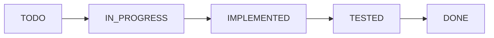

# DenHub — Development Process

> **Đây là quy trình phát triển BẮT BUỘC của DenHub.**  
> Mọi developer, Frontend Agent, Backend Agent và AI Coding Agent phải đọc file này trước khi thay đổi code.  
> **Không được bắt đầu implementation nếu chưa đọc các tài liệu liên quan trong `/docs`.**

---

## 1. MANDATORY READING BEFORE CODING

Trước khi thực hiện **BẤT KỲ** task nào, developer/agent phải đọc:

1. [`AGENTS.md`](../AGENTS.md)
2. [`00-DEVELOPMENT-PROCESS.md`](./00-DEVELOPMENT-PROCESS.md)
3. [`01-PROJECT-OVERVIEW.md`](./01-PROJECT-OVERVIEW.md)
4. [`02-SYSTEM-ARCHITECTURE.md`](./02-SYSTEM-ARCHITECTURE.md)
5. [`03-DATABASE-DESIGN.md`](./03-DATABASE-DESIGN.md)

Sau đó đọc code hiện tại liên quan trực tiếp tới task.

### Tuyệt đối KHÔNG được:
- Chỉ đọc prompt rồi code ngay.
- Chỉ đọc một file source code rồi tự suy đoán architecture toàn cục.
- Tự tạo endpoint mới ngoài contract.
- Tự tạo DTO contract hoặc tự thêm field tùy tiện.
- Tự tạo entity / field trong database.
- Tự tạo role / permission.
- Tự tạo enum / status.
- Tự tạo WebSocket destination.
- Tự thay đổi quan hệ database (relationships).

> [!WARNING]
> Nếu tài liệu chưa xác định một nghiệp vụ hoặc kỹ thuật:
> **Status: `TBD`**  
> Agent phải báo rằng contract chưa được chốt. **KHÔNG tự quyết định thay team.**

---

## 2. SOURCE OF TRUTH

Thứ tự ưu tiên và trách nhiệm của từng tài liệu trong `/docs`:

```
01-PROJECT-OVERVIEW.md      ───> WHAT / BUSINESS (Nghiệp vụ, khái niệm cốt lõi, phạm vi)
02-SYSTEM-ARCHITECTURE.md    ───> HOW / API / SECURITY / WEBSOCKET (Kiến trúc, contract giao tiếp)
03-DATABASE-DESIGN.md        ───> DATA / ENTITY / RELATIONSHIP / DATABASE (Schema, bảng, document)
00-DEVELOPMENT-PROCESS.md    ───> DEVELOPMENT RULES (Quy trình, checklist, tiến độ)
```

- **Không duplicate contract giữa các file.** Mỗi thông tin chỉ có một nơi duy nhất chịu trách nhiệm.
- **Nếu code và docs mâu thuẫn:**
  - **STOP.**
  - Không tự sửa docs theo code.
  - Không tự sửa code theo docs.
  - Phải ghi nhận conflict và yêu cầu team xác nhận.

---

## 3. BEFORE STARTING A TASK

Trước khi code, developer/agent phải xác định rõ các thông số:

```yaml
Task: [Tên task cụ thể]
Module: [Auth / Room / Member / Message / Real-time]
Related Business Rule: [Mục nào trong 01-PROJECT-OVERVIEW.md]
Related API: [Endpoint nào trong 02-SYSTEM-ARCHITECTURE.md]
Related Database: [Bảng SQL Server trong 03-DATABASE-DESIGN.md]
Related WebSocket: [Destination nào trong 02-SYSTEM-ARCHITECTURE.md]
Affected Frontend: [Các component/page bị ảnh hưởng]
Affected Backend: [Các controller/service/repo bị ảnh hưởng]
Status: [TODO / IN_PROGRESS]
```

### Checklist bắt buộc trước khi code:
- [ ] Business Rule đã `CONFIRMED` chưa?
- [ ] API Contract đã `CONFIRMED` chưa?
- [ ] Database design đã `CONFIRMED` chưa?
- [ ] Permission đã `CONFIRMED` chưa?
- [ ] Có dependency với task khác không?

> [!CAUTION]
> Nếu task phụ thuộc vào một contract vẫn là `TBD`:  
> **KHÔNG tự implement theo phỏng đoán.** Dừng lại và yêu cầu team xác nhận trước.

### Kế hoạch và approval gate

Sau khi đọc docs, tiến độ/handoff, source, tests và Git status/branch, trình kế hoạch gồm: Task, Current State, Related Documentation, Files Expected to Change (mục đích từng file), Backend, Frontend, Database, API/WebSocket, Security/Permission, Test Plan (test và lệnh thực tế), Documentation Impact, Risks/Open Questions.

**DỪNG và chờ người dùng duyệt kế hoạch trước khi sửa application code, schema, API contract, cài dependency hoặc refactor.** Nếu kế hoạch thay đổi đáng kể, trình lại và chờ duyệt lại. Không coi im lặng là đồng ý. Với đợt docs 2026-10-10, Duy đã trực tiếp yêu cầu đồng bộ tài liệu theo prompt; việc này không tự phê duyệt kế hoạch triển khai Backend hoặc Frontend.

---

## 4. IMPLEMENTATION RULE

Khi implement:
- **Chỉ thay đổi những file thực sự cần thiết cho task.**
- **Không được tự ý:**
  - Refactor các module không liên quan.
  - Rename API không liên quan.
  - Rename database field không liên quan.
  - Thay đổi response format chung.
  - Thay đổi cơ chế phân quyền (permission).
  - Thêm dependency không cần thiết vào `package.json` hoặc `build.gradle.kts`.
  - Thêm feature nằm ngoài phạm vi task được giao.
  - Tự ý mở rộng scope vì lý do *"Discord cũng có tính năng này"*.
- **Implementation phải tuân thủ nghiêm ngặt theo các tài liệu trong `/docs`.**

---

## 5. TASK STATUS

Mỗi task di chuyển qua vòng đời trạng thái:



| Trạng thái | Ý nghĩa |
| :--- | :--- |
| `TODO` | Chưa bắt đầu thực hiện. |
| `IN_PROGRESS` | Đang trong quá trình implement. |
| `IMPLEMENTED` | Đã code xong nhưng chưa xác nhận test hoàn chỉnh. |
| `TESTED` | Đã chạy toàn bộ các bài test bắt buộc và PASS 100%. |
| `DONE` | Code + test + docs liên quan đã đồng bộ hoàn toàn. |

---

## 6. DEFINITION OF DONE (DoD)

Một task **CHỈ ĐƯỢC PHÉP** chuyển sang trạng thái `DONE` khi thỏa mãn toàn bộ checklist:

- [ ] Implementation hoàn thành đầy đủ yêu cầu.
- [ ] Không còn compile error ở cả FE và BE.
- [ ] Không còn lỗi lint / build liên quan.
- [ ] Test liên quan đã được chạy thực tế.
- [ ] Test pass 100%.
- [ ] API contract vẫn đúng theo tài liệu.
- [ ] Database contract vẫn đúng theo tài liệu.
- [ ] Business Rules vẫn đúng theo tài liệu.
- [ ] FE/BE contract đồng bộ, không bị lệch trường dữ liệu.
- [ ] Docs liên quan đã được cập nhật (`01`, `02`, `03` nếu bị ảnh hưởng).
- [ ] Không còn code debug tạm (`console.log`, `System.out.println` rác, commented-out code).
- [ ] Không chứa secret / password / token nhạy cảm trong code.
- [ ] Git diff đã được review kỹ lưỡng (`git diff`, `git status`).
- [ ] Task status đã được cập nhật trong [Section 10](#10-current-project-progress) và [Section 11](#11-completed-work-log).

> [!WARNING]
> Nếu thiếu bất kỳ mục bắt buộc nào ở trên: **Task KHÔNG được đánh dấu DONE.**

---

## 7. TEST BEFORE COMMIT

> **TEST LÀ BẮT BUỘC TRƯỚC KHI COMMIT.**  
> Tuyệt đối không làm theo chu trình: `CODE → COMMIT → TEST SAU`.  
> Phải tuân theo chu trình:  
> `CODE → TEST → FIX → TEST LẠI → UPDATE DOCS → REVIEW DIFF → COMMIT`

### 7.1 Frontend
Trước khi commit Frontend phải tối thiểu:
1. Kiểm tra dependency hợp lệ.
2. Build project Frontend:
   ```bash
   npm run build
   ```
3. Kiểm tra route/page liên quan.
4. Kiểm tra lỗi console trình duyệt liên quan.
5. Test chức năng vừa thay đổi.
6. Nếu project có lint: `npm run lint`.
7. Nếu project có automated test: `npm test`.

*(Tuyệt đối không được ghi "TESTED" nếu command chưa thực sự được chạy).*

### 7.2 Backend
Trước khi commit Backend phải chạy test project:
- **Gradle (Project hiện tại):**
  ```bash
  # Linux / macOS
  ./gradlew test
  
  # Windows PowerShell / CMD
  .\gradlew.bat test
  ```
- Hoặc lệnh build/verify toàn diện:
  ```bash
  .\gradlew.bat check
  ```
*(Trường hợp sử dụng Maven: `./mvnw test` hoặc `mvnw.cmd test`).*

Phải kiểm tra:
- Compile không lỗi.
- Unit test pass.
- Service test pass.
- Repository test nếu liên quan pass.
- Controller / MockMvc test nếu liên quan pass.
- Security test nếu liên quan pass.
- Validation / error handling test nếu liên quan pass.

*(Không được đánh dấu TESTED nếu có bất kỳ test nào fail).*

### 7.3 API Integration
Nếu task ảnh hưởng cả FE ↔ BE, phải kiểm tra toàn chuỗi:

$$\text{Frontend Request} \longrightarrow \text{Backend Endpoint} \longrightarrow \text{Request DTO} \longrightarrow \text{Service} \longrightarrow \text{Database} \longrightarrow \text{Response DTO} \longrightarrow \text{Frontend}$$

Phải xác nhận:
- Endpoint URL chính xác tuyệt đối.
- HTTP method giống nhau.
- Field name khớp chuẩn (cả camelCase / snake_case).
- Kiểu dữ liệu (Datatype) tương thích hoàn toàn.
- Response thành công là DTO trực tiếp, không wrapper; lỗi dùng Problem Details theo RFC 9457 (chi tiết ở mục 4 của tài liệu kiến trúc).
- Error format trả về đúng mã và cấu trúc lỗi.
- Authorization headers truyền đúng cách.

### 7.4 WebSocket
Nếu task ảnh hưởng WebSocket / STOMP, phải kiểm tra:
- `CONNECT`: Handshake và xác thực token thành công.
- `SEND`: Gửi payload lên đúng Destination prefix.
- `SUBSCRIBE`: Nhận message đúng Topic.
- `PAYLOAD`: Cấu trúc JSON gửi và nhận khớp contract.
- `AUTHENTICATION`: Bị từ chối nếu thiếu token hoặc token sai.
- `ERROR`: Xử lý khi có lỗi xảy ra.
- `RECONNECT`: Xử lý khi mất kết nối (nếu có).

FE và BE bắt buộc phải dùng cùng destination và payload format.

---

## 8. TEST FAILURE RULE

Nếu test fail:
**KHÔNG ĐƯỢC COMMIT / PUSH NHƯ MỘT TASK HOÀN CHỈNH.**

Phải thực hiện theo các bước:
1. Xác định chính xác test nào bị fail.
2. Tìm ra nguyên nhân gốc rễ (Root Cause).
3. Fix lỗi nếu thuộc phạm vi của task hiện tại.
4. Chạy lại test suite để kiểm tra ảnh hưởng phụ (regression).
5. Chỉ chuyển trạng thái `TESTED` khi tất cả bài test đã PASS.

> [!NOTE]
> **Xử lý lỗi tồn tại từ trước (Pre-existing issue):**  
> Nếu lỗi tồn tại từ trước và không thuộc phạm vi task:  
> - Không tự ý sửa nếu có nguy cơ ảnh hưởng sang module khác.  
> - Bắt buộc ghi nhận rõ ràng:  
>   `PRE-EXISTING ISSUE: [Mô tả chi tiết lỗi và file liên quan]`  
> - **Tuyệt đối không được giả vờ test pass.**

---

## 9. DOCUMENTATION UPDATE AFTER TASK

Sau khi hoàn thành code, **BẮT BUỘC** kiểm tra xem tài liệu trong `/docs` có cần cập nhật không:

- Thay đổi **Business / Feature / Rule**  
  $\longrightarrow$ Cập nhật [`01-PROJECT-OVERVIEW.md`](./01-PROJECT-OVERVIEW.md)
- Thay đổi **Architecture / API / DTO / Security / WebSocket**  
  $\longrightarrow$ Cập nhật [`02-SYSTEM-ARCHITECTURE.md`](./02-SYSTEM-ARCHITECTURE.md)
- Thay đổi **Entity / Field / Relationship / Constraint / Index / Enum**  
  $\longrightarrow$ Cập nhật [`03-DATABASE-DESIGN.md`](./03-DATABASE-DESIGN.md)

*Không phải task nào cũng sửa cả 3 file, chỉ cập nhật file thực sự bị ảnh hưởng. Nhưng BẮT BUỘC phải kiểm tra cả 3 trước khi đánh dấu DONE.*

---

## 10. CURRENT PROJECT PROGRESS

Bảng này phản ánh chính xác trạng thái thực tế của code và tài liệu trong dự án.\
*(Không đánh dấu DONE chỉ vì đã tạo file rỗng hay class chưa hoàn chỉnh).*

| Module | FE | BE | DB | Integration | Test | Status | Last Update |
| :--- | :---: | :---: | :---: | :---: | :---: | :---: | :---: |
| **Authentication** | IMPLEMENTED | IMPLEMENTED | IMPLEMENTED | IN_PROGRESS | TESTED | IN_PROGRESS | 2026-10-06 |
| **Server & Invite** | TODO | IMPLEMENTED | IMPLEMENTED | TODO | TODO | IN_PROGRESS | 2026-10-06 |
| **Member & Role** | TODO | IMPLEMENTED | IMPLEMENTED | TODO | TODO | IN_PROGRESS | 2026-10-06 |
| **Channel** | TODO | IMPLEMENTED | IMPLEMENTED | TODO | TODO | IN_PROGRESS | 2026-10-06 |
| **Message & Real-time** | IN_PROGRESS | IMPLEMENTED | IMPLEMENTED | TODO | TODO | IN_PROGRESS | 2026-10-06 |
| **Direct Message (1-1)** | TODO | TODO | TODO | TODO | TODO | TODO | 2026-10-06 |

Các trạng thái module ngày 2026-10-06 được giữ như bản ghi trước đó, chưa được kiểm chứng lại toàn bộ trong đợt docs này. Không suy ra Task 1.07 đã có API hoàn chỉnh chỉ từ ô BE `IMPLEMENTED` của module Message.

### Theo dõi riêng phạm vi Duy (2026-10-10)

| Công việc | Trạng thái | Bằng chứng / bước còn lại |
| :--- | :--- | :--- |
| Đồng bộ docs theo prompt | DONE | Đã cập nhật 4 tài liệu; kiểm tra Markdown/JSON/link, contract và diff đạt. Không thay application code hoặc database. |
| Xác minh schema SQL Server | DONE | `messages.content` là `NVARCHAR(MAX)`, nullable; không có CHECK/trigger giới hạn 4000. Sau xác minh, Duy giao agent lựa chọn; đã chọn giới hạn request 4000 đơn vị UTF-16, giữ nguyên database. |
| Task 1.07 — API gửi tin nhắn + test | IN_PROGRESS | Lượt 1A hoàn thành DTO/Repository/Service và 25 unit tests; cả suite 26 tests PASS. Chưa có Controller, HTTP/security response tests hoặc integration SQL Server. Chờ lượt 1B. |
| Task 1.07 / lượt 1A | DONE | 9 file thuộc phạm vi đã trình; compileJava/test/check PASS, docs đồng bộ; dừng để giải thích và chờ Tiếp tục trước lượt 1B. |
| Task 1.12 — UI nhập và gửi tin nhắn | TODO | Chờ đợt Backend và xác nhận tiếp tục; tích hợp API cần Duy đồng ý. |

Chỉ đánh dấu `TESTED` khi đã thực sự chạy và vượt qua các kiểm thử phù hợp. Kiểm tra docs không thay thế test code hoặc integration test SQL Server.

---

## 11. COMPLETED WORK LOG

Nhật ký công việc đã hoàn thành. Mỗi task khi đạt chuẩn `DONE` sẽ được bổ sung một entry ngắn gọn theo template dưới đây:

### [2026-10-10] TASK-1.07-1A — Nghiệp vụ gửi tin nhắn và unit tests

Authorization / Decisions:
- Theo kế hoạch Backend đã trình và yêu cầu tiếp tục của Duy, sau khi kiểm tra SQL Server, Duy giao agent chọn giới hạn phù hợp.
- Chọn tối đa 4000 đơn vị UTF-16 ở request, giữ nguyên schema `NVARCHAR(MAX)`, nội dung hợp lệ giữ nguyên; response timestamp dùng `Instant` UTC.
- Giữ điểm dừng sau lượt 1A để Duy học và xác nhận trước lượt 1B; không coi Task 1.07 đã hoàn tất.

Implemented:
- Thêm `SendMessageRequest`, `MessageResponse`, `ChannelRepository`, `MessageService`.
- Thêm `existsByServerIdAndUserId` vào `ServerMemberRepository`; tái sử dụng Message Entity/Repository, UserRepository và SecurityUtils hiện có.
- Service lấy email từ Security Context, từ chối anonymous/principal chưa xác thực, tra User đang activated để lấy sender ID, validate request, tìm Channel, kiểm tra membership đúng Server, lưu và map DTO trong transaction.
- Validation từ chối null/rỗng/khoảng trắng Unicode/nội dung quá dài; không trim hoặc cắt nội dung. Chưa tạo Message Controller hoặc sửa shared response/security handlers.

Tests Added / Updated:
- Thêm `server/src/test/java/com/denhub/service/MessageServiceTest.java`: 25 cases với JUnit 5, Mockito, Validator thật và JWT fixture trong Security Context.
- Bao phủ nội dung/sender/channel/timestamp trả về, biên 4000/4001 với emoji, whitespace Unicode, request/path ID null, missing/anonymous/unauthenticated principal, subject trống, User không tồn tại/inactive, Channel không tồn tại, không có membership và lỗi lưu.
- Kiểm tra Repository không bị gọi khi validation/authentication thất bại và không save khi quyền hoặc Channel không hợp lệ.

Verification (thực thi tại `server/`):
- `.\gradlew.bat test --tests com.denhub.service.MessageServiceTest --no-daemon`: lần đầu FAIL 1/23 do `@NotBlank` không chặn EM SPACE trong phiên bản Validator hiện có. Đã thêm `@Pattern` Unicode và hai cases whitespace khác, chạy lại PASS 25/25.
- `.\gradlew.bat compileJava test check --no-daemon`: PASS, suite có 26 tests (25 MessageService + 1 DenHubApplicationTests), 0 failures/errors/skipped.
- Spring context test dùng H2; các Repository trong MessageServiceTest là mock. Chưa kiểm thử HTTP `201`, Problem Details, chữ ký JWT, rollback transaction thực tế hoặc ghi dữ liệu SQL Server.
- `git diff --check -- docs server/src`: PASS; đã kiểm tra code fences, JSON, link docs và review các file thuộc task. Các file ngoài danh sách sửa giữ nguyên SHA256 so với đầu lượt.

Documentation Impact:
- Cập nhật `docs/00-DEVELOPMENT-PROCESS.md` (progress/log/handoff), `docs/02-SYSTEM-ARCHITECTURE.md` (contract và hiện trạng 1A), `docs/03-DATABASE-DESIGN.md` (giới hạn request và mô tả kiểu cột đã xác minh).
- Đã kiểm tra `docs/01-PROJECT-OVERVIEW.md`: phạm vi/nghiệp vụ hiện có vẫn phù hợp, không cần sửa trong lượt 1A.

Remaining / Git:
- Lượt 1B còn Controller, HTTP/security tests, DTO trực tiếp qua wrapper hiện có và Problem Details qua error handlers/Security filter; phải trình phạm vi cụ thể trước khi sửa shared files.
- Chưa làm Frontend, lịch sử, sửa/xóa hoặc WebSocket; không đổi Entity, database, dependencies, branch, không commit/merge.
- Not pushed — AI agents are not allowed to push DenHub.

### [2026-10-10] SCHEMA-MESSAGE-CONTENT — Xác minh trước khi chốt validation

Implemented:
- Theo lựa chọn của Duy, kiểm tra schema SQL Server bằng truy vấn metadata chỉ đọc, dùng cấu hình kết nối hiện có.
- Xác nhận `dbo.messages.content` là `NVARCHAR(MAX)`, nullable; không có CHECK constraint hoặc trigger giới hạn 4000.
- Ghi nhận tên bảng/cột thực tế và việc chưa có FK của Message/Channel/ServerMember tại thời điểm kiểm tra.
- Giới hạn request vẫn chưa chốt; không suy ra rằng Duy đã đồng ý 4000.

Tests / Verification:
- `sqlcmd -S $dbServer -d $dbName -U $dbSettings['DB_USERNAME'] -C -b -l 5 -t 15 -W -s '|' -w 1000 -Q $schemaQuery`: PASS; chỉ truy vấn system catalog, không đọc hàng dữ liệu người dùng. Mật khẩu truyền qua biến môi trường của tiến trình và không ghi ra log.
- Baseline trước lượt kiểm tra schema: `.\gradlew.bat test --no-daemon --rerun-tasks` tại `server/`: PASS, 1 test `DenHubApplicationTests`, 0 lỗi, dùng H2; chưa phải test API gửi tin nhắn.
- Không tạo/cập nhật test ứng dụng trong lượt kiểm tra schema; chưa chạy integration test gửi tin nhắn trên SQL Server.

Docs Updated:
- `docs/00-DEVELOPMENT-PROCESS.md`, `docs/02-SYSTEM-ARCHITECTURE.md`, `docs/03-DATABASE-DESIGN.md`.

Git / Database:
- Chưa commit; không đổi branch, source, dependency, schema hoặc dữ liệu. Không khởi động ứng dụng với `ddl-auto=update` để kiểm tra database.
- Not pushed — AI agents are not allowed to push DenHub.

### [2026-10-10] DOCS-DUY-GROUP-CHAT — Đồng bộ theo prompt Task 1.07 / 1.12

Implemented:
- Theo yêu cầu trực tiếp của Duy, cập nhật convention Response DTO trực tiếp, HTTP status và Problem Details RFC 9457.
- Ghi phạm vi API gửi tin nhắn, MessageInput, điều kiện tích hợp, tests và quy trình Backend trước / Frontend sau với phần mentor, interview, kiểm tra kiến thức.
- Đồng bộ approval gate, commit cần cho phép riêng và cấm agent push với AGENTS.md.
- Ghi rõ chênh lệch docs/source, các điểm cần quyết định và tài liệu tham chiếu hiện bị thiếu; không tuyên bố API hoặc database đã được kiểm thử.
- Loại giá trị mật khẩu khỏi bản tài liệu hiện tại, không thay credential hoặc viết lại lịch sử Git.

Frontend / Backend / Database:
- Không sửa source, dependencies, schema hoặc migration. Giữ các thay đổi ngoài docs đã có từ trước.

Tests / Verification:
- Không tạo/cập nhật test ứng dụng: đợt này chỉ sửa tài liệu.
- `git diff --check -- docs`: lần đầu báo trailing whitespace, đã sửa cách viết xuống dòng Markdown và chạy lại PASS.
- Kiểm tra bằng PowerShell: code fences cân bằng, ví dụ JSON parse được bằng `ConvertFrom-Json`, link tương đối có đích tồn tại, contract cũ đã được thay, các file ngoài docs giữ nguyên SHA256 so với đầu đợt: PASS.
- Đã review diff so với bản đầu đợt để phân biệt thay đổi của agent với thay đổi có sẵn.
- Backend compile/test, Frontend build/test và integration SQL Server: CHƯA CHẠY, vì chưa triển khai application code trong đợt này.

Docs Updated:
- `docs/00-DEVELOPMENT-PROCESS.md`
- `docs/01-PROJECT-OVERVIEW.md`
- `docs/02-SYSTEM-ARCHITECTURE.md`
- `docs/03-DATABASE-DESIGN.md`

Commit:
- Chưa commit; branch `feature/group-chat`, agent không chuyển branch.

Push:
- Not pushed — AI agents are not allowed to push DenHub.

### Template mẫu:
```markdown
### [YYYY-MM-DD] TASK-ID — Task Name
Implemented:
- Tóm tắt tính năng đã hoàn thiện

Frontend:
- Component/Service FE đã thêm hoặc chỉnh sửa

Backend:
- Controller/Service/Repo BE đã thêm hoặc chỉnh sửa

Database:
- Bảng SQL Server đã thêm/sửa

Tests:
- Lệnh test đã chạy (e.g., gradlew.bat test, npm run build)
- Kết quả (e.g., PASS 15/15 tests)

Docs Updated:
- docs/0X-FILENAME.md (hoặc: None — no contract/documentation change)

Commit:
- <commit-hash> (hoặc: PENDING)
```

---

### [2026-10-06] DOCS-CANONICAL-SPEC — Đồng bộ đặc tả hệ thống chuẩn & giải quyết xung đột nghiệp vụ
Implemented:
- Kiểm tra toàn diện toàn bộ tài liệu và codebase FE/BE.
- Tạo `docs/DOCUMENT_CONSISTENCY_REPORT.md` phân loại các điểm xung đột giữa tài liệu và mã nguồn.
- Tạo `docs/DECISION_LOG.md` ghi nhận 12 quyết định kỹ thuật và kiến trúc cốt lõi.
- Xây dựng tài liệu đặc tả chuẩn xác thực tế `docs/DEN_APP_SYSTEM_SPECIFICATION.md` với 20 đề mục chi tiết, 23 Use Cases và ma trận phân quyền.
- Đồng bộ chuẩn hóa toàn bộ `01-PROJECT-OVERVIEW.md`, `02-SYSTEM-ARCHITECTURE.md`, `03-DATABASE-DESIGN.md` sang mô hình chuẩn: User -> Server -> Channel -> Message và duy nhất Microsoft SQL Server.

Frontend:
- Xác định và đánh dấu các module Out-of-Scope (Meetings) cần decouple trong sprint tới.

Backend:
- Giữ nguyên cấu trúc thực thể JPA hiện hữu (`Server`, `Channel`, `ServerMember`, `Message`, `User`) khớp với đặc tả chuẩn.

Database:
- Thống nhất toàn bộ schema trên Microsoft SQL Server, loại bỏ hoàn toàn MongoDB khỏi thiết kế.

Tests:
- Markdown validation & contract consistency check: PASS

Docs Updated:
- `docs/DOCUMENT_CONSISTENCY_REPORT.md` (Created)
- `docs/DECISION_LOG.md` (Created)
- `docs/DEN_APP_SYSTEM_SPECIFICATION.md` (Created)
- `docs/01-PROJECT-OVERVIEW.md` (Updated)
- `docs/02-SYSTEM-ARCHITECTURE.md` (Updated)
- `docs/03-DATABASE-DESIGN.md` (Updated)
- `docs/00-DEVELOPMENT-PROCESS.md` (Updated)

Commit:
- PENDING

---

### [2026-10-06] CONFIG-ENV-FILE — Tách cấu hình nhạy cảm sang biến môi trường .env
Implemented:
- Tạo file `server/.env` cục bộ cho môi trường local (chứa DB credentials, JWT secret, server port, client url).
- Tạo template mẫu `server/.env.example` không chứa mật khẩu nhạy cảm để chia sẻ trong repository.
- Cập nhật `server/.gitignore` đảm bảo bỏ qua `.env` và theo dõi `.env.example`.
- Cập nhật `application.properties` và `application.properties.example` sử dụng cú pháp `${ENV_VAR:fallback}` để tự động nạp từ biến môi trường hoặc fallback về giá trị mặc định.

Backend:
- `server/.env`, `server/.env.example`, `server/.gitignore`, `server/src/main/resources/application.properties`, `server/src/main/resources/application.properties.example`.

Tests:
- `.\gradlew.bat test`: PASS (1/1 test passed)

Docs Updated:
- `docs/00-DEVELOPMENT-PROCESS.md` (Updated)

Commit:
- PENDING

---

### [2026-10-06] REFACTOR-PROPERTIES-PREFIX — Đổi đồng bộ tiền tố cấu hình djnd sang denhub
Implemented:
- Thay thế toàn bộ tiền tố `djnd.*` thành `denhub.*` (`denhub.app.name`, `denhub.jwt.*`, `denhub.client.*`).
- Cập nhật các file cấu hình: `application.properties`, `application.properties.example`, `server/src/test/resources/application.properties`.
- Cập nhật 5 file Java (`ExceptionTranslator.java`, `AccountResource.java`, `MailService.java`, `SecurityUtils.java`, `SecurityConfiguration.java`).
- Dọn dẹp ghi chú trong `server/HELP.md`.

Backend:
- Các file cấu hình properties và 5 file source Java bảo mật/mail/rest.

Tests:
- `.\gradlew.bat test`: PASS (1/1 test passed)

Docs Updated:
- `docs/00-DEVELOPMENT-PROCESS.md` (Updated)

Commit:
- PENDING

---

### [2026-10-06] CONFIG-DATASOURCE — Cập nhật cấu hình DataSource sang Microsoft SQL Server
Implemented:
- Cập nhật cấu hình datasource trong `server/src/main/resources/application.properties` từ H2 sang Microsoft SQL Server.
- Cấu hình driver `com.microsoft.sqlserver.jdbc.SQLServerDriver`, dialect `org.hibernate.dialect.SQLServerDialect`.
- Cấu hình kết nối tới SQL Server local (`localhost:1433`, database `denhubdb`, user `sa`).
- Đã cấu hình thông tin xác thực SQL Server cục bộ và ghi nhận kiểm tra đăng nhập ở đợt này; giá trị mật khẩu đã được loại khỏi tài liệu ngày 2026-10-10. Không thay đổi credential thực tế hoặc lịch sử Git trong đợt docs.
- Tắt H2 console (`spring.h2.console.enabled=false`).
- Cập nhật template mẫu trong `server/src/main/resources/application.properties.example`.
- Giữ nguyên cấu hình H2 in-memory độc lập cho test suite trong `server/src/test/resources/application.properties`.

Backend:
- `server/src/main/resources/application.properties`

Tests:
- `.\gradlew.bat test`: PASS (1/1 test passed)

Docs Updated:
- `docs/00-DEVELOPMENT-PROCESS.md` (Updated)

Commit:
- PENDING

---

### [2026-10-09] FIX-MEMORY — Tối ưu tài nguyên Gradle và khắc phục sự cố sập JVM OOM
Implemented:
- Dọn dẹp hơn 70 crash dump logs (`hs_err_pid*.log`, `replay_pid*.log`) do tràn RAM hệ thống.
- Bổ sung cấu hình JVM args (`-Xms256m -Xmx768m -XX:MaxMetaspaceSize=256m -XX:+UseSerialGC`) và giới hạn `org.gradle.workers.max=2`, `idletimeout=60000` trong `gradle.properties` và `server/gradle.properties` để tránh cạn kiệt RAM trên CPU đa luồng.
- Cập nhật `.gitignore` để bỏ qua các file `hs_err_pid*.log` và `replay_pid*.log`.
- Dừng toàn bộ các Gradle daemon nhàn rỗi ngậm RAM.

Frontend:
- Không thay đổi.

Backend:
- Cập nhật cấu hình build tool `gradle.properties` và `server/gradle.properties`.

Database:
- Không thay đổi.

Tests:
- `.\server\gradlew.bat --stop`: PASS
- `.\server\gradlew.bat -p server help`: PASS (1 actionable task executed, build thành công trong 7s, không phát sinh crash log)

Docs Updated:
- `docs/00-DEVELOPMENT-PROCESS.md` (Updated)

Commit:
- PENDING

---

### [2026-10-06] REFACTOR-BACKEND — Đổi tên thư mục backend thành server và refactor package com.denhub
Implemented:
- Đổi tên thư mục backend từ `den-app-java-spring/` thành `server/`.
- Refactor toàn bộ package từ `tech.djnd.sample.app` sang `com.denhub`.
- Đổi tên Application class thành `DenHubApplication.java` và test class thành `DenHubApplicationTests.java`.
- Cập nhật `settings.gradle.kts` (`denhub-server`) và `build.gradle.kts` (`group = "com.denhub"`).
- Thêm cấu hình test `application.properties` (H2 in-memory) và `application.properties.example`.

Frontend:
- Chạy kiểm tra `npm run build` thành công, không có lỗi xung đột.

Backend:
- Toàn bộ 58 file Java đã cập nhật package sang `com.denhub`.

Database:
- Không thay đổi schema.

Tests:
- `.\gradlew.bat clean compileJava --no-daemon`: PASS
- `.\gradlew.bat test --no-daemon`: PASS (1/1 test passed)
- `npm run build`: PASS

Docs Updated:
- `docs/00-DEVELOPMENT-PROCESS.md` (Updated)

Commit:
- PENDING

---

### [2026-10-06] DOCS-INIT — Khởi tạo hệ thống tài liệu chuẩn DenHub
Implemented:
- Khởi tạo bộ 4 tài liệu cốt lõi làm Source of Truth cho toàn bộ dự án.

Frontend:
- Chưa thay đổi code.

Backend:
- Chưa thay đổi code.

Database:
- Chưa chạy migration.

Tests:
- File linting & Markdown validation: PASS

Docs Updated:
- `docs/00-DEVELOPMENT-PROCESS.md` (Created)
- `docs/01-PROJECT-OVERVIEW.md` (Created)
- `docs/02-SYSTEM-ARCHITECTURE.md` (Created)
- `docs/03-DATABASE-DESIGN.md` (Created)

Commit:
- PENDING

---

## 12. CURRENT WORK / HANDOFF

Phần này dùng để bàn giao giữa các Developer và AI Coding Agent khi chuyển ca hoặc dừng giữa task:

```yaml
Current Task: Task 1.07 — Lượt 1A (DTO, Repository, Service và unit tests)
Status: DONE lượt 1A; Task 1.07 IN_PROGRESS; chờ Duy trả lời kiến thức và Tiếp tục
Completed:
  - Đã đọc yêu cầu của Duy và bốn tài liệu cốt lõi
  - Đã ghi contract DTO trực tiếp, HTTP status và RFC 9457
  - Đã ghi phạm vi Backend trước, Frontend sau và yêu cầu mentor
  - Đã đối chiếu một số Entity, Repository, wrapper, error handler và Axios hiện có
  - Các thay đổi ngoài phạm vi 1A được giữ nguyên; kiểm tra docs và diff đạt
  - Đã kiểm tra JWT dùng email làm subject; UserRepository có truy vấn theo email
  - Đã chạy lại baseline H2 với 1 test PASS và trình kế hoạch Backend chia lượt 1A, 1B
  - Đã truy vấn SQL Server thực tế; messages.content là NVARCHAR(MAX), nullable, không có CHECK/trigger giới hạn 4000
  - Duy giao agent chọn giới hạn; đã triển khai validation tối đa 4000 đơn vị UTF-16 và giữ nguyên database
  - Đã thêm DTO, ChannelRepository, truy vấn membership, MessageService và 25 unit tests
  - compileJava/test/check PASS; 26 tests trong suite, gồm 1 context test H2 có sẵn
Remaining:
  - Duy trả lời 3 câu kiểm tra kiến thức, agent nhận xét và chờ Tiếp tục
  - Trình phạm vi lượt 1B (Controller, HTTP tests, wrapper và lỗi dùng chung), chờ duyệt trước khi sửa shared files
  - Hoàn thành HTTP 201, JSON DTO trực tiếp và Problem Details kể cả lỗi do Security filter
  - Chưa chạy integration test ghi SQL Server; không coi mock/H2 là kiểm chứng SQL Server
Known Issues:
  - Entity và SQL Server vẫn dùng server_member/created_date khác một số phần thiết kế; đã ghi chênh lệch trong docs, không thay schema
  - ResFormatResponse vẫn bọc success response; ExceptionTranslator dùng Zalando Problem
  - messageApi.js hiện gọi đường dẫn rooms thay vì channels
  - Ba tài liệu được nhắc trong log cũ không có trong docs tại lần kiểm tra này (DEN_APP_SYSTEM_SPECIFICATION.md, DECISION_LOG.md, DOCUMENT_CONSISTENCY_REPORT.md)
Next Recommended Step:
  - Chờ Tiếp tục rồi lập kế hoạch lượt 1B, không tự làm module khác hoặc Frontend
Files Being Changed:
  - client/src/api/authApi.js
  - client/src/contexts/AuthContext.jsx
  - server/src/main/java/com/denhub/service/dto/SendMessageRequest.java
  - server/src/main/java/com/denhub/service/dto/MessageResponse.java
  - server/src/main/java/com/denhub/repository/ChannelRepository.java
  - server/src/main/java/com/denhub/repository/ServerMemberRepository.java
  - server/src/main/java/com/denhub/service/MessageService.java
  - server/src/test/java/com/denhub/service/MessageServiceTest.java
  - docs/00-DEVELOPMENT-PROCESS.md
  - docs/02-SYSTEM-ARCHITECTURE.md
  - docs/03-DATABASE-DESIGN.md
Git:
  - Branch quan sát được là feature/group-chat, agent không chuyển branch
  - Các thay đổi có sẵn được giữ nguyên; không commit, push hoặc merge
Related Docs:
  - AGENTS.md
  - docs/00-DEVELOPMENT-PROCESS.md
  - docs/01-PROJECT-OVERVIEW.md
  - docs/02-SYSTEM-ARCHITECTURE.md
  - docs/03-DATABASE-DESIGN.md
```

---

## 13. GIT DIFF REVIEW

Trước khi tạo commit, **BẮT BUỘC** chạy và review:

```bash
git status
git diff
# Nếu đã git add:
git diff --staged
```

### Danh mục kiểm tra:
- File nào thực sự bị thay đổi? Có file nào ngoài phạm vi task bị sửa nhầm không?
- Có để sót code debug tạm thời không (`console.log`, `debugger`, comment rác)?
- Có vô tình commit bí mật không (API keys, secret tokens, mật khẩu, file `.env`)?
- Có file rác do build sinh ra không (`.class`, `dist/`, `.log`, `.DS_Store`)?
- Có thay đổi contract API/DB ngoài ý muốn không?

---

## 14. COMMIT RULE

Mỗi commit **CHỈ ĐƯỢC CHỨA MỘT LOGICAL CHANGE DUY NHẤT.**  
Không gom nhiều task hoặc các thay đổi không liên quan vào một commit lớn.

Agent chỉ được commit khi người dùng cho phép riêng, sau khi implementation, tests, verification, docs, tiến độ và diff review hoàn tất. Nếu chưa được cho phép, báo sẵn sàng commit rồi dừng. Không tự merge hoặc chuyển branch.

### Quy chuẩn đặt tên commit (Conventional Commits):

#### ✅ GOOD:
- `feat(auth): implement login API`
- `feat(room): add room creation`
- `feat(message): add realtime message delivery`
- `test(room): add room service tests`
- `docs(api): document room API contract`
- `fix(auth): handle expired JWT`

#### ❌ BAD (Tuyệt đối tránh):
- `update code`
- `fix`
- `final`
- `done`
- `project update`
- `everything works`

---

## 15. PUSH RULE

> [!CAUTION]
> **AI AGENTS KHÔNG ĐƯỢC PUSH**, kể cả khi tests pass hoặc đã được phép commit. Không dùng lệnh hay công cụ tương đương để upload commit, force push hoặc thay đổi remote branch. Trách nhiệm của agent kết thúc ở local; con người tự thực hiện push theo quy trình nhóm.

Báo cáo cuối phải ghi: `Not pushed — AI agents are not allowed to push DenHub.`

---

## 16. AGENT STARTUP PROTOCOL

Mỗi AI Coding Agent khi nhận task **BẮT BUỘC** tuân thủ tuần tự 17 bước:

1. **STEP 1:** Đọc kỹ [`AGENTS.md`](../AGENTS.md) và [`00-DEVELOPMENT-PROCESS.md`](./00-DEVELOPMENT-PROCESS.md).
2. **STEP 2:** Đọc [`01-PROJECT-OVERVIEW.md`](./01-PROJECT-OVERVIEW.md) để nắm Business Context.
3. **STEP 3:** Đọc [`02-SYSTEM-ARCHITECTURE.md`](./02-SYSTEM-ARCHITECTURE.md) để nắm API & Architecture Contract.
4. **STEP 4:** Đọc [`03-DATABASE-DESIGN.md`](./03-DATABASE-DESIGN.md) để nắm Database Model.
5. **STEP 5:** Đọc mục [Current Project Progress](#10-current-project-progress), [Current Work / Handoff](#12-current-work--handoff) và [Completed Work Log](#11-completed-work-log).
6. **STEP 6:** Inspect toàn bộ mã nguồn liên quan trực tiếp đến task.
7. **STEP 7:** So sánh tài liệu `/docs` với implementation hiện tại của codebase.
8. **STEP 8:** Nếu phát hiện conflict $\longrightarrow$ **STOP NGAY LẬP TỨC** và báo cáo conflict cho team.
9. **STEP 9:** Khi contract rõ ràng, trình kế hoạch theo mục 3, dừng và chờ người dùng duyệt. Chỉ sau đó mới implement đúng phạm vi đã duyệt.
10. **STEP 10:** Viết/cập nhật test hành vi phù hợp rồi chạy automated tests liên quan và compile/build cần thiết.
11. **STEP 11:** Fix lỗi phát sinh và chạy lại test cho đến khi PASS 100%.
12. **STEP 12:** Cập nhật tài liệu `/docs` nếu có thay đổi liên quan.
13. **STEP 13:** Cập nhật bảng `Current Project Progress`.
14. **STEP 14:** Cập nhật `Completed Work Log` hoặc `Current Work / Handoff`.
15. **STEP 15:** Review kỹ lưỡng `git diff`.
16. **STEP 16:** Chỉ tạo commit với format chuẩn nếu người dùng đã cho phép riêng và mọi kiểm tra bắt buộc đã đạt.
17. **STEP 17:** Báo kết quả chính xác và dừng; không push. Với Duy, thực hiện thêm phần giải thích và kiểm tra kiến thức tại mục 20.

---

## 17. AGENT STOP CONDITIONS

Agent phải **STOP** và chủ động hỏi/xác nhận từ team nếu gặp các tình huống sau:

- Business Rule cần thiết cho task vẫn đang ở trạng thái `TBD`.
- API contract chưa được chốt (`TBD`).
- Database schema / relationship chưa được định nghĩa rõ ràng.
- Quyền hạn (Permission / Role) chưa được thống nhất.
- Các tài liệu trong `/docs` mâu thuẫn lẫn nhau.
- Tài liệu trong `/docs` mâu thuẫn với code hiện có.
- Contract phía Frontend và Backend không khớp nhau.
- Yêu cầu task có dấu hiệu mở rộng scope (Scope creep).
- Cần xóa hoặc thay đổi lớn cấu trúc dữ liệu đã có.
- Cần thay đổi kiến trúc lớn của hệ thống.
- Test bị fail mà nguyên nhân không thuộc task hoặc chưa xác định được rõ ràng.
- Có thay đổi chưa commit ngoài dự kiến hoặc phát hiện secret trong tracked files.
- Cần thay đổi đáng kể kế hoạch đã được duyệt hoặc đụng module của thành viên khác.

*(Tuyệt đối không giải quyết bằng cách tự suy đoán).*

---

## 18. DOCUMENTATION IS PART OF THE CODE

Đối với dự án DenHub:
> **Chỉ viết code là CHƯA ĐỦ.**  
> Một thay đổi có ảnh hưởng đến contract nhưng không cập nhật tài liệu `/docs` được xem là **CHƯA HOÀN THÀNH.**

### Flow chuẩn:
```
READ DOCS
    ↓
UNDERSTAND CURRENT STATUS
    ↓
CHECK CONTRACT
    ↓
CREATE IMPLEMENTATION PLAN
    ↓
WAIT FOR USER APPROVAL
    ↓
IMPLEMENT
    ↓
WRITE / UPDATE TESTS
    ↓
TEST
    ↓
FIX
    ↓
TEST AGAIN
    ↓
UPDATE DOCS
    ↓
UPDATE PROGRESS / HANDOFF
    ↓
REVIEW GIT DIFF
    ↓
COMMIT ONLY IF AUTHORIZED
    ↓
STOP — NO PUSH
```

---

## 19. FINAL CHECKLIST

Trước khi kết thúc bất kỳ phiên làm việc nào:

- [ ] Đã đọc `00-DEVELOPMENT-PROCESS.md`
- [ ] Đã đọc `01-PROJECT-OVERVIEW.md`
- [ ] Đã đọc `02-SYSTEM-ARCHITECTURE.md`
- [ ] Đã đọc `03-DATABASE-DESIGN.md`
- [ ] Đã hiểu rõ `Current Project Progress`
- [ ] Kế hoạch implementation đã được người dùng duyệt
- [ ] Task không vi phạm bất kỳ contract nào
- [ ] Implementation đã hoàn thành
- [ ] Build pass
- [ ] Tests pass
- [ ] FE/BE contract đồng bộ hoàn toàn
- [ ] Docs liên quan đã được cập nhật
- [ ] Project Progress đã được cập nhật
- [ ] Work Log / Handoff đã được cập nhật
- [ ] Git diff đã được review
- [ ] Không có secret hoặc debug code
- [ ] Nếu có commit: đã được cho phép riêng và chỉ chứa logical change
- [ ] Không push, merge hoặc tự chuyển branch

---

## 20. Quy trình Coding Agent + Mentor cho Duy

Áp dụng cho Module 4 — Task 1.07 và 1.12. Mục tiêu là Duy tự viết lại và giải thích được code khi bảo vệ SBA301 hoặc phỏng vấn Java Backend / Full-stack.

### 20.1 Kiểm tra trước khi code

- Đọc cấu trúc Backend/Frontend, tiến độ/handoff/log, Git status và branch; kiểm tra thay đổi của developer khác.
- Kiểm tra Message Entity/Repository/Service/Controller/DTO, bảng `messages`, `users`, `channels`, membership, Spring Security/JWT và error handler.
- Kiểm tra Axios, React Router, component và state hiện có. Tái sử dụng code; không tạo trùng hoặc đổi kiến trúc tùy tiện.
- Liệt kê file dự kiến tạo/sửa, mục đích từng file và dependencies chưa sẵn sàng. Trình kế hoạch và chờ duyệt theo mục 3.
- Không sửa module của Ben, Hoàng, Vinh, Kỳ Anh; không tự thay database, commit, push, merge hoặc chuyển branch.

### 20.2 Đợt 1 — Backend

Sau duyệt kế hoạch, triển khai API và test trong khoảng 5–10 file mỗi đợt. Nếu cần hơn 10 file, chia nhỏ và chờ xác nhận giữa các lần; không bỏ tests/docs để lách giới hạn.

Test hành vi bằng JUnit 5 / Mockito và MockMvc phù hợp:

- Gửi thành công, đúng `senderId`, `channelId`, `content`, HTTP `201` và JSON DTO trực tiếp.
- Nội dung null, rỗng, toàn khoảng trắng hoặc quá dài: `400`.
- Channel không tồn tại: `404`; chưa đăng nhập/token không hợp lệ: `401`; không thuộc Server: `403`.
- Không lưu Message khi validation hoặc permission thất bại; người gửi được lấy từ xác thực, không do client chọn.
- Kiểm tra response thực tế qua advice/security hiện có để phát hiện wrapper hoặc sai error contract.

Mock dependency khi Auth/Server/Channel/Member chưa sẵn sàng. Không hardcode sender hoặc bypass bảo mật trong production. Báo rõ mock unit test, MockMvc test và integration test thật trên SQL Server; mock/H2 không chứng minh SQL Server đã hoạt động.

Các lệnh dự kiến từ thư mục `server/`: `.\gradlew.bat compileJava`, `.\gradlew.bat test`; chạy `.\gradlew.bat check` khi cần full check. Báo chính xác lệnh thực thi và `PASS / FAIL / CHƯA CHẠY`. Fix lỗi thuộc phạm vi rồi chạy lại; ghi `PRE-EXISTING ISSUE` nếu lỗi không thuộc task, không tự sửa module khác.

Sau verification: đồng bộ docs, cập nhật tiến độ/handoff, review diff, giải thích code, đưa 5 câu interview kèm đáp án và hỏi 3 câu kiểm tra kiến thức. **DỪNG, chờ Duy trả lời và nói “Tiếp tục” trước đợt Frontend.** Nhận xét, sửa câu trả lời sai; nếu Duy chưa hiểu, giải thích lại bằng ví dụ đơn giản hơn.

### 20.3 Nội dung giải thích Backend bắt buộc

Với từng file được tạo/sửa: ghi đường dẫn và dòng code thực tế, nhiệm vụ, lý do cần, tầng kiến trúc, import/annotation quan trọng, từng method nhận gì–xử lý gì–trả gì, lý do chọn cách làm, file được gọi, ảnh hưởng nếu xóa và rủi ro bảo mật. File test/docs cũng cần giải thích đúng vai trò, không ép chúng vào tầng runtime.

Liên hệ với source vừa triển khai: `@RestController`, `@RequestMapping`, `@PostMapping`, `@PathVariable`, `@RequestBody`, `@Valid`, `@Service`, `@Repository`, `@Entity`, `@Id`, Dependency Injection, Spring Data JPA, Hibernate, DTO mapping, `ResponseEntity`, Spring Security, JWT, JUnit 5 và Mockito. Chỉ giải thích `@ManyToOne` / `@Transactional` như code đang dùng khi thực sự có sử dụng.

Giải thích REST API, JSON, Request DTO/Response DTO, lý do không trả Entity, các HTTP status trong kiến trúc, Problem Details, Axios `response.data` và convention bỏ wrapper của DenHub. Phân biệt convention dự án với tiêu chuẩn HTTP, không khẳng định wrapper bị REST cấm.

Mô tả đường đi “Hello mọi người!” vào Channel 5 từ request, Security, validation, Service, Repository, SQL Server tới DTO/response; chỉ rõ dữ liệu đang ở đâu từng bước. Dùng ID như ví dụ giảng dạy, không hardcode production.

### 20.4 Đợt 2 — Frontend

Chỉ bắt đầu sau xác nhận của Duy; kiểm tra React và trình kế hoạch file, chờ duyệt trước khi implement. Mỗi đợt tối đa khoảng 5–10 file. Yêu cầu UI và điều kiện tích hợp API nằm ở mục 8 của tài liệu kiến trúc.

Kiểm tra UI: input hợp lệ/không hợp lệ, Enter/Shift+Enter, loading/disable chống gửi trùng, giữ nội dung và hiển thị lỗi khi thất bại, xóa input và báo component cha khi thành công, đổi Channel, JWT và các lỗi `400/401/403/404`. Nếu chưa tích hợp được, dùng mock kiểm tra UI độc lập và báo giới hạn.

Từ thư mục `client/`, chạy `npm run build`; chỉ chạy lint/test nếu scripts tương ứng tồn tại. `package.json` tại lần kiểm tra 2026-10-10 có `dev`, `build`, `preview`, chưa có script lint/test. Kiểm tra route, API, loading/error, authorization, form và console trình duyệt; không nhận đã kiểm tra browser nếu chưa thực hiện. Hướng dẫn Duy chạy `npm run dev` và mở địa chỉ Vite thực tế in ra.

Giải thích từng file/component với dòng code thực tế: Component, props, state, `useState`, controlled input, `onChange`, event handler, Enter/Shift+Enter, Promise, `async/await`, Axios/JSON/JWT, loading/error, thời điểm xóa input, tránh hardcode ID, quan hệ cha–con. Khi API thành công nhưng UI chưa cập nhật, hướng dẫn kiểm tra response mapping, callback về cha và cập nhật state.

Mô tả luồng từ gõ chữ đến React state, Send, Axios, Backend lưu, DTO trả về và UI cập nhật bằng source DenHub. Sau đó đưa 5 câu interview kèm đáp án, hỏi 3 câu kiểm tra kiến thức, chờ trả lời và nhận xét. **DỪNG, chờ “Tiếp tục”; không tự chuyển sang task khác.**

### 20.5 Báo cáo cuối mỗi đợt

Giải thích bằng tiếng Việt dễ hiểu, giữ thuật ngữ kỹ thuật; comment code bằng tiếng Anh khi cần. Báo: Implemented, Tests Added/Updated, Verification (lệnh và kết quả thật), Documentation, Remaining Issues, Git Status và Push. Không dùng kết quả test của log cũ để nhận PASS cho phiên hiện tại.

Luôn ghi: `Not pushed — AI agents are not allowed to push DenHub.`
