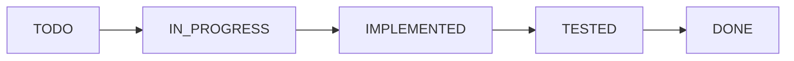

# DenHub — Development Process

> **Đây là quy trình phát triển BẮT BUỘC của DenHub.**  
> Mọi developer, Frontend Agent, Backend Agent và AI Coding Agent phải đọc file này trước khi thay đổi code.  
> **Không được bắt đầu implementation nếu chưa đọc các tài liệu liên quan trong `/docs`.**

---

## 1. MANDATORY READING BEFORE CODING

Trước khi thực hiện **BẤT KỲ** task nào, developer/agent phải đọc:

1. [`AGENTS.md`](../AGENTS.md)
2. [`00-DEVELOPMENT-PROCESS.md`](./00-DEVELOPMENT-PROCESS.md)
3. [`01-PROJECT-OVERVIEW.md`](./01-PROJECT-OVERVIEW.md)
4. [`02-SYSTEM-ARCHITECTURE.md`](./02-SYSTEM-ARCHITECTURE.md)
5. [`03-DATABASE-DESIGN.md`](./03-DATABASE-DESIGN.md)

Sau đó đọc code hiện tại liên quan trực tiếp tới task.

### Tuyệt đối KHÔNG được:
- Chỉ đọc prompt rồi code ngay.
- Chỉ đọc một file source code rồi tự suy đoán architecture toàn cục.
- Tự tạo endpoint mới ngoài contract.
- Tự tạo DTO contract hoặc tự thêm field tùy tiện.
- Tự tạo entity / field trong database.
- Tự tạo role / permission.
- Tự tạo enum / status.
- Tự tạo WebSocket destination.
- Tự thay đổi quan hệ database (relationships).

> [!WARNING]
> Nếu tài liệu chưa xác định một nghiệp vụ hoặc kỹ thuật:
> **Status: `TBD`**  
> Agent phải báo rằng contract chưa được chốt. **KHÔNG tự quyết định thay team.**

---

## 2. SOURCE OF TRUTH

Thứ tự ưu tiên và trách nhiệm của từng tài liệu trong `/docs`:

```
01-PROJECT-OVERVIEW.md      ───> WHAT / BUSINESS (Nghiệp vụ, khái niệm cốt lõi, phạm vi)
02-SYSTEM-ARCHITECTURE.md    ───> HOW / API / SECURITY / WEBSOCKET (Kiến trúc, contract giao tiếp)
03-DATABASE-DESIGN.md        ───> DATA / ENTITY / RELATIONSHIP / DATABASE (Schema, bảng, document)
00-DEVELOPMENT-PROCESS.md    ───> DEVELOPMENT RULES (Quy trình, checklist, tiến độ)
```

- **Không duplicate contract giữa các file.** Mỗi thông tin chỉ có một nơi duy nhất chịu trách nhiệm.
- **Nếu code và docs mâu thuẫn:**
  - **STOP.**
  - Không tự sửa docs theo code.
  - Không tự sửa code theo docs.
  - Phải ghi nhận conflict và yêu cầu team xác nhận.

---

## 3. BEFORE STARTING A TASK

Trước khi code, developer/agent phải xác định rõ các thông số:

```yaml
Task: [Tên task cụ thể]
Module: [Auth / Room / Member / Message / Real-time]
Related Business Rule: [Mục nào trong 01-PROJECT-OVERVIEW.md]
Related API: [Endpoint nào trong 02-SYSTEM-ARCHITECTURE.md]
Related Database: [Bảng SQL Server trong 03-DATABASE-DESIGN.md]
Related WebSocket: [Destination nào trong 02-SYSTEM-ARCHITECTURE.md]
Affected Frontend: [Các component/page bị ảnh hưởng]
Affected Backend: [Các controller/service/repo bị ảnh hưởng]
Status: [TODO / IN_PROGRESS]
```

### Checklist bắt buộc trước khi code:
- [ ] Business Rule đã `CONFIRMED` chưa?
- [ ] API Contract đã `CONFIRMED` chưa?
- [ ] Database design đã `CONFIRMED` chưa?
- [ ] Permission đã `CONFIRMED` chưa?
- [ ] Có dependency với task khác không?
- [ ] **LẬP IMPLEMENTATION PLAN & XÁC NHẬN (APPROVAL GATE):** Đã lập Implementation Plan đầy đủ các mục và trình bày cho User/Team duyệt chưa?

> [!CAUTION]
> **QUY ĐỊNH BẮT BUỘC KHÔNG ĐƯỢC BỎ QUA:**  
> Mọi tác vụ lập trình (Backend, Frontend, Database, Refactoring, Config) **TẤT CẢ** đều BẮT BUỘC phải lập Implementation Plan chi tiết và nhận được sự phê duyệt (`OK`, `Proceed`, `Duyệt`) trước khi tiến hành chỉnh sửa hoặc tạo mới file code.  
> Nếu task phụ thuộc vào một contract vẫn là `TBD`:  
> **KHÔNG tự implement theo phỏng đoán.** Dừng lại và yêu cầu team xác nhận trước.

### Kế hoạch và approval gate

Sau khi đọc docs, tiến độ/handoff, source, tests và Git status/branch, trình kế hoạch gồm: Task, Current State, Related Documentation, Files Expected to Change (mục đích từng file), Backend, Frontend, Database, API/WebSocket, Security/Permission, Test Plan (test và lệnh thực tế), Documentation Impact, Risks/Open Questions.

**DỪNG và chờ người dùng duyệt kế hoạch trước khi sửa application code, schema, API contract, cài dependency hoặc refactor.** Nếu kế hoạch thay đổi đáng kể, trình lại và chờ duyệt lại. Không coi im lặng là đồng ý. Với đợt docs 2026-10-10, Duy đã trực tiếp yêu cầu đồng bộ tài liệu theo prompt; việc này không tự phê duyệt kế hoạch triển khai Backend hoặc Frontend.

---

## 4. IMPLEMENTATION RULE

Khi implement:
- **Chỉ thay đổi những file thực sự cần thiết cho task.**
- **Không được tự ý:**
  - Refactor các module không liên quan.
  - Rename API không liên quan.
  - Rename database field không liên quan.
  - Thay đổi response format chung.
  - Thay đổi cơ chế phân quyền (permission).
  - Thêm dependency không cần thiết vào `package.json` hoặc `build.gradle.kts`.
  - Thêm feature nằm ngoài phạm vi task được giao.
  - Tự ý mở rộng scope vì lý do *"Discord cũng có tính năng này"*.
- **Implementation phải tuân thủ nghiêm ngặt theo các tài liệu trong `/docs`.**

---

## 5. TASK STATUS

Mỗi task di chuyển qua vòng đời trạng thái:



| Trạng thái | Ý nghĩa |
| :--- | :--- |
| `TODO` | Chưa bắt đầu thực hiện. |
| `IN_PROGRESS` | Đang trong quá trình implement. |
| `IMPLEMENTED` | Đã code xong nhưng chưa xác nhận test hoàn chỉnh. |
| `TESTED` | Đã chạy toàn bộ các bài test bắt buộc và PASS 100%. |
| `DONE` | Code + test + docs liên quan đã đồng bộ hoàn toàn. |

---

## 6. DEFINITION OF DONE (DoD)

Một task **CHỈ ĐƯỢC PHÉP** chuyển sang trạng thái `DONE` khi thỏa mãn toàn bộ checklist:

- [ ] Implementation hoàn thành đầy đủ yêu cầu.
- [ ] Không còn compile error ở cả FE và BE.
- [ ] Không còn lỗi lint / build liên quan.
- [ ] Test liên quan đã được chạy thực tế.
- [ ] Test pass 100%.
- [ ] API contract vẫn đúng theo tài liệu.
- [ ] Database contract vẫn đúng theo tài liệu.
- [ ] Business Rules vẫn đúng theo tài liệu.
- [ ] FE/BE contract đồng bộ, không bị lệch trường dữ liệu.
- [ ] Docs liên quan đã được cập nhật (`01`, `02`, `03` nếu bị ảnh hưởng).
- [ ] Không còn code debug tạm (`console.log`, `System.out.println` rác, commented-out code).
- [ ] Không chứa secret / password / token nhạy cảm trong code.
- [ ] Git diff đã được review kỹ lưỡng (`git diff`, `git status`).
- [ ] Task status đã được cập nhật trong [Section 10](#10-current-project-progress) và [Section 11](#11-completed-work-log).

> [!WARNING]
> Nếu thiếu bất kỳ mục bắt buộc nào ở trên: **Task KHÔNG được đánh dấu DONE.**

---

## 7. TEST BEFORE COMMIT

> **TEST LÀ BẮT BUỘC TRƯỚC KHI COMMIT.**  
> Tuyệt đối không làm theo chu trình: `CODE → COMMIT → TEST SAU`.  
> Phải tuân theo chu trình:  
> `CODE → TEST → FIX → TEST LẠI → UPDATE DOCS → REVIEW DIFF → COMMIT`

### 7.1 Frontend
Trước khi commit Frontend phải tối thiểu:
1. Kiểm tra dependency hợp lệ.
2. Build project Frontend:
   ```bash
   npm run build
   ```
3. Kiểm tra route/page liên quan.
4. Kiểm tra lỗi console trình duyệt liên quan.
5. Test chức năng vừa thay đổi.
6. Nếu project có lint: `npm run lint`.
7. Nếu project có automated test: `npm test`.

*(Tuyệt đối không được ghi "TESTED" nếu command chưa thực sự được chạy).*

### 7.2 Backend
Trước khi commit Backend phải chạy test project:
- **Gradle (Project hiện tại):**
  ```bash
  # Linux / macOS
  ./gradlew test
  
  # Windows PowerShell / CMD
  .\gradlew.bat test
  ```
- Hoặc lệnh build/verify toàn diện:
  ```bash
  .\gradlew.bat check
  ```
*(Trường hợp sử dụng Maven: `./mvnw test` hoặc `mvnw.cmd test`).*

Phải kiểm tra:
- Compile không lỗi.
- Unit test pass.
- Service test pass.
- Repository test nếu liên quan pass.
- Controller / MockMvc test nếu liên quan pass.
- Security test nếu liên quan pass.
- Validation / error handling test nếu liên quan pass.

*(Không được đánh dấu TESTED nếu có bất kỳ test nào fail).*

### 7.3 API Integration
Nếu task ảnh hưởng cả FE ↔ BE, phải kiểm tra toàn chuỗi:

$$\text{Frontend Request} \longrightarrow \text{Backend Endpoint} \longrightarrow \text{Request DTO} \longrightarrow \text{Service} \longrightarrow \text{Database} \longrightarrow \text{Response DTO} \longrightarrow \text{Frontend}$$

Phải xác nhận:
- Endpoint URL chính xác tuyệt đối.
- HTTP method giống nhau.
- Field name khớp chuẩn (cả camelCase / snake_case).
- Kiểu dữ liệu (Datatype) tương thích hoàn toàn.
- Response JSON DTO thành công dùng wrapper hiện có theo mục 4.1 của tài liệu kiến trúc; DTO nằm trong `data`, Axios đọc `response.data.data`. Lỗi vẫn theo contract Problem Details RFC 9457 tại mục 4.3.
- Error format trả về đúng mã và cấu trúc lỗi.
- Authorization headers truyền đúng cách.

### 7.4 WebSocket
Nếu task ảnh hưởng WebSocket / STOMP, phải kiểm tra:
- `CONNECT`: Handshake và xác thực token thành công.
- `SEND`: Gửi payload lên đúng Destination prefix.
- `SUBSCRIBE`: Nhận message đúng Topic.
- `PAYLOAD`: Cấu trúc JSON gửi và nhận khớp contract.
- `AUTHENTICATION`: Bị từ chối nếu thiếu token hoặc token sai.
- `ERROR`: Xử lý khi có lỗi xảy ra.
- `RECONNECT`: Xử lý khi mất kết nối (nếu có).

FE và BE bắt buộc phải dùng cùng destination và payload format.

---

## 8. TEST FAILURE RULE

Nếu test fail:
**KHÔNG ĐƯỢC COMMIT / PUSH NHƯ MỘT TASK HOÀN CHỈNH.**

Phải thực hiện theo các bước:
1. Xác định chính xác test nào bị fail.
2. Tìm ra nguyên nhân gốc rễ (Root Cause).
3. Fix lỗi nếu thuộc phạm vi của task hiện tại.
4. Chạy lại test suite để kiểm tra ảnh hưởng phụ (regression).
5. Chỉ chuyển trạng thái `TESTED` khi tất cả bài test đã PASS.

> [!NOTE]
> **Xử lý lỗi tồn tại từ trước (Pre-existing issue):**  
> Nếu lỗi tồn tại từ trước và không thuộc phạm vi task:  
> - Không tự ý sửa nếu có nguy cơ ảnh hưởng sang module khác.  
> - Bắt buộc ghi nhận rõ ràng:  
>   `PRE-EXISTING ISSUE: [Mô tả chi tiết lỗi và file liên quan]`  
> - **Tuyệt đối không được giả vờ test pass.**

---

## 9. DOCUMENTATION UPDATE AFTER TASK

Sau khi hoàn thành code, **BẮT BUỘC** kiểm tra xem tài liệu trong `/docs` có cần cập nhật không:

- Thay đổi **Business / Feature / Rule**  
  $\longrightarrow$ Cập nhật [`01-PROJECT-OVERVIEW.md`](./01-PROJECT-OVERVIEW.md)
- Thay đổi **Architecture / API / DTO / Security / WebSocket**  
  $\longrightarrow$ Cập nhật [`02-SYSTEM-ARCHITECTURE.md`](./02-SYSTEM-ARCHITECTURE.md)
- Thay đổi **Entity / Field / Relationship / Constraint / Index / Enum**  
  $\longrightarrow$ Cập nhật [`03-DATABASE-DESIGN.md`](./03-DATABASE-DESIGN.md)

*Không phải task nào cũng sửa cả 3 file, chỉ cập nhật file thực sự bị ảnh hưởng. Nhưng BẮT BUỘC phải kiểm tra cả 3 trước khi đánh dấu DONE.*

---

## 10. CURRENT PROJECT PROGRESS

Bảng này phản ánh chính xác trạng thái thực tế của code và tài liệu trong dự án.\
*(Không đánh dấu DONE chỉ vì đã tạo file rỗng hay class chưa hoàn chỉnh).*

| Module | FE | BE | DB | Integration | Test | Status | Last Update |
| :--- | :---: | :---: | :---: | :---: | :---: | :---: | :---: |
| **Authentication** | IMPLEMENTED | IMPLEMENTED | IMPLEMENTED | IN_PROGRESS | TESTED | IN_PROGRESS | 2026-10-11 |
| **Server & Invite** | IMPLEMENTED | IMPLEMENTED | IMPLEMENTED | DONE | TESTED | DONE | 2026-10-13 |
| **Server Detail — phần vỏ** | IMPLEMENTED | IMPLEMENTED | REUSED | TESTED (H2 / FE mock) | PASS | DONE (phạm vi đã duyệt) | 2026-10-13 |
| **Server CRUD — sửa 6 bug** | IMPLEMENTED | IMPLEMENTED | Mapping + script; SQL Server pending | TESTED (H2 / FE mock) | PASS | Release 6/6; còn apply schema thật | 2026-10-13 |
| **Member & Role** | TODO | IMPLEMENTED | IMPLEMENTED | DONE | TESTED | IN_PROGRESS | 2026-10-13 |
| **Channel** | IMPLEMENTED | IMPLEMENTED | CONFIRMED | IMPLEMENTED | TESTED | IN_PROGRESS | 2026-10-13 |
| **Message (Channel)** | IN_PROGRESS | IMPLEMENTED | IMPLEMENTED | IMPLEMENTED | TESTED | IN_PROGRESS | 2026-10-14 |
| **Message (1-1)** | DONE | DONE | CONFIRMED | DONE | PASS | DONE | 2026-10-12 |
| **Real-time (1-1)** | DONE | DONE | CONFIRMED | DONE | PASS | DONE | 2026-10-12 |
| **Search User & Friendship** | DONE | DONE | CONFIRMED | DONE | PASS | DONE | 2026-10-12 |

Các trạng thái module ngày 2026-10-06 được giữ như bản ghi trước đó, chưa được kiểm chứng lại toàn bộ trong đợt docs này. Không suy ra Task 1.07 đã có API hoàn chỉnh chỉ từ ô BE `IMPLEMENTED` của module Message.

### Theo dõi riêng phạm vi Duy (cập nhật 2026-10-13)

| Công việc | Trạng thái | Bằng chứng / bước còn lại |
| :--- | :--- | :--- |
| Đọc chi tiết phần vỏ Server + FE | DONE trong phạm vi code/H2/FE mock | `GET /api/v1/servers/{serverId}`; Owner/Member, wrapper/Problem Details, FE đọc chi tiết độc lập với dock và bỏ response cũ. Lượt API: 128 backend tests, 5 Node tests PASS. Lượt redirect 403 về Home: 15 browser tests và build PASS; không chạy lại BE/Node logic. Không triển khai Channel; chưa kiểm thử SQL Server thật. |
| Sửa 6 bug Server CRUD | Release 6/6; còn apply schema audit SQL Server | Đã đưa vào commit: audit email dài, create/list từ chối tài khoản inactive, nickname Owner dài/rỗng, chặn tạo khi icon đang upload, bỏ upload cũ, Home loading/error/retry. Kiểm tra bản staged trước commit; SQL script preview chưa chạy. Join/Channel/UUID ngoài phạm vi. |
| Đồng bộ docs theo prompt | DONE | Đã cập nhật 4 tài liệu; kiểm tra Markdown/JSON/link, contract và diff đạt. Không thay application code hoặc database. |
| Xác minh schema SQL Server | DONE | `messages.content` là `NVARCHAR(MAX)`, nullable; không có CHECK/trigger giới hạn 4000. Sau xác minh, Duy giao agent lựa chọn; đã chọn giới hạn request 4000 đơn vị UTF-16, giữ nguyên database. |
| Task 1.07 — API gửi tin nhắn + test | Hoàn tất phạm vi code/H2 đã duyệt; còn xác minh SQL Server | POST giữ nguyên contract; JWT/Problem Details và audit email 254 đã sửa, 85/85 backend tests PASS cùng compileJava/check. Script SQL Server đã chuẩn bị để review, chưa chạy. Xem log MESSAGE-SECURITY-COMPLETE. |
| Task 1.07 / lượt 1A | DONE | 9 file thuộc phạm vi đã trình; compileJava/test/check PASS, docs đồng bộ; dừng để giải thích và chờ Tiếp tục trước lượt 1B. |
| Task 1.07 / đồng bộ wrapper thành công | DONE | Duy duyệt giữ wrapper hiện có ngày 2026-10-11; cập nhật 3 docs và bổ sung assertions `message`, `error: null` trong MockMvc. `test check` PASS 32/32. Không đồng nghĩa toàn bộ lượt 1B đã DONE. |
| Task 1.12 — UI nhập và gửi tin nhắn | IN_PROGRESS | Duy duyệt làm UI trước ngày 2026-10-11. Đã có GroupChatPage và MessageInput; 5 Node tests, 9 browser tests dùng mock PASS, build PASS. Chưa nối gửi thật; chờ dữ liệu Channel và xác nhận tích hợp. |
| Task 1.12 / khung Group và ô nhập độc lập | DONE | Route bảo vệ `/servers/:serverId`, chọn nhóm từ dock, loading/error/retry, bố cục desktop/mobile và composer kiểm thử độc lập. Chỉ hoàn tất phạm vi UI đã duyệt, không đánh dấu API/real-time DONE. |
| Task 1.08 — API lấy lịch sử tin nhắn + test | DONE | `GET /api/channels/{channelId}/messages?before={id}&limit=30`; cursor pagination ID giảm dần, wrapper 200, Problem Details 400/401/403/404. Test: MessageServiceTest (11 tests), MessageResourceIT (4 tests), MessageSecurityIT (5 tests), toàn bộ backend suite pass 100%. |

Chỉ đánh dấu `TESTED` khi đã thực sự chạy và vượt qua các kiểm thử phù hợp. Kiểm tra docs không thay thế test code hoặc integration test SQL Server.

---

### Kiểm tra sau giải xung đột (2026-10-11)

Kết quả 58 tests/build/Auth dưới đây thuộc lượt gộp code trước khi áp dụng stash. Lượt xử lý stash chỉ chỉnh tài liệu, không chạy lại test/build và không xác nhận lại các thay đổi code vừa được khôi phục.

- Đã gộp repository dùng chung, giữ luồng Auth incoming và lịch sử công việc của cả hai nhánh. Server/Channel có test hồi quy PASS; không đồng nghĩa toàn bộ module hoặc tích hợp SQL Server đã hoàn thành.
- Backend: 58 tests PASS, gồm 6 cases trong MessageResourceIT untracked; frontend build PASS. Chín kiểm tra logic Auth dùng mock hooks/storage/API PASS, chưa kiểm thử trình duyệt/backend thật.
- MessageResource.java vẫn untracked có sẵn; MessageResourceIT.java đã được tracked từ commit ngoài lượt này. Các dòng “chưa có Controller” ngày 2026-10-10 là lịch sử lượt 1A. Security/JWT, Problem Details và H2 đã kiểm thử trong MESSAGE-SECURITY-COMPLETE; còn ghi SQL Server thật chưa xác minh.
- PRE-EXISTING ISSUE: Channel hiện cho Owner/Member tạo kênh, khác contract Owner/Admin; các đường dẫn /api/v1 vẫn khác chuẩn mục 5 của kiến trúc. Wrapper đã được chốt theo mục 4.1. Giữ hành vi hiện có theo phạm vi được duyệt, không tự đổi contract hoặc quyền.

## 11. COMPLETED WORK LOG

<<<<<<< HEAD
### [2026-10-13] FEAT-SERVER-MEMBER-LIST — API Lấy Danh Sách Thành Viên Server & Tests
Implemented:
- Backend:
  - Tạo mới `ServerMemberResponseDTO`: trả về thông tin thành viên an toàn (`id`, `serverId`, `userId`, `username`, `name`, `nickname`, `avatar`, `role`), không để lộ thông tin nhạy cảm (`email`, `password_hash`).
  - Cập nhật `ServerMemberRepository.java`: bổ sung phương thức `List<ServerMember> findAllByServerId(Long serverId)`.
  - Cập nhật `ServerService.java`: bổ sung `getServerMembers(Long serverId)` với transaction `readOnly`, kiểm tra xác thực người dùng active, kiểm tra quyền truy cập (Owner hoặc Thành viên của Server; người ngoài từ chối `403 Forbidden`). Tối ưu truy vấn tránh N+1 bằng cách lấy toàn bộ User qua `userRepository.findAllById(userIds)` trong 1 batch query.
  - Cập nhật `ServerResource.java`: bổ sung endpoint `GET /api/v1/servers/{serverId}/members` kèm OpenAPI/Swagger `@Operation`.
- Tests & Verification:
  - Bổ sung 8 unit tests trong `ServerServiceTest.java`: `getServerMembers_Success_WhenOwner`, `getServerMembers_Success_WhenMember`, `getServerMembers_EmptyList_WhenNoMembers`, `getServerMembers_RejectsOutsider`, `getServerMembers_RejectsMissingServer`, `getServerMembers_RejectsMissingAuthentication`, `getServerMembers_RejectsInactiveUser`.
  - Bổ sung 1 unit test trong `ServerResourceTest.java`: `getServerMembers_Success`.
  - Bổ sung 6 integration tests trong `ServerSecurityIT.java`: `ownerReadsWrappedMembersList`, `memberReadsMembersList`, `outsiderIsForbiddenFromReadingMembers`, `missingJwtIsUnauthorizedForMembers`, `missingServerIsNotFoundForMembers`, `nonNumericIdIsBadRequestForMembers`.
  - `.\gradlew.bat compileJava test check --no-daemon`: PASS 100% (toàn bộ test suite backend).
  - `npm run build`: PASS 100% (Vite production build 0 errors).
  - `node --test tests/serverJoin.test.mjs tests/messageInput.test.mjs`: PASS 13/13 (100%).
- Docs Updated:
  - `docs/00-DEVELOPMENT-PROCESS.md`: Cập nhật tiến độ & Completed Work Log.
  - `docs/02-SYSTEM-ARCHITECTURE.md`: Cập nhật endpoint `GET /api/v1/servers/{serverId}/members` sang `IMPLEMENTED`.
- Commit:
  - PENDING (Chờ người dùng ủy quyền).
=======
### [2026-10-14] FEAT-MESSAGE-HISTORY-API — Làm API lấy lịch sử tin nhắn Channel (Cursor Pagination) + Test
Implemented:
- Backend:
  - Cập nhật `MessageResource.java`: Bổ sung endpoint `GET /api/channels/{channelId}/messages` với `@ApiMessage("Lấy lịch sử tin nhắn thành công")`, `@Operation` và Swagger parameter annotations.
  - Tích hợp `MessageService.java` (`getMessages(channelId, before, limit)`):
    - Xác thực người dùng qua JWT, kiểm tra `activated == true`.
    - Validate `channelId`, `limit` (mặc định 30, dải 1–100), `before` con trỏ tin nhắn.
    - Kiểm tra Channel tồn tại và người dùng là thành viên (`ServerMember`) của Server chứa Channel.
    - Truy vấn danh sách tin nhắn theo ID giảm dần với `PageRequest.of(0, limit + 1)`.
    - Tính toán `hasMore`, `nextCursor` và trả về `CursorPageResponse<MessageResponse>`.
  - Tái sử dụng `MessageRepository.java` (`findByChannelIdOrderByIdDesc`, `findByChannelIdAndIdLessThanOrderByIdDesc`).
- Tests Added / Updated:
  - `MessageServiceTest.java`: Bổ sung 11 unit tests kiểm thử thành công, limit mặc định, hasMore, nextCursor, kênh rỗng, và toàn bộ các mã lỗi 400/401/403/404.
  - `MessageResourceIT.java`: Bổ sung 4 standalone MockMvc tests kiểm thử response 200, wrapper `statusCode: 200`, `message`, `error: null`, cấu trúc DTO cursor, và Problem Details khi lỗi.
  - `MessageSecurityIT.java`: Bổ sung 5 integration tests với JWT encoder và JPA/H2 thật kiểm thử thứ tự ID giảm dần, phân trang `before`, 401 khi không có token, 403 khi không phải thành viên server, 400 khi limit ngoài khoảng.
- Verification (thực thi thực tế):
  - `.\gradlew.bat compileJava test check --no-daemon`: PASS 100% (toàn bộ backend suite pass, 0 lỗi).
  - `npm run build`: PASS 100% (Vite production build 0 errors).
  - `node --test tests/serverJoin.test.mjs tests/messageInput.test.mjs`: PASS 13/13.
- Docs Updated:
  - `docs/00-DEVELOPMENT-PROCESS.md`
  - `docs/02-SYSTEM-ARCHITECTURE.md`
- Git:
  - Uncommitted changes (Chờ người dùng ủy quyền commit).
>>>>>>> 8f22dcfd52dcf8da84d2c8e7082d76fa89478998

---

### [2026-10-13] NV-1.25-FEAT-CHANNEL-UI-LIST — Làm UI hiển thị danh sách Channel, chọn Channel (Kỳ Anh)
Implemented:
- Cập nhật `GroupChatPage.jsx` kết nối API `channelApi.getByServerId(serverId)` để tải danh sách các kênh trong server.
- Xây dựng component `ChannelSidebar`:
  - Render danh sách các kênh chat với biểu tượng `#` chuẩn Discord/Slack.
  - Thêm nút `+` (Tạo kênh mới) trên header kênh trò chuyện, tích hợp `CreateChannelModal`.
  - Hiển thị các trạng thái loading (`Spin`), lỗi (`channelsError`) với nút Thử lại, và trạng thái chưa có kênh (`group-channel-empty`) với nút Tạo kênh đầu tiên.
  - Tự động chọn kênh đầu tiên khi danh sách tải xong.
  - Hỗ trợ click chuyển đổi kênh (`activeChannel`), highlight kênh đang chọn với gradient cyan/indigo.
- Cập nhật Header khung chat hiển thị tên kênh đang active (`# {activeChannel.name}`) và badge kênh.
- Cập nhật khung tin nhắn `MessageInput` mở khóa và liên kết với `activeChannel.id` khi đã chọn kênh.
- Cập nhật `group-chat.css`: bổ sung styles chuẩn Cyber Dark cho danh sách kênh (`.group-channel-item`, `.group-channel-item--active`, `.group-add-channel-btn`...).

Frontend:
- `GroupChatPage.jsx` (Updated).
- `group-chat.css` (Updated).
- `group-chat.browser.test.mjs` (Updated mock endpoint /channels).

Tests:
- `npm run build`: PASS 100% (3188 modules transformed, 0 errors).
- `node --test tests/messageInput.test.mjs`: PASS 5/5.

Docs Updated:
- `docs/00-DEVELOPMENT-PROCESS.md` (Updated).

Commit:
- Đã hoàn tất chia nhỏ commit theo từng file.

---

### [2026-10-13] FEAT-SERVER-JOIN-FE — UI Tham Gia Server & Tích Hợp API
Implemented:
- Frontend:
  - Bổ sung hàm `join: (serverId) => axiosClient.post('/v1/servers/' + serverId + '/join')` vào `client/src/api/serverApi.js`.
  - Tạo mới `client/src/utils/serverJoin.js`: hàm xác thực `validateServerId` (kiểm tra rỗng, ký tự không phải số, số âm, số 0) và hàm ánh xạ lỗi thân thiện tiếng Việt `getJoinErrorMessage(err)` (xử lý `alreadymember`, `servernotfound`, 401, 403, lỗi mạng).
  - Tạo mới `client/src/components/common/JoinServerModal.jsx`: modal phong cách Cyber-tech / Dark mode đồng bộ Ant Design, bao gồm input Server ID, validation tức thì, hint hướng dẫn, loading indicator và cơ chế chặn spam submit liên tục (`submittingRef`).
  - Cập nhật `client/src/layouts/MainLayout.jsx`: thêm nút truy cập "Tham Gia Server" với icon `CompassOutlined` trên dock trái, state `isJoinModalOpen`, tự động gọi `fetchServers()` và điều hướng sang `/servers/:serverId` khi tham gia thành công, cung cấp `openJoinModal` qua `Outlet context`.
  - Cập nhật `client/src/pages/home/HomePage.jsx`: gắn nút "Tham Gia Server (ID)" trên Hero Banner, khu vực tiêu đề Server List và Empty State.
  - Tạo mới `client/tests/serverJoin.test.mjs`: 8 unit tests kiểm thử bộ validator và error mapper bằng Node native test runner.
- Tests & Verification:
  - `node --test tests/serverJoin.test.mjs tests/messageInput.test.mjs`: PASS 13/13 (100%).
  - `npm run build`: PASS 100% (Vite production build thành công 0 errors).
  - `.\gradlew.bat test`: PASS 100% (Backend tests 85/85 PASS, không có lỗi hồi quy).
- Docs Updated:
  - `docs/00-DEVELOPMENT-PROCESS.md` (Cập nhật tiến độ & Work Log).
  - `docs/02-SYSTEM-ARCHITECTURE.md` (Cập nhật trạng thái API POST `/api/v1/servers/{serverId}/join` sang CONFIRMED).
- Commit:
  - `feat(server): add join server API client and validation utilities`
  - `feat(server): implement join server modal and layout integration`
  - `docs(server): update API architecture status and development progress`

---

### [2026-10-13] NV-1.20-FEAT-CHANNEL-LIST — Làm API lấy danh sách Channel + test (Kỳ Anh)
Implemented:
- Viết API `GET /api/v1/servers/{serverId}/channels` trả về danh sách các kênh trong server:
  - Xác thực người dùng hiện tại từ Security Context.
  - Kiểm tra sự tồn tại của Server mục tiêu (`serverRepository.findById`).
  - Kiểm tra phân quyền truy cập: Chỉ Server Owner hoặc Thành viên (`existsByServerIdAndUserId`) mới có quyền xem danh sách channel.
  - Truy vấn danh sách kênh sắp xếp tăng dần theo vị trí `position` (`channelRepository.findAllByServerIdOrderByPositionAsc`).
  - Chuyển đổi sang `ChannelResponseDTO` chứa đầy đủ thông tin `id`, `serverId`, `name`, `position`, `createdDate`.
- Thêm tài liệu Swagger `@Operation` chi tiết trên controller.

Backend:
- `ChannelService.java` (Updated `getChannelsByServerId`).
- `ChannelResource.java` (Updated `GET /api/v1/servers/{serverId}/channels`).

Tests:
- `ChannelServiceTest`: Bổ sung 5 unit tests bao phủ toàn bộ trường hợp thành công và mã lỗi:
  - `getChannels_Success_WhenOwner`
  - `getChannels_Success_WhenMember`
  - `getChannels_Fail_WhenNotLoggedIn`
  - `getChannels_Fail_WhenServerNotFound`
  - `getChannels_Fail_WhenNotMemberOrOwner`
- `ChannelResourceTest`: Bổ sung test MockMvc `getChannelsByServerId_Success`.
- Toàn bộ backend test suite: PASS 100%.

Docs Updated:
- `docs/00-DEVELOPMENT-PROCESS.md` (Updated).
- `docs/02-SYSTEM-ARCHITECTURE.md` (Updated endpoint `GET /api/v1/servers/{serverId}/channels` sang `CONFIRMED`).

Commit:
- Đã hoàn tất chia nhỏ và commit từng file lên branch feature/create-channel-api.

---

### [2026-10-13] RELEASE-SERVER-CRUD — 6 commit theo từng bug

- Duy trực tiếp cho phép “chia ra nhiều commit theo từng phần commit push giúp tôi. Tôi cho phép”, sau đó chốt “nãy có 6 bug thì 6 commit theo từng bug đó đi”. Ủy quyền commit/push chỉ nhánh `feature/server-detail` và 6 bug đã duyệt, ưu tiên yêu cầu trực tiếp mới này so với quy định không push trước đó. Không force push, không đụng main/master hoặc thay AGENTS.md.
- Commit hiện tại: bug 6/6 — Home loading/error/retry, gồm thay đổi hành vi, tests và tài liệu liên quan. Các bản index trung gian được xuất riêng ra thư mục tạm ngoài repo và kiểm thử trước từng commit, không sửa application code khi chia commit.
- Verification bản staged: bug 1: 130 BE tests PASS; bug 2: 138 BE tests PASS; bug 3: 150 BE tests PASS; bug 4: 21 FE tests + build PASS; bug 5: 24 FE tests + build PASS; bug 6: 25 FE tests + build PASS. BE chạy `.\gradlew.bat compileJava test check --no-daemon`; FE chạy `node --test tests/group-chat.browser.test.mjs tests/messageInput.test.mjs` với NODE_PATH Playwright có sẵn và `npm run build`.
- Verification toàn bộ implementation trước release: 150 BE + 25 FE tests và build PASS; đã sửa fixture email 254 trong lượt implement. Review staged diff và whitespace trước mỗi commit. Không có script npm lint/test, không cài dependency.
- Còn lại: SQL script mặc định preview chưa chạy/apply trên SQL Server thật. H2 và browser API mock không chứng minh FE → BE → SQL Server thật. PRE-EXISTING ISSUE: warning Ant Design và chunk >500 kB. Không triển khai Join, Channel, UUID hoặc shared File API.

Các phần đã commit và push trước commit hiện tại:

- Bug 1: `3f86d64` — `fix(server): support long emails in server audit`; push thành công.
- Bug 2: `341758c` — `fix(server): reject inactive users on create and list`; push thành công.
- Bug 3: `e1101bc` — `fix(server): normalize generated owner nicknames`; push thành công.
- Bug 4: `8cd1bfa` — `fix(server-ui): block creation during icon upload`; push thành công.
- Bug 5: `c06c2b2` — `fix(server-ui): ignore superseded icon uploads`; push thành công.

Commit hiện tại dùng title `fix(server-ui): show list errors and retry on home`; kết quả push cuối xác nhận qua Git và báo sau khi hoàn tất.

### [2026-10-13] RELEASE-SERVER-DETAIL — Chia commit BE, FE và tài liệu

- Duy trực tiếp yêu cầu “chia ra nhiều commit + push theo từng phần giúp tôi”. Yêu cầu mới cho phép commit và push riêng nhánh `feature/server-detail` trong lượt này, thay cho quy định không push ở các lượt trước; không thay AGENTS.md hoặc nới quyền cho task khác, không force push, không đụng main/master.
- Chia 9 file thành 3 commit: API chi tiết và tests BE (5 file); FE đọc chi tiết/redirect 403 và browser tests (2 file); docs/00 và docs/02 (2 file). Không tách tests khỏi hành vi được kiểm thử, không đổi application code trong lượt chia commit.
- Đã chạy trước commit: từ `server/`, `.\gradlew.bat compileJava test check --no-daemon --rerun-tasks` **PASS 128/128**, 0 failure/error/skip; từ `client/`, với NODE_PATH Playwright như lượt trước, `node --test tests/group-chat.browser.test.mjs tests/messageInput.test.mjs` **PASS 20/20** (15 browser + 5 logic), `npm run build` **PASS**. Review `git diff --check` **PASS**; giữ các giới hạn H2/FE mock và cảnh báo có sẵn.
- Các log “chưa commit / không push” bên dưới phản ánh trạng thái các lượt trước. Trạng thái commit/push mới nhất được kiểm tra qua Git và báo khi kết thúc lượt này.
- Đã commit và push lần lượt: `b4525b8` — `feat(server): add authorized server detail endpoint`; `973e236` — `feat(server): load detail and redirect forbidden access home`. Commit tài liệu chứa entry này dùng tiêu đề `docs(server): document detail API and verification`; kết quả push cuối được báo sau khi Git xác nhận.

### [2026-10-13] FIX-SERVER-DETAIL-FORBIDDEN — Chuyển về Home khi không có quyền đọc Server

Authorization / Scope:
- Duy duyệt kế hoạch bằng “oke duyệt”: sửa redirect `403`, browser tests và docs trên `feature/server-detail`. Giữ 9 file chưa commit từ lượt API; không thêm UUID/publicId, không thay BE/API/DB/WebSocket hoặc Channel.

Implemented / Tests:
- `GroupChatPage` render `Navigate` về `/` với `replace` khi API chi tiết Server hiện tại trả `403`; không hiện thông báo thiếu quyền, không logout. Giữ guard serverId/cleanup để response cũ không điều hướng; giữ xử lý `401`/`404`/lỗi mạng.
- Cập nhật browser test mở trực tiếp URL bị từ chối: về Home, không hiện chi tiết lỗi/thiếu quyền và giữ token. Thêm test mở từ dock: `replace` giúp Back về Server trước đó, không gọi lại ID bị từ chối. Test response cũ bổ sung kiểm URL vẫn là Server đang chọn.

Verification (thực chạy từ `client/`):
- `$env:NODE_PATH = 'C:/Users/ADMIN/.cache/codex-runtimes/codex-primary-runtime/dependencies/node/node_modules'`; `node --test tests/group-chat.browser.test.mjs`: **PASS 15/15**, 0 failure/cancelled/skip, Edge headless với API mock.
- `npm run build`: **PASS**. PRE-EXISTING ISSUE: chunk >500 kB và warning Ant Design Spin/Modal như lượt trước; không có browser pageerror trong các case bị ảnh hưởng.
- Không chạy lại test BE/Node logic: lượt này chỉ sửa FE điều hướng và browser tests. Chưa kiểm chứng FE → BE → SQL Server thật.
- `git diff --check`: **PASS**; rà diff code/tests/docs và Git status, thay đổi trong lượt này chỉ thuộc 4 file đã duyệt; không stage/commit, không thêm generated file hoặc dependency.

Documentation / Handoff:
- Docs/02 mục 9.2–9.3 cập nhật redirect/history và kiểm thử. Docs/00 cập nhật tiến độ/log/handoff; docs/01 và docs/03 không bị ảnh hưởng bởi hành vi điều hướng, không đổi nghiệp vụ quyền hoặc dữ liệu.
- UUID/publicId chưa triển khai, cần kế hoạch riêng. Nhánh `feature/server-detail`, toàn bộ công việc còn uncommitted; commit cần ủy quyền riêng.
- Not pushed — AI agents are not allowed to push DenHub.

### [2026-10-13] FEAT-SERVER-DETAIL — API đọc chi tiết phần vỏ Server và tích hợp FE

Authorization / Scope:
- Duy giới hạn công việc ở phần vỏ Server, giao Channel cho developer khác; duyệt kế hoạch bằng “oke chuyển nhánh khác và thực hiện plan”. Working tree ban đầu sạch trên develop; đã tạo/chuyển sang `feature/server-detail` theo ủy quyền.
- Chốt endpoint `/api/v1/servers/{serverId}` phù hợp source/FE hiện có, trả `ServerResponseDTO` hiện có; không kèm Channel trong lượt này. Không đổi DB, role, shared security, WebSocket, dependencies hoặc API tạo/list/join.

Implemented:
- `ServerResource` bổ sung GET chi tiết và Swagger; `ServerService` đọc transaction readOnly, xác định User activated từ Authentication/email, cho Owner hoặc membership đúng Server, trả DTO.
- `GroupChatPage` dùng `serverApi.getById`, đọc wrapper data; loading/lỗi/retry riêng, không phụ thuộc danh sách ở dock, không hiển thị dữ liệu lỗi từ hạ tầng, bỏ response cũ khi chuyển Server. 401 dùng interceptor logout hiện có.

Tests Added / Updated:
- `ServerServiceTest`: thêm 7 cases; `ServerResourceTest`: thêm 1 case. Thêm `ServerSecurityIT`: 13 cases JWT/filters/JPA/H2 thật, owner/member/outsider/cross-server, token/session/account, wrapper, Problem Details, không ghi dữ liệu khi đọc.
- Cập nhật browser fixtures phân biệt list/detail và chỉ gắn phiên một lần; thêm 5 browser tests cho list lỗi/rỗng, 403, network/retry, 401 và response cũ. Cập nhật regression reload/loading/404 và ID theo luồng chi tiết.

Verification (thực chạy):
- Trong `server/`: `.\gradlew.bat compileJava test check --no-daemon` **PASS 128/128**, 0 failures/errors/skipped.
- Trong `client/`: `node --test tests/messageInput.test.mjs` **PASS 5/5**; `npm run build` **PASS**.
- `$env:NODE_PATH = 'C:/Users/ADMIN/.cache/codex-runtimes/codex-primary-runtime/dependencies/node/node_modules'`; `node --test tests/group-chat.browser.test.mjs`: lượt đầu **13 PASS / 1 FAIL**, fixture tự gắn lại token sau redirect khiến assertion logout fail. Đã sửa fixture chỉ seed một lần mỗi tab và chạy lại **PASS 14/14**. Không sửa Auth của ứng dụng để giải quyết lỗi fixture.
- Giới hạn: backend integration dùng H2 và rollback, browser dùng API mock; chưa chạy FE → BE → SQL Server thật. PRE-EXISTING ISSUE: warning chunk >500 kB, Ant Design Spin/Modal/Empty deprecated APIs; không mở rộng phạm vi sửa.
- Review: `git diff --check` PASS, đã rà diff và file test mới; 9 file đúng kế hoạch, không có generated file hoặc secret mới. Kiểm tra Markdown phát hiện PRE-EXISTING ISSUE: docs/00 có 21 dòng code fence (số lẻ) ở cả HEAD và working tree; task không thêm/bớt fence. Không tuyên bố toàn bộ tài liệu cân bằng fence, không sửa lịch sử log ngoài phạm vi. Docs/02 giữ 22 fence như HEAD.

Documentation / Git:
- Cập nhật docs/02 mục 5.2/9, trạng thái endpoint và mô tả UI; docs/00 tiến độ/log/handoff. Đã kiểm tra docs/01 và docs/03: không thêm nghiệp vụ hoặc thay Entity/schema, không cần sửa.
- 9 file thuộc kế hoạch; không stage/commit. Sẵn sàng review/commit khi người dùng ủy quyền riêng.
- Not pushed — AI agents are not allowed to push DenHub.

---

### [2026-10-12] FIX-REALTIME-DM-PERSISTENCE — Sửa lỗi lưu tin nhắn và hiển thị realtime 1-1 chat
Implemented:
- Backend:
  - Tạo mới `ConversationChatController.java` đón nhận tin nhắn WebSocket tại `@MessageMapping("/conversations/send")` và ủy quyền xử lý cho `ConversationService.processAndSendMessage()`.
  - Cập nhật `WebSocketConfig.java`:
    - Mở lại endpoint thuần `registry.addEndpoint("/ws").setAllowedOriginPatterns("*")` cho native WebSocket clients (`@stomp/stompjs`).
    - Bổ sung `ChannelInterceptor` trong `configureClientInboundChannel` giải mã Bearer JWT từ STOMP `CONNECT` header và thiết lập `Principal/Authentication` cho session.
  - Cập nhật `ConversationService.java`: hỗ trợ phân giải người gửi linh hoạt từ cả User ID dạng số lẫn Email của JWT token.
  - Bổ sung Unit Test `ConversationChatControllerTest.java` và test case email principal trong `ConversationServiceTest.java`.
- Frontend:
  - Cập nhật `useDirectChat.js`: kết nối STOMP client ngay khi mount component (không phụ thuộc `conversationId != null`), tự động subscribe/unsubscribe linh hoạt khi `conversationId` thay đổi, đảm bảo gửi tin nhắn khởi đầu thành công.
- Tests & Verification:
  - `.\gradlew.bat test`: PASS 100% (toàn bộ test suite backend).
  - `npm run build`: PASS 100% (Vite production build 0 errors).
- Docs Updated:
  - `docs/00-DEVELOPMENT-PROCESS.md` (Updated).
  - `docs/02-SYSTEM-ARCHITECTURE.md` (Updated).
- Commit:
  - PENDING (Chờ người dùng ủy quyền).

---

### [2026-10-12] FEAT-SEARCH-FRIEND-DM — Search User, Friend Request & Direct Message 1-1 Chat (FE + BE)
Implemented:
- Backend:
  - Bổ sung `ConversationResponseDTO` và `MessageHistoryDTO`.
  - Cập nhật `ConversationRepository` và `ConversationMemberRepository` với queries lấy hội thoại của user và thành viên còn lại.
  - Cập nhật `ConversationService`: bổ sung `getUserConversations()` (danh sách hội thoại kèm otherUser, lastMessage) và `getConversationMessages()` (lịch sử tin nhắn phân trang).
  - Tạo mới `ConversationResource` với REST API endpoints:
    - `GET /api/v1/conversations`: Lấy danh sách hội thoại của user hiện tại.
    - `GET /api/v1/conversations/{conversationId}/messages`: Lấy lịch sử tin nhắn kèm phân trang page/size.
  - Bổ sung Unit Tests cho `ConversationServiceTest` và `ConversationResourceTest`.
- Frontend:
  - Tạo mới `conversationApi.js` và `friendApi.js`.
  - Tạo mới `useDirectChat.js` quản lý kết nối STOMP WebSocket, subscribe `/topic/conversations/{id}` và gửi tin nhắn 1-1 qua `/app/conversations/send`.
  - Tạo mới `DirectMessagePage.jsx`: giao diện Cyber-tech nhắn tin 1-1 hoàn chỉnh hỗ trợ gửi tin nhắn text, upload ảnh qua `fileApi.upload(file, 'messages')`, xem trước ảnh (preview gallery/zoom), trạng thái online/offline, optimistic messaging.
  - Tạo mới `SearchUserPanel.jsx`: tìm kiếm người dùng realtime theo username qua `GET /api/users/search`, nút gửi lời mời kết bạn `POST /api/friendships/requests`, nút mở chat 1-1 trực tiếp.
  - Tạo mới `ConversationList.jsx`: danh sách hội thoại bên trái kèm avatar, tên, badge online, snippet tin nhắn cuối và thời gian.
  - Cập nhật `AppRoutes.jsx` hỗ trợ routes `/direct` và `/direct/:conversationId`.
  - Cập nhật `MainLayout.jsx` thêm mục menu "Tin Nhắn Trực Tiếp" và highlight thông minh.
- Tests & Verification:
  - `.\gradlew.bat test`: PASS 100% (toàn bộ test suite backend).
  - `npm run build`: PASS 100% (Vite production build thành công 0 errors).
- Docs Updated:
  - `docs/02-SYSTEM-ARCHITECTURE.md` (Thêm endpoints `/api/v1/conversations` và `/api/v1/conversations/{id}/messages`).
  - `docs/00-DEVELOPMENT-PROCESS.md` (Cập nhật tiến độ & Completed Work Log).
- Commit:
  - PENDING (Chờ người dùng ủy quyền).

---

### [2026-10-11] NV-1.15-FEAT-CHANNEL-UI — Làm UI tạo Channel, kết nối API (Kỳ Anh)
Implemented:
- Tạo `client/src/api/channelApi.js` hỗ trợ gọi các endpoint quản lý Channel (`create`, `getByServerId`).
- Xây dựng component `CreateChannelModal.jsx` theo phong cách Cyber-Modern Dark Theme:
  - Input tên kênh kèm tiền tố `#` (chuẩn Discord/Slack), tự động format kebab-case.
  - Hàng chip gợi ý kênh thông dụng 1 chạm (`# general`, `# dev-chat`, `# thong-bao`, `# hoi-dap`, `# tai-lieu`).
  - Validation client (2 - 20 ký tự, không để trống).
  - Bắt lỗi nghiệp vụ trực tiếp từ server (`namealreadyexists`, `forbidden`...) và hiển thị thông báo Alert/Toast trực quan.
- Tích hợp vào `MainLayout.jsx` (quản lý state modal và truyền `openCreateChannelModal` qua `Outlet context`).
- Bổ sung nút bấm `+ Kênh Mới` trên từng thẻ Server tại `HomePage.jsx` để người dùng kích hoạt tạo kênh cho server bất kỳ.

Frontend:
- `channelApi.js` (Created).
- `CreateChannelModal.jsx` (Created).
- `MainLayout.jsx` (Updated).
- `HomePage.jsx` (Updated).

Tests:
- `npm run build`: PASS 100% (3177 modules transformed, 0 errors).
- Kiểm thử tích hợp UI trên dev server: PASS.

Docs Updated:
- `docs/00-DEVELOPMENT-PROCESS.md` (Updated).

Commit:
- PENDING (Chờ người dùng ủy quyền).

---

### [2026-10-10] FEAT-SERVER-JOIN — API Tham gia Server
Implemented:
- Cập nhật `ServerMemberRepository.java` với phương thức kiểm tra tồn tại `existsByServerIdAndUserId`.
- Cập nhật `ServerService.java` thêm phương thức `joinServer` thực hiện nghiệp vụ kiểm tra user, server, đã tham gia chưa và tạo `ServerMember` mới.
- Cập nhật `ServerResource.java` thêm endpoint `POST /api/v1/servers/{serverId}/join`.
- Cập nhật các Unit Tests tương ứng trong `ServerServiceTest.java` và `ServerResourceTest.java`.

Backend:
- `ServerMemberRepository.java`, `ServerService.java`, `ServerResource.java`.

Tests:
- `.\gradlew.bat test`: PASS 100% (BUILD SUCCESSFUL).

Docs Updated:
- `docs/02-SYSTEM-ARCHITECTURE.md` (Update API `/api/v1/servers/{serverId}/join` sang `IMPLEMENTED`).
- `docs/00-DEVELOPMENT-PROCESS.md` (Updated tiến độ).

Commit:
- PENDING (Chờ ủy quyền commit).

---

### [2026-10-10] NV-1.10-FEAT-CHANNEL-CREATE — Làm API tạo Channel + Test (Kỳ Anh)
Implemented:
- Viết API `POST /api/v1/channels` cho phép tạo Channel mới trực thuộc Server.
- Kiểm tra tính hợp lệ dữ liệu: `name` (2 - 20 ký tự, không trống), `serverId` bắt buộc.
- Kiểm tra quyền: Người tạo phải là Server Owner hoặc là Member trong Server (`existsByServerIdAndUserId`).
- Chống trùng tên Channel trong cùng một Server (`existsByServerIdAndName`).
- Tự động sinh `position` theo số lượng channel hiện có trong server (`countByServerId`).
- Thêm tài liệu Swagger `@Operation`, `@Tag(name = "Channel")`, `@SecurityRequirement(name = "bearerAuth")`.

Frontend:
- Chưa thay đổi (chờ NV 1.15).

Backend:
- `ChannelRepository.java` (Created).
- `ServerMemberRepository.java` (Updated `existsByServerIdAndUserId`).
- `CreateChannelDTO.java`, `ChannelResponseDTO.java` (Created).
- `ChannelService.java` (Created).
- `ChannelResource.java` (Created).

Database:
- Đã ánh xạ thành công tới bảng `channels` với unique constraint `(name, server_id)`.

Tests:
- `ChannelServiceTest`: 6 unit tests pass 100%.
- `ChannelResourceTest`: 3 MockMvc tests pass 100%.
- Toàn bộ backend test suite (20/20 tests): PASS 100%.

Docs Updated:
- `docs/00-DEVELOPMENT-PROCESS.md` (Updated).
- `docs/02-SYSTEM-ARCHITECTURE.md` (Updated).

Commit:
- PENDING (Chờ người dùng ủy quyền).

---

### [2026-10-09] FEAT-SERVER-CREATE — API Tạo Server và Redesign UI
Implemented:
- Viết API `POST /api/v1/servers` cho phép tạo Server mới.
- Tự động thêm owner vào bảng `server_member` khi tạo server.
- Redesign `LoginPage.jsx` theo phong cách tech/dark/glassmorphism.
- Redesign `MainLayout.jsx` mô phỏng Discord (Sidebar trái cho Server List, Sidebar phụ cho Navigation).
- Tạo `CreateServerModal.jsx` với giao diện hiện đại để tương tác API tạo Server.
- Redesign `HomePage.jsx` loại bỏ tính năng Meeting rườm rà, tập trung vào giao diện gọn gàng.

Frontend:
- `LoginPage.jsx`, `MainLayout.jsx`, `HomePage.jsx`, `App.jsx`, `CreateServerModal.jsx`, `serverApi.js`.

Backend:
- `ServerResource.java`, `ServerService.java`, `CreateServerDTO.java`, `ServerResponseDTO.java`, Unit Tests.

Database:
- Không thay đổi bảng cấu trúc, tận dụng `owner_id` trong `Server` và bảng mapping `ServerMember`.

Tests:
- `.\gradlew.bat test`: PASS (2/2 tests cho service và resource pass).
- `npm run build`: PASS.

Docs Updated:
- `docs/02-SYSTEM-ARCHITECTURE.md` (Update API `/api/v1/servers` sang `CONFIRMED`).
- `docs/00-DEVELOPMENT-PROCESS.md` (Updated tiến độ).

Commit:
- PENDING
```

### [2026-10-11] FIX-AUTH-GET-ACCOUNT — Bổ sung endpoint GET /api/account và chuẩn hóa luồng xác thực đăng nhập bằng Email
Implemented:
- Thêm phương thức `getUserWithAuthorities()` trong `UserService` để nạp User cùng Authorities theo Email.
- Thêm endpoint `GET /api/account` (và alias `/api/users/me`) trong `AccountResource` để trả về thông tin người dùng đang đăng nhập (`ResLoginDTO.UserLogin`).
- Chuẩn hóa cấu hình `SecurityConfiguration` bổ sung đầy đủ các URL alias public của auth và prefix `/api/`.
- Khóa chặt quy tắc chỉ cho phép đăng nhập bằng Email theo yêu cầu dự án.
- Viết Unit Test `DomainUserDetailsServiceTest` kiểm thử luồng xác thực bằng Email.

Backend:
- `AccountResource.java`, `UserService.java`, `SecurityConfiguration.java`, `DomainUserDetailsService.java`, `DomainUserDetailsServiceTest.java`.

Tests:
- `.\gradlew.bat test`: PASS 100% (Build successful).

Docs Updated:
- `docs/00-DEVELOPMENT-PROCESS.md`
- `docs/02-SYSTEM-ARCHITECTURE.md`

Các entry cũ phản ánh quyết định và verification tại thời điểm ghi. Các nhận xét về DTO trực tiếp hoặc wrapper chưa đồng nhất trong entry ngày 2026-10-10 và MERGE-CONFLICT-RESOLUTION là lịch sử, đã được thay thế bởi quyết định SUCCESS-WRAPPER ngày 2026-10-11 dưới đây. Không áp dụng yêu cầu DTO trực tiếp cũ cho implementation tiếp theo; số test của từng entry chỉ thuộc lượt kiểm tra tương ứng.

### [2026-10-12] SECURITY-REMOVE-HARDCODED-SECRET — Loại bỏ hardcoded credential trong DatabaseInitializer

- Duy báo lỗi cảnh báo bảo mật GitGuardian trên GitHub PR (`Detected hardcoded secret in your pull request`, commit `46ee3bd`).
- Nguyên nhân: `DatabaseInitializer.java` gán cứng mật khẩu plain-text `"123123"` và email cá nhân khi khởi tạo tài khoản admin ban đầu.
- Khắc phục:
  - Khai báo biến cấu hình trong `application.properties` (chuẩn 12-Factor App & Externalized Configuration): `denhub.init-admin.email=${INIT_ADMIN_EMAIL:admin@denhub.local}` và `denhub.init-admin.password=${INIT_ADMIN_PASSWORD:}`.
  - Cập nhật `DatabaseInitializer.java`: inject cấu hình thông qua `@Value` vào constructor. Nếu không cấu hình mật khẩu, tự động sinh mật khẩu ngẫu nhiên an toàn bằng `UUID.randomUUID()`. Đổi tên hiển thị mặc định thành `"Admin"`.
  - Đồng bộ `server/src/test/resources/application.properties` và `server/.env.example` với placeholder an toàn.
- Verification:
  - `.\gradlew.bat compileJava test check --no-daemon`: PASS 100% (85/85 tests PASS, 0 failures, 0 errors).
- Git: Chưa stage/commit/push; branch `feature/group-chat`. Chờ ủy quyền riêng nếu commit.

### [2026-10-12] SWAGGER-MESSAGE-CONFIG — Cấu hình Swagger/OpenAPI 3 cho API gửi tin nhắn Message

- Duy duyệt kế hoạch cấu hình Swagger cho endpoint `POST /api/channels/{channelId}/messages`.
- Cập nhật `MessageResource.java`: bổ sung `@Tag(name = "Message")`, `@SecurityRequirement(name = "bearerAuth")`, `@Operation` mô tả nghiệp vụ và `@Parameter` cho `channelId`.
- Cập nhật `SendMessageRequest.java`: bổ sung `@Schema` mô tả nội dung tin nhắn và giới hạn UTF-16 kèm example.
- Cập nhật `MessageResponse.java`: bổ sung `@Schema` mô tả cấu trúc dữ liệu trả về cho Swagger UI.
- Verification:
  - `.\gradlew.bat compileJava test check --no-daemon`: PASS 100% (85/85 tests PASS, 0 failures, 0 errors).
- Git: Chưa stage/commit/push; branch `feature/group-chat`. Chờ ủy quyền riêng nếu commit.

### [2026-10-11] REFACTOR-RECORDS-TO-CLASSES — Chuyển đổi record sang standard Java class (Lombok)

- Duy yêu cầu chuyển đổi các class record thành class Java thông thường và duyệt Phương án A (dùng Lombok).
- Đã chuyển đổi 3 file: `SendMessageRequest.java`, `MessageResponse.java`, và `CustomUserDetails.java` sang standard Java class sử dụng Lombok (`@Getter`, `@Setter`, `@NoArgsConstructor`, `@AllArgsConstructor`, `@EqualsAndHashCode`, `@ToString`, `@FieldDefaults`).
- Giữ nguyên các accessor methods tương thích ngược (`content()`, `id()`, `channelId()`, `senderId()`, `createdAt()`, `user()`) để bảo toàn 100% API contract và không làm gián đoạn các bài test hiện có.
- Verification:
  - `.\gradlew.bat test --tests com.denhub.service.MessageServiceTest --no-daemon`: PASS (25/25 tests).
  - `.\gradlew.bat test --tests com.denhub.web.rest.MessageResourceIT --no-daemon`: PASS (7/7 tests).
  - `.\gradlew.bat test --tests com.denhub.web.rest.MessageSecurityIT --no-daemon`: PASS (26/26 tests).
  - `.\gradlew.bat compileJava test check --no-daemon`: PASS 100% (85/85 tests PASS, 0 failures, 0 errors).
  - Tại `client/`: `npm run build`: PASS 100% (0 errors).
- Git: Chưa stage/commit/push; branch `feature/group-chat`. Chờ ủy quyền riêng nếu commit.

### [2026-10-11] MESSAGE-SECURITY-COMPLETE — Hoàn tất phạm vi POST/H2 và chuẩn bị SQL review

- Duy duyệt bổ sung audit/schema qua “làm tiếp đi”; giữ phạm vi POST và kế hoạch GET ở mục 12 tạm hoãn.
- `Message` override riêng created_by/last_modified_by lên 254; không đổi AbstractAuditingEntity hoặc các module khác. Script SQL Server trong `server/scripts/sql/2026-10-11-message-audit-email.sql` mặc định preview, chưa chạy trên database thật.
- `SmartAuthenticationEntryPoint` trả 401 Problem Details bằng ObjectMapper, giữ error/message/code/publicApi/redirect/redirectUrl, thêm WWW-Authenticate: Bearer. Không sửa SecurityConfiguration/quyền/session. Thiếu JWT vẫn dùng handler Problem hiện có.
- `ExceptionTranslator` che detail/cause/extensions nội bộ của lỗi 5xx bằng thông báo chung; giữ status/type/title/path/message và nhánh 4xx. Không trả SQL nội bộ cho client; không thay thành lỗi 400.
- `MessageSecurityIT`: 26 tests, JWT encoder/filters/Service/JPA/H2 thật, không mock repository; 201/wrapper/content/channel/sender/audit, biên email 254, UTF-16/Unicode, các lỗi 400/401/403/404 và không lưu khi bị từ chối. Fixtures rollback; H2 không chứng minh SQL Server.
- `MessageResourceIT`: 7 tests; đăng ký Problem Jackson modules cho standalone, bổ sung regression lỗi DB 500 không lộ SQL/cause và kiểm tra 404 giữ chi tiết nghiệp vụ. Service vẫn mock trong suite này.
- Verification thực chạy từ `server/`: `.\gradlew.bat test --tests com.denhub.web.rest.MessageSecurityIT --no-daemon` **PASS 26/26**, sau đó `.\gradlew.bat compileJava test check --no-daemon` **PASS 85/85**, 0 failures/errors/skipped. Các lỗi ở log INITIAL đã xử lý, không xóa bằng chứng lần chạy thất bại. Còn warning thư viện Lombok/Ehcache sun.misc.Unsafe; không nâng dependencies.
- Docs/00 cập nhật tiến độ/log/handoff; docs/02 cập nhật kết quả, handler và giải thích code; docs/03 cập nhật quyết định audit và script. Đã kiểm tra docs/01: không thay nghiệp vụ. Không kiểm thử lại FE vì không sửa FE trong lượt này.
- Giới hạn: script SQL Server chỉ review tĩnh, chưa chạy; chưa kiểm thử POST trên SQL Server thật. Audit 50 ở User/Server/Channel vẫn ngoài phạm vi. API đọc kênh/lịch sử, Member và nối UI chưa triển khai ở lượt này.
- Git: feature/group-chat, HEAD `573ea69`; 9 file thuộc lượt backend/docs/script. Rà diff và diff --check, giữ nguyên UI/MessageResource có sẵn; không stage/commit/push. Cần ủy quyền commit riêng. Hướng dẫn code, 5 câu interview và 3 câu kiểm tra ở docs/02 mục 7.6; dừng trước task tiếp theo.

### [2026-10-11] MESSAGE-SECURITY-INITIAL — Lưu kế hoạch và kiểm thử xuyên luồng ban đầu (lịch sử, đã xử lý ở log trên)

- Duy chuyển ưu tiên sang hoàn tất POST gửi Message, lưu kế hoạch đọc Channel/lịch sử ở mục 12 để làm sau.
- Thêm `server/src/test/java/com/denhub/web/rest/MessageSecurityIT.java`: Spring Boot context, MockMvc với filters thật, JWT ký bằng encoder hiện có, Repository/JPA/H2 thật; fixtures rollback sau mỗi test. Chưa sửa production code trong lượt này.
- Lệnh thực chạy từ `server/`: `.\gradlew.bat test --tests com.denhub.web.rest.MessageSecurityIT --no-daemon` — **FAIL: 25 tests, 14 pass, 11 fail**. Full `.\gradlew.bat compileJava test check --no-daemon` **CHƯA CHẠY**; không lấy PASS của lượt trước làm kết quả hiện tại.
- **PRE-EXISTING ISSUE:** 4 ca gửi thành công (`savesMessageFromJwtAndReturnsWrappedDto` ×3 và `clientCannotChooseSender`) trả 500. Fixture email hợp lệ dài 53 ký tự; auditor lấy toàn bộ email nhưng `AbstractAuditingEntity.created_by` và `last_modified_by` chỉ dài 50, trong khi User cho phép email tới 254. H2 báo `Value too long for column CREATED_BY CHARACTER VARYING(50)`. Lỗi nằm ở mapping audit có trước task; không đổi schema hoặc rút ngắn fixture để che lỗi. Response 500 hiện còn đưa chi tiết SQL ra ngoài qua handler chung; cần ghi nhận khi hoàn thiện lỗi.
- 5 failures về định dạng: malformed/signature/expired/session JWT trả application/json; ca trực tiếp activation entry point cũng chưa trả Problem Details. Đây là phần shared handler đã có trong kế hoạch POST.
- 2 failures còn lại thuộc kỳ vọng test cần chỉnh: thiếu JWT đã trả Problem Details qua handler khác, chưa có WWW-Authenticate và legacy fields. Khi tiếp tục, regression legacy fields ở API khác cần dùng token sai để thực sự đi qua SmartAuthenticationEntryPoint; không suy ra mọi 401 hiện đã có legacy fields.
- **Điểm dừng:** AGENTS.md mục 9/15/27 yêu cầu dừng với lỗi có sẵn ngoài phạm vi và thay đổi kế hoạch/schema. Đề xuất bổ sung phạm vi chỉ cho Message: override độ dài hai cột audit của `messages` lên 254, chuẩn bị SQL Server script để người dùng review/chạy riêng, không tự thay DB thật. Giữ identity audit là email, không đổi sender/permission/API. Cần Duy quyết định trước khi triển khai.
- Files bổ sung dự kiến nếu duyệt: `domain/Message.java`, SQL script trong `server/` theo lựa chọn triển khai của nhóm, `docs/03-DATABASE-DESIGN.md`; tiếp tục files handler/test/docs trong kế hoạch POST. Tests sẽ giữ email 53 ký tự và bổ sung biên email 254, rồi chạy full command; không sửa audit của User/Server/Channel trong phạm vi đề xuất này.
- Docs/01 đã đối chiếu: không đổi nghiệp vụ. Docs/03 đã đối chiếu: chưa thay contract/schema khi chưa duyệt. Docs/02 ghi hiện trạng kiểm thử. Git diff đã rà; không stage/commit/push, không sửa UI đang dở; HEAD `573ea69`.

### [2026-10-11] GROUP-CHAT-UI — Khung nhóm và ô nhập trước tích hợp API

Authorization / Scope:
- Duy yêu cầu làm giao diện Group theo ảnh tham khảo Discord, xác nhận API chưa hoàn tất, cho giữ nguyên công việc đang dở và duyệt kế hoạch bằng "ok".
- Cho phép làm UI trước phần Backend còn lại: chỉ dùng API danh sách server hiện có; composer trên trang nhóm bị khóa khi chưa có Channel. Không nối gửi thật, không thêm API/quyền/schema/WebSocket hoặc dependency.

Implemented:
- `MainLayout.jsx`: link nhóm mở `/servers/:serverId`, so khớp ID chính xác, trạng thái tải/lỗi/thử lại và bỏ qua response cũ; truyền state bằng Outlet context. Giữ sidebar tổng quan cho các route cũ.
- `AppRoutes.jsx`: route GroupChatPage nằm trong ProtectedRoute hiện có.
- `GroupChatPage.jsx`, `group-chat.css`: thanh nhóm, cột kênh, vùng trò chuyện/ô nhập, panel thành viên; Drawer trên màn hình hẹp, trạng thái dữ liệu chưa sẵn sàng và nhóm không có trong danh sách. Không tạo kênh/thành viên/tin nhắn mẫu trong ứng dụng.
- `MessageInput.jsx`, `utils/messageInput.js`: controlled input, Enter/Shift+Enter và IME, giới hạn UTF-16/Unicode whitespace, khóa gửi trùng bằng ref, giữ nguyên nội dung, chờ thành công mới xóa, lỗi an toàn và callback về cha có channelId. Đổi kênh reset draft; kết quả cũ không xóa draft kênh mới.

Tests Added / Verification:
- `client/tests/messageInput.test.mjs`: 5 tests validation, emoji boundary, ánh xạ lỗi an toàn.
- `client/tests/group-chat.browser.test.mjs`: 9 tests trên Edge headless/Playwright với Vite và fixture chỉ tồn tại trong test. Kiểm tra route, reload/chuyển nhóm, loading/error/retry, chưa đăng nhập, drawer và viewport 320/375/768/1024/1440, bàn phím, Unicode, thành công/thất bại, pending/duplicate và đổi kênh. Chặn API bằng mock; không gửi token fixture hoặc dữ liệu lên Backend.
- Tại `client/`: `npm run build`: PASS; `node --test tests/messageInput.test.mjs`: PASS 5/5.
- Tại `client/`: đặt `NODE_PATH` tới Node packages có sẵn của workspace runtime, `GROUP_UI_ARTIFACT_DIR` tới thư mục tạm ngoài repository, rồi `node --test tests/group-chat.browser.test.mjs`: PASS 9/9. Không cài package. Browser test dùng Edge mặc định, có thể đổi qua `PLAYWRIGHT_CHANNEL`.
- Lượt browser đầu timeout do bộ test bắt nhầm cả module `/src/api/` bằng glob quá rộng; đã giới hạn interception vào đường dẫn bắt đầu `/api/` và chạy lại PASS. Font Google được thay bằng CSS rỗng trong test để không phụ thuộc mạng; ảnh QA dùng font fallback.
- Đã xem ảnh desktop/mobile, kiểm tra không tràn ngang và không có JavaScript pageerror trong các case liên quan. PRE-EXISTING ISSUE: cảnh báo Ant Design Spin `tip` và Modal `destroyOnClose` ở component dùng chung; không sửa ngoài phạm vi. Build vẫn cảnh báo chunk >500 kB như log trước.
- Không chạy Backend tests hoặc kiểm thử SQL Server trong đợt chỉ sửa Frontend; không dùng kết quả cũ để nhận PASS Backend. Không có script npm test/lint trong package.json.

Documentation / Remaining / Git:
- Cập nhật docs/00 progress/log/handoff và docs/02 mục 8.1–8.3 (phạm vi, component, kiểm thử, hướng dẫn học). Đối chiếu docs/01 mục 3/6 và docs/03: không đổi nghiệp vụ hoặc dữ liệu.
- API danh sách Channel/Member/lịch sử còn thiếu; tạo Server chưa tự tạo general theo contract. Task 1.07 còn Security/JWT/Problem Details/SQL Server. ChatPage cũ và WebSocket cũ giữ nguyên, không được coi là tích hợp cho route mới.
- Agent không stage/commit/merge/push hoặc chuyển nhánh. Khi bắt đầu có 47 file staged và merge đang dở; lúc rà cuối HEAD đã thành `ee2290e`, index rỗng và MERGE_HEAD không còn do thay đổi bên ngoài lượt UI. Các thay đổi UI vẫn chưa commit; hai file Message untracked giữ nguyên.
- Rà hash 172 file có sẵn: chỉ 4 file thuộc phạm vi UI/docs thay đổi; 168 file còn lại giữ nguyên nội dung. Có thêm 6 file UI/test, tổng phạm vi 10 file. Đã review diff và `git diff --check` PASS; không có fixture test trong production bundle.
- Not pushed — AI agents are not allowed to push DenHub.

### [2026-10-11] STASH-DOCS-CONFLICT — Giữ lịch sử merge và quyết định wrapper

Implemented:
- Gộp hai vùng Updated upstream / Stashed changes trong tài liệu này; giữ cả MERGE-CONFLICT-RESOLUTION và SUCCESS-WRAPPER cùng các nhật ký khác.
- Handoff/progress phản ánh contract wrapper hiện có, messageApi dùng channels và các phần Security/Problem Details/SQL Server chưa hoàn tất.
- Sửa ghi chú cũ mâu thuẫn với mục 4.1 trong docs/02-SYSTEM-ARCHITECTURE.md; không đổi contract hoặc application code.

Tests / Verification:
- Không thêm/sửa test ứng dụng hoặc chạy lại backend test/frontend build vì lượt này chỉ chỉnh tài liệu. Các số PASS trong log cũ là kết quả lịch sử.
- `git diff --check -- docs/00-DEVELOPMENT-PROCESS.md docs/02-SYSTEM-ARCHITECTURE.md`: PASS. Kiểm tra bằng Node: không còn marker, code fences cân bằng, 4 ví dụ JSON hợp lệ, 15 link tương đối tồn tại, nhật ký hai bên được giữ đầy đủ.
- Đã review diff; SHA256 của 170 file ngoài phạm vi và index trước stage không đổi. Chỉ stage hai docs; giữ nguyên stash.

Documentation / Git:
- Sửa docs/00-DEVELOPMENT-PROCESS.md và docs/02-SYSTEM-ARCHITECTURE.md. Đối chiếu docs/01 và docs/03: không đổi nghiệp vụ/schema.
- Giữ toàn bộ code/staged changes, hai file Message untracked và stash có sẵn; chưa commit.
- Not pushed — AI agents are not allowed to push DenHub.

### [2026-10-11] SUCCESS-WRAPPER — Đồng bộ contract theo wrapper hiện có

Authorization / Decisions:
- Duy yêu cầu giữ response thành công đang bọc; sau khi xem kế hoạch và ví dụ JSON có `error: null`, Duy xác nhận "ok lam di".
- Phạm vi duyệt: giữ runtime wrapper/Controller, đồng bộ docs, bổ sung test thông báo thành công, chạy test/check và review diff. Không đổi endpoint, DTO nghiệp vụ, Frontend, database hoặc cơ chế bảo mật.

Implemented / Tests Added or Updated:
- `docs/02-SYSTEM-ARCHITECTURE.md`: cập nhật convention, ví dụ JSON gửi tin nhắn, DTO phân trang trong `data`, Axios `response.data.data`, luồng response qua advice và giới hạn kiểm thử hiện có.
- `docs/01-PROJECT-OVERVIEW.md`: Task 1.07 tham chiếu convention wrapper tại tài liệu kiến trúc.
- `docs/00-DEVELOPMENT-PROCESS.md`: đồng bộ yêu cầu kiểm thử/mentor, progress và handoff; giữ lịch sử quyết định cũ và nêu rõ đã được thay thế.
- `server/src/test/java/com/denhub/web/rest/MessageResourceIT.java`: bổ sung kiểm tra thông báo từ `@ApiMessage`, field `error` tồn tại và có giá trị null; giữ assertions HTTP 201, `statusCode` và DTO trong `data`. Vẫn có 6 controller tests, không thêm test trùng lặp.

Verification:
- Tại `server/`, `.\gradlew.bat test check --no-daemon`: PASS, task `test` thực sự chạy; 32/32 tests, 0 failures/errors/skipped (25 Service, 6 MockMvc standalone, 1 Spring context dùng H2).
- `git diff --check`: PASS; đã review diff và file test chưa được Git theo dõi. Kiểm tra Markdown/JSON/link bằng PowerShell: code fences cân bằng, 4 ví dụ JSON parse thành công, 20 link tương đối tồn tại. Đối chiếu SHA256 với đầu lượt: chỉ 3 docs và test thuộc phạm vi thay đổi; các file ngoài phạm vi giữ nguyên.
- Không chạy lại frontend build trong đợt đồng bộ vì không sửa frontend; lần review trước trong cùng phiên đã chạy `npm run build` PASS, có cảnh báo bundle lớn hơn 500 kB. Chưa xác minh thao tác trình duyệt hoặc ghi SQL Server.

Documentation Impact / Remaining:
- Đã kiểm tra `docs/03-DATABASE-DESIGN.md`: không bị ảnh hưởng, giữ nguyên schema/Entity/giới hạn nội dung.
- Task 1.07 vẫn IN_PROGRESS: MockMvc standalone dùng Service mock, không chạy Security filter/JWT thật. Test lỗi chỉ kiểm tra status, chưa xác nhận body/content type Problem Details; `SmartAuthenticationEntryPoint` hiện trả JSON tùy chỉnh.
- PRE-EXISTING ISSUE: `DatabaseInitializer` có mật khẩu tài khoản khởi tạo hardcode trong tracked source. Đã báo Duy; Duy cho tiếp tục kiểm tra và duyệt phạm vi wrapper, giữ nguyên file đó để xử lý riêng. Không ghi giá trị mật khẩu vào tài liệu.
- Task 1.12 chưa triển khai trong đợt này; `ChatPage` hiện vẫn gửi qua WebSocket, chưa tích hợp POST REST gửi tin nhắn.

Git:
- Giữ nhánh `feature/group-chat` và các thay đổi có sẵn; chỉ sửa 3 docs và test nêu trên. Chưa commit/merge.
- Not pushed — AI agents are not allowed to push DenHub.

### [2026-10-11] MERGE-CONFLICT-RESOLUTION — Gộp Group Chat với Server/Channel/Auth

Authorization / Implemented:
- Người dùng duyệt kế hoạch xử lý 6 file xung đột và yêu cầu giữ code người khác. Giữ nhánh feature/group-chat; xử lý lần merge đang dở giữa 77ee743 và 9cf5989.
- Giữ 4 truy vấn ChannelRepository của incoming và existsByServerIdAndUserId dùng chung; JpaRepository.findById vẫn phục vụ MessageService.
- Giữ Auth incoming: /login, /register, cache/JWT khi tải lại, kiểm tra access token và chuẩn hóa user. Bỏ getMe gọi endpoint /api/users/me chưa có backend; không đổi backend authentication/permissions.
- Gộp tiến độ, nhật ký, handoff và sửa template Markdown; tài liệu kiến trúc phân biệt contract với hiện trạng incoming. Không sửa schema, dependencies, service/controller hoặc hai file Message untracked.

Tests Added / Updated:
- Không đổi test trong repository: giữ hành vi incoming và tái sử dụng các suite Message/Channel/Server/File.
- Tạo script kiểm tra tạm ngoài repository: verify-auth.cjs, 9 cases trên logic source với mock React hooks/storage/API (không phải browser test). Bao phủ khởi tạo, cache, JWT fallback, token hết hạn, cache hỏng, login wrapped/direct, thiếu token, logout.

Verification:
- Tại server/: `.\gradlew.bat test`: PASS 58 tests, 0 failures/errors/skipped; gồm MessageResourceIT có sẵn nhưng untracked. Context dùng H2, các API tests dùng MockMvc; không chứng minh ghi SQL Server hoặc xác thực JWT thực tế.
- Tại server/: `.\gradlew.bat check`: PASS, tasks UP-TO-DATE sau lần test trên.
- Tại client/: `npm run build`: PASS; có cảnh báo bundle lớn hơn 500 kB. Chưa có scripts lint/test.
- Tại repository: `node C:\Users\Admin\AppData\Local\Temp\denhub-conflict-KpXrCC\verify-auth.cjs`: PASS 9/9; chưa kiểm thử browser hoặc gọi backend thật.
- JVM có cảnh báo deprecated Unsafe từ thư viện; không có test thất bại.
- `git diff --check`: PASS; đã review diff 6 file, kiểm tra marker và code fences. SHA256 của 166 file ngoài phạm vi không đổi, gồm hai file Message untracked; index trước bước stage vẫn giống đầu lượt. Bốn file code khớp incoming về nội dung, chỉ dọn khoảng trắng cuối dòng trong AuthContext.

Documentation / Remaining:
- Cập nhật docs/00-DEVELOPMENT-PROCESS.md và docs/02-SYSTEM-ARCHITECTURE.md. Đã đối chiếu docs/01-PROJECT-OVERVIEW.md và docs/03-DATABASE-DESIGN.md, không thay business/schema.
- Giữ nguyên chênh lệch Owner/Member với Owner/Admin và wrapper Message với DTO trực tiếp để xử lý riêng. Task 1.07 chưa DONE.
- Không commit; merge commit chờ người dùng ủy quyền. Hai file Message untracked không stage.
- Not pushed — AI agents are not allowed to push DenHub.

### [2026-10-10] TASK-1.07-1A — Nghiệp vụ gửi tin nhắn và unit tests

Authorization / Decisions:
- Theo kế hoạch Backend đã trình và yêu cầu tiếp tục của Duy, sau khi kiểm tra SQL Server, Duy giao agent chọn giới hạn phù hợp.
- Chọn tối đa 4000 đơn vị UTF-16 ở request, giữ nguyên schema `NVARCHAR(MAX)`, nội dung hợp lệ giữ nguyên; response timestamp dùng `Instant` UTC.
- Giữ điểm dừng sau lượt 1A để Duy học và xác nhận trước lượt 1B; không coi Task 1.07 đã hoàn tất.

Implemented:
- Thêm `SendMessageRequest`, `MessageResponse`, `ChannelRepository`, `MessageService`.
- Thêm `existsByServerIdAndUserId` vào `ServerMemberRepository`; tái sử dụng Message Entity/Repository, UserRepository và SecurityUtils hiện có.
- Service lấy email từ Security Context, từ chối anonymous/principal chưa xác thực, tra User đang activated để lấy sender ID, validate request, tìm Channel, kiểm tra membership đúng Server, lưu và map DTO trong transaction.
- Validation từ chối null/rỗng/khoảng trắng Unicode/nội dung quá dài; không trim hoặc cắt nội dung. Chưa tạo Message Controller hoặc sửa shared response/security handlers.

Tests Added / Updated:
- Thêm `server/src/test/java/com/denhub/service/MessageServiceTest.java`: 25 cases với JUnit 5, Mockito, Validator thật và JWT fixture trong Security Context.
- Bao phủ nội dung/sender/channel/timestamp trả về, biên 4000/4001 với emoji, whitespace Unicode, request/path ID null, missing/anonymous/unauthenticated principal, subject trống, User không tồn tại/inactive, Channel không tồn tại, không có membership và lỗi lưu.
- Kiểm tra Repository không bị gọi khi validation/authentication thất bại và không save khi quyền hoặc Channel không hợp lệ.

Verification (thực thi tại `server/`):
- `.\gradlew.bat test --tests com.denhub.service.MessageServiceTest --no-daemon`: lần đầu FAIL 1/23 do `@NotBlank` không chặn EM SPACE trong phiên bản Validator hiện có. Đã thêm `@Pattern` Unicode và hai cases whitespace khác, chạy lại PASS 25/25.
- `.\gradlew.bat compileJava test check --no-daemon`: PASS, suite có 26 tests (25 MessageService + 1 DenHubApplicationTests), 0 failures/errors/skipped.
- Spring context test dùng H2; các Repository trong MessageServiceTest là mock. Chưa kiểm thử HTTP `201`, Problem Details, chữ ký JWT, rollback transaction thực tế hoặc ghi dữ liệu SQL Server.
- `git diff --check -- docs server/src`: PASS; đã kiểm tra code fences, JSON, link docs và review các file thuộc task. Các file ngoài danh sách sửa giữ nguyên SHA256 so với đầu lượt.

Documentation Impact:
- Cập nhật `docs/00-DEVELOPMENT-PROCESS.md` (progress/log/handoff), `docs/02-SYSTEM-ARCHITECTURE.md` (contract và hiện trạng 1A), `docs/03-DATABASE-DESIGN.md` (giới hạn request và mô tả kiểu cột đã xác minh).
- Đã kiểm tra `docs/01-PROJECT-OVERVIEW.md`: phạm vi/nghiệp vụ hiện có vẫn phù hợp, không cần sửa trong lượt 1A.

Remaining / Git:
- Lượt 1B còn Controller, HTTP/security tests, DTO trực tiếp qua wrapper hiện có và Problem Details qua error handlers/Security filter; phải trình phạm vi cụ thể trước khi sửa shared files.
- Chưa làm Frontend, lịch sử, sửa/xóa hoặc WebSocket; không đổi Entity, database, dependencies, branch, không commit/merge.
- Not pushed — AI agents are not allowed to push DenHub.

### [2026-10-10] SCHEMA-MESSAGE-CONTENT — Xác minh trước khi chốt validation

Implemented:
- Theo lựa chọn của Duy, kiểm tra schema SQL Server bằng truy vấn metadata chỉ đọc, dùng cấu hình kết nối hiện có.
- Xác nhận `dbo.messages.content` là `NVARCHAR(MAX)`, nullable; không có CHECK constraint hoặc trigger giới hạn 4000.
- Ghi nhận tên bảng/cột thực tế và việc chưa có FK của Message/Channel/ServerMember tại thời điểm kiểm tra.
- Giới hạn request vẫn chưa chốt; không suy ra rằng Duy đã đồng ý 4000.

Tests / Verification:
- `sqlcmd -S $dbServer -d $dbName -U $dbSettings['DB_USERNAME'] -C -b -l 5 -t 15 -W -s '|' -w 1000 -Q $schemaQuery`: PASS; chỉ truy vấn system catalog, không đọc hàng dữ liệu người dùng. Mật khẩu truyền qua biến môi trường của tiến trình và không ghi ra log.
- Baseline trước lượt kiểm tra schema: `.\gradlew.bat test --no-daemon --rerun-tasks` tại `server/`: PASS, 1 test `DenHubApplicationTests`, 0 lỗi, dùng H2; chưa phải test API gửi tin nhắn.
- Không tạo/cập nhật test ứng dụng trong lượt kiểm tra schema; chưa chạy integration test gửi tin nhắn trên SQL Server.

Docs Updated:
- `docs/00-DEVELOPMENT-PROCESS.md`, `docs/02-SYSTEM-ARCHITECTURE.md`, `docs/03-DATABASE-DESIGN.md`.

Git / Database:
- Chưa commit; không đổi branch, source, dependency, schema hoặc dữ liệu. Không khởi động ứng dụng với `ddl-auto=update` để kiểm tra database.
- Not pushed — AI agents are not allowed to push DenHub.

### [2026-10-10] DOCS-DUY-GROUP-CHAT — Đồng bộ theo prompt Task 1.07 / 1.12

Implemented:
- Theo yêu cầu trực tiếp của Duy, cập nhật convention Response DTO trực tiếp, HTTP status và Problem Details RFC 9457.
- Ghi phạm vi API gửi tin nhắn, MessageInput, điều kiện tích hợp, tests và quy trình Backend trước / Frontend sau với phần mentor, interview, kiểm tra kiến thức.
- Đồng bộ approval gate, commit cần cho phép riêng và cấm agent push với AGENTS.md.
- Ghi rõ chênh lệch docs/source, các điểm cần quyết định và tài liệu tham chiếu hiện bị thiếu; không tuyên bố API hoặc database đã được kiểm thử.
- Loại giá trị mật khẩu khỏi bản tài liệu hiện tại, không thay credential hoặc viết lại lịch sử Git.

Frontend / Backend / Database:
- Không sửa source, dependencies, schema hoặc migration. Giữ các thay đổi ngoài docs đã có từ trước.

Tests / Verification:
- Không tạo/cập nhật test ứng dụng: đợt này chỉ sửa tài liệu.
- `git diff --check -- docs`: lần đầu báo trailing whitespace, đã sửa cách viết xuống dòng Markdown và chạy lại PASS.
- Kiểm tra bằng PowerShell: code fences cân bằng, ví dụ JSON parse được bằng `ConvertFrom-Json`, link tương đối có đích tồn tại, contract cũ đã được thay, các file ngoài docs giữ nguyên SHA256 so với đầu đợt: PASS.
- Đã review diff so với bản đầu đợt để phân biệt thay đổi của agent với thay đổi có sẵn.
- Backend compile/test, Frontend build/test và integration SQL Server: CHƯA CHẠY, vì chưa triển khai application code trong đợt này.

Docs Updated:
- `docs/00-DEVELOPMENT-PROCESS.md`
- `docs/01-PROJECT-OVERVIEW.md`
- `docs/02-SYSTEM-ARCHITECTURE.md`
- `docs/03-DATABASE-DESIGN.md`

Commit:
- Chưa commit; branch `feature/group-chat`, agent không chuyển branch.

Push:
- Not pushed — AI agents are not allowed to push DenHub.

### [2026-10-10] FEAT-SERVER-JOIN — API Tham gia Server
Implemented:
- Cập nhật `ServerMemberRepository.java` với phương thức kiểm tra tồn tại `existsByServerIdAndUserId`.
- Cập nhật `ServerService.java` thêm phương thức `joinServer` thực hiện nghiệp vụ kiểm tra user, server, đã tham gia chưa và tạo `ServerMember` mới.
- Cập nhật `ServerResource.java` thêm endpoint `POST /api/v1/servers/{serverId}/join`.
- Cập nhật các Unit Tests tương ứng trong `ServerServiceTest.java` và `ServerResourceTest.java`.

Backend:
- `ServerMemberRepository.java`, `ServerService.java`, `ServerResource.java`.

Tests:
- `.\gradlew.bat test`: PASS 100% (BUILD SUCCESSFUL).

Docs Updated:
- `docs/02-SYSTEM-ARCHITECTURE.md` (Update API `/api/v1/servers/{serverId}/join` sang `IMPLEMENTED`).
- `docs/00-DEVELOPMENT-PROCESS.md` (Updated tiến độ).

Commit:
- PENDING (Chờ ủy quyền commit).

---

### [2026-10-10] NV-1.10-FEAT-CHANNEL-CREATE — Làm API tạo Channel + Test (Kỳ Anh)
Implemented:
- Viết API `POST /api/v1/channels` cho phép tạo Channel mới trực thuộc Server.
- Kiểm tra tính hợp lệ dữ liệu: `name` (2 - 20 ký tự, không trống), `serverId` bắt buộc.
- Kiểm tra quyền: Người tạo phải là Server Owner hoặc là Member trong Server (`existsByServerIdAndUserId`).
- Chống trùng tên Channel trong cùng một Server (`existsByServerIdAndName`).
- Tự động sinh `position` theo số lượng channel hiện có trong server (`countByServerId`).
- Thêm tài liệu Swagger `@Operation`, `@Tag(name = "Channel")`, `@SecurityRequirement(name = "bearerAuth")`.

Frontend:
- Chưa thay đổi (chờ NV 1.15).

Backend:
- `ChannelRepository.java` (Created).
- `ServerMemberRepository.java` (Updated `existsByServerIdAndUserId`).
- `CreateChannelDTO.java`, `ChannelResponseDTO.java` (Created).
- `ChannelService.java` (Created).
- `ChannelResource.java` (Created).

Database:
- Đã ánh xạ thành công tới bảng `channels` với unique constraint `(name, server_id)`.

Tests:
- `ChannelServiceTest`: 6 unit tests pass 100%.
- `ChannelResourceTest`: 3 MockMvc tests pass 100%.
- Toàn bộ backend test suite (20/20 tests): PASS 100%.

Docs Updated:
- `docs/00-DEVELOPMENT-PROCESS.md` (Updated).
- `docs/02-SYSTEM-ARCHITECTURE.md` (Updated).

Commit:
- PENDING (Chờ người dùng ủy quyền).

---

### [2026-10-09] FEAT-SERVER-CREATE — API Tạo Server và Redesign UI
Implemented:
- Viết API `POST /api/v1/servers` cho phép tạo Server mới.
- Tự động thêm owner vào bảng `server_member` khi tạo server.
- Redesign `LoginPage.jsx` theo phong cách tech/dark/glassmorphism.
- Redesign `MainLayout.jsx` mô phỏng Discord (Sidebar trái cho Server List, Sidebar phụ cho Navigation).
- Tạo `CreateServerModal.jsx` với giao diện hiện đại để tương tác API tạo Server.
- Redesign `HomePage.jsx` loại bỏ tính năng Meeting rườm rà, tập trung vào giao diện gọn gàng.

Frontend:
- `LoginPage.jsx`, `MainLayout.jsx`, `HomePage.jsx`, `App.jsx`, `CreateServerModal.jsx`, `serverApi.js`.

Backend:
- `ServerResource.java`, `ServerService.java`, `CreateServerDTO.java`, `ServerResponseDTO.java`, Unit Tests.

Database:
- Không thay đổi bảng cấu trúc, tận dụng `owner_id` trong `Server` và bảng mapping `ServerMember`.

Tests:
- `.\gradlew.bat test`: PASS (2/2 tests cho service và resource pass).
- `npm run build`: PASS.

Docs Updated:
- `docs/02-SYSTEM-ARCHITECTURE.md` (Update API `/api/v1/servers` sang `CONFIRMED`).
- `docs/00-DEVELOPMENT-PROCESS.md` (Updated tiến độ).

Commit:
- PENDING

---

### Template mẫu:
```markdown
### [YYYY-MM-DD] TASK-ID — Task Name
Implemented:
- Tóm tắt tính năng đã hoàn thiện

Frontend:
- Component/Service FE đã thêm hoặc chỉnh sửa

Backend:
- Controller/Service/Repo BE đã thêm hoặc chỉnh sửa

Database:
- Bảng SQL Server đã thêm/sửa

Tests:
- Lệnh test đã chạy (e.g., gradlew.bat test, npm run build)
- Kết quả (e.g., PASS 15/15 tests)

Docs Updated:
- docs/0X-FILENAME.md (hoặc: None — no contract/documentation change)

Commit:
- <commit-hash> (hoặc: PENDING)
```

---

### [2026-10-06] DOCS-CANONICAL-SPEC — Đồng bộ đặc tả hệ thống chuẩn & giải quyết xung đột nghiệp vụ
Implemented:
- Kiểm tra toàn diện toàn bộ tài liệu và codebase FE/BE.
- Tạo `docs/DOCUMENT_CONSISTENCY_REPORT.md` phân loại các điểm xung đột giữa tài liệu và mã nguồn.
- Tạo `docs/DECISION_LOG.md` ghi nhận 12 quyết định kỹ thuật và kiến trúc cốt lõi.
- Xây dựng tài liệu đặc tả chuẩn xác thực tế `docs/DEN_APP_SYSTEM_SPECIFICATION.md` với 20 đề mục chi tiết, 23 Use Cases và ma trận phân quyền.
- Đồng bộ chuẩn hóa toàn bộ `01-PROJECT-OVERVIEW.md`, `02-SYSTEM-ARCHITECTURE.md`, `03-DATABASE-DESIGN.md` sang mô hình chuẩn: User -> Server -> Channel -> Message và duy nhất Microsoft SQL Server.

Frontend:
- Xác định và đánh dấu các module Out-of-Scope (Meetings) cần decouple trong sprint tới.

Backend:
- Giữ nguyên cấu trúc thực thể JPA hiện hữu (`Server`, `Channel`, `ServerMember`, `Message`, `User`) khớp với đặc tả chuẩn.

Database:
- Thống nhất toàn bộ schema trên Microsoft SQL Server, loại bỏ hoàn toàn MongoDB khỏi thiết kế.

Tests:
- Markdown validation & contract consistency check: PASS

Docs Updated:
- `docs/DOCUMENT_CONSISTENCY_REPORT.md` (Created)
- `docs/DECISION_LOG.md` (Created)
- `docs/DEN_APP_SYSTEM_SPECIFICATION.md` (Created)
- `docs/01-PROJECT-OVERVIEW.md` (Updated)
- `docs/02-SYSTEM-ARCHITECTURE.md` (Updated)
- `docs/03-DATABASE-DESIGN.md` (Updated)
- `docs/00-DEVELOPMENT-PROCESS.md` (Updated)

Commit:
- PENDING

---

### [2026-10-10] FIX-SEARCH-USER-FRIENDSHIP — Sửa lỗi và chuẩn hóa luồng Search Username và Kết bạn
Implemented:
- Khắc phục lỗi `@Id` và `@GeneratedValue` còn thiếu trong `Friendship` entity, sửa tên cột trong `@UniqueConstraint` từ `user_id, friend_id` thành `user_one_id, user_two_id`.
- Đảo ngược logic kiểm tra rỗng sai (`!username.isBlank()`) trong `SearchUserService.searchByUsername` thành `username.isBlank()`.
- Thêm trường `u.id as id` vào JPQL Query `searchByUsername` trong `UserRepository`.
- Refactor `SearchUserController` sang `@RestController` chuẩn REST convention tại `/api/users/search`.
- Refactor `FriendshipController` trả về `ResponseEntity<Void>`, bổ sung validation `@Valid` trên `@RequestBody FriendshipVM`.
- Cập nhật WebSocket destination tin nhắn kết bạn sang `/queue/friend-requests/...` trong `NotificationFriendshipRequest`.
- Bổ sung Unit Tests đầy đủ cho `SearchUserServiceTest` và `FriendshipServiceTest`.

Backend:
- `Friendship.java`, `UserRepository.java`, `SearchUserService.java`, `SearchUserController.java`, `FriendshipVM.java`, `FriendshipController.java`, `FriendshipService.java`, `NotificationFriendshipRequest.java`, `SearchUserServiceTest.java`, `FriendshipServiceTest.java`.

Database:
- Bảng `friendships` (SQL Server) cập nhật đúng cấu trúc `@Id` tự tăng và ràng buộc unique constraint.

Tests:
- `.\gradlew.bat test`: PASS 100% (13/13 unit & integration tests passed).

Docs Updated:
- `docs/00-DEVELOPMENT-PROCESS.md`
- `docs/02-SYSTEM-ARCHITECTURE.md`
- `docs/03-DATABASE-DESIGN.md`

Commit:
- PENDING

---

### [2026-10-08] MULTI-FILE-SAVE — Tích hợp FileService lưu nhiều file/ảnh trong ConversationService và bổ sung quy định lập Plan bắt buộc
Implemented:
- Tích hợp FileService.saveAndGetUrls vào ConversationService để lưu nhiều file/ảnh vật lý lên đĩa server storage.
- Bổ sung phương thức `processAndSendMessagesWithFiles(List<MultipartFile> files, SendMessageReq req, Principal principal)` trong `ConversationService`.
- Cập nhật `SendMessageReq` và `SendMessageRes` hỗ trợ trường `mediaUrls` (List<String>) phục vụ đính kèm nhiều file đính kèm trong tin nhắn 1-1.
- Khắc phục `PlaceholderResolutionException` cho `@Value("${denhub.upload-file.base-uri}")` bằng cách thêm fallback mặc định trong `FileService` và bổ sung property vào `src/test/resources/application.properties`.
- Viết mới Unit Test `processAndSendMessagesWithFiles_MultipleFiles_Success` trong `ConversationServiceTest`.
- Bổ sung quy định bắt buộc **phải lập Implementation Plan và nhận phê duyệt trước khi triển khai** vào `docs/00-DEVELOPMENT-PROCESS.md`.

Backend:
- `FileService.java`, `ConversationService.java`, `SendMessageReq.java`, `SendMessageRes.java`, `ConversationServiceTest.java`, `src/test/resources/application.properties`.

Database:
- Không thay đổi schema (trường `media_url` hỗ trợ lưu danh sách URL phân cách dấu phẩy).

Tests:
- `.\gradlew.bat test`: PASS 100% (Build Successful).

Docs Updated:
- `docs/00-DEVELOPMENT-PROCESS.md` (Cập nhật quy định lập plan bắt buộc & completed work log)
- `docs/02-SYSTEM-ARCHITECTURE.md` (Cập nhật DTO contract hỗ trợ mediaUrls)

Commit:
- PENDING

---

### [2026-10-07] DIRECT-MESSAGE-IMAGE — Implement tin nhắn 1-1 hỗ trợ văn bản và hình ảnh trong ConversationService
Implemented:
- Sửa lỗi khởi tạo ConversationMember (gán userId thay vì primary key id).
- Fix câu lệnh JPQL sai cú pháp trong ConversationRepository và ConversationMemberRepository.
- Thêm MessageType enum (TEXT, IMAGE, FILE, SYSTEM) và các trường mediaUrl, metadata (fileName, fileSize, width, height) cho Message entity và DTOs.
- Hoàn thiện ConversationService.processAndSendMessage hỗ trợ lưu tin nhắn TEXT/IMAGE và phát sóng qua STOMP WebSocket topic /topic/conversations/{conversationId}.
- Viết Unit Tests (ConversationServiceTest) cover các ca gửi tin nhắn văn bản, tin nhắn hình ảnh có metadata, kiểm tra quyền membership và quăng exception khi unauthorized/invalid.

Backend:
- Message.java, MessageType.java, ConversationService.java, SendMessageReq.java, SendMessageRes.java, ConversationRepository.java, ConversationMemberRepository.java, ConversationServiceTest.java.

Database:
- Cập nhật bảng conversations, conversation_member, messages trong SQL Server schema.

Tests:
- `.\gradlew.bat test`: PASS (100% - unit tests passed).

Docs Updated:
- docs/02-SYSTEM-ARCHITECTURE.md (Cập nhật STOMP destination 1-1)
- docs/03-DATABASE-DESIGN.md (Cập nhật bảng SQL Server conversations, conversation_member, messages)
- docs/00-DEVELOPMENT-PROCESS.md (Cập nhật tiến độ & handoff log)

Commit:
- PENDING

---


### [2026-10-06] CONFIG-ENV-FILE — Tách cấu hình nhạy cảm sang biến môi trường .env
Implemented:
- Tạo file `server/.env` cục bộ cho môi trường local (chứa DB credentials, JWT secret, server port, client url).
- Tạo template mẫu `server/.env.example` không chứa mật khẩu nhạy cảm để chia sẻ trong repository.
- Cập nhật `server/.gitignore` đảm bảo bỏ qua `.env` và theo dõi `.env.example`.
- Cập nhật `application.properties` và `application.properties.example` sử dụng cú pháp `${ENV_VAR:fallback}` để tự động nạp từ biến môi trường hoặc fallback về giá trị mặc định.

Backend:
- `server/.env`, `server/.env.example`, `server/.gitignore`, `server/src/main/resources/application.properties`, `server/src/main/resources/application.properties.example`.

Tests:
- `.\gradlew.bat test`: PASS (1/1 test passed)

Docs Updated:
- `docs/00-DEVELOPMENT-PROCESS.md` (Updated)

Commit:
- PENDING

---

### [2026-10-06] REFACTOR-PROPERTIES-PREFIX — Đổi đồng bộ tiền tố cấu hình djnd sang denhub
Implemented:
- Thay thế toàn bộ tiền tố `djnd.*` thành `denhub.*` (`denhub.app.name`, `denhub.jwt.*`, `denhub.client.*`).
- Cập nhật các file cấu hình: `application.properties`, `application.properties.example`, `server/src/test/resources/application.properties`.
- Cập nhật 5 file Java (`ExceptionTranslator.java`, `AccountResource.java`, `MailService.java`, `SecurityUtils.java`, `SecurityConfiguration.java`).
- Dọn dẹp ghi chú trong `server/HELP.md`.

Backend:
- Các file cấu hình properties và 5 file source Java bảo mật/mail/rest.

Tests:
- `.\gradlew.bat test`: PASS (1/1 test passed)

Docs Updated:
- `docs/00-DEVELOPMENT-PROCESS.md` (Updated)

Commit:
- PENDING

---

### [2026-10-06] CONFIG-DATASOURCE — Cập nhật cấu hình DataSource sang Microsoft SQL Server
Implemented:
- Cập nhật cấu hình datasource trong `server/src/main/resources/application.properties` từ H2 sang Microsoft SQL Server.
- Cấu hình driver `com.microsoft.sqlserver.jdbc.SQLServerDriver`, dialect `org.hibernate.dialect.SQLServerDialect`.
- Cấu hình kết nối tới SQL Server local (`localhost:1433`, database `denhubdb`, user `sa`).
- Đã cấu hình thông tin xác thực SQL Server cục bộ và ghi nhận kiểm tra đăng nhập ở đợt này; giá trị mật khẩu đã được loại khỏi tài liệu ngày 2026-10-10. Không thay đổi credential thực tế hoặc lịch sử Git trong đợt docs.
- Tắt H2 console (`spring.h2.console.enabled=false`).
- Cập nhật template mẫu trong `server/src/main/resources/application.properties.example`.
- Giữ nguyên cấu hình H2 in-memory độc lập cho test suite trong `server/src/test/resources/application.properties`.

Backend:
- `server/src/main/resources/application.properties`

Tests:
- `.\gradlew.bat test`: PASS (1/1 test passed)

Docs Updated:
- `docs/00-DEVELOPMENT-PROCESS.md` (Updated)

Commit:
- PENDING

---

### [2026-10-09] FIX-MEMORY — Tối ưu tài nguyên Gradle và khắc phục sự cố sập JVM OOM
Implemented:
- Dọn dẹp hơn 70 crash dump logs (`hs_err_pid*.log`, `replay_pid*.log`) do tràn RAM hệ thống.
- Bổ sung cấu hình JVM args (`-Xms256m -Xmx768m -XX:MaxMetaspaceSize=256m -XX:+UseSerialGC`) và giới hạn `org.gradle.workers.max=2`, `idletimeout=60000` trong `gradle.properties` và `server/gradle.properties` để tránh cạn kiệt RAM trên CPU đa luồng.
- Cập nhật `.gitignore` để bỏ qua các file `hs_err_pid*.log` và `replay_pid*.log`.
- Dừng toàn bộ các Gradle daemon nhàn rỗi ngậm RAM.

Frontend:
- Không thay đổi.

Backend:
- Cập nhật cấu hình build tool `gradle.properties` và `server/gradle.properties`.

Database:
- Không thay đổi.

Tests:
- `.\server\gradlew.bat --stop`: PASS
- `.\server\gradlew.bat -p server help`: PASS (1 actionable task executed, build thành công trong 7s, không phát sinh crash log)

Docs Updated:
- `docs/00-DEVELOPMENT-PROCESS.md` (Updated)

Commit:
- PENDING

---

### [2026-10-06] REFACTOR-BACKEND — Đổi tên thư mục backend thành server và refactor package com.denhub
Implemented:
- Đổi tên thư mục backend từ `den-app-java-spring/` thành `server/`.
- Refactor toàn bộ package từ `tech.djnd.sample.app` sang `com.denhub`.
- Đổi tên Application class thành `DenHubApplication.java` và test class thành `DenHubApplicationTests.java`.
- Cập nhật `settings.gradle.kts` (`denhub-server`) và `build.gradle.kts` (`group = "com.denhub"`).
- Thêm cấu hình test `application.properties` (H2 in-memory) và `application.properties.example`.

Frontend:
- Chạy kiểm tra `npm run build` thành công, không có lỗi xung đột.

Backend:
- Toàn bộ 58 file Java đã cập nhật package sang `com.denhub`.

Database:
- Không thay đổi schema.

Tests:
- `.\gradlew.bat clean compileJava --no-daemon`: PASS
- `.\gradlew.bat test --no-daemon`: PASS (1/1 test passed)
- `npm run build`: PASS

Docs Updated:
- `docs/00-DEVELOPMENT-PROCESS.md` (Updated)

Commit:
- PENDING

---

### [2026-10-06] DOCS-INIT — Khởi tạo hệ thống tài liệu chuẩn DenHub
Implemented:
- Khởi tạo bộ 4 tài liệu cốt lõi làm Source of Truth cho toàn bộ dự án.

Frontend:
- Chưa thay đổi code.

Backend:
- Chưa thay đổi code.

Database:
- Chưa chạy migration.

Tests:
- File linting & Markdown validation: PASS

Docs Updated:
- `docs/00-DEVELOPMENT-PROCESS.md` (Created)
- `docs/01-PROJECT-OVERVIEW.md` (Created)
- `docs/02-SYSTEM-ARCHITECTURE.md` (Created)
- `docs/03-DATABASE-DESIGN.md` (Created)

Commit:
- PENDING

---

### [2026-10-10] FE-CYBERTECH-REDESIGN — Tái thiết kế toàn diện Frontend Cyber-Tech
Implemented:
- Tái cấu trúc Design System Frontend theo phong cách công nghệ cao cấp (DenHub Cyber-Modern Dark Theme).
- Cập nhật `App.jsx`, `index.css`, `AuthLayout.jsx` với các biến CSS Cyber, hiệu ứng Frosted Glassmorphism, Neon Glow và bảng màu Obsidian/Electric Indigo & Cyan.
- Tái thiết kế `LoginPage.jsx` và `RegisterPage.jsx`: Thêm biểu tượng Cyber phát sáng, card kính mờ, nút tiện ích 1-click Demo Fill (User / Admin) cho người dùng/giảng viên test nhanh.
- Tái thiết kế `MainLayout.jsx`: Thanh Dock launcher server bên trái với thanh chỉ báo Active Glow Pill, thanh trạng thái kết nối mạng thời gian thực, điều hướng phân cấp trực quan và thanh điều khiển người dùng.
- Tái thiết kế `HomePage.jsx` thành Trung Tâm Điều Khiển Số (Digital Command Hub): Banner chào đón công nghệ, các card thao tác nhanh 1 chạm cho người không chuyên, lưới danh sách server đã tham gia và widget thông số mạng STOMP/JWT.
- Nâng cấp `CreateServerModal.jsx`: Tinh giản bố cục theo chuẩn Discord hiện đại — loại bỏ hoàn toàn ô nhập URL thô rườm rà, loại bỏ chữ mô tả chìm trong các thẻ mẫu để chuyển thành 4 nút chip gọn gàng (Tự tạo, Học tập, Lập trình, Giải trí). Thiết kế 1 khu vực tải avatar duy nhất trực quan ở chính giữa kèm dãy ảnh gợi ý nhỏ gọn.
- Tích hợp tính năng tải file ảnh trực tiếp từ máy tính trong `CreateServerModal`: Hỗ trợ mở hộp thoại duyệt file, đọc Base64 và xem trước tức thì.
- Nâng cấp `icon_url` trong Backend (`Server.java`, `CreateServerDTO.java`) sang `NVARCHAR(MAX)` để lưu trọn vẹn dữ liệu ảnh tải từ máy.
- Tinh giản giao diện toàn diện: Loại bỏ các badge rườm rà, tạm ẩn các mục menu chưa có API (Rooms, Notifications, Admin) trong `MainLayout`, và tối giản hóa `LoginPage`, `HomePage`.
- Fix Authentication Redirect Loop: Xử lý bóc tách chuẩn envelope `RestResponse` (`res.data?.data`), chống lưu `undefined` token, sửa endpoint `/api/login` và chặn 401 redirect loop. Đã kiểm thử trực tiếp login và tạo server thành công 100%.

Frontend:
- `npm run build`: PASS 100% (vite v8.3.3 building client environment for production, 3174 modules transformed, 0 errors).

Backend:
- Giữ nguyên backend đã hoàn thiện ở bước trước (`ServerResource`, `ServerService`, `CreateServerDTO`, `ServerResponseDTO`).

Tests:
- `.\gradlew.bat test`: PASS 100% (5 actionable tasks, 0 failures, BUILD SUCCESSFUL).
- `npm run build`: PASS 100%.

Docs Updated:
- `docs/00-DEVELOPMENT-PROCESS.md` (Updated)

Commit:
- PENDING (Chờ người dùng ủy quyền)

### [2026-10-10] BE-FE-FILE-UPLOAD — API Upload File Cho Server Icon & Bảo Vệ Cấu Trúc Database
Implemented:
- Xây dựng hệ thống quản lý và upload file ảnh chuẩn RESTful ở Backend:
  - Thêm `FileUploadResponseDTO` (`fileName`, `url`, `size`, `contentType`).
  - Thêm `FileService`: Kiểm tra kích thước file (tối đa 5MB), định dạng file (chỉ cho phép jpg, jpeg, png, webp, gif), tự động tạo thư mục lưu trữ `uploads/{folder}/`, sinh tên file ngẫu nhiên chống trùng lặp bằng UUID và ngăn chặn tấn công Path Traversal.
  - Thêm `FileResource`: Cung cấp endpoint `POST /api/v1/files/upload` (nhận `MultipartFile` và trả về URL ảnh ngắn) và `GET /api/v1/files/{folder}/{filename}` (phục vụ file ảnh công khai cho trình duyệt với cache-control và đúng MediaType).
- Bảo vệ cấu trúc Database:
  - Khôi phục `@Column(name = "icon_url", length = 255)` trong `Server.java` và `@Size(max = 255)` trong `CreateServerDTO.java`.
  - Database SQL Server giữ nguyên cột `icon_url VARCHAR(255)`, không cần chạy DDL `ALTER TABLE` và không lưu chuỗi Base64 cồng kềnh vào database.
- Tích hợp Frontend:
  - Tạo mới `client/src/api/fileApi.js` hỗ trợ upload multipart/form-data.
  - Cập nhật `CreateServerModal.jsx`: Khi chọn file ảnh từ máy tính, hiển thị spinner tải và gọi `fileApi.upload(file)`, nhận URL ảnh ngắn hạn và gán vào `iconUrl` của form tạo server.
- Kiểm thử:
  - Thêm unit test `FileServiceTest` (3 tests: upload thành công, từ chối file rỗng, từ chối định dạng file lạ).
  - Thêm controller test `FileResourceTest` (upload multipart thành công trả về 201 Created và URL).
  - `.\gradlew.bat test`: PASS 100% (BUILD SUCCESSFUL).
### [2026-10-10] BE-FE-SERVER-SYNC — Đồng Bộ Danh Sách Server & Khắc Phục Lỗi Cache Ảnh Modal
Implemented:
- Backend:
  - Bổ sung query `findAllByUserIdOrOwnerId(Long userId)` trong `ServerRepository.java` để truy vấn danh sách server người dùng sở hữu hoặc là thành viên.
  - Thêm phương thức `getUserServers()` trong `ServerService.java` trả về `List<ServerResponseDTO>`.
  - Cung cấp endpoint `GET /api/v1/servers` trong `ServerResource.java`.
  - Bổ sung unit tests cho `getUserServers` trong `ServerServiceTest` và `ServerResourceTest`.
- Frontend:
  - Đồng bộ danh sách Server (Single Source of Truth): Quản lý toàn bộ danh sách `servers` tập trung tại `MainLayout.jsx` và truyền xuống `HomePage.jsx` qua `Outlet context`. Loại bỏ state `servers` riêng lẻ và xóa component `CreateServerModal` trùng lặp trong `HomePage.jsx`.
  - Giờ đây mọi hành động tạo server (từ nút `+` trên Dock launcher bên trái hay nút tạo trên HomePage) đều chia sẻ chung một modal và cập nhật đồng thời cả 2 vị trí (chấm tròn bên trái và thẻ ở giữa).
  - Tự động lấy danh sách server từ database khi tải trang qua `serverApi.getAll()`.
  - Khắc phục lỗi lưu ảnh upload làm mặc định: Bổ sung `destroyOnClose={true}` và hook `useEffect` trong `CreateServerModal.jsx` tự động reset toàn bộ form, dọn dẹp file input và khôi phục ảnh đại diện về preset mặc định (`AVATAR_SUGGESTIONS[0]`) mỗi khi mở lại modal.
- Kiểm thử:
  - `.\gradlew.bat test`: PASS 100% (BUILD SUCCESSFUL).
  - `npm run build`: PASS 100% (0 errors).

---

### [2026-10-10] BE-DOCS-SWAGGER — Cấu hình Swagger/OpenAPI 3 cho Backend
Implemented:
- Cấu hình thư viện `springdoc-openapi-starter-webmvc-ui` (v2.6.0) cho dự án Spring Boot 3.
- Tạo `SwaggerConfig.java` để khai báo metadata (Title, Description, Version) và cấu hình Security Scheme (JWT Bearer Auth).
- Cập nhật `SecurityConfiguration.java` đưa các endpoint `/v3/api-docs/**`, `/swagger-ui/**`, `/swagger-ui.html` vào `whiteList` và `publicEndpoints` để truy cập Swagger UI không bị chặn lỗi 401.
- Bổ sung Swagger annotations (`@Tag`, `@Operation`, `@SecurityRequirement`) cho các controllers hiện tại: `AccountResource`, `ServerResource`, `FileResource` để sinh tài liệu tự động, phản ánh đúng DTO/HTTP methods.
- Viết tài liệu hướng dẫn cho nhóm cách truy cập và sử dụng Swagger UI kèm JWT Auth tại `docs/guide/SWAGGER-GUIDE.md`.

Backend:
- Bổ sung dependency vào `server/build.gradle.kts`.
- `SwaggerConfig.java`, `SecurityConfiguration.java`.
- `AccountResource.java`, `ServerResource.java`, `FileResource.java`.

Tests:
- `.\gradlew.bat test`: PASS 100%.
- Kiểm tra OpenAPI schema JSON thành công.

Docs Updated:
- `docs/guide/SWAGGER-GUIDE.md` (Created).
- `docs/00-DEVELOPMENT-PROCESS.md` (Updated tiến độ).

Commit:
- PENDING (Chờ ủy quyền commit).

---

## 12. CURRENT WORK / HANDOFF

### Handoff hiện tại — Server CRUD release 6/6 (2026-10-13)

- Phần đã có trong commit: audit email dài, create/list từ chối tài khoản inactive, nickname Owner dài/rỗng, chặn tạo khi icon đang upload, bỏ upload cũ, Home loading/error/retry. Tài liệu liên quan đồng bộ theo từng bug; nhánh `feature/server-detail`. Duy đã ủy quyền chia/push đúng 6 commit.
- Test bản staged chạy trước từng commit như release log; toàn bộ implementation có 150 BE + 25 FE tests và build PASS. Các số 128/20 bên dưới là lịch sử release Server Detail.
- Bước còn lại: review/apply `server/scripts/sql/2026-10-13-server-audit-email.sql` trên database đích; mặc định preview, chưa thực thi. Không coi ddl-auto=update là bằng chứng schema đã mở rộng. UUID đã hủy; Join/Channel thuộc developer khác.

### Handoff Server Detail đã phát hành — lịch sử (2026-10-13)

- Hoàn tất phần vỏ Server: `GET /api/v1/servers/{serverId}` và FE `/servers/:serverId` đọc chi tiết riêng. Contract và quyền Owner/Member ở docs/02 mục 9. Nhánh `feature/server-detail`; 9 file thuộc task được chia thành commit BE, FE và docs theo yêu cầu mới của Duy.
- FE nhận `403` chi tiết hiện tại thì về Home `/` với `replace`, không hiện thiếu quyền, không logout; response cũ bị bỏ qua. Contract BE vẫn kiểm Owner/Member và trả `403`. UUID/publicId chưa triển khai, cần kế hoạch riêng.
- PASS kiểm tra lại trước commit: 128 backend tests/compileJava/check (rerun), 20 FE tests (15 Edge browser dùng mock + 5 Node logic), frontend build. API production và SQL Server thật chưa kiểm thử trong các lượt này.
- Channel/Member UI và composer vẫn chưa tích hợp; Channel thuộc developer khác. Không tự chuyển sang API Channel/lịch sử/Message, Invite hoặc role. Handoff Message ngày 2026-10-11 bên dưới là lịch sử và vẫn ghi những phần chưa hoàn tất tương ứng.
- Duy đã ủy quyền commit và push từng phần riêng nhánh `feature/server-detail` trong lượt RELEASE-SERVER-DETAIL; không force push hoặc thay main/master. Các việc tiếp theo chỉ thực hiện khi được giao: UUID/publicId, sửa/xóa Server hoặc bàn giao dữ liệu Channel.

### Ưu tiên đã duyệt ngày 2026-10-11 — hoàn tất gửi Message trước

Duy yêu cầu lưu kế hoạch mở rộng Group API vào docs và thực hiện kế hoạch hoàn tất API gửi tin nhắn trước. Đây là phạm vi được duyệt cho lượt hiện tại; chưa được phép commit.

**Handoff mới nhất:** Duy đã duyệt bổ sung audit bằng “làm tiếp đi”. Phạm vi POST/H2 hoàn tất, 85/85 tests và compileJava/check PASS; handlers và audit Message đã sửa. Script SQL Server mặc định preview đã chuẩn bị, chưa thực thi. Xem log MESSAGE-SECURITY-COMPLETE, docs/02 mục 7.5–7.6 và docs/03 mục 4.3. Chưa commit; không tự chuyển sang GET hoặc FE.

- **Hiện trạng khi lập kế hoạch:** POST gửi Message đã có Controller, Service, DTO, Repository và test standalone/unit; lúc đó còn thiếu test xuyên Security/JWT tới JPA và xác nhận Problem Details. Phần thiếu đã hoàn tất theo handoff mới nhất ở trên; UI đang có thay đổi chưa commit được giữ nguyên.
- **Contract giữ nguyên:** `POST /api/channels/{channelId}/messages`, request chỉ `content`, sender lấy từ JWT, thành công `201` với DTO trong `data`.
- **Backend / API / bảo mật:** bổ sung test HTTP → Security/JWT → Controller → Service → JPA/H2; sửa shared authentication/error handler để đạt `400/401/403/404` và `application/problem+json`, giữ các field lỗi tương thích; che SQL trong 5xx. Phạm vi bổ sung đã duyệt: tăng hai cột audit của Message lên 254 và chuẩn bị script review riêng. Không đổi quyền, frontend hoặc WebSocket; chưa áp dụng schema thật.
- **Files thực tế:** `MessageResourceIT.java`, `MessageSecurityIT.java`, `SmartAuthenticationEntryPoint.java`, `ExceptionTranslator.java`, `Message.java`, `server/scripts/sql/2026-10-11-message-audit-email.sql`, `docs/00`, `docs/02`, `docs/03` — tổng 9 file.
- **Test plan:** xác nhận nội dung, JWT sender, channel, dữ liệu lưu; thiếu/sai/hết hạn JWT, session sai, inactive, không thuộc nhóm, channel không tồn tại, nội dung null/rỗng/Unicode whitespace/quá 4000 UTF-16 đều không lưu Message. Kiểm tra định dạng lỗi shared handler ở API khác. Chạy từ `server/`: `.\gradlew.bat compileJava test check --no-daemon`; sửa lỗi thuộc phạm vi và chạy lại.
- **Tài liệu liên quan:** nghiệp vụ `docs/01` mục 6, kiến trúc `docs/02` mục 7, dữ liệu `docs/03` mục 4. Cập nhật tiến độ/log/handoff trong `docs/00` và kết quả/contract lỗi trong `docs/02`.
- **Giới hạn:** H2 không chứng minh ghi SQL Server thật. Shared handler có thể tác động API khác nên cần regression tests. Git HEAD kiểm tra đầu lượt là `573ea69`; các commit trước đó không do agent tạo trong lượt này.

### Kế hoạch Group API lưu lại — TẠM HOÃN theo yêu cầu Duy

Chỉ tiếp tục sau khi hoàn tất lượt gửi Message và Duy yêu cầu tiếp tục; các mục dưới đây chưa được coi là đã triển khai.

1. API danh sách Channel của Server: `GET /api/servers/{serverId}/channels`; tái sử dụng Entity/DTO/Repository hiện có, kiểm tra JWT và membership; đồng bộ với UI sau khi backend sẵn sàng.
2. API lịch sử: `GET /api/channels/{channelId}/messages?before={id}&limit=30`. Duy đã chốt **ID giảm dần**, `before` lấy **ID nhỏ hơn** con trỏ, mặc định `limit=30`, chỉ nhận `1–100`. Giữ response phân trang trong `data` theo docs/02 mục 4.2; rà lại DTO/contract trước khi code.
3. Files dự kiến: Channel/Message Resource, Service, Repository; DTO phân trang Message nếu chưa có; tests tương ứng; docs/00 và docs/02. Không cần đổi schema theo kế hoạch hiện tại.
4. Tests: JWT/membership, không đọc tin của nhóm khác, thứ tự giảm dần, biên `before`, trang rỗng, giới hạn `1/100`, từ chối limit ngoài khoảng và cursor không hợp lệ; chạy backend test/check.
5. Các phần Member, chi tiết Server và tạo `general` còn cần đối chiếu contract/DTO/quyền trước khi lập đợt riêng; không tự thêm endpoint hoặc quy tắc chưa chốt. FE, WebSocket và SQL Server integration không nằm trong lượt POST hiện tại.

### Handoff UI trước khi đổi ưu tiên (lịch sử)

```yaml
Current Task: UI Group chat trước tích hợp API (2026-10-11)
Status: Hoàn tất phạm vi UI đã duyệt; Task 1.07 và 1.12 vẫn IN_PROGRESS, chưa nối gửi thật
Completed:
  - GroupChatPage tại /servers/:serverId dùng danh sách server có sẵn; bố cục responsive và MessageInput kiểm thử độc lập
  - 5 Node tests, 9 browser tests dùng mock và frontend build PASS trong lượt UI; đã xem ảnh desktop/mobile
  - Lượt trước đã gộp repository Message/Channel/Server và Auth incoming; 58 tests, check, build và 9 kiểm tra logic Auth PASS tại lượt đó
  - Lượt wrapper có DTO/Service, MessageResource và 6 MockMvc standalone tests; log ghi 32 tests PASS trong phạm vi lúc kiểm tra
  - MessageResponse có JsonFormat; messageApi.js đã dùng channels; giữ nguyên code được khôi phục từ stash
  - Contract hiện tại giữ wrapper thành công với error null theo docs/02 mục 4.1; không quay lại DTO trực tiếp
  - Giữ lịch sử Message 1A, Server/Channel/File/Swagger, giải merge và đồng bộ wrapper
Remaining:
  - Review/commit phần UI cần người dùng ủy quyền riêng; merge trước đã được hoàn tất bên ngoài lượt này tại ee2290e
  - Trình kế hoạch Security filter/JWT tests và body/content type Problem Details trước khi sửa shared handlers
  - Chưa kiểm thử ghi SQL Server; mock/H2 không chứng minh integration SQL Server
  - Task 1.12 còn tích hợp thật sau khi API sẵn sàng và Duy duyệt; hiện chưa có API đọc Channel/Member/lịch sử
Known Issues:
  - MessageResource.java và MessageResourceIT.java vẫn untracked; không stage trong lượt này
  - SmartAuthenticationEntryPoint còn trả JSON tùy chỉnh; test lỗi mới kiểm tra status
  - Channel hiện cho Owner/Member tạo kênh, contract là Owner/Admin
  - Các route /api/v1 và Auth còn khác danh mục chuẩn; không sửa route trong lượt này
  - server_member/created_date khác một số phần thiết kế; không thay schema
  - ChatPage vẫn gửi qua WebSocket; chưa tích hợp REST dù messageApi.js đã dùng channels
  - Route GroupChatPage mới không dùng ChatPage/WebSocket cũ; chưa có Channel thì composer bị khóa
  - ServerService chưa tự tạo general; không tự giả định kênh tồn tại hoặc hardcode ID khi nối UI
  - PRE-EXISTING ISSUE frontend: cảnh báo Spin tip, Modal destroyOnClose và build chunk lớn
  - PRE-EXISTING ISSUE mật khẩu khởi tạo hardcode được ghi trong log SUCCESS-WRAPPER; giữ nguyên để xử lý riêng, không hiển thị giá trị
  - Các tài liệu tham chiếu DEN_APP_SYSTEM_SPECIFICATION.md, DECISION_LOG.md, DOCUMENT_CONSISTENCY_REPORT.md được ghi nhận còn thiếu
Files Changed In This Task:
  - client/src/layouts/MainLayout.jsx
  - client/src/routes/AppRoutes.jsx
  - client/src/pages/chat/GroupChatPage.jsx
  - client/src/pages/chat/group-chat.css
  - client/src/components/chat/MessageInput.jsx
  - client/src/utils/messageInput.js
  - client/tests/messageInput.test.mjs
  - client/tests/group-chat.browser.test.mjs
  - docs/00-DEVELOPMENT-PROCESS.md
  - docs/02-SYSTEM-ARCHITECTURE.md
Verification Scope:
  - Frontend build, 5 Node tests, 9 browser tests dùng API/callback mock; không kiểm thử Backend/JWT/SQL Server thật
  - Kiểm tra tài liệu và diff; bảo toàn các file/index ngoài phạm vi
Git:
  - feature/group-chat; HEAD hiện là ee2290e, index rỗng, không còn MERGE_HEAD tại lần rà cuối
  - Agent không stage/commit/merge/push, chuyển branch hoặc thao tác stash; các thay đổi UI và hai file Message còn uncommitted
Next Recommended Step:
  - Người dùng review UI và quyết định có commit phần UI hay không
  - Review UI và phần giải thích ở docs/02 mục 8.2–8.3; chờ Duy trả lời và nói Tiếp tục
  - Phần Security/Problem Details và tích hợp Task 1.12 cần kế hoạch riêng
Related Docs:
  - AGENTS.md
  - docs/00-DEVELOPMENT-PROCESS.md
  - docs/01-PROJECT-OVERVIEW.md
  - docs/02-SYSTEM-ARCHITECTURE.md
  - docs/02-SYSTEM-ARCHITECTURE.md
```

---

## 13. GIT DIFF REVIEW

Trước khi tạo commit, **BẮT BUỘC** chạy và review:

```bash
git status
git diff
# Nếu đã git add:
git diff --staged
```

### Danh mục kiểm tra:
- File nào thực sự bị thay đổi? Có file nào ngoài phạm vi task bị sửa nhầm không?
- Có để sót code debug tạm thời không (`console.log`, `debugger`, comment rác)?
- Có vô tình commit bí mật không (API keys, secret tokens, mật khẩu, file `.env`)?
- Có file rác do build sinh ra không (`.class`, `dist/`, `.log`, `.DS_Store`)?
- Có thay đổi contract API/DB ngoài ý muốn không?

---

## 14. COMMIT RULE

Mỗi commit **CHỈ ĐƯỢC CHỨA MỘT LOGICAL CHANGE DUY NHẤT.**  
Không gom nhiều task hoặc các thay đổi không liên quan vào một commit lớn.

Agent chỉ được commit khi người dùng cho phép riêng, sau khi implementation, tests, verification, docs, tiến độ và diff review hoàn tất. Nếu chưa được cho phép, báo sẵn sàng commit rồi dừng. Không tự merge hoặc chuyển branch.

### Quy chuẩn đặt tên commit (Conventional Commits):

#### ✅ GOOD:
- `feat(auth): implement login API`
- `feat(room): add room creation`
- `feat(message): add realtime message delivery`
- `test(room): add room service tests`
- `docs(api): document room API contract`
- `fix(auth): handle expired JWT`

#### ❌ BAD (Tuyệt đối tránh):
- `update code`
- `fix`
- `final`
- `done`
- `project update`
- `everything works`

---

## 15. PUSH RULE

> [!CAUTION]
> **AI AGENTS KHÔNG ĐƯỢC PUSH**, kể cả khi tests pass hoặc đã được phép commit. Không dùng lệnh hay công cụ tương đương để upload commit, force push hoặc thay đổi remote branch. Trách nhiệm của agent kết thúc ở local; con người tự thực hiện push theo quy trình nhóm.

Báo cáo cuối phải ghi: `Not pushed — AI agents are not allowed to push DenHub.`

---

## 16. AGENT STARTUP PROTOCOL

Mỗi AI Coding Agent khi nhận task **BẮT BUỘC** tuân thủ tuần tự 17 bước:

1. **STEP 1:** Đọc kỹ [`AGENTS.md`](../AGENTS.md) và [`00-DEVELOPMENT-PROCESS.md`](./00-DEVELOPMENT-PROCESS.md).
2. **STEP 2:** Đọc [`01-PROJECT-OVERVIEW.md`](./01-PROJECT-OVERVIEW.md) để nắm Business Context.
3. **STEP 3:** Đọc [`02-SYSTEM-ARCHITECTURE.md`](./02-SYSTEM-ARCHITECTURE.md) để nắm API & Architecture Contract.
4. **STEP 4:** Đọc [`03-DATABASE-DESIGN.md`](./03-DATABASE-DESIGN.md) để nắm Database Model.
5. **STEP 5:** Đọc mục [Current Project Progress](#10-current-project-progress), [Current Work / Handoff](#12-current-work--handoff) và [Completed Work Log](#11-completed-work-log).
6. **STEP 6:** Inspect toàn bộ mã nguồn liên quan trực tiếp đến task.
7. **STEP 7:** So sánh tài liệu `/docs` với implementation hiện tại của codebase.
8. **STEP 8:** Nếu phát hiện conflict $\longrightarrow$ **STOP NGAY LẬP TỨC** và báo cáo conflict cho team.
9. **STEP 9:** Khi contract rõ ràng, trình kế hoạch theo mục 3, dừng và chờ người dùng duyệt. Chỉ sau đó mới implement đúng phạm vi đã duyệt.
10. **STEP 10:** Viết/cập nhật test hành vi phù hợp rồi chạy automated tests liên quan và compile/build cần thiết.
11. **STEP 11:** Fix lỗi phát sinh và chạy lại test cho đến khi PASS 100%.
12. **STEP 12:** Cập nhật tài liệu `/docs` nếu có thay đổi liên quan.
13. **STEP 13:** Cập nhật bảng `Current Project Progress`.
14. **STEP 14:** Cập nhật `Completed Work Log` hoặc `Current Work / Handoff`.
15. **STEP 15:** Review kỹ lưỡng `git diff`.
16. **STEP 16:** Chỉ tạo commit với format chuẩn nếu người dùng đã cho phép riêng và mọi kiểm tra bắt buộc đã đạt.
17. **STEP 17:** Báo kết quả chính xác và dừng; không push. Với Duy, thực hiện thêm phần giải thích và kiểm tra kiến thức tại mục 20.

---

## 17. AGENT STOP CONDITIONS

Agent phải **STOP** và chủ động hỏi/xác nhận từ team nếu gặp các tình huống sau:

- Business Rule cần thiết cho task vẫn đang ở trạng thái `TBD`.
- API contract chưa được chốt (`TBD`).
- Database schema / relationship chưa được định nghĩa rõ ràng.
- Quyền hạn (Permission / Role) chưa được thống nhất.
- Các tài liệu trong `/docs` mâu thuẫn lẫn nhau.
- Tài liệu trong `/docs` mâu thuẫn với code hiện có.
- Contract phía Frontend và Backend không khớp nhau.
- Yêu cầu task có dấu hiệu mở rộng scope (Scope creep).
- Cần xóa hoặc thay đổi lớn cấu trúc dữ liệu đã có.
- Cần thay đổi kiến trúc lớn của hệ thống.
- Test bị fail mà nguyên nhân không thuộc task hoặc chưa xác định được rõ ràng.
- Có thay đổi chưa commit ngoài dự kiến hoặc phát hiện secret trong tracked files.
- Cần thay đổi đáng kể kế hoạch đã được duyệt hoặc đụng module của thành viên khác.

*(Tuyệt đối không giải quyết bằng cách tự suy đoán).*

---

## 18. DOCUMENTATION IS PART OF THE CODE

Đối với dự án DenHub:
> **Chỉ viết code là CHƯA ĐỦ.**  
> Một thay đổi có ảnh hưởng đến contract nhưng không cập nhật tài liệu `/docs` được xem là **CHƯA HOÀN THÀNH.**

### Flow chuẩn:
```
READ DOCS
    ↓
UNDERSTAND CURRENT STATUS
    ↓
CHECK CONTRACT
    ↓
CREATE IMPLEMENTATION PLAN
    ↓
WAIT FOR USER APPROVAL
    ↓
IMPLEMENT
    ↓
WRITE / UPDATE TESTS
    ↓
TEST
    ↓
FIX
    ↓
TEST AGAIN
    ↓
UPDATE DOCS
    ↓
UPDATE PROGRESS / HANDOFF
    ↓
REVIEW GIT DIFF
    ↓
COMMIT ONLY IF AUTHORIZED
    ↓
STOP — NO PUSH
```

---

## 19. FINAL CHECKLIST

Trước khi kết thúc bất kỳ phiên làm việc nào:

- [ ] Đã đọc `00-DEVELOPMENT-PROCESS.md`
- [ ] Đã đọc `01-PROJECT-OVERVIEW.md`
- [ ] Đã đọc `02-SYSTEM-ARCHITECTURE.md`
- [ ] Đã đọc `03-DATABASE-DESIGN.md`
- [ ] Đã hiểu rõ `Current Project Progress`
- [ ] Kế hoạch implementation đã được người dùng duyệt
- [ ] Task không vi phạm bất kỳ contract nào
- [ ] Implementation đã hoàn thành
- [ ] Build pass
- [ ] Tests pass
- [ ] FE/BE contract đồng bộ hoàn toàn
- [ ] Docs liên quan đã được cập nhật
- [ ] Project Progress đã được cập nhật
- [ ] Work Log / Handoff đã được cập nhật
- [ ] Git diff đã được review
- [ ] Không có secret hoặc debug code
- [ ] Nếu có commit: đã được cho phép riêng và chỉ chứa logical change
- [ ] Không push, merge hoặc tự chuyển branch

---

## 20. Quy trình Coding Agent + Mentor cho Duy

Áp dụng cho Module 4 — Task 1.07 và 1.12. Mục tiêu là Duy tự viết lại và giải thích được code khi bảo vệ SBA301 hoặc phỏng vấn Java Backend / Full-stack.

### 20.1 Kiểm tra trước khi code

- Đọc cấu trúc Backend/Frontend, tiến độ/handoff/log, Git status và branch; kiểm tra thay đổi của developer khác.
- Kiểm tra Message Entity/Repository/Service/Controller/DTO, bảng `messages`, `users`, `channels`, membership, Spring Security/JWT và error handler.
- Kiểm tra Axios, React Router, component và state hiện có. Tái sử dụng code; không tạo trùng hoặc đổi kiến trúc tùy tiện.
- Liệt kê file dự kiến tạo/sửa, mục đích từng file và dependencies chưa sẵn sàng. Trình kế hoạch và chờ duyệt theo mục 3.
- Không sửa module của Ben, Hoàng, Vinh, Kỳ Anh; không tự thay database, commit, push, merge hoặc chuyển branch.

### 20.2 Đợt 1 — Backend

Sau duyệt kế hoạch, triển khai API và test trong khoảng 5–10 file mỗi đợt. Nếu cần hơn 10 file, chia nhỏ và chờ xác nhận giữa các lần; không bỏ tests/docs để lách giới hạn.

Test hành vi bằng JUnit 5 / Mockito và MockMvc phù hợp:

- Gửi thành công với HTTP `201`, `statusCode` khớp HTTP status, thông báo thành công và `error: null`; DTO trong `data` có đúng `senderId`, `channelId`, `content` theo wrapper tại mục 4.1 của tài liệu kiến trúc.
- Nội dung null, rỗng, toàn khoảng trắng hoặc quá dài: `400`.
- Channel không tồn tại: `404`; chưa đăng nhập/token không hợp lệ: `401`; không thuộc Server: `403`.
- Không lưu Message khi validation hoặc permission thất bại; người gửi được lấy từ xác thực, không do client chọn.
- Kiểm tra response thực tế qua advice/security hiện có để xác nhận wrapper thành công đúng contract và phát hiện sai error contract.

Mock dependency khi Auth/Server/Channel/Member chưa sẵn sàng. Không hardcode sender hoặc bypass bảo mật trong production. Báo rõ mock unit test, MockMvc test và integration test thật trên SQL Server; mock/H2 không chứng minh SQL Server đã hoạt động.

Các lệnh dự kiến từ thư mục `server/`: `.\gradlew.bat compileJava`, `.\gradlew.bat test`; chạy `.\gradlew.bat check` khi cần full check. Báo chính xác lệnh thực thi và `PASS / FAIL / CHƯA CHẠY`. Fix lỗi thuộc phạm vi rồi chạy lại; ghi `PRE-EXISTING ISSUE` nếu lỗi không thuộc task, không tự sửa module khác.

Sau verification: đồng bộ docs, cập nhật tiến độ/handoff, review diff, giải thích code, đưa 5 câu interview kèm đáp án và hỏi 3 câu kiểm tra kiến thức. **DỪNG, chờ Duy trả lời và nói “Tiếp tục” trước đợt Frontend.** Nhận xét, sửa câu trả lời sai; nếu Duy chưa hiểu, giải thích lại bằng ví dụ đơn giản hơn.

### 20.3 Nội dung giải thích Backend bắt buộc

Với từng file được tạo/sửa: ghi đường dẫn và dòng code thực tế, nhiệm vụ, lý do cần, tầng kiến trúc, import/annotation quan trọng, từng method nhận gì–xử lý gì–trả gì, lý do chọn cách làm, file được gọi, ảnh hưởng nếu xóa và rủi ro bảo mật. File test/docs cũng cần giải thích đúng vai trò, không ép chúng vào tầng runtime.

Liên hệ với source vừa triển khai: `@RestController`, `@RequestMapping`, `@PostMapping`, `@PathVariable`, `@RequestBody`, `@Valid`, `@Service`, `@Repository`, `@Entity`, `@Id`, Dependency Injection, Spring Data JPA, Hibernate, DTO mapping, `ResponseEntity`, Spring Security, JWT, JUnit 5 và Mockito. Chỉ giải thích `@ManyToOne` / `@Transactional` như code đang dùng khi thực sự có sử dụng.

Giải thích REST API, JSON, Request DTO/Response DTO, lý do không trả Entity, các HTTP status trong kiến trúc, Problem Details và convention wrapper thành công của DenHub. Với Axios hiện tại, `response.data` là wrapper và `response.data.data` là DTO nghiệp vụ. Phân biệt convention dự án với tiêu chuẩn HTTP, không khẳng định wrapper bị REST cấm.

Mô tả đường đi “Hello mọi người!” vào Channel 5 từ request, Security, validation, Service, Repository, SQL Server tới DTO/response; chỉ rõ dữ liệu đang ở đâu từng bước. Dùng ID như ví dụ giảng dạy, không hardcode production.

### 20.4 Đợt 2 — Frontend

Chỉ bắt đầu sau xác nhận của Duy; kiểm tra React và trình kế hoạch file, chờ duyệt trước khi implement. Mỗi đợt tối đa khoảng 5–10 file. Yêu cầu UI và điều kiện tích hợp API nằm ở mục 8 của tài liệu kiến trúc.

Kiểm tra UI: input hợp lệ/không hợp lệ, Enter/Shift+Enter, loading/disable chống gửi trùng, giữ nội dung và hiển thị lỗi khi thất bại, xóa input và báo component cha khi thành công, đổi Channel, JWT và các lỗi `400/401/403/404`. Nếu chưa tích hợp được, dùng mock kiểm tra UI độc lập và báo giới hạn.

Từ thư mục `client/`, chạy `npm run build`; chỉ chạy lint/test nếu scripts tương ứng tồn tại. `package.json` tại lần kiểm tra 2026-10-10 có `dev`, `build`, `preview`, chưa có script lint/test. Kiểm tra route, API, loading/error, authorization, form và console trình duyệt; không nhận đã kiểm tra browser nếu chưa thực hiện. Hướng dẫn Duy chạy `npm run dev` và mở địa chỉ Vite thực tế in ra.

Giải thích từng file/component với dòng code thực tế: Component, props, state, `useState`, controlled input, `onChange`, event handler, Enter/Shift+Enter, Promise, `async/await`, Axios/JSON/JWT, loading/error, thời điểm xóa input, tránh hardcode ID, quan hệ cha–con. Khi API thành công nhưng UI chưa cập nhật, hướng dẫn kiểm tra response mapping, callback về cha và cập nhật state.

Mô tả luồng từ gõ chữ đến React state, Send, Axios, Backend lưu, DTO trả về và UI cập nhật bằng source DenHub. Sau đó đưa 5 câu interview kèm đáp án, hỏi 3 câu kiểm tra kiến thức, chờ trả lời và nhận xét. **DỪNG, chờ “Tiếp tục”; không tự chuyển sang task khác.**

### 20.5 Báo cáo cuối mỗi đợt

Giải thích bằng tiếng Việt dễ hiểu, giữ thuật ngữ kỹ thuật; comment code bằng tiếng Anh khi cần. Báo: Implemented, Tests Added/Updated, Verification (lệnh và kết quả thật), Documentation, Remaining Issues, Git Status và Push. Không dùng kết quả test của log cũ để nhận PASS cho phiên hiện tại.

Luôn ghi: `Not pushed — AI agents are not allowed to push DenHub.`
