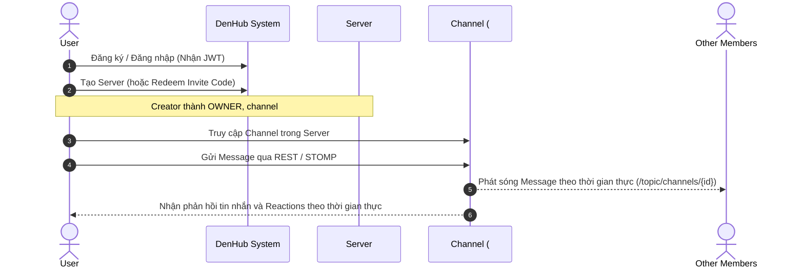

# 01 - PROJECT OVERVIEW: DENHUB

> **Tài liệu tổng quan dự án & Định vị nghiệp vụ**\
> **Source of Truth:** Tài liệu này quản lý nghiệp vụ và phạm vi. API ở [`02-SYSTEM-ARCHITECTURE.md`](./02-SYSTEM-ARCHITECTURE.md), dữ liệu ở [`03-DATABASE-DESIGN.md`](./03-DATABASE-DESIGN.md). Các trạng thái `CONFIRMED` mô tả yêu cầu, không khẳng định code đã hoàn thành.

---

## 1. Thông tin chung về dự án

| Thuộc tính | Giá trị | Trạng thái |
| :--- | :--- | :---: |
| **Tên dự án** | **DenHub (Den App)** | `CONFIRMED` |
| **Loại dự án** | Nền tảng giao tiếp và cộng tác cộng đồng trên web (Web-based Community Communication Platform) | `CONFIRMED` |
| **Khóa môn / Ngữ cảnh**| Môn học SBA301 | `CONFIRMED` |
| **Ý tưởng tổng quát** | Nền tảng giao tiếp cộng đồng lấy cảm hứng từ mô hình tổ chức của Discord (User → Server → Channel → Realtime Messaging), tinh giản để tập trung tối đa vào trải nghiệm chat văn bản thời gian thực chất lượng cao. | `CONFIRMED` |

---

## 2. Tuyên ngôn định vị: DenHub KHÔNG PHẢI BẢN SAO DISCORD

> [!IMPORTANT]
> **Nguyên tắc bất di bất dịch:**  
> Discord chỉ là nguồn cảm hứng tham khảo về mô hình tổ chức không gian (Server / Channel).\
> **DenHub KHÔNG sao chép:**
> - Nghiệp vụ phức tạp của Discord (Bot ecosystem, OAuth applications, Rich Presence)
> - Hệ thống phân quyền nhiều tầng phức tạp (Permission overrides per-channel)
> - Giao tiếp âm thanh / hình ảnh (Voice / Video calls)
> - Toàn bộ hệ sinh thái phụ trợ (Store, Nitro, Server Boosting)
>
> **Không được tự suy luận rằng một chức năng tồn tại trong DenHub chỉ vì Discord có chức năng đó.**

### Danh sách tính năng TUYỆT ĐỐI KHÔNG THIẾT KẾ (Out of Scope - Đã chốt `CONFIRMED`)
- ❌ **Meeting & Lịch họp:** Không thiết kế Meeting, Meeting Schedule, Meeting Participant.
- ❌ **Giao tiếp âm thanh / hình ảnh:** Không có Voice Meeting, Video Meeting, Voice Call, Video Call, Screen Sharing.
- ❌ **Kênh thoại / Kênh sân khấu:** Không có Voice Channel, Stage Channel, Forum Channel.
- ❌ **Tính năng phụ trợ phức tạp:** Không có Bot, Webhook platform, Threads, Categories, Server Boost, Custom Guild Emojis.
- ❌ **Group DM:** Chỉ hỗ trợ Direct Message 1-1 (không hỗ trợ nhóm chat riêng ngoài Server).

---

## 3. Mô hình miền cốt lõi (Core Domain Model - `CONFIRMED`)

Mô hình cấu trúc cốt lõi chuẩn của DenHub:

```
User ──(tham gia)──> Server ──(chứa)──> Channels (Text) ──(chứa)──> Messages (Real-time)
                       │
                       └──(chứa)──> ServerMembers (OWNER / ADMIN / MEMBER)
```

1. **User** (`CONFIRMED`): Tài khoản người dùng định danh toàn hệ thống.
2. **Server** (`CONFIRMED`): Không gian giao tiếp cộng đồng độc lập. Khi tạo mới, hệ thống tự động gán Creator làm `OWNER` và khởi tạo Channel mặc định `#general`.
3. **ServerMember** (`CONFIRMED`): Thực thể liên kết giữa User và Server, mang vai trò (`OWNER`, `ADMIN`, `MEMBER`) và nickname nội bộ.
4. **Channel** (`CONFIRMED`): Kênh chat văn bản bên trong Server. Mỗi Server có ít nhất kênh `#general` (không được xóa).
5. **Message** (`CONFIRMED`): Tin nhắn trao đổi trong Channel, hỗ trợ chỉnh sửa (chỉ tác giả), xóa mềm, trích dẫn (reply) và reaction emoji.
6. **DirectConversation & DirectMessage** (`CONFIRMED`): Kênh chat riêng tư 1-1 giữa 2 người dùng (bảo đảm tính duy nhất của cặp người dùng không phân biệt thứ tự).

---

## 4. Luồng người dùng chuẩn MVP (`CONFIRMED`)



---

## 5. Bảng trạng thái nghiệp vụ (Synchronized Status)

Các quyết định nghiệp vụ hiện được ghi nhận dưới đây. Các điểm chưa thống nhất giữa thiết kế và source phải được ghi riêng trong handoff, không mặc định rằng mọi `TBD` đã được giải quyết:

| Phân hệ | Vấn đề nghiệp vụ | Trạng thái | Quyết định chuẩn hóa |
| :--- | :--- | :---: | :--- |
| **SERVER** | Ai được tạo Server? | `CONFIRMED` | Người dùng đã xác thực, tồn tại và có `activated = true`. Tạo/list/đọc chi tiết từ chối tài khoản không hợp lệ với `401`. |
| **SERVER** | Nickname Owner tự sinh khi tạo Server? | `CONFIRMED` (2026-10-13) | Lấy tên hiển thị đã bỏ khoảng trắng đầu/cuối; null/rỗng/toàn khoảng trắng dùng `Owner`. Tối đa 20 đơn vị UTF-16, không cắt giữa surrogate pair của emoji; chỉ rút ngắn nickname tự sinh, giữ nguyên `User.name`. Không áp dụng thay đổi này vào Join. |
| **SERVER** | Thành viên tham gia Server bằng cách nào? | `CONFIRMED` | Qua Invite code duy nhất do Owner/Admin tạo. |
| **SERVER** | Creator có vai trò gì khi tạo Server? | `CONFIRMED` | Creator nhận vai trò `OWNER`. Server tự tạo kênh `#general`. |
| **SERVER** | Owner có thể rời Server không? | `CONFIRMED` | Không. Owner chỉ có thể chuyển quyền hoặc xóa Server (BR-SRV-01). |
| **SERVER** | Ai có quyền xóa Server? | `CONFIRMED` | Duy nhất Server `OWNER`. |
| **CHANNEL** | Loại kênh trong MVP? | `CONFIRMED` | Kênh văn bản (Text Channel). Tên kênh dạng slug chữ thường `[a-z0-9-]`. |
| **CHANNEL** | Kênh `#general` có thể bị xóa không? | `CONFIRMED` | Không. Luôn duy trì ít nhất kênh `#general` trong Server (BR-SRV-02). |
| **MEMBER** | Ma trận quyền hạn Server? | `CONFIRMED` | Phân cấp `OWNER > ADMIN > MEMBER` với Hierarchy Kick Shield (BR-MEM-02). |
| **MEMBER** | Admin có được kick Admin / Owner không? | `CONFIRMED` | Không. Admin chỉ được kick `MEMBER`. Chỉ Owner mới được kick Admin. |
| **MESSAGE** | Message lưu trữ ở đâu? | `CONFIRMED` | Lưu trữ trong Microsoft SQL Server (bảng `messages`), xóa mềm (`deleted_at`). |
| **MESSAGE** | Ai được gửi tin nhắn Channel? | `CONFIRMED` | Người dùng đã xác thực và là thành viên của Server chứa Channel. Danh tính người gửi lấy từ cơ chế Authentication hiện có. |
| **MESSAGE** | Nội dung gửi trong Task 1.07? | `CONFIRMED` | Tin nhắn văn bản; không null, rỗng hoặc toàn khoảng trắng, không vượt giới hạn database đã xác nhận. |
| **MESSAGE** | Ai được quyền sửa tin nhắn? | `CONFIRMED` | Duy nhất tác giả tin nhắn (BR-MSG-02). |
| **MESSAGE** | Cơ chế phân trang lịch sử tin nhắn? | `CONFIRMED` | Phân trang bằng con trỏ (Cursor Pagination) qua `before` và `limit`. |
| **DIRECT MESSAGE** | Phạm vi Direct Message? | `CONFIRMED` | Duy nhất 1-1. Cặp người dùng duy nhất không phân biệt thứ tự `(user1 < user2)`. |
| **AUTH** | Xác thực & Phiên làm việc? | `CONFIRMED` | Spring Security + JWT Access Token (24h) + HttpOnly Refresh Token Cookie. |

---

## 6. Phạm vi công việc của Duy — Module 4: Group Chat Management

| Task | Kết quả cần đạt | Giới hạn |
| :--- | :--- | :--- |
| **1.07 — API gửi tin nhắn + test** | Gửi tin nhắn vào Channel qua REST, kiểm tra nội dung và membership, lưu SQL Server, trả DTO trong wrapper thành công theo mục 4.1 của tài liệu kiến trúc; test validation, authentication, authorization và response. | Không làm lịch sử, sửa/xóa hoặc WebSocket. |
| **1.12 — UI nhập và gửi tin nhắn** | Ô nhập và nút Send, thao tác bàn phím, loading/error, giữ nội dung khi lỗi, cập nhật UI sau thành công. | Chỉ bắt đầu sau xác nhận tiếp tục của Duy; tích hợp API khi sẵn sàng và được Duy đồng ý. |

- Backend làm trước; Frontend làm ở đợt riêng. Mỗi đợt giải thích code, chuẩn bị interview và kiểm tra mức độ hiểu trước khi chuyển tiếp.
- Không sửa module của Ben, Hoàng, Vinh hoặc Kỳ Anh; không làm chat riêng của Ben.
- Không tự thay database, commit, push, merge hoặc chuyển branch.
- Các tính năng khác trong mô hình MVP vẫn là phạm vi dự án tổng thể, không tự động thuộc hai task này.
- Contract chi tiết ở mục 7–8 của tài liệu kiến trúc; quy trình hướng dẫn ở mục 20 của tài liệu phát triển.

## 7. Tài liệu tham chiếu chi tiết
- **Quy trình, tiến độ và bàn giao:** [`00-DEVELOPMENT-PROCESS.md`](./00-DEVELOPMENT-PROCESS.md)
- **Kiến trúc hệ thống & API:** [`02-SYSTEM-ARCHITECTURE.md`](./02-SYSTEM-ARCHITECTURE.md)
- **Thiết kế cơ sở dữ liệu:** [`03-DATABASE-DESIGN.md`](./03-DATABASE-DESIGN.md)

`DEN_APP_SYSTEM_SPECIFICATION.md` và `DECISION_LOG.md` được nhắc trong lịch sử công việc nhưng không có trong thư mục docs tại lần kiểm tra 2026-10-10; không dùng nội dung chưa truy cập được để suy đoán contract.
