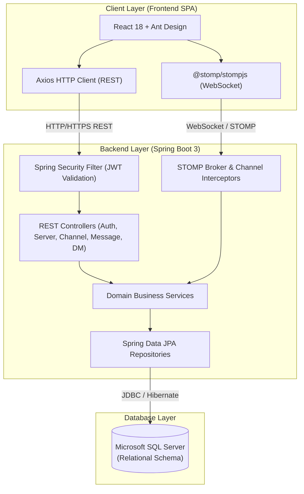

# 02 - SYSTEM ARCHITECTURE: DENHUB

> **Tài liệu kiến trúc hệ thống & Quy chuẩn giao tiếp**\
> **Source of Truth:** Tài liệu này quản lý architecture, API, DTO, Security và WebSocket; nghiệp vụ ở [`01-PROJECT-OVERVIEW.md`](./01-PROJECT-OVERVIEW.md), dữ liệu ở [`03-DATABASE-DESIGN.md`](./03-DATABASE-DESIGN.md).\
> **Cập nhật 2026-10-10:** Contract REST và phạm vi Task 1.07 / 1.12 theo yêu cầu của Duy. Contract được chốt không đồng nghĩa source code đã triển khai xong; xem mục 7.

---

## 1. Technology Stack (`CONFIRMED`)

| Tầng / Phân hệ | Công nghệ lựa chọn | Mục đích sử dụng | Trạng thái |
| :--- | :--- | :--- | :---: |
| **Frontend Framework** | **React + Vite** | SPA hiệu năng cao | `CONFIRMED` |
| **Routing** | **React Router DOM** | Điều hướng và bảo vệ Protected Routes | `CONFIRMED` |
| **UI Component Library** | **Ant Design (antd)** | Layout, Navigation, Chat Form, Modals | `CONFIRMED` |
| **HTTP Client** | **Axios** | REST client có Bearer token interceptor | `CONFIRMED` |
| **Real-time Client** | **STOMP / WebSocket (@stomp/stompjs)** | Kết nối WebSocket và xử lý STOMP protocol | `CONFIRMED` |
| **Backend Framework** | **Java 21 + Spring Boot 3** | REST API, Business Services, WebSocket Broker | `CONFIRMED` |
| **Security & Auth** | **Spring Security 6 + Nimbus JWT** | Xác thực JWT Access Token, bảo vệ API & STOMP | `CONFIRMED` |
| **ORM / Data Access** | **Spring Data JPA (Hibernate)** | Tương tác dữ liệu quan hệ Microsoft SQL Server | `CONFIRMED` |
| **Database** | **Microsoft SQL Server** | Cơ sở dữ liệu duy nhất toàn bộ hệ thống | `CONFIRMED` |
| **File Storage** | **Cloudinary / Local File Storage** | Lưu trữ ảnh và file đính kèm (DB lưu metadata) | `CONFIRMED` |
| **Backend Testing** | **JUnit 5 + Mockito + MockMvc** | Kiểm thử đơn vị và API integration | `CONFIRMED` |

---

## 2. Kiến trúc tổng thể hệ thống



---

## 3. Phân tách ranh giới REST vs WebSocket

| Giao thức | Phạm vi áp dụng | Lý do thiết kế |
| :--- | :--- | :--- |
| **REST API (HTTP/HTTPS)** | - Authentication (Đăng ký, Đăng nhập, Profile)<br>- Quản lý Server, Channel, Member, Invite<br>- Gửi tin nhắn Channel (Task 1.07)<br>- Tải lịch sử tin nhắn (Cursor Pagination)<br>- Quản lý Direct Conversation | Xử lý các tác vụ truy vấn, giao dịch ACID, phân trang và tải dữ liệu khởi tạo đáng tin cậy. |
| **WebSocket (STOMP)** | - Phát sóng tin nhắn kênh mới (`MESSAGE_CREATED`)<br>- Cập nhật / Xóa tin nhắn (`UPDATED`, `DELETED`)<br>- Sự kiện thả cảm xúc (`REACTION_ADDED`, `REMOVED`)<br>- Phân phối tin nhắn riêng tư 1-1 qua private queue | Truyền tải sự kiện thời gian thực độ trễ thấp, không gây tải polling liên tục lên server. |

---

## 4. Chuẩn REST Response & Error Contract

### 4.1 Phản hồi thành công: Response DTO trực tiếp (`CONFIRMED`)

- Trả Response DTO trực tiếp, không trả JPA Entity và không bọc `ApiResponse<T>` hay wrapper tương đương.
- Không thêm các field `success`, `message`, `data`, `timestamp` chỉ để bao ngoài DTO.
- Backend dùng `ResponseEntity` để chọn HTTP status phù hợp; không trả HTTP 200 cho mọi kết quả.
- Không để lộ password, password hash, token hoặc thông tin nhạy cảm.
- Đây là **convention riêng của DenHub**. HTTP/REST không bắt buộc mọi dự án phải dùng hoặc phải bỏ wrapper.

| HTTP status | Ý nghĩa áp dụng |
| :--- | :--- |
| `200 OK` | Lấy hoặc cập nhật dữ liệu thành công, có body. |
| `201 Created` | Tạo tài nguyên mới thành công. |
| `204 No Content` | Thành công, không có response body. |
| `400 Bad Request` | Request không hợp lệ. |
| `401 Unauthorized` | Chưa xác thực hoặc token không hợp lệ. |
| `403 Forbidden` | Đã xác thực nhưng không có quyền thực hiện. |
| `404 Not Found` | Không tìm thấy tài nguyên. |
| `500 Internal Server Error` | Lỗi hệ thống ngoài dự kiến. |

### 4.2 Cấu trúc phân trang Cursor chuẩn (Lịch sử tin nhắn)

Đây là DTO phân trang, không bọc thêm một lớp response. Lịch sử tin nhắn nằm ngoài Task 1.07 / 1.12.

```json
{
  "items": [],
  "nextCursor": null,
  "hasMore": false,
  "limit": 30
}
```

### 4.3 Phản hồi lỗi: Problem Details theo RFC 9457 (`CONFIRMED`)

Sử dụng `application/problem+json` cho response Problem Details. Ví dụ:

```json
{
  "type": "about:blank",
  "title": "Forbidden",
  "status": 403,
  "detail": "Bạn không có quyền gửi tin nhắn trong Channel này"
}
```

- Ưu tiên `ProblemDetail` có sẵn của Spring khi phiên bản hỗ trợ.
- Kiểm tra và tái sử dụng cơ chế xử lý lỗi hiện tại; không tạo GlobalExceptionHandler trùng hoặc xung đột.
- Phân biệt validation (`400`), authentication (`401`), authorization (`403`) và tài nguyên không tồn tại (`404`).
- Không trả stack trace, nguyên nhân nội bộ nhạy cảm hoặc credentials cho client.
- Lỗi do Security filter phát sinh cũng phải được kiểm tra, không chỉ lỗi trong Controller.

### 4.4 Axios nhận Response DTO

```javascript
const response = await axiosClient.post(`/channels/${channelId}/messages`, { content });
const message = response.data;
```

`axiosClient` hiện có base URL kết thúc bằng `/api`; không thêm `/api` lần nữa vào đường dẫn trên. `response.data` là HTTP response body do Axios đọc. Không dùng `response.data.data`, trừ khi DTO của endpoint thực sự có field `data` được thiết kế cho nghiệp vụ.

---

## 5. Danh mục REST API Chuẩn hóa (`CONFIRMED`)

### 5.1 Authentication & User
- `POST /api/auth/register`: Đăng ký tài khoản mới
- `POST /api/auth/login`: Đăng nhập, nhận Access Token JWT và cookie Refresh Token
- `POST /api/auth/logout`: Đăng xuất, hủy refresh token
- `GET /api/users/me`: Thông tin người dùng hiện tại
- `PATCH /api/users/me`: Cập nhật display name, avatar
- `GET /api/users/search?q={query}`: Tìm kiếm người dùng theo tên

### 5.2 Server & Member Management
- `GET /api/servers`: Lấy danh sách server người dùng tham gia
- `POST /api/servers`: Tạo server mới (transactional với `#general` channel và Owner)
- `GET /api/servers/{serverId}`: Chi tiết server kèm danh sách kênh
- `PATCH /api/servers/{serverId}`: Cập nhật tên/ảnh server (Owner)
- `DELETE /api/servers/{serverId}`: Xóa server (Owner)
- `POST /api/servers/{serverId}/leave`: Rời server (Member, Admin)
- `POST /api/servers/{serverId}/invites`: Tạo invite code
- `POST /api/invites/{code}/join`: Tham gia server qua code
- `DELETE /api/invites/{code}`: Thu hồi invite code
- `GET /api/servers/{serverId}/members`: Danh sách thành viên
- `DELETE /api/servers/{serverId}/members/{userId}`: Kick thành viên
- `PATCH /api/servers/{serverId}/members/{userId}/role`: Phân quyền `ADMIN`/`MEMBER` (Owner)

### 5.3 Channels & Messages
- `GET /api/servers/{serverId}/channels`: Danh sách kênh trong server
- `POST /api/servers/{serverId}/channels`: Tạo kênh văn bản mới (Owner/Admin)
- `PATCH /api/channels/{channelId}`: Đổi tên / thứ tự kênh
- `DELETE /api/channels/{channelId}`: Xóa kênh (kênh `#general` không thể xóa)
- `GET /api/channels/{channelId}/messages?before={id}&limit=30`: Lịch sử tin nhắn
- `POST /api/channels/{channelId}/messages`: Gửi tin nhắn mới
- `PATCH /api/messages/{messageId}`: Chỉnh sửa tin nhắn (tác giả)
- `DELETE /api/messages/{messageId}`: Xóa mềm tin nhắn
- `POST /api/messages/{messageId}/reactions`: Thả emoji reaction
- `DELETE /api/messages/{messageId}/reactions/{emoji}`: Gỡ emoji reaction

### 5.4 Direct Messages (1-1)
- `GET /api/direct-conversations`: Danh sách các cuộc trò chuyện 1-1
- `POST /api/direct-conversations`: Khởi tạo hoặc tìm cuộc trò chuyện 1-1
- `GET /api/direct-conversations/{id}/messages?before={id}&limit=30`: Lịch sử DM
- `POST /api/direct-conversations/{id}/messages`: Gửi tin nhắn DM

---

## 6. Quy chuẩn WebSocket / STOMP Real-time Contract (`CONFIRMED`)

WebSocket là task sau, không triển khai trong Task 1.07 hoặc 1.12. Các destination dưới đây giữ vai trò contract cho giai đoạn real-time.

- **Handshake Endpoint:** `/ws`
- **Authentication:** Header `Authorization: Bearer <jwt-token>` trong frame STOMP `CONNECT`.
- **Authorization on Subscribe:** `ChannelInterceptor` kiểm tra người dùng phải là `ServerMember` của server sở hữu channel mới cho phép subscribe topic.

### Ma trận Destination & Topic:
```
Client ──[SEND]──> /app/channels/{channelId}/send ──> Server Process & Commit
                                                            │
Server ──[BROADCAST]──> /topic/channels/{channelId} ───────(Tất cả Members)
Server ──[PRIVATE]────> /user/queue/direct-messages ───────(Người nhận DM)
```

| Destination | Action | Mục đích |
| :--- | :---: | :--- |
| `/app/channels/{channelId}/send` | `SEND` | Gửi tin nhắn văn bản vào channel |
| `/topic/channels/{channelId}` | `SUBSCRIBE` | Nhận sự kiện tin nhắn (`CREATED`, `UPDATED`, `DELETED`) |
| `/topic/channels/{channelId}/reactions` | `SUBSCRIBE` | Nhận sự kiện reaction (`ADDED`, `REMOVED`) |
| `/topic/servers/{serverId}` | `SUBSCRIBE` | Nhận sự kiện quản trị server (kênh mới, thành viên bị kick) |
| `/user/queue/direct-messages` | `SUBSCRIBE` | Nhận tin nhắn riêng tư 1-1 gửi trực tiếp cho người dùng |
| `/user/queue/errors` | `SUBSCRIBE` | Nhận thông báo lỗi thời gian thực cá nhân |

---

## 7. Task 1.07 — API gửi tin nhắn Channel

### 7.1 Request và response (`CONFIRMED`)

`POST /api/channels/{channelId}/messages`, xác thực bằng JWT theo cơ chế hiện có.

Request DTO `SendMessageRequest` chỉ nhận nội dung:

```json
{
  "content": "Hello mọi người!"
}
```

Response DTO `MessageResponse`, HTTP `201 Created`:

```json
{
  "id": 101,
  "channelId": 5,
  "senderId": 2,
  "content": "Hello mọi người!",
  "createdAt": "2026-10-10T07:30:00Z"
}
```

Các ID và thời gian chỉ minh họa cấu trúc, không được hardcode. `senderId` ánh xạ từ `Message.authorId`; không nhận danh tính người gửi từ request. `MessageResponse.createdAt` dùng `Instant`, lấy từ `Message.createdDate`; contract JSON dùng ISO-8601 UTC với hậu tố `Z`. Controller/serialization HTTP sẽ được kiểm thử ở lượt 1B, chưa hoàn tất trong lượt 1A.

### 7.2 Xử lý và bảo mật

1. Xác định người dùng từ Spring Security/JWT đã được xác thực; không hardcode tài khoản và không bỏ qua authentication.
2. Validate `content`: không null, không rỗng, không toàn khoảng trắng kể cả Unicode, tối đa 4000 đơn vị UTF-16 theo quyết định mục 4.2 của tài liệu database. Giữ nguyên nội dung hợp lệ; không trim hoặc cắt bớt tin nhắn. Database vẫn dùng `NVARCHAR(MAX)`.
3. Kiểm tra Channel tồn tại; trả `404` nếu không tìm thấy.
4. Kiểm tra người gửi thuộc Server chứa Channel; trả `403` nếu không có membership.
5. Lưu Message bằng Repository vào SQL Server, map sang Response DTO và trả `201`.

Luồng: `HTTP Request → Security/JWT → Controller/Validation → Service → Repository → SQL Server → Response DTO → HTTP Response`.

Chỉ gửi tin nhắn văn bản trong task này; không làm lịch sử, sửa/xóa, reply, reaction, attachment, Direct Message hoặc WebSocket.

### 7.3 Hiện trạng cần xử lý khi lập kế hoạch (2026-10-10)

| Thành phần đã kiểm tra | Hiện trạng / tác động |
| :--- | :--- |
| `Message`, `MessageRepository` | Đã tồn tại; tái sử dụng, không tạo trùng. |
| `Channel`, `ServerMember`, `ServerMemberRepository` | Tái sử dụng Entity; lượt 1A thêm `ChannelRepository` và `existsByServerIdAndUserId` vào Repository membership. |
| Message Service / Controller / DTO | Lượt 1A đã thêm `MessageService`, `SendMessageRequest`, `MessageResponse` và unit tests. Chưa có Message Controller, endpoint HTTP chưa được triển khai. |
| `ResFormatResponse` | `ResponseBodyAdvice` hiện tự bọc response thành công. Chỉ trả DTO từ Controller chưa đủ để đáp ứng contract mới. Kế hoạch cần xử lý ảnh hưởng này mà không tự sửa module của thành viên khác. |
| `ExceptionTranslator` | Đã có handler dùng Zalando Problem; cần kiểm tra khả năng đáp ứng RFC 9457, không tạo handler toàn cục thứ hai hoặc tự thay toàn bộ hệ thống lỗi. |
| JWT hiện có | JWT đã xác thực có subject là email; Service dùng `SecurityUtils` đọc subject rồi `UserRepository.findOneByEmail` lấy User ID. Từ chối anonymous, principal chưa xác thực, User không tồn tại hoặc chưa activated; không dùng ID do client gửi. |
| `client/src/api/messageApi.js` | Hiện dùng `/rooms/{roomId}/messages`; chưa tích hợp contract `/channels/{channelId}/messages`. |

Đây là các chênh lệch đã ghi nhận để lập kế hoạch, không phải bằng chứng API đã triển khai hoặc đã qua integration test. Nếu thay đổi shared infrastructure đụng module của Ben, Hoàng, Vinh hoặc Kỳ Anh, phải trình phạm vi cụ thể và xin quyết định trước khi sửa.

### 7.4 Phần đã triển khai trong lượt 1A

`MessageService.sendMessage(channelId, request)` thực hiện trong `@Transactional`: xác định email từ Security Context, validate request, tra User, tra Channel, kiểm tra membership của chính Server chứa Channel, rồi `MessageRepository.save` và map DTO từ Entity trả về.

Service dùng `ResponseStatusException` của Spring với `400`, `401`, `403`, `404`; chưa tạo handler mới. Exception mang status/reason không có nghĩa HTTP Problem Details đã được kiểm chứng. Lượt 1B còn phải xử lý wrapper, lỗi qua Security filter, Controller validation và response thật bằng MockMvc, gồm `201`, JSON trực tiếp và `application/problem+json`.

Unit tests hiện dùng Validator thật, Repository mock và Security Context chứa JWT fixture đã xác thực. Chúng không xác minh chữ ký JWT, HTTP response, transaction rollback thực tế hoặc việc ghi vào SQL Server. Spring context test dùng H2 riêng theo cấu hình test hiện có.

## 8. Task 1.12 — UI nhập và gửi tin nhắn

- Dùng React + Ant Design; tái sử dụng hoặc tạo `MessageInput` sau khi kiểm tra component hiện tại.
- Nhận `channelId` qua props hoặc cơ chế state/router có sẵn; không hardcode `channelId` hoặc `senderId`.
- Controlled input có nút Send; Enter gửi, Shift + Enter xuống dòng.
- Không gửi nội dung rỗng hoặc toàn khoảng trắng; disable Send khi không hợp lệ hoặc đang gửi, hiển thị loading và ngăn gửi trùng trong lúc chờ request.
- Hiển thị lỗi khi thất bại, giữ nội dung để người dùng thử lại; chỉ xóa input sau khi gửi thành công.
- Khi API sẵn sàng **và Duy đồng ý tích hợp**, dùng Axios service theo cấu trúc hiện có, lấy JWT theo Authentication hiện tại, POST đúng endpoint và đọc DTO trực tiếp theo mục 4.4.
- Trả kết quả thành công cho component cha để cập nhật UI. Không thêm WebSocket hoặc chat riêng trong task này.
- Nếu chưa thể tích hợp, test UI độc lập bằng mock; không đưa mock sender hoặc bypass xác thực vào production.

Luồng tích hợp: `Người dùng nhập → React State cập nhật → Send → Axios → Backend lưu → Response DTO → Component cha cập nhật UI`.
