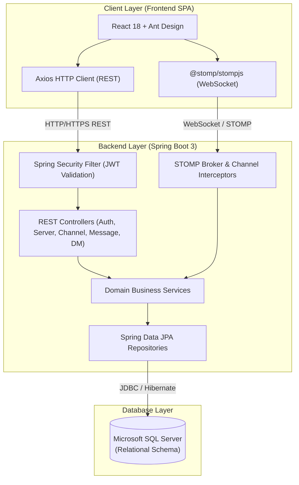

# 02 - SYSTEM ARCHITECTURE: DENHUB

> **Tài liệu kiến trúc hệ thống & Quy chuẩn giao tiếp**\
> **Source of Truth:** Tài liệu này quản lý architecture, API, DTO, Security và WebSocket; nghiệp vụ ở [`01-PROJECT-OVERVIEW.md`](./01-PROJECT-OVERVIEW.md), dữ liệu ở [`03-DATABASE-DESIGN.md`](./03-DATABASE-DESIGN.md).\
> **Cập nhật 2026-10-11:** Duy chốt giữ wrapper response thành công hiện có; xem mục 4.1, 4.4 và 7.1. Contract được chốt không đồng nghĩa source code đã triển khai xong; xem mục 7.
> **Cập nhật 2026-10-13:** Đọc chi tiết phần vỏ Server qua `GET /api/v1/servers/{serverId}` và tích hợp FE đã hoàn tất theo phạm vi Duy duyệt; xem mục 9. Channel thuộc developer khác.

---

## 1. Technology Stack (`CONFIRMED`)

| Tầng / Phân hệ | Công nghệ lựa chọn | Mục đích sử dụng | Trạng thái |
| :--- | :--- | :--- | :---: |
| **Frontend Framework** | **React + Vite** | SPA hiệu năng cao | `CONFIRMED` |
| **Routing** | **React Router DOM** | Điều hướng và bảo vệ Protected Routes | `CONFIRMED` |
| **UI Component Library** | **Ant Design (antd)** | Layout, Navigation, Chat Form, Modals | `CONFIRMED` |
| **HTTP Client** | **Axios** | REST client có Bearer token interceptor | `CONFIRMED` |
| **Real-time Client** | **STOMP / WebSocket (@stomp/stompjs)** | Kết nối WebSocket và xử lý STOMP protocol | `CONFIRMED` |
| **Backend Framework** | **Java 21 + Spring Boot 3** | REST API, Business Services, WebSocket Broker | `CONFIRMED` |
| **Security & Auth** | **Spring Security 6 + Nimbus JWT** | Xác thực JWT Access Token, bảo vệ API & STOMP | `CONFIRMED` |
| **ORM / Data Access** | **Spring Data JPA (Hibernate)** | Tương tác dữ liệu quan hệ Microsoft SQL Server | `CONFIRMED` |
| **Database** | **Microsoft SQL Server** | Cơ sở dữ liệu duy nhất toàn bộ hệ thống | `CONFIRMED` |
| **File Storage** | **Cloudinary / Local File Storage** | Lưu trữ ảnh và file đính kèm (DB lưu metadata) | `CONFIRMED` |
| **Backend Testing** | **JUnit 5 + Mockito + MockMvc** | Kiểm thử đơn vị và API integration | `CONFIRMED` |

---

## 2. Kiến trúc tổng thể hệ thống



---

## 3. Phân tách ranh giới REST vs WebSocket

| Giao thức | Phạm vi áp dụng | Lý do thiết kế |
| :--- | :--- | :--- |
| **REST API (HTTP/HTTPS)** | - Authentication (Đăng ký, Đăng nhập, Profile)<br>- Quản lý Server, Channel, Member, Invite<br>- Gửi tin nhắn Channel (Task 1.07)<br>- Tải lịch sử tin nhắn (Cursor Pagination)<br>- Quản lý Direct Conversation | Xử lý các tác vụ truy vấn, giao dịch ACID, phân trang và tải dữ liệu khởi tạo đáng tin cậy. |
| **WebSocket (STOMP)** | - Phát sóng tin nhắn kênh mới (`MESSAGE_CREATED`)<br>- Cập nhật / Xóa tin nhắn (`UPDATED`, `DELETED`)<br>- Sự kiện thả cảm xúc (`REACTION_ADDED`, `REMOVED`)<br>- Phân phối tin nhắn riêng tư 1-1 qua private queue | Truyền tải sự kiện thời gian thực độ trễ thấp, không gây tải polling liên tục lên server. |

---

## 4. Chuẩn REST Response & Error Contract

### 4.1 Phản hồi thành công: Wrapper `RestResponse<T>` (`CONFIRMED`)

- Quyết định của Duy ngày 2026-10-11 thay thế convention DTO trực tiếp trước đó: giữ wrapper thành công hiện có của `ResFormatResponse` và `RestResponse<T>`.
- Với response JSON DTO thành công có body, đặt DTO trong `data`; không trả JPA Entity. Wrapper có `statusCode` (khớp HTTP status), `message` (thông báo kết quả), `error` (`null` khi thành công) và `data` (dữ liệu nghiệp vụ).
- Controller trả `ResponseEntity<DTO>`; `ResFormatResponse` bọc đúng một lần trước khi ghi HTTP body. Không tự tạo thêm `RestResponse` trong Controller vì advice hiện có sẽ bọc lồng nhau.
- `message` lấy từ `@ApiMessage`, mặc định là `Call API success!` khi method không có annotation. Với gửi tin nhắn, giá trị là `Gửi tin nhắn thành công`; nội dung chat nằm ở `data.content`.
- Backend dùng `ResponseEntity` để chọn HTTP status phù hợp; không trả HTTP 200 cho mọi kết quả.
- HTTP `204` không có body. Giữ các ngoại lệ hiện có của advice cho Swagger/API docs, String, file/resource và byte array; không áp dụng wrapper JSON cho các response đó.
- Response lỗi có status từ `400` trở lên không đi qua wrapper thành công; yêu cầu Problem Details ở mục 4.3 giữ nguyên. Việc chốt wrapper không xác nhận các error handlers đã đáp ứng contract.
- Không để lộ password, password hash, token hoặc thông tin nhạy cảm.
- Đây là **convention riêng của DenHub**. HTTP/REST không bắt buộc mọi dự án phải dùng hoặc phải bỏ wrapper.

| HTTP status | Ý nghĩa áp dụng |
| :--- | :--- |
| `200 OK` | Lấy hoặc cập nhật dữ liệu thành công, có body. |
| `201 Created` | Tạo tài nguyên mới thành công. |
| `204 No Content` | Thành công, không có response body. |
| `400 Bad Request` | Request không hợp lệ. |
| `401 Unauthorized` | Chưa xác thực hoặc token không hợp lệ. |
| `403 Forbidden` | Đã xác thực nhưng không có quyền thực hiện. |
| `404 Not Found` | Không tìm thấy tài nguyên. |
| `500 Internal Server Error` | Lỗi hệ thống ngoài dự kiến. |

### 4.2 Cấu trúc phân trang Cursor chuẩn (Lịch sử tin nhắn)

Đây là cấu trúc DTO phân trang đặt trong `data` của wrapper tại mục 4.1; ví dụ dưới đây chỉ mô tả phần `data`. Lịch sử tin nhắn nằm ngoài Task 1.07 / 1.12.

```json
{
  "items": [],
  "nextCursor": null,
  "hasMore": false,
  "limit": 30
}
```

### 4.3 Phản hồi lỗi: Problem Details theo RFC 9457 (`CONFIRMED`)

Sử dụng `application/problem+json` cho response Problem Details. Ví dụ:

```json
{
  "type": "about:blank",
  "title": "Forbidden",
  "status": 403,
  "detail": "Bạn không có quyền gửi tin nhắn trong Channel này"
}
```

- Ưu tiên `ProblemDetail` có sẵn của Spring khi phiên bản hỗ trợ.
- Kiểm tra và tái sử dụng cơ chế xử lý lỗi hiện tại; không tạo GlobalExceptionHandler trùng hoặc xung đột.
- Phân biệt validation (`400`), authentication (`401`), authorization (`403`) và tài nguyên không tồn tại (`404`).
- Không trả stack trace, nguyên nhân nội bộ nhạy cảm hoặc credentials cho client.
- Lỗi do Security filter phát sinh cũng phải được kiểm tra, không chỉ lỗi trong Controller.

### 4.4 Axios đọc Response DTO trong wrapper

```javascript
const response = await axiosClient.post(`/channels/${channelId}/messages`, { content });
const message = response.data.data;
```

`axiosClient` hiện có base URL kết thúc bằng `/api`; không thêm `/api` lần nữa vào đường dẫn trên. Interceptor hiện trả nguyên Axios response: `response.data` là toàn bộ wrapper, `response.data.message` là thông báo thành công và `response.data.data` là DTO nghiệp vụ. Ví dụ `message.content` là nội dung chat. Quy tắc đọc này áp dụng cho response thành công được bọc; response lỗi đọc theo mục 4.3.

### 4.5 Danh mục từ nhánh incoming — cần đối chiếu với contract

Bảng dưới giữ các endpoint và trạng thái được ghi ở nhánh incoming trước khi gộp ngày 2026-10-11. Đây là bản ghi để đối chiếu, không thay thế contract mục 5 và không xác nhận mọi endpoint đã tồn tại. Các mục TBD vẫn chưa được quyết định.

| Phân hệ | Phương thức | Endpoint | Chức năng dự kiến | Trạng thái |
| :--- | :---: | :--- | :--- | :---: |
| **Search** | `GET` | `/api/users/search?username={q}` | Tìm kiếm danh sách người dùng theo username | `CONFIRMED` |
| **Friendship** | `POST` | `/api/friendships/requests` | Gửi yêu cầu kết bạn (hoặc chấp nhận nếu đã có pended req) | `CONFIRMED` |
| **Auth** | `POST` | `/api/login` | Đăng nhập bằng Email và nhận JWT Access Token | `CONFIRMED` |
| **Auth** | `GET` | `/api/account` (hoặc `/api/users/me`) | Lấy thông tin tài khoản người dùng hiện tại qua token | `CONFIRMED` |
| **Auth** | `POST` | `/api/v1/auth/register` | Đăng ký tài khoản mới | `TBD` |
| **Auth** | `POST` | `/api/v1/auth/login` | Đăng nhập và lấy Access Token JWT | `TBD` |
| **Auth** | `GET` | `/api/v1/auth/me` | Lấy thông tương user hiện tại qua token | `TBD` |
| **Auth** | `POST` | `/api/v1/auth/logout` | Đăng xuất người dùng | `TBD` |
| **Server** | `GET` | `/api/v1/servers` | Lấy danh sách Server mà User là Member / Owner | `CONFIRMED` |
| **Server** | `POST` | `/api/v1/servers` | Tạo một Server mới | `CONFIRMED` |
| **Server** | `GET` | `/api/v1/servers/{serverId}` | Đọc thông tin phần vỏ Server; Owner/Member, contract mục 9 | `IMPLEMENTED` |
| **Server** | `PUT` | `/api/v1/servers/{serverId}` | Cập nhật thông tin Server | `TBD` |
| **Server** | `DELETE`| `/api/v1/servers/{serverId}` | Xóa Server | `TBD` |
| **Server** | `POST` | `/api/v1/servers/{serverId}/join` | Tham gia vào một Server | `CONFIRMED` |
| **Server** | `POST` | `/api/v1/servers/{serverId}/leave` | Rời khỏi Server | `TBD` |
| **Member** | `GET` | `/api/v1/servers/{serverId}/members` | Lấy danh sách Member của Server | `IMPLEMENTED` |
| **Member** | `DELETE`| `/api/v1/servers/{serverId}/members/{userId}` | Kick một Member ra khỏi Server | `TBD` |
| **Member** | `PUT` | `/api/v1/servers/{serverId}/members/{userId}/role` | Phân quyền Member trong Server | `TBD` |
| **Message** | `GET` | `/api/v1/servers/{serverId}/messages` | Lấy lịch sử Message (có pagination) | `TBD` |
| **Message** | `DELETE`| `/api/v1/servers/{serverId}/messages/{messageId}` | Xóa Message (nếu có tính năng) | `TBD` |
| **Channel** | `POST` | `/api/v1/channels` | Tạo mới một Channel trong Server (yêu cầu là Owner/Member) | `CONFIRMED` |
| **Channel** | `GET` | `/api/v1/servers/{serverId}/channels` | Lấy danh sách Channel của Server | `CONFIRMED` |
| **Media / File** | `POST` | `/api/v1/files/upload` | Tải lên file ảnh (multipart/form-data) nhận URL tĩnh | `CONFIRMED` |
| **Media / File** | `GET` | `/api/v1/files/{folder}/{filename}` | Phục vụ file ảnh công khai cho trình duyệt | `CONFIRMED` |
| **Conversation** | `GET` | `/api/v1/conversations` | Lấy danh sách hội thoại của user hiện tại (thông tin người kia & tin nhắn mới nhất) | `CONFIRMED` |
| **Conversation** | `GET` | `/api/v1/conversations/{conversationId}/messages` | Lấy lịch sử tin nhắn của một hội thoại (phân trang page & size) | `CONFIRMED` |

Hiện trạng đã đọc từ source sau gộp:

- AccountResource có POST /api/login; Auth frontend gọi /login và /register với base URL /api. Chưa tìm thấy backend GET /api/users/me; Auth khôi phục cache/JWT theo incoming, không gọi endpoint này. JWT decode trên frontend không xác minh chữ ký; backend vẫn chịu trách nhiệm xác thực/phân quyền.
- ServerResource dùng /api/v1/servers (GET, POST, POST /{serverId}/join); ChannelResource dùng POST /api/v1/channels; FileResource dùng /api/v1/files. Đây là chênh lệch với mục 5, không tự đổi route trong lần giải conflict.
- ChannelService cho Owner hoặc Member tạo kênh, khác Owner/Admin tại mục 5.3. Giữ hành vi incoming theo phạm vi được duyệt; cần quyết định riêng trước khi đổi permission.
- ResFormatResponse bọc success response đúng quyết định SUCCESS-WRAPPER tại mục 4.1/7.1. MessageResource.java còn untracked có sẵn; MessageResourceIT.java đã tracked. Security/JWT/Problem Details và H2 đã PASS theo mục 7.5; còn ghi SQL Server thật chưa xác minh.
- Backend 58 tests và frontend build PASS thuộc lượt gộp code trước khi áp dụng stash. Lượt gộp tài liệu sau stash không chạy lại test/build; các kết quả lịch sử không xác nhận lại toàn bộ working tree hiện tại hoặc các chênh lệch còn lại.


---

## 5. Danh mục REST API Chuẩn hóa (`CONFIRMED`)

### 5.1 Authentication & User
- `POST /api/auth/register`: Đăng ký tài khoản mới
- `POST /api/auth/login`: Đăng nhập, nhận Access Token JWT và cookie Refresh Token
- `POST /api/auth/logout`: Đăng xuất, hủy refresh token
- `GET /api/users/me`: Thông tin người dùng hiện tại
- `PATCH /api/users/me`: Cập nhật display name, avatar
- `GET /api/users/search?q={query}`: Tìm kiếm người dùng theo tên

### 5.2 Server & Member Management
- `GET /api/servers`: Lấy danh sách server người dùng tham gia
- `POST /api/servers`: Tạo server mới (transactional với `#general` channel và Owner)
- `GET /api/v1/servers/{serverId}`: Chi tiết phần vỏ Server theo phạm vi duyệt 2026-10-13 (mục 9); trả DTO Server hiện có. Thiết kế trước đó `/api/servers/{serverId}` kèm danh sách kênh được thu hẹp cho lượt này; dữ liệu Channel thuộc module Channel, không thêm alias `/api/servers/{serverId}`.
- `PATCH /api/servers/{serverId}`: Cập nhật tên/ảnh server (Owner)
- `DELETE /api/servers/{serverId}`: Xóa server (Owner)
- `POST /api/servers/{serverId}/leave`: Rời server (Member, Admin)
- `POST /api/servers/{serverId}/invites`: Tạo invite code
- `POST /api/invites/{code}/join`: Tham gia server qua code
- `DELETE /api/invites/{code}`: Thu hồi invite code
- `GET /api/v1/servers/{serverId}/members`: Danh sách thành viên (Owner/Member, `ServerMemberResponseDTO`)
- `DELETE /api/servers/{serverId}/members/{userId}`: Kick thành viên
- `PATCH /api/servers/{serverId}/members/{userId}/role`: Phân quyền `ADMIN`/`MEMBER` (Owner)

### 5.3 Channels & Messages
- `GET /api/servers/{serverId}/channels`: Danh sách kênh trong server
- `POST /api/servers/{serverId}/channels`: Tạo kênh văn bản mới (Owner/Admin)
- `PATCH /api/channels/{channelId}`: Đổi tên / thứ tự kênh
- `DELETE /api/channels/{channelId}`: Xóa kênh (kênh `#general` không thể xóa)
- `GET /api/channels/{channelId}/messages?before={id}&limit=30`: Lịch sử tin nhắn
- `POST /api/channels/{channelId}/messages`: Gửi tin nhắn mới
- `PATCH /api/messages/{messageId}`: Chỉnh sửa tin nhắn (tác giả)
- `DELETE /api/messages/{messageId}`: Xóa mềm tin nhắn
- `POST /api/messages/{messageId}/reactions`: Thả emoji reaction
- `DELETE /api/messages/{messageId}/reactions/{emoji}`: Gỡ emoji reaction

### 5.4 Direct Messages (1-1)
- `GET /api/direct-conversations`: Danh sách các cuộc trò chuyện 1-1
- `POST /api/direct-conversations`: Khởi tạo hoặc tìm cuộc trò chuyện 1-1
- `GET /api/direct-conversations/{id}/messages?before={id}&limit=30`: Lịch sử DM
- `POST /api/direct-conversations/{id}/messages`: Gửi tin nhắn DM

---

## 6. Quy chuẩn WebSocket / STOMP Real-time Contract (`CONFIRMED`)

WebSocket là task sau, không triển khai trong Task 1.07 hoặc 1.12. Các destination dưới đây giữ vai trò contract cho giai đoạn real-time.

- **Handshake Endpoint:** `/ws`
- **Authentication:** Header `Authorization: Bearer <jwt-token>` trong frame STOMP `CONNECT`.
- **Authorization on Subscribe:** `ChannelInterceptor` kiểm tra người dùng phải là `ServerMember` của server sở hữu channel mới cho phép subscribe topic.

### Ma trận Destination & Topic:
```
Client ──[SEND]──> /app/channels/{channelId}/send ──> Server Process & Commit
                                                            │
Server ──[BROADCAST]──> /topic/channels/{channelId} ───────(Tất cả Members)
Server ──[PRIVATE]────> /user/queue/direct-messages ───────(Người nhận DM)
```

| Destination | Action | Mục đích | Trạng thái |
| :--- | :---: | :--- | :---: |
| `/app/channels/{channelId}/send` | `SEND` | Gửi tin nhắn văn bản vào channel | `CONFIRMED` |
| `/topic/channels/{channelId}` | `SUBSCRIBE` | Nhận sự kiện tin nhắn (`CREATED`, `UPDATED`, `DELETED`) | `CONFIRMED` |
| `/topic/channels/{channelId}/reactions` | `SUBSCRIBE` | Nhận sự kiện reaction (`ADDED`, `REMOVED`) | `TBD` |
| `/topic/servers/{serverId}` | `SUBSCRIBE` | Nhận sự kiện quản trị server (kênh mới, thành viên bị kick) | `TBD` |
| `/app/conversations/send` | `SEND` | Client gửi tin nhắn 1-1 (Text / Image) | `CONFIRMED` |
| `/topic/conversations/{conversationId}` | `SUBSCRIBE` | Client lắng nghe tin nhắn 1-1 real-time | `CONFIRMED` |
| `/user/queue/friend-requests/received` | `SUBSCRIBE` | Nhận thông báo có lời mời kết bạn mới | `CONFIRMED` |
| `/user/queue/friend-requests/accepted` | `SUBSCRIBE` | Nhận thông báo lời mời kết bạn được chấp nhận | `CONFIRMED` |
| `/user/queue/direct-messages` | `SUBSCRIBE` | Nhận tin nhắn riêng tư 1-1 gửi trực tiếp cho người dùng | `TBD` |
| `/user/queue/errors` | `SUBSCRIBE` | Nhận thông báo lỗi thời gian thực cá nhân | `TBD` |

### 6.3 Định dạng WebSocket Payload gửi lên 1-1 (`SendMessageReq`) (`CONFIRMED`)
```json
{
  "conversationId": 100,
  "targetUserId": 2,
  "type": "IMAGE",
  "content": "Gửi mọi người bộ ảnh tài liệu",
  "mediaUrl": "denhub-172838392-uuid1.webp,denhub-172838392-uuid2.webp",
  "mediaUrls": [
    "denhub-172838392-uuid1.webp",
    "denhub-172838392-uuid2.webp"
  ]
}
```

### 6.4 Định dạng WebSocket Message phát sóng xuống Client (`SendMessageRes`) (`CONFIRMED`)
```json
{
  "messageId": 501,
  "conversationId": 100,
  "sender": {
    "userId": 1,
    "name": "Hoàng Nam",
    "avatar": "https://..."
  },
  "type": "IMAGE",
  "content": "Gửi mọi người bộ ảnh tài liệu",
  "mediaUrl": "denhub-172838392-uuid1.webp,denhub-172838392-uuid2.webp",
  "mediaUrls": [
    "denhub-172838392-uuid1.webp",
    "denhub-172838392-uuid2.webp"
  ],
  "status": "SENT",
  "createdAt": "2026-10-08T17:10:00Z"
}
```

---

## 7. Task 1.07 — API gửi tin nhắn Channel

### 7.1 Request và response (`CONFIRMED`)

`POST /api/channels/{channelId}/messages`, xác thực bằng JWT theo cơ chế hiện có.

Request DTO `SendMessageRequest` chỉ nhận nội dung:

```json
{
  "content": "Hello mọi người!"
}
```

HTTP `201 Created`, Response DTO `MessageResponse` nằm trong `data`:

```json
{
  "statusCode": 201,
  "error": null,
  "message": "Gửi tin nhắn thành công",
  "data": {
    "id": 101,
    "channelId": 5,
    "senderId": 2,
    "content": "Hello mọi người!",
    "createdAt": "2026-10-10T07:30:00Z"
}
```

Các ID và thời gian chỉ minh họa cấu trúc, không được hardcode. `senderId` ánh xạ từ `Message.authorId`; không nhận danh tính người gửi từ request. `MessageResponse.createdAt` dùng `Instant`, lấy từ `Message.createdDate`; contract JSON dùng ISO-8601 UTC với hậu tố `Z`. MockMvc test hiện kiểm tra HTTP 201, wrapper, thông báo, `error: null` và DTO kể cả timestamp; giới hạn kiểm thử được ghi tại mục 7.4.

### 7.2 Xử lý và bảo mật

1. Xác định người dùng từ Spring Security/JWT đã được xác thực; không hardcode tài khoản và không bỏ qua authentication.
2. Validate `content`: không null, không rỗng, không toàn khoảng trắng kể cả Unicode, tối đa 4000 đơn vị UTF-16 theo quyết định mục 4.2 của tài liệu database. Giữ nguyên nội dung hợp lệ; không trim hoặc cắt bớt tin nhắn. Database vẫn dùng `NVARCHAR(MAX)`.
3. Kiểm tra Channel tồn tại; trả `404` nếu không tìm thấy.
4. Kiểm tra người gửi thuộc Server chứa Channel; trả `403` nếu không có membership.
5. Lưu Message bằng Repository vào SQL Server, map sang Response DTO; advice bọc DTO trong `data` và trả HTTP `201`.

Luồng: `HTTP Request → Security/JWT → Controller/Validation → Service → Repository → SQL Server → Response DTO → ResFormatResponse → HTTP Response`.

Chỉ gửi tin nhắn văn bản trong task này; không làm lịch sử, sửa/xóa, reply, reaction, attachment, Direct Message hoặc WebSocket.

### 7.3 Hiện trạng cần xử lý khi lập kế hoạch (2026-10-11)

Đây là hiện trạng lịch sử trước lượt hoàn tất ngày 2026-10-11. Kết quả hiện tại ở mục 7.5; không dùng các ô còn thiếu test dưới đây để suy ra trạng thái mới nhất.

| Thành phần đã kiểm tra | Hiện trạng / tác động |
| :--- | :--- |
| `Message`, `MessageRepository` | Đã tồn tại; tái sử dụng, không tạo trùng. |
| `Channel`, `ServerMember`, `ServerMemberRepository` | Tái sử dụng Entity; lượt 1A thêm `ChannelRepository` và `existsByServerIdAndUserId` vào Repository membership. |
| Message Service / Controller / DTO | Lượt 1A đã thêm `MessageService`, `SendMessageRequest`, `MessageResponse` và unit tests. Lượt 1B có `MessageResource` (`POST /api/channels/{channelId}/messages`, HTTP 201 Created) và `MessageResourceIT` dùng MockMvc standalone với Service mock; chưa kiểm thử Security filter hoặc ghi SQL Server. |
| `ResFormatResponse` | `ResponseBodyAdvice` tự bọc response thành công theo convention được Duy chốt ngày 2026-10-11 tại mục 4.1. |
| `ExceptionTranslator` / Security errors | Đã có handler dùng Zalando Problem. `SmartAuthenticationEntryPoint` hiện trả JSON tùy chỉnh (`application/json`), chưa đúng contract Problem Details; các test lỗi hiện chỉ kiểm tra status. Cần kế hoạch riêng trước khi sửa shared handlers. |
| JWT hiện có | JWT đã xác thực có subject là email; Service dùng `SecurityUtils` đọc subject rồi `UserRepository.findOneByEmail` lấy User ID. Từ chối anonymous, principal chưa xác thực, User không tồn tại hoặc chưa activated; không dùng ID do client gửi. |
| `client/src/api/messageApi.js` | Đã cập nhật contract `/channels/{channelId}/messages`. |

Các thành phần và giới hạn trên dùng để lập kế hoạch phần còn lại; không coi MockMvc standalone là kiểm thử toàn chuỗi qua JWT và SQL Server. Nếu thay đổi shared infrastructure đụng module của Ben, Hoàng, Vinh hoặc Kỳ Anh, phải trình phạm vi cụ thể và xin quyết định trước khi sửa.

### 7.4 Phần đã triển khai trong lượt 1A

`MessageService.sendMessage(channelId, request)` thực hiện trong `@Transactional`: xác định email từ Security Context, validate request, tra User, tra Channel, kiểm tra membership của chính Server chứa Channel, rồi `MessageRepository.save` và map DTO từ Entity trả về.

Service dùng `ResponseStatusException` của Spring với `400`, `401`, `403`, `404`; tái sử dụng handler hiện có. Lượt 1B ban đầu chỉ có MockMvc standalone kiểm tra status; lượt hoàn tất đã bổ sung Security/JWT/H2 và xác nhận body/content type ở mục 7.5.

Unit tests hiện dùng Validator thật, Repository mock và Security Context chứa JWT fixture đã xác thực. Chúng không xác minh chữ ký JWT, HTTP response, transaction rollback thực tế hoặc việc ghi vào SQL Server. Spring context test dùng H2 riêng theo cấu hình test hiện có.

### 7.5 Hoàn tất POST trong phạm vi code/H2 (2026-10-11)

Duy đã duyệt hoàn tất POST và bổ sung sửa audit riêng của Message. Contract request/201/wrapper ở mục 7.1 giữ nguyên; không đổi SecurityConfiguration, quyền, FE hoặc WebSocket.

- `MessageSecurityIT` chạy HTTP/MockMvc → Security/JWT ký thật → Controller → Service → Repository/JPA/H2. Không mock Service/Repository, không bypass filter; fixtures nằm trong transaction test và rollback. Test flush/clear trước khi đọc lại Message để kiểm tra lưu trữ thay vì chỉ kiểm tra DTO.
- 26 tests xác nhận 201/wrapper, content nguyên văn, JWT sender, channel, audit email 53/254, đúng biên 4000 UTF-16; token thiếu/malformed/sai chữ ký/hết hạn, session sai, inactive, không thuộc nhóm dù có ROLE_ADMIN, membership nhóm khác, channel không tồn tại, nội dung không hợp lệ. Lỗi 400/401/403/404 đều có Problem Details và không lưu thêm tin.
- JWT sai qua `SmartAuthenticationEntryPoint` nay trả `application/problem+json`, `type/title/status/detail` và giữ `error/message/code/publicApi/redirect/redirectUrl`; thêm `WWW-Authenticate: Bearer`. ObjectMapper escape dấu nháy/xuống dòng đúng JSON, kể cả thông báo activation. Có regression trên API khác với token sai.
- Thiếu JWT vẫn theo handler Problem có sẵn, không giả định có legacy fields hoặc WWW-Authenticate giống entry point. Không thay chính sách session hoặc các trường hợp public endpoint.
- `ExceptionTranslator.process` vẫn giữ nhánh 4xx; nhánh 5xx bỏ detail/cause/extensions nội bộ, dùng detail “Đã xảy ra lỗi hệ thống”, giữ status/type/title/path và message `error.http.<status>`. Regression 500 dùng lỗi DB giả lập xác nhận không trả SQL/cause; regression 404 xác nhận detail nghiệp vụ vẫn giữ nguyên.
- `Message` override created_by/last_modified_by dài 254, khắc phục lỗi 500 đã phát hiện với email 53 ký tự mà không cắt email. Script review riêng và giới hạn áp dụng xem docs/03 mục 4.3; không đổi mapping audit của User/Server/Channel.

Verification từ `server/`: `.\gradlew.bat test --tests com.denhub.web.rest.MessageSecurityIT --no-daemon` **PASS 26/26**, tiếp đó `.\gradlew.bat compileJava test check --no-daemon` **PASS 85/85**, không fail/error/skip. Lần fail ban đầu được giữ trong log MESSAGE-SECURITY-INITIAL của docs/00.

**Giới hạn:** H2 không chứng minh SQL Server thật; script SQL chỉ review tĩnh, chưa chạy hoặc áp dụng. Không có migration tự động được thêm. Code còn uncommitted; UI đang dở được giữ nguyên. GET Channel/lịch sử (ID giảm dần, before exclusive, limit 1–100 mặc định 30) lưu tạm hoãn ở docs/00 mục 12; chưa triển khai trong lượt này.

### 7.6 Giải thích lượt hoàn tất cho Duy

Các đường dẫn dưới đây tính từ repository root; dòng được đối chiếu sau khi sửa. Tests/docs/script phục vụ kiểm chứng và vận hành, không phải controller runtime.

| File / dòng | Vai trò và thay đổi |
| :--- | :--- |
| `server/src/main/java/com/denhub/domain/Message.java:12` | Tầng persistence: `@Entity`/`@Table` map messages, `@Id` sinh khóa. `@AttributeOverrides` đổi riêng mapping hai field kế thừa; nếu bỏ sẽ trở lại 50 và email dài lại gây lỗi. Getter/setter và ID scalar giữ nguyên, không thêm `@ManyToOne`. |
| `server/src/main/java/com/denhub/config/SmartAuthenticationEntryPoint.java:28` | Constructor nhận ObjectMapper qua Dependency Injection. `commence` ở dòng 33 nhận request/response/AuthenticationException, chọn thông báo/code/redirect hiện có, tạo ProblemDetail, serialize vào response 401. Không xác thực token tại đây: filter đã từ chối trước đó. Bỏ serializer sẽ mất escape JSON an toàn; bỏ legacy fields có thể làm client cũ hỏng. |
| `server/src/main/java/com/denhub/web/rest/errors/ExceptionTranslator.java:32` | `@ControllerAdvice` xử lý lỗi chung qua Zalando. `process` nhận Problem response và request, giữ metadata, phân nhánh 5xx tại dòng 53 để tránh lộ SQL; 4xx giữ validation/business detail. Các method handleLogin/Email/Session giữ nguyên, gọi create để trả Problem. Bỏ nhánh 5xx có thể trả chi tiết DB cho client. |
| `server/src/test/java/com/denhub/web/rest/MessageSecurityIT.java:54` | `@SpringBootTest`/`@AutoConfigureMockMvc` dùng app context và filters thật, `@Transactional` rollback fixture. `setUp` tạo User/Server/Channel/membership; các ca dòng 101–265 gọi HTTP và kiểm tra DB/error. Helper `request` tạo POST JSON; `token` ký JWT test; `problem` kiểm tra cấu trúc; `assertNoMessageSaved` flush/clear/count. Không dùng Mockito trong suite này. Nếu bỏ sẽ mất coverage xuyên tầng và regression email dài. |
| `server/src/test/java/com/denhub/web/rest/MessageResourceIT.java:55` | Standalone MockMvc với Mockito Service; setUp đăng ký Jackson Problem modules giống serializer cần thiết. Test 404 dòng 147 giữ chi tiết nghiệp vụ; test DB 500 dòng 164 giả lập exception chứa SQL/cause và kiểm tra chúng không lộ. Đây không phải chứng minh DB rollback thật. |
| `server/scripts/sql/2026-10-11-message-audit-email.sql:1` | Script thủ công, mặc định preview. Nhận database đã chọn và cờ ApplyChanges; kiểm metadata, dựng ALTER chỉ khi cần mở rộng, xuất SQL, áp dụng trong transaction nếu người vận hành bật cờ. Không chứa credential, không được app tự chạy. Bỏ script sẽ thiếu bước đồng bộ DB cũ dù JPA/H2 đã pass. |
| `docs/00-DEVELOPMENT-PROCESS.md` mục 10–12 | Tiến độ, log kết quả thật, duyệt phạm vi và handoff/API hoãn. Không thay runtime; bỏ cập nhật dễ khiến người sau làm lại hoặc coi SQL Server đã kiểm chứng. |
| `docs/02-SYSTEM-ARCHITECTURE.md` mục 7.5–7.6 | Ghi hành vi lỗi, coverage/giới hạn và giải thích source; không thay request hoặc quyền. |
| `docs/03-DATABASE-DESIGN.md` mục 4.3 | Ghi quyết định audit, phạm vi riêng messages và script chưa áp dụng; tránh nhầm annotation với schema production đã cập nhật. |

**Luồng ví dụ “Hello mọi người!” vào Channel 5:** client gửi JSON `{content: ...}` qua REST POST kèm Bearer JWT. Security kiểm chữ ký/hạn/session rồi lưu danh tính vào SecurityContext. `MessageResource` dùng `@RestController`, `@RequestMapping`, `@PostMapping`, `@PathVariable` đọc 5, `@RequestBody` đọc DTO và `@Valid` chặn nội dung sai. `MessageService` (`@Service`, constructor injection, `@Transactional`) lấy email từ JWT, tra User/Channel/membership rồi gọi Spring Data JPA Repository. Repository interface kế thừa JpaRepository được Spring tạo bean; không cần tự viết SQL hoặc thêm `@Repository` nếu source không có. Hibernate map `Message` sang bảng, auditor lấy email để ghi cùng dữ liệu. Trong test là H2; môi trường thực cấu hình SQL Server nhưng chưa kiểm thử ở lượt này. Service map Entity sang MessageResponse, Controller trả `ResponseEntity` 201 và ResFormatResponse bọc trong data. ID 5 chỉ là ví dụ, không hardcode trong production.

Request DTO chỉ có content để client không chọn người gửi; Response DTO chỉ lộ các field được chốt thay vì trả cả Entity/audit. JSON là định dạng trao đổi, REST là cách thiết kế giao tiếp qua tài nguyên/HTTP. 201 là tạo thành công, 400 input sai, 401 chưa xác thực hợp lệ, 403 thiếu quyền membership, 404 không có channel. Problem Details mô tả lỗi; wrapper success là convention riêng của DenHub, không phải điều REST cấm. Với Axios, `response.data` là wrapper, `response.data.data` là DTO. Transaction Service phục vụ tính nhất quán DB; transaction test rollback fixture không chứng minh đã commit trên SQL Server.

**5 câu interview và đáp án:**

1. Vì sao thêm test Security khi đã có Service test? Unit test có thể tự gắn Authentication; chỉ test qua filter với token ký thật mới kiểm chữ ký/hạn/session và entry point.
2. Vì sao override audit ở Message? Field kế thừa dài 50 không đủ email 254; override sửa đúng phạm vi Message, không đổi schema mọi Entity.
3. JWT hợp lệ có đủ quyền gửi không? Không; Service còn kiểm User active, Channel tồn tại và membership đúng Server. ROLE_ADMIN trong token không bỏ qua membership hiện tại.
4. Vì sao dùng ObjectMapper thay String.format cho lỗi? Serializer escape ký tự theo JSON và trả Problem Details nhất quán, vẫn giữ extensions cho client cũ.
5. 85 tests pass có chứng minh SQL Server không? Không; suite DB dùng H2 và rollback. Còn phải review/apply script, chạy kiểm thử SQL Server riêng.

**3 câu kiểm tra cho Duy trước task tiếp theo:**

1. Client gửi thêm senderId khác thì ai quyết định tác giả thật, tại tầng nào?
2. Vì sao 2000 emoji `😀` được chấp nhận còn thêm một chữ `a` bị 400?
3. Vì sao JPA/H2 pass nhưng database SQL Server cũ vẫn cần được kiểm tra hai cột audit?

Dừng tại phạm vi POST; chờ Duy trả lời và yêu cầu tiếp tục trước API GET hoặc frontend.

## 8. Task 1.12 — UI nhập và gửi tin nhắn

- Dùng React + Ant Design; tái sử dụng hoặc tạo `MessageInput` sau khi kiểm tra component hiện tại.
- Nhận `channelId` qua props hoặc cơ chế state/router có sẵn; không hardcode `channelId` hoặc `senderId`.
- Controlled input có nút Send; Enter gửi, Shift + Enter xuống dòng.
- Không gửi nội dung rỗng hoặc toàn khoảng trắng; disable Send khi không hợp lệ hoặc đang gửi, hiển thị loading và ngăn gửi trùng trong lúc chờ request.
- Hiển thị lỗi khi thất bại, giữ nội dung để người dùng thử lại; chỉ xóa input sau khi gửi thành công.
- Khi API sẵn sàng **và Duy đồng ý tích hợp**, dùng Axios service theo cấu trúc hiện có, lấy JWT theo Authentication hiện tại, POST đúng endpoint và đọc DTO từ `response.data.data` theo mục 4.4.
- Trả kết quả thành công cho component cha để cập nhật UI. Không thêm WebSocket hoặc chat riêng trong task này.
- Nếu chưa thể tích hợp, test UI độc lập bằng mock; không đưa mock sender hoặc bypass xác thực vào production.

Luồng tích hợp: `Người dùng nhập → React State cập nhật → Send → Axios → Backend lưu → Wrapper chứa Response DTO → Axios đọc response.data.data → Component cha cập nhật UI`.

### 8.1 UI Group đã triển khai trước tích hợp (2026-10-11)

Duy duyệt riêng phạm vi làm UI trước khi API Group chat hoàn tất. Đây là ngoại lệ thứ tự thực hiện cho đợt UI, không xác nhận Backend đã DONE hoặc cho phép tự thay contract.

- Route Frontend `/servers/:serverId` nằm trong `ProtectedRoute`, dùng `GroupChatPage`; dock chọn nhóm bằng `Link`. Đây là route trình duyệt, không phải endpoint Backend.
- Trong lượt UI ban đầu, tái sử dụng `GET /api/v1/servers` qua `serverApi.getAll()` và state của `MainLayout` để chọn nhóm. Từ 2026-10-13, `GroupChatPage` đọc riêng `serverApi.getById(serverId)` theo mục 9; dock vẫn dùng danh sách. Loading và lỗi trang chi tiết độc lập với danh sách ở dock.
- Bố cục tham khảo Discord, dùng màu DenHub: dock nhóm → cột kênh → vùng trò chuyện/ô nhập → thành viên. Từ 1200 px có panel thành viên bật/tắt; dưới 1200 px dùng Drawer thành viên, dưới 992 px dùng Drawer kênh. Không có voice, category hoặc trạng thái online giả.
- Chưa có API đọc danh sách kênh, thành viên hoặc lịch sử trong source. Tạo server hiện chưa tạo general. UI hiển thị dữ liệu chưa sẵn sàng và khóa composer; không tạo kênh/thành viên/tin nhắn giả, không hardcode channelId, không gọi WebSocket cũ.
- `MessageInput` nhận props `channelId`, `channelName`, `disabled`, `onSend`, `onSent`. `onSend(channelId, { content })` phải trả Promise chứa kết quả gửi thành công; `onSent(message, channelId)` báo về cha sau thành công. Đây là giao diện component nội bộ, không bổ sung DTO/endpoint.
- State giữ nội dung nguyên văn; validation tối đa 4000 đơn vị UTF-16 và không chỉ chứa Unicode White_Space (bao gồm U+0085). Enter gửi, Shift+Enter xuống dòng; Enter trong composition không gửi. Trong lúc chờ: ref chặn request lặp ngay lập tức, input readOnly, nút loading/disabled. Thất bại giữ nội dung và hiển thị lỗi an toàn; chỉ thành công mới xóa input.
- Component con được key theo channelId để reset draft khi đổi kênh. Callback kết quả giữ channelId của request cũ để cha có thể phân luồng; kết quả cũ không xóa draft mới. Bản nháp không được lưu bền hoặc phục hồi khi quay lại kênh trong phạm vi này.
- Production hiện chưa truyền `onSend`; kiểm thử callback hoàn toàn độc lập. Khi duyệt tích hợp sau này, adapter mới gọi `messageApi.sendMessage`, giữ interceptor JWT và lấy DTO từ `response.data.data`. Chưa được tuyên bố POST, JWT, membership, lưu SQL Server hoặc broadcast đã chạy xuyên suốt từ UI.

### 8.2 Hướng dẫn đọc source của đợt UI

Các dòng dưới đây được đối chiếu tại thời điểm triển khai; nếu sửa source về sau cần kiểm tra lại vị trí.

| File / dòng | Nhiệm vụ và luồng xử lý |
| :--- | :--- |
| `client/src/layouts/MainLayout.jsx:23` | `useMatch` lấy ID nhóm đang mở; `useState` giữ danh sách/loading/error. `fetchServers` tại dòng 36 dùng Axios service có sẵn, đọc wrapper và cập nhật state; ref số thứ tự bỏ response cũ khi retry/unmount. `Outlet` dòng 383 truyền state cho trang con. Nếu thiếu phần này, dock không mở nhóm và page không biết đang tải hay lỗi. |
| `client/src/routes/AppRoutes.jsx:49` | Khai báo route Group bên trong `ProtectedRoute`. React Router đọc serverId; route guard dùng phiên Auth có sẵn. Frontend guard hỗ trợ UX, không thay thế xác thực/phân quyền Backend. |
| `client/src/pages/chat/GroupChatPage.jsx:47` | `useParams` lấy ID, `useOutletContext` nhận danh sách và trạng thái tải, `useAuth` nhận tài khoản hiện tại. `ChannelSidebar` dòng 9 và `MembersPanel` dòng 34 hiển thị các vùng giao diện; breakpoint và state điều khiển panel/Drawer. Không tìm được nhóm chỉ có nghĩa nhóm không nằm trong danh sách hiện tại, không tự suy ra Backend trả 403 hay nhóm đã bị xóa. |
| `client/src/pages/chat/group-chat.css:1` | CSS của workspace và composer: focus bàn phím, flex layout, vùng cuộn nội dung, kích thước panel, breakpoint và reduced motion. Không thay global theme hoặc CSS của ChatPage cũ. |
| `client/src/components/chat/MessageInput.jsx:7` | Component ngoài key component con theo kênh. Component con dòng 11 giữ content/sending/error bằng useState; `value` + `onChange` tạo controlled input. `handleSend` dòng 24 validate, khóa bằng ref, await onSend, xử lý lỗi rồi callback onSent. `handleKeyDown` dòng 45 phân biệt Enter, Shift+Enter và IME. Nếu xóa ref, các event sát nhau có thể vượt qua state chưa render; nếu xóa input trước await sẽ mất bản nháp khi lỗi. |
| `client/src/utils/messageInput.js:3` | Hàm thuần nhận nội dung, trả thông báo lỗi hoặc null; `.length` của JavaScript cùng đơn vị UTF-16 với Backend. Hàm dòng 14 ánh xạ status sang thông báo an toàn, không hiển thị nguyên error body/stack trace. |
| `client/tests/messageInput.test.mjs:1` | Node test runner + assert kiểm tra whitespace, nội dung, giới hạn ASCII/emoji và lỗi. Đây là kiểm thử logic thuần, không render React hoặc gọi HTTP. |
| `client/tests/group-chat.browser.test.mjs:54` | Khởi tạo Vite + Edge headless, chỉ đăng ký trang fixture trong test. `openPage` dòng 84 chặn các request `/api/` và cung cấp danh sách nhóm giả lập; `openComposer` dòng 112 render component thật với Promise thành công/thất bại/pending. 9 cases kiểm tra hành vi DOM, callback, route, auth guard và kích thước màn hình; không chứng minh API thật chạy. |
| `docs/00-DEVELOPMENT-PROCESS.md` | Progress, log và handoff phân biệt UI đã kiểm thử với API/tích hợp chưa hoàn tất; giữ lịch sử công việc trước. |
| `docs/02-SYSTEM-ARCHITECTURE.md` | Mục 8 mô tả phạm vi UI, giao diện props, cách kiểm thử và giới hạn tích hợp; không đổi REST/DB contract. |

Luồng hiện tại trong test: gõ chữ → `onChange` → `content` → `handleSend` → Promise `onSend` giả lập → xóa input sau resolve → `onSent` đưa kết quả về cha → cha cập nhật state và render. JSX của cha trong fixture minh họa cập nhật tin nhắn; trang Group thực tế chưa thực hiện bước gửi.

Luồng tích hợp được dự kiến sau khi duyệt: `onSend` dùng Axios gửi JSON `{ content }` cùng Bearer token qua interceptor → Backend lấy người gửi từ JWT, validate và kiểm tra membership → lưu → trả wrapper → adapter đọc `response.data.data` → `onSent`. Nếu API thành công mà UI chưa đổi, kiểm tra lần lượt DTO được bóc đúng chưa, callback có chạy không, channelId có khớp không và cha có cập nhật state bằng mảng mới không.

Chạy từ thư mục `client/`:

```powershell
node --test tests/messageInput.test.mjs
npm run build
npm run dev
```

Mở đúng URL Vite in ra, đăng nhập rồi bấm biểu tượng nhóm ở dock trái. Nút gửi đang khóa đúng phạm vi chưa tích hợp. `package.json` chưa có script lint/test.

Browser tests cần Playwright và Edge đã có trên máy; không tự cài dependency vào dự án. Có thể cung cấp thư viện từ runtime của workspace:

```powershell
$env:NODE_PATH = 'C:/Users/Admin/.cache/codex-runtimes/codex-primary-runtime/dependencies/node/node_modules'
node --test tests/group-chat.browser.test.mjs
```

Ở máy khác, dùng đường dẫn Playwright đã cài của máy đó hoặc bản local. `PLAYWRIGHT_CHANNEL` mặc định `msedge`; `GROUP_UI_ARTIFACT_DIR` tùy chọn để lưu screenshot ngoài repository. Test tự mở/đóng Vite, không cần chạy dev server trước. API, tài khoản và Promise là fixture trong test; font ngoài được thay bằng fallback. Không dùng fixture để truy cập Backend thật.

### 8.3 Ôn tập Task 1.12

Năm câu hỏi phỏng vấn kèm đáp án:

1. **Controlled input là gì?** React state là nguồn dữ liệu của input: `value={content}`, `onChange` cập nhật content. Nhờ vậy có thể validate, khóa gửi và reset đúng thời điểm.
2. **Vì sao dùng cả state và ref để chống gửi trùng?** State phục vụ render/loading nhưng cập nhật theo lượt render; ref đổi ngay trong event để chặn hai lần gọi trước khi UI kịp cập nhật.
3. **Vì sao chỉ xóa input sau khi await thành công?** Promise có thể reject vì mạng hoặc permission. Giữ draft giúp người dùng sửa/thử lại, không mất nội dung.
4. **Vì sao không gửi senderId từ browser?** Danh tính do Backend lấy từ JWT đã xác thực. Browser có thể bị chỉnh sửa, không phải nguồn tin cậy cho sender hoặc quyền.
5. **Vì sao 2000 emoji có thể chạm giới hạn 4000?** Nhiều emoji chiếm hai đơn vị UTF-16; JS `.length` và Java `String.length()` đếm đơn vị này, không đếm ký tự nhìn thấy.

Ba câu kiểm tra để Duy trả lời trước khi chuyển đợt:

1. `onSend` reject thì input và nút Gửi thay đổi thế nào?
2. Nếu lấy `response.data` thay vì `response.data.data`, component cha sẽ nhận gì?
3. Vì sao route Group hiện chưa được mở gửi thật dù đã có MessageInput?

## 9. Đọc chi tiết phần vỏ Server (`CONFIRMED`, 2026-10-13)

Duy xác nhận chỉ phụ trách phần vỏ Server; Channel thuộc developer khác. Lượt đầu bổ sung API đọc và nối FE trên nhánh `feature/server-detail`; không thay database hoặc API tạo/list. Lượt sửa 6 bug được duyệt sau đó mở rộng riêng phần tạo/list, audit Server và FE như mục 9.4; không thay role, Join, Channel, Message, Invite hoặc WebSocket.

### 9.1 REST contract

- `GET /api/v1/servers/{serverId}`; dùng prefix hiện có của `ServerResource` và hàm `serverApi.getById` đã tồn tại. Không có request body hoặc endpoint alias mới.
- Bearer JWT theo Security hiện có. Service từ chối anonymous, Authentication chưa xác thực, subject trống, User không tồn tại hoặc chưa activated. Owner được xác định qua `Server.ownerId`; thành viên được kiểm bằng `existsByServerIdAndUserId` đúng Server. `ROLE_ADMIN` toàn hệ thống không bỏ qua điều kiện này.
- HTTP `200`, `ServerResponseDTO` nằm trong `data` của wrapper mục 4.1; gồm `id`, `name`, `iconUrl` (có thể null), `ownerId`, `createdDate` (`Instant`, JSON ISO-8601 UTC). `message` dùng mặc định `Call API success!`, `error` là null. Không trả Entity, audit hoặc danh sách Channel.
- `401`: thiếu/JWT sai, hết hạn, session sai hoặc tài khoản không hợp lệ; `403`: User hợp lệ nhưng không phải Owner/Member; `404`: Server không tồn tại; `400`: ID không chuyển được sang Long. Lỗi qua handler hiện có, `application/problem+json`; không bọc success.
- `ServerService.getServerDetail` dùng transaction `readOnly`; không tạo membership hoặc thay dữ liệu khi đọc. Owner có thể đọc ngay cả khi chưa có bản ghi membership, thống nhất cách lấy danh sách Server hiện có.

### 9.2 Frontend

- Khi mở, reload hoặc chuyển `/servers/:serverId`, `GroupChatPage` gọi `GET /api/v1/servers/{serverId}` và đọc `response.data.data`. Dock ở `MainLayout` tiếp tục dùng API danh sách.
- Trang chi tiết độc lập với thành công/thất bại của danh sách; không suy ra thiếu quyền chỉ vì Server chưa nằm trong state dock.
- Loading riêng; API chi tiết trả `403` thì FE chuyển về Home `/` bằng `replace`, không hiển thị thông báo thiếu quyền, không logout. Đường dẫn bị từ chối được thay trong history để Back quay về trang trước đó. `404`/`400` vẫn có thông báo an toàn, lỗi mạng/5xx có thể thử lại. `401` sử dụng interceptor đã có để xóa phiên và về login. Không hiển thị nguyên chi tiết hạ tầng từ response lỗi.
- Effect cleanup bỏ qua response thành công/thất bại của request cũ; render kiểm tra serverId để tránh hiển thị nhóm cũ khi route đã đổi. Retry tải lại chi tiết của Server hiện tại.
- Duy duyệt thay đổi redirect bằng “oke duyệt” ngày 2026-10-13. BE vẫn trả `403` và kiểm Owner/Member; redirect chỉ áp dụng cho lỗi chi tiết của Server hiện tại. Response `403` cũ không được điều hướng về Home. URL tiếp tục dùng ID số; UUID/publicId cần kế hoạch và phê duyệt riêng.
- Giữ khung Channel/Member và composer chưa tích hợp của lượt UI trước; không tự tạo kênh hoặc bật gửi tin.

### 9.3 Verification và giới hạn

- `ServerServiceTest`: thêm 7 cases đọc/authorization/identity; `ServerResourceTest`: thêm case ánh xạ đúng ID. Standalone test chỉ kiểm Controller; wrapper/errors/filters được kiểm trong suite bên dưới.
- Lượt API ban đầu: `ServerSecurityIT` có 13 cases chạy HTTP/MockMvc → JWT ký thật/filters → Service → JPA/H2, không mock Service/Repository. Kiểm Owner không có membership, Member, outsider dù có ROLE_ADMIN, membership Server khác, 404, ID sai, token thiếu/malformed/sai chữ ký/hết hạn, session sai, User inactive/missing; assertions wrapper/Problem Details và đọc không làm thay dữ liệu. Fixture rollback sau test. Lượt sửa bug dùng spy Repository riêng để gây lỗi membership có kiểm soát; xem mục 9.4.
- Từ `server/`: `.\gradlew.bat compileJava test check --no-daemon` **PASS 128/128**, 0 failure/error/skip.
- Từ `client/`: `node --test tests/messageInput.test.mjs` **PASS 5/5**; `npm run build` **PASS**; với Playwright sẵn có qua NODE_PATH, `node --test tests/group-chat.browser.test.mjs` **PASS 14/14** trên Edge headless.
- Browser tests kiểm DTO chi tiết khác snapshot danh sách, ID/reload, list lỗi/rỗng, loading/503/404, 403, lỗi mạng/retry, 401/logout, response cũ thành công/lỗi, route guard, responsive và regression composer. API là fixture trong test; không kiểm thử FE gọi BE/SQL Server thật.
- Lượt redirect `403` (2026-10-13): cập nhật case mở URL trực tiếp về Home, không hiện thiếu quyền và không mất token; thêm case mở từ dock và Back về Server trước đó; bổ sung assertion URL cho response cũ. `node --test tests/group-chat.browser.test.mjs` với NODE_PATH như lượt trước **PASS 15/15**, 0 failure/skip; `npm run build` **PASS**. Chỉ đổi FE/tests/docs, không chạy lại backend hoặc Node logic tests trong lượt này. Số 14/14 bên trên là kết quả trước thay đổi redirect.
- PRE-EXISTING ISSUE: build có warning chunk >500 kB; browser có warning Ant Design Spin tip, Modal destroyOnClose và Empty imageStyle. Không đổi dependency hoặc sửa module khác.
- Kiểm tra lại trước commit (2026-10-13): `.\gradlew.bat compileJava test check --no-daemon --rerun-tasks` **PASS 128/128**; với NODE_PATH Playwright như lượt trước, `node --test tests/group-chat.browser.test.mjs tests/messageInput.test.mjs` **PASS 20/20**; `npm run build` **PASS**. Duy đã trực tiếp yêu cầu chia commit và push nhánh `feature/server-detail`; xem log RELEASE-SERVER-DETAIL trong docs/00.
- Chưa kiểm thử SQL Server thật; không khởi động app với cấu hình production hoặc thay schema.

### 9.4 Sửa 6 bug phần Server CRUD (`CONFIRMED`, 2026-10-13)

- Duy duyệt kế hoạch bằng “triển khai”; không triển khai UUID/publicId, Join hoặc Channel. Endpoint và DTO thành công giữ nguyên.
- `POST /api/v1/servers` và `GET /api/v1/servers` dùng cùng kiểm tra identity với chi tiết: Authentication đã xác thực, không anonymous, subject email hợp lệ, User tồn tại và `activated = true`. Vi phạm trả `401` Problem Details; không lưu Server/membership hoặc đọc danh sách trước khi qua kiểm tra. Email được trim/lowercase khi tìm User, audit vẫn giữ identity đầy đủ.
- Tạo Server vẫn nằm trong một transaction cùng membership Owner. Nickname Owner tự sinh theo quy tắc docs/01 mục 5; không đổi tên User hoặc mở rộng cột nickname. Nếu lưu membership lỗi, Server cũng rollback. Audit Server riêng hỗ trợ email 254 ký tự theo docs/03 mục 4.4.
- `CreateServerModal` khóa nút tạo và kiểm tra upload đang chờ trong handler submit, kể cả Enter/Form submit. Upload thành công cập nhật `iconUrl` trước khi cho tạo.
- Mỗi upload có request ID. Đóng/mở lại modal, chọn preset/template hoặc file mới làm request trước đó hết hiệu lực. Success, error và finally của request cũ không được sửa icon/form/loading hoặc hiển thị toast của phiên mới. Bỏ qua response không xóa file đã upload trên máy chủ; quản lý file dùng chung ngoài phạm vi này.
- Home sử dụng `serversLoading`, `serversError`, `refreshServers` từ MainLayout: loading riêng, lỗi mạng/5xx có nút Thử lại, chỉ hiển thị “Bạn chưa có Server nào” và số lượng khi tải danh sách thành công. Không hiển thị nguyên lỗi hạ tầng.
- Verification: từ `server/`, `.\gradlew.bat compileJava test check --no-daemon` **PASS 150/150**, 0 failure/error/skip sau sửa fixture email biên trong test. Thêm 13 unit cases nickname/identity và 9 integration cases create/list, email 55/254, tên rỗng/dài/emoji, rollback. `ServerMemberRepository` là spy gọi thật mặc định; duy nhất case rollback stub lỗi save, chạy ngoài transaction test để xác nhận transaction Service rollback.
- Từ `client/`, với NODE_PATH Playwright như mục 8.2, `node --test tests/group-chat.browser.test.mjs tests/messageInput.test.mjs` **PASS 25/25** (20 Edge browser + 5 logic); `npm run build` **PASS**. Năm browser tests mới kiểm loading/503/retry/empty, submit pending, icon gửi đúng, response cũ, file mới/preset/template và lỗi upload hiện tại. Không có pageerror trong các cases.
- H2 và browser mock không chứng minh FE → BE → SQL Server thật. Script SQL Server chỉ đã chuẩn bị/review nội dung, chưa thực thi; cần review/apply trên database đích. Các warning Ant Design và chunk >500 kB có sẵn vẫn còn. Không có npm script lint/test để chạy.
