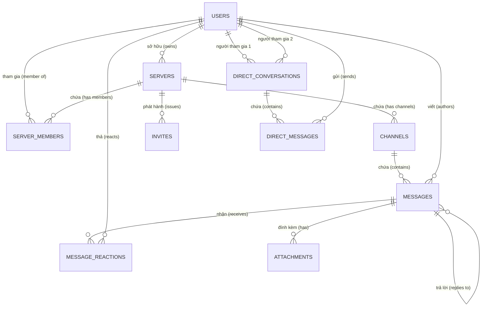

# 03 - DATABASE DESIGN: DENHUB

> **Tài liệu thiết kế cơ sở dữ liệu Microsoft SQL Server (Relational)**\
> **Source of Truth:** Tài liệu này quản lý thiết kế dữ liệu; API ở [`02-SYSTEM-ARCHITECTURE.md`](./02-SYSTEM-ARCHITECTURE.md).\
> **Lưu ý 2026-10-10:** ERD và bảng tại mục 2–3 là thiết kế đã ghi nhận, không phải schema SQL Server vừa được xác minh. Xem mục 4 để đối chiếu với Entity hiện có trước khi làm Task 1.07; đợt cập nhật docs không thay database hoặc tạo migration.

---

## 1. Chiến lược lưu trữ thống nhất

Theo phạm vi DenHub hiện đã chốt, hệ thống sử dụng một cơ sở dữ liệu quan hệ duy nhất: **Microsoft SQL Server**. File `DECISION_LOG.md` từng được tham chiếu hiện không có trong thư mục docs.

- Toàn bộ thực thể từ User, Server, Member, Channel, Message, Reaction, Attachment đến Direct Conversation đều được quản lý với đầy đủ tính toàn vẹn dữ liệu (ACID, Foreign Keys, Unique & Check Constraints).
- **Loại bỏ hoàn toàn MongoDB** khỏi thiết kế kỹ thuật để loại bỏ phân mảnh transaction và đồng bộ tuyệt đối với dependencies hiện có trong backend (`server/build.gradle.kts`).

---

## 2. Mô hình quan hệ thực thể (ERD Toàn diện)

---

## 3. Chi tiết Bảng & Ràng buộc (SQL Server DDL)

### 3.1 Bảng `users` (Tài khoản người dùng)
| Cột | Kiểu dữ liệu | Ràng buộc | Ý nghĩa |
| :--- | :--- | :--- | :--- |
| `id` | `BIGINT` | `PK`, `IDENTITY(1,1)` | Khóa chính |
| `username` | `VARCHAR(50)` | `NOT NULL`, `UQ` | Tên đăng nhập |
| `email` | `VARCHAR(254)` | `NOT NULL`, `UQ` | Địa chỉ email liên hệ |
| `password_hash` | `VARCHAR(255)` | `NOT NULL` | Mật khẩu hash BCrypt |
| `display_name` | `NVARCHAR(100)` | `NOT NULL` | Tên hiển thị người dùng |
| `avatar_url` | `VARCHAR(500)` | `NULL` | Đường dẫn ảnh đại diện |
| `activated` | `BIT` | `NOT NULL`, `DEFAULT 1` | Trạng thái kích hoạt |
| `refresh_token` | `NVARCHAR(MAX)` | `NULL` | Token gia hạn phiên đăng nhập |
| `created_at` | `DATETIME2` | `NOT NULL`, `DEFAULT SYSUTCDATETIME()` | Thời điểm tạo |
| `updated_at` | `DATETIME2` | `NULL` | Thời điểm cập nhật cuối |

### 3.2 Bảng `servers` (Không gian cộng đồng)
| Cột | Kiểu dữ liệu | Ràng buộc | Ý nghĩa |
| :--- | :--- | :--- | :--- |
| `id` | `BIGINT` | `PK`, `IDENTITY(1,1)` | Khóa chính |
| `name` | `NVARCHAR(100)` | `NOT NULL` | Tên Server |
| `icon_url` | `VARCHAR(500)` | `NULL` | Ảnh biểu tượng server |
| `owner_id` | `BIGINT` | `NOT NULL`, `FK -> users(id)` | Khóa ngoại người sở hữu |
| `created_at` | `DATETIME2` | `NOT NULL`, `DEFAULT SYSUTCDATETIME()` | Thời điểm tạo |
| `updated_at` | `DATETIME2` | `NULL` | Thời điểm cập nhật cuối |

*Chỉ mục:* `IX_servers_owner` trên `owner_id`.

### 3.3 Bảng `server_members` (Tư cách thành viên & Quyền hạn)
| Cột | Kiểu dữ liệu | Ràng buộc | Ý nghĩa |
| :--- | :--- | :--- | :--- |
| `id` | `BIGINT` | `PK`, `IDENTITY(1,1)` | Khóa chính |
| `server_id` | `BIGINT` | `NOT NULL`, `FK -> servers(id) ON DELETE CASCADE` | Tham chiếu Server |
| `user_id` | `BIGINT` | `NOT NULL`, `FK -> users(id)` | Tham chiếu User |
| `role` | `VARCHAR(20)` | `NOT NULL`, `CHECK(role IN ('OWNER','ADMIN','MEMBER'))` | Vai trò trong Server |
| `nickname` | `NVARCHAR(50)` | `NULL` | Nickname tùy biến |
| `joined_at` | `DATETIME2` | `NOT NULL`, `DEFAULT SYSUTCDATETIME()` | Thời điểm gia nhập |

*Ràng buộc duy nhất & Chỉ mục:*
- `UQ_server_member`: `UNIQUE (server_id, user_id)`
- `IX_server_members_user`: Phục vụ truy vấn server của user.

### 3.4 Bảng `channels` (Kênh chat văn bản)
| Cột | Kiểu dữ liệu | Ràng buộc | Ý nghĩa |
| :--- | :--- | :--- | :--- |
| `id` | `BIGINT` | `PK`, `IDENTITY(1,1)` | Khóa chính |
| `server_id` | `BIGINT` | `NOT NULL`, `FK -> servers(id) ON DELETE CASCADE` | Tham chiếu Server |
| `name` | `VARCHAR(30)` | `NOT NULL` | Tên kênh (`general`, `chat-chung`...) |
| `position` | `INT` | `NOT NULL`, `DEFAULT 0` | Thứ tự sắp xếp kênh |
| `created_at` | `DATETIME2` | `NOT NULL`, `DEFAULT SYSUTCDATETIME()` | Thời điểm tạo |

*Ràng buộc duy nhất:* `UQ_channels_server_name`: `UNIQUE (server_id, name)`.

### 3.5 Bảng `invites` (Mã mời tham gia)
| Cột | Kiểu dữ liệu | Ràng buộc | Ý nghĩa |
| :--- | :--- | :--- | :--- |
| `id` | `BIGINT` | `PK`, `IDENTITY(1,1)` | Khóa chính |
| `server_id` | `BIGINT` | `NOT NULL`, `FK -> servers(id) ON DELETE CASCADE` | Tham chiếu Server |
| `code` | `VARCHAR(32)` | `NOT NULL`, `UQ` | Mã mời duy nhất |
| `created_by` | `BIGINT` | `NOT NULL`, `FK -> users(id)` | Người tạo mã |
| `expires_at` | `DATETIME2` | `NULL` | Thời điểm hết hạn (null = vĩnh viễn) |
| `status` | `VARCHAR(20)` | `NOT NULL`, `CHECK(status IN ('ACTIVE','REVOKED'))` | Trạng thái mã |
| `created_at` | `DATETIME2` | `NOT NULL`, `DEFAULT SYSUTCDATETIME()` | Thời điểm tạo |

### 3.6 Bảng `messages` (Tin nhắn trong kênh)
| Cột | Kiểu dữ liệu | Ràng buộc | Ý nghĩa |
| :--- | :--- | :--- | :--- |
| `id` | `BIGINT` | `PK`, `IDENTITY(1,1)` | Khóa chính |
| `channel_id` | `BIGINT` | `NOT NULL`, `FK -> channels(id) ON DELETE CASCADE` | Tham chiếu Channel |
| `author_id` | `BIGINT` | `NOT NULL`, `FK -> users(id)` | Tác giả |
| `reply_to_message_id` | `BIGINT` | `NULL`, `FK -> messages(id)` | Trích dẫn tin nhắn cùng kênh |
| `content` | `NVARCHAR(MAX)` | `NULL` | Giữ kiểu lưu trữ đã xác minh; API gửi văn bản giới hạn 4000 đơn vị UTF-16 (mục 4.2). |
| `created_at` | `DATETIME2` | `NOT NULL`, `DEFAULT SYSUTCDATETIME()` | Thời điểm gửi |
| `updated_at` | `DATETIME2` | `NULL` | Thời điểm sửa |
| `deleted_at` | `DATETIME2` | `NULL` | Thời điểm xóa mềm |

*Chỉ mục tối ưu hóa phân trang:* `IX_messages_channel_created`: `(channel_id, created_at DESC)`.

### 3.7 Bảng `message_reactions` (Thả cảm xúc)
| Cột | Kiểu dữ liệu | Ràng buộc | Ý nghĩa |
| :--- | :--- | :--- | :--- |
| `id` | `BIGINT` | `PK`, `IDENTITY(1,1)` | Khóa chính |
| `message_id` | `BIGINT` | `NOT NULL`, `FK -> messages(id) ON DELETE CASCADE` | Tham chiếu tin nhắn |
| `user_id` | `BIGINT` | `NOT NULL`, `FK -> users(id)` | Người thả reaction |
| `emoji` | `NVARCHAR(32)` | `NOT NULL` | Ký tự emoji |
| `created_at` | `DATETIME2` | `NOT NULL`, `DEFAULT SYSUTCDATETIME()` | Thời điểm thả |

*Ràng buộc chống spam:* `UQ_message_user_emoji`: `UNIQUE (message_id, user_id, emoji)`.

### 3.8 Bảng `attachments` (Tệp đính kèm)
| Cột | Kiểu dữ liệu | Ràng buộc | Ý nghĩa |
| :--- | :--- | :--- | :--- |
| `id` | `BIGINT` | `PK`, `IDENTITY(1,1)` | Khóa chính |
| `message_id` | `BIGINT` | `NOT NULL`, `FK -> messages(id) ON DELETE CASCADE` | Tham chiếu tin nhắn |
| `file_name` | `NVARCHAR(255)` | `NOT NULL` | Tên gốc của tệp |
| `file_url` | `VARCHAR(1000)`| `NOT NULL` | Đường dẫn URL truy cập tệp |
| `file_type` | `VARCHAR(100)` | `NOT NULL` | MIME type |
| `file_size` | `BIGINT` | `NOT NULL` | Kích thước tính theo byte |
| `uploaded_at` | `DATETIME2` | `NOT NULL`, `DEFAULT SYSUTCDATETIME()` | Thời điểm tải lên |

### 3.9 Bảng `direct_conversations` (Hội thoại riêng tư 1-1)
| Cột | Kiểu dữ liệu | Ràng buộc | Ý nghĩa |
| :--- | :--- | :--- | :--- |
| `id` | `BIGINT` | `PK`, `IDENTITY(1,1)` | Khóa chính |
| `user1_id` | `BIGINT` | `NOT NULL`, `FK -> users(id)` | Người dùng ID nhỏ hơn |
| `user2_id` | `BIGINT` | `NOT NULL`, `FK -> users(id)` | Người dùng ID lớn hơn |
| `created_at` | `DATETIME2` | `NOT NULL`, `DEFAULT SYSUTCDATETIME()` | Thời điểm tạo |
| `updated_at` | `DATETIME2` | `NOT NULL`, `DEFAULT SYSUTCDATETIME()` | Thời điểm có tin nhắn mới nhất |

*Ràng buộc bất biến duy nhất cặp người dùng:*
- `UQ_direct_pair`: `UNIQUE (user1_id, user2_id)`
- `CK_direct_order`: `CHECK (user1_id < user2_id)`

### 3.10 Bảng `direct_messages` (Tin nhắn trực tiếp 1-1)
| Cột | Kiểu dữ liệu | Ràng buộc | Ý nghĩa |
| :--- | :--- | :--- | :--- |
| `id` | `BIGINT` | `PK`, `IDENTITY(1,1)` | Khóa chính |
| `conversation_id` | `BIGINT` | `NOT NULL`, `FK -> direct_conversations(id) ON DELETE CASCADE`| Tham chiếu cuộc trò chuyện |
| `sender_id` | `BIGINT` | `NOT NULL`, `FK -> users(id)` | Người gửi |
| `content` | `NVARCHAR(4000)`| `NOT NULL` | Nội dung tin nhắn |
| `created_at` | `DATETIME2` | `NOT NULL`, `DEFAULT SYSUTCDATETIME()` | Thời điểm gửi |
| `deleted_at` | `DATETIME2` | `NULL` | Thời điểm xóa mềm |

*Chỉ mục phân trang:* `IX_dm_conversation_created`: `(conversation_id, created_at DESC)`.

---

### 3.4 Bảng `conversations` (Quản lý Cuộc trò chuyện 1-1 / Nhóm)
- **Mục đích:** Lưu trữ các cuộc trò chuyện trực tiếp giữa 2 cá nhân hoặc nhóm nhỏ.
- **Trạng thái:** `CONFIRMED`

| Cột | Kiểu dữ liệu | Ràng buộc (Constraint) | Ý nghĩa / Ghi chú |
| :--- | :--- | :--- | :--- |
| `id` | `BIGINT` | `PK`, `IDENTITY(1,1)` | Khóa chính tự tăng |
| `type` | `VARCHAR(20)` | `NOT NULL`, `DEFAULT 'DIRECT'` | Loại cuộc trò chuyện (`DIRECT`, `GROUP`) |
| `last_message_id` | `BIGINT` | `NULL` | Tham chiếu ID tin nhắn mới nhất |
| `created_date` | `DATETIME2` | `NOT NULL`, `DEFAULT GETUTCDATE()` | Thời điểm tạo |

---

### 3.5 Bảng `conversation_member` (Thành viên cuộc trò chuyện 1-1)
- **Mục đích:** Liên kết User và Conversation 1-1.
- **Trạng thái:** `CONFIRMED`

| Cột | Kiểu dữ liệu | Ràng buộc (Constraint) | Ý nghĩa / Ghi chú |
| :--- | :--- | :--- | :--- |
| `id` | `BIGINT` | `PK`, `IDENTITY(1,1)` | Khóa chính tự tăng |
| `conversation_id` | `BIGINT` | `NOT NULL`, `FK -> conversations(id)` | Tham chiếu cuộc trò chuyện |
| `user_id` | `BIGINT` | `NOT NULL`, `FK -> users(id)` | Tham chiếu người dùng |
| `joined_at` | `DATETIME2` | `NULL`, `DEFAULT GETUTCDATE()` | Thời điểm tham gia |
| `unread_count` | `INT` | `NOT NULL`, `DEFAULT 0` | Số lượng tin nhắn chưa đọc |
| `is_muted` | `BIT` | `DEFAULT 0` | Tắt thông báo |
| `is_deleted` | `BIT` | `DEFAULT 0` | Xóa hội thoại phía user |

*Ràng buộc:*
- `ux_conversation_member`: `UNIQUE (user_id, conversation_id)`

---

### 3.6 Bảng `messages` (Quản lý Tin nhắn trong SQL Server)
- **Mục đích:** Lưu trữ nội dung tin nhắn trao đổi 1-1 (Văn bản & Hình ảnh) và Channel nhóm.
- **Trạng thái:** `CONFIRMED`

| Cột | Kiểu dữ liệu | Ràng buộc (Constraint) | Ý nghĩa / Ghi chú |
| :--- | :--- | :--- | :--- |
| `id` | `BIGINT` | `PK`, `IDENTITY(1,1)` | Khóa chính tự tăng |
| `sender_id` | `BIGINT` | `NULL`, `FK -> users(id)` | Người gửi tin nhắn direct |
| `author_id` | `BIGINT` | `NULL`, `FK -> users(id)` | Tác giả tin nhắn channel |
| `conversation_id` | `BIGINT` | `NULL`, `FK -> conversations(id)` | Cuộc trò chuyện direct tham chiếu |
| `channel_id` | `BIGINT` | `NULL`, `FK -> channels(id)` | Channel nhóm tham chiếu |
| `type` | `VARCHAR(20)` | `NULL`, `DEFAULT 'TEXT'` | Loại tin nhắn (`TEXT`, `IMAGE`, `FILE`, `SYSTEM`) |
| `content` | `NVARCHAR(MAX)` | `NULL` | Nội dung văn bản |
| `media_url` | `NVARCHAR(1000)` | `NULL` | Đường dẫn đến tệp ảnh/tài liệu |
| `file_name` | `NVARCHAR(255)` | `NULL` | Tên tệp tin đính kèm |
| `file_size` | `BIGINT` | `NULL` | Kích thước tệp tin (bytes) |
| `width` | `INT` | `NULL` | Chiều rộng ảnh (pixels) |
| `height` | `INT` | `NULL` | Chiều cao ảnh (pixels) |
| `created_at` | `DATETIME2` | `NULL` | Thời điểm gửi direct |
| `created_date` | `DATETIME2` | `NULL` | Kế thừa từ AbstractAuditingEntity |

---

### 3.7 Bảng `friendships` (Quản lý Quan hệ Bạn bè)
- **Mục đích:** Lưu trữ quan hệ bạn bè và trạng thái lời mời kết bạn.
- **Trạng thái:** `CONFIRMED`

| Cột | Kiểu dữ liệu | Ràng buộc (Constraint) | Ý nghĩa / Ghi chú |
| :--- | :--- | :--- | :--- |
| `id` | `BIGINT` | `PK`, `IDENTITY(1,1)` | Khóa chính tự tăng |
| `user_one_id` | `BIGINT` | `NOT NULL`, `FK -> users(id)` | Min(UserId1, UserId2) |
| `user_two_id` | `BIGINT` | `NOT NULL`, `FK -> users(id)` | Max(UserId1, UserId2) |
| `status` | `VARCHAR(20)` | `NOT NULL`, `DEFAULT 'PENDING'` | Trạng thái (`PENDING`, `ACCEPT`, `BLOCKED`) |
| `action_user_id` | `BIGINT` | `NOT NULL`, `FK -> users(id)` | ID người thực hiện hành động gần nhất |
| `created_date` | `DATETIME2` | `NOT NULL`, `DEFAULT GETUTCDATE()` | Thời điểm tạo |

*Ràng buộc & Index:*
- `ux_friendship`: `UNIQUE (user_one_id, user_two_id)`

---

## 4. Đối chiếu source trước Task 1.07 (2026-10-10)

Đã đọc các Entity liên quan và, theo yêu cầu của Duy, **đã truy vấn metadata SQL Server thực tế của `denhubdb` bằng `sqlcmd` ngày 2026-10-10**. Kết quả chi tiết ở mục 4.1. Không coi annotation JPA là bằng chứng database có đủ cột, FK, index hoặc constraint trong thiết kế.

| Nội dung | Thiết kế trước đợt 1A | Source / trạng thái hiện tại | Hành động |
| :--- | :--- | :--- | :--- |
| Bảng membership | `server_members` | `ServerMember` dùng `@Table(name = "server_member")`, có `serverId`, `userId`, `nickname`; chưa có `role`, `joinedAt`. | Tái sử dụng mapping hiện có khi lập kế hoạch; không tự đổi tên bảng hoặc thêm role. Kiểm tra membership theo User và Server. |
| `messages.content` | `NVARCHAR(4000)`, nullable | Entity và database là `NVARCHAR(MAX)`, nullable. `SendMessageRequest` giới hạn 4000 đơn vị UTF-16. | Duy giao agent chọn phương án phù hợp; đã chốt giới hạn API 4000, giữ nguyên schema và cập nhật mô tả cột tại mục 3.6. |
| Tác giả | `messages.author_id` | `Message.authorId` kiểu `Long` | `MessageResponse.senderId` ánh xạ từ `authorId`; không cần đổi cột database theo tên DTO. |
| Thời điểm gửi | `created_at` | Kế thừa `AbstractAuditingEntity.createdDate` kiểu `Instant`, cột `created_date`. | `MessageService` ánh xạ `createdDate` sang `MessageResponse.createdAt` kiểu `Instant`, contract JSON UTC; không rename cột. |
| Liên kết Channel và tác giả | FK trong thiết kế | `Message.channelId`, `Message.authorId`, `Channel.serverId` là ID scalar, không dùng `@ManyToOne`. | Tái sử dụng cấu trúc hiện có; giải thích đúng code thực tế, không thêm relationship chỉ để minh họa annotation. |
| Các field mở rộng Message | reply, updated/deleted timestamps | `Message` chưa có reply/deleted field; có audit kế thừa. | Không triển khai reply hoặc sửa/xóa trong Task 1.07. |
| Tên Channel | `VARCHAR(30)` | `Channel.name` dùng `NVARCHAR(20)` và validation 2–20. | Ghi nhận chênh lệch; không sửa module Channel trong đợt này. |
| User người gửi | Bảng `users` | `User` đã map bảng `users`. JWT converter hiện xử lý subject như email. | Đọc đầy đủ Authentication trước khi lấy User ID; không hardcode hoặc nhận sender ID từ request. |

API gửi văn bản yêu cầu `content` không null, không rỗng, không toàn khoảng trắng ngay cả khi cột database cho phép null. Đây là validation của request, không phải yêu cầu tự thay nullability của database.

Nếu cần thay schema, bổ sung migration hoặc sửa Entity thuộc module khác để triển khai, phải dừng và trình phạm vi cho Duy quyết định. Không giải quyết các chênh lệch trên bằng cách âm thầm sửa code hoặc database.

### 4.1 Kết quả kiểm tra SQL Server chỉ đọc (2026-10-10)

Kết nối bằng cấu hình database hiện có, không khởi động Spring Boot vì `ddl-auto=update` có thể làm thay đổi schema. Chỉ chạy `SELECT` trên system catalog và `SET NOCOUNT ON` cho phiên truy vấn; không đọc dữ liệu người dùng, không sửa schema/dữ liệu và không hiển thị credential.

| Đối tượng | Kết quả metadata thực tế |
| :--- | :--- |
| Database / schema | `denhubdb` / `dbo` |
| `messages.content` | `nvarchar`, `max_length = -1` (kiểu `MAX`), `is_nullable = 1`; không phải `NVARCHAR(4000)`. |
| CHECK constraint / trigger của `messages` | Không có; không phát hiện giới hạn 4000 ở các cơ chế này. |
| `messages.id` | `bigint`, identity, không nullable. |
| `messages.author_id`, `messages.channel_id` | `bigint`, không nullable. |
| `messages.created_date` | `datetimeoffset`, nullable; không có cột `created_at`. |
| Membership | Có bảng `dbo.server_member`; không thấy bảng `server_members`. |
| `channels.name` | `nvarchar(20)`, không nullable. |
| Foreign key của `messages`, `channels`, `server_member` | System catalog không trả về FK nào cho ba bảng này. Không được khẳng định các FK trong thiết kế đã tồn tại. |

Các truy vấn dùng `sys.tables`, `sys.schemas`, `sys.columns`, `sys.types`, `sys.default_constraints`, `sys.check_constraints`, `sys.triggers`, `sys.foreign_keys` và `sys.foreign_key_columns`. Kết quả là kiểm tra cấu trúc tại thời điểm kết nối, **không phải integration test gửi tin nhắn**.

Kết luận tại thời điểm kiểm tra schema: Entity và database thống nhất ở kiểu `NVARCHAR(MAX)`; giới hạn request là quyết định riêng của API. Sau đó Duy giao agent chọn phương án phù hợp; quyết định triển khai được ghi tại mục 4.2.

### 4.2 Quyết định giới hạn nội dung — Lượt 1A (`CONFIRMED`)

- Giữ nguyên `messages.content` là `NVARCHAR(MAX)`, nullable; không sửa Entity, không chạy migration hoặc thay schema SQL Server.
- API gửi văn bản yêu cầu nội dung không null, không rỗng, không toàn khoảng trắng (kể cả khoảng trắng Unicode) và tối đa **4000 đơn vị UTF-16**, cùng cách đếm với `String.length()` của Java và `.length` của JavaScript.
- `SendMessageRequest` dùng `@NotBlank`, `@Pattern` với chế độ Unicode và `@Size(max = 4000)`; `MessageService` gọi Validator thật để bảo vệ cả khi Service được gọi ngoài Controller.
- Ký tự như `🙂` chiếm 2 đơn vị UTF-16; chuỗi 2000 emoji này đạt giới hạn 4000. Không dùng số ký tự nhìn thấy bằng mắt để suy ra giới hạn.
- Nội dung hợp lệ được lưu nguyên văn, không tự trim, cắt ngắn hoặc thay đổi xuống dòng.
- Timestamp response lấy từ `Message.createdDate` hiện có, không dựa trên cột `created_at` chưa tồn tại.

### 4.3 Audit của Message hỗ trợ email 254 ký tự (`CONFIRMED`, 2026-10-11)

Duy đã duyệt bổ sung sửa audit bằng yêu cầu “làm tiếp đi” sau khi xem lỗi email 53 ký tự gây 500 và kế hoạch tăng riêng hai cột audit của messages lên 254.

- `Message` dùng `@AttributeOverrides` cho `createdBy` → `created_by` và `lastModifiedBy` → `last_modified_by`, `length = 254`. Giữ `created_by` không updatable; giữ nullability hiện có, identity audit vẫn là email lấy từ Security Context. Không rút ngắn email.
- Ở lượt Message đây là override riêng Entity Message; `AbstractAuditingEntity` và mapping User/Server/Channel được giữ nguyên. Server sau đó được sửa riêng ở mục 4.4; User/Channel vẫn còn giới hạn audit 50 ký tự và cần task riêng.
- Script thủ công: `server/scripts/sql/2026-10-11-message-audit-email.sql`. Script chỉ xét `dbo.messages.created_by` và `last_modified_by`; giữ varchar/nvarchar, collation và nullability từ metadata; chỉ mở rộng cột ngắn hơn 254, không thu hẹp cột dài hơn/MAX. Sai bảng/cột/kiểu thông thường sẽ dừng.
- Script mặc định `@ApplyChanges = 0` để in database và SQL dự kiến. Người vận hành chọn đúng database, review rồi mới đặt `1`; hai ALTER nằm trong transaction, lỗi sẽ rollback. Script không được đăng ký chạy tự động khi ứng dụng khởi động.
- **Chưa chạy hoặc xác minh script trên SQL Server thật**, chưa áp dụng schema thật. Trước khi triển khai, review/apply schema bằng quy trình của nhóm; không coi `ddl-auto=update` là bằng chứng migration đã thành công.
- H2/JPA tests đã PASS với email fixture 53 và biên 254 ký tự; kiểm tra cả hai trường audit đọc lại nguyên vẹn cùng Message content/author/channel. Không thay `content`, FK, index hoặc tên cột timestamp.

### 4.4 Audit của Server hỗ trợ email 254 ký tự (`CONFIRMED`, 2026-10-13)

- Duy duyệt kế hoạch sửa 6 bug phần Server bằng “triển khai”. `Server` override riêng `createdBy` → `created_by` và `lastModifiedBy` → `last_modified_by`, `length = 254`, giữ `created_by` không updatable và nullability hiện có. Giữ đầy đủ email làm audit; không đổi AbstractAuditingEntity, User, Channel hoặc ServerMember.
- Script `server/scripts/sql/2026-10-13-server-audit-email.sql` chỉ xét `dbo.servers.created_by` và `last_modified_by`. Kiểm đủ hai cột varchar/nvarchar thông thường; bảo toàn kiểu, collation và nullability; chỉ mở rộng cột ngắn hơn 254, không thu hẹp cột dài hơn hoặc MAX. Không thay index/FK/timestamps.
- Mặc định `@ApplyChanges = 0`: hiển thị database, metadata và SQL dự kiến rồi dừng. Người vận hành chọn đúng database, review rồi đặt `1` để apply hai ALTER trong transaction; lỗi rollback. Script không chạy tự động khi khởi động ứng dụng.
- **Chưa thực thi hoặc xác minh script trên SQL Server thật.** Cần review/apply schema trước khi coi lỗi email dài đã được xử lý trên database đang triển khai; không suy ra `ddl-auto=update` đã thực hiện thành công thay đổi này.
- MockMvc/JWT/JPA/H2 test PASS với email 55 và 254 ký tự: tạo Server kèm membership Owner, đọc lại cả hai audit đầy đủ, cập nhật Server và đọc lại không mất email. Bản staged bug audit đã kiểm tra 130/130 backend tests PASS.
